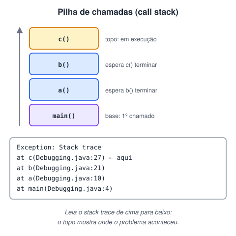

# Debugging

> 🗺️ **Nesta aula:** o que é depurar, como ler a pilha de execução e o stack trace de um erro e os atalhos de debug mais usados nas IDEs.

O debugging é o processo de encontrar e corrigir erros em um código. No Java, podemos utilizar diversas ferramentas para debuggar nosso código, como o Eclipse, IntelliJ IDEA, NetBeans, entre outros.

Algumas das principais técnicas de debugging incluem:

- Usar pontos de interrupção (breakpoints) para pausar a execução do programa em um determinado ponto e examinar variáveis, estado do programa e executar o código linha a linha;
- Usar ferramentas de inspeção de variáveis para examinar valores de variáveis em tempo de execução;
- Usar logging para registrar mensagens de depuração em diferentes níveis de gravidade para ajudar a identificar onde ocorre um problema;
- Usar ferramentas de profiling para identificar gargalos de desempenho no código.

### Depuração/Debugging

Linguagens de alto nível tornam a depuração mais fácil, pois fornecem mais ferramentas para identificar erros, como o tratamento de exceções.

Os depuradores funcionam assumindo o controle do tempo de execução de um programa e permitindo que você o observe e controle. Para fazer isso, ele mostra a pilha do programa e permite que você a atravesse em qualquer direção. Quando você está em um depurador, obtém uma imagem mais completa de um quadro de pilha do que quando olha os rastreamentos de pilha em uma mensagem de log.

## Pilha de Execução de um Programa Java/Stack Trace

### Pilha de Execução:

Toda invocação de método é empilhada em uma estrutura de dados que isola a área de memória de cada um. Quando um método termina (retorna), ele volta para o método que o invocou.

### Stack Trace:

É o **retrato da pilha de execução** no momento em que uma exceção aconteceu: a lista dos métodos que estavam em andamento, com classe, arquivo e número da linha de cada um. A **primeira linha** mostra onde o erro ocorreu; as seguintes mostram quem chamou quem, até o `main`.



> 🛠️ **Ajuste:** o texto original dizia que o stack trace "busca a próxima linha onde a exceção pode surgir". Ele não prevê nada: é um **registro** de onde a execução estava quando o problema ocorreu. Também se lê **de cima para baixo** (a linha do topo é a mais recente), e não de baixo para cima como dizia o comentário do código.

### Analisando pilha de código com o “Thread.dumpStack”

**Código**

```java
public class Debugging {
  public static void main(String[] args) {
    System.out.println("Entrou no método 'main'");
    a();
    System.out.println("Finalizou o programa no método 'main'");
  }

  public static void a(){
    System.out.println("Entrou no método 'a'");
    b();
    System.out.println("Finalizou o método 'a'");
  }
  public static void b(){
    System.out.println("Entrou no método 'b'");
    for(int i = 0; i <= 5; i++){
      System.out.println(i);
    }
    c();
    System.out.println("Finalizou o método 'b'");
  }
  public static void c(){
    System.out.println("Entrou no método 'c'");
    // Mostra a pilha atual: a linha de cima é o método em execução (c), a de baixo é o main
    Thread.dumpStack();
    System.out.println("Finalizou o método 'c'");
  }
}
```

```java
import java.util.Scanner;

public class Main {
  public static void main(String[] args) {
    Scanner scan = new Scanner(System.in);
    String[] alunos = {"Ana", "Camila", "Bruna", "Lucas"};

    double media = calcularMediaTurma(alunos, scan);
    System.out.printf("A média da turma é %.2f%n", media);
  }

  public static double calcularMediaTurma(String[] alunos, Scanner scanner){
    double soma = 0;
    for (String aluno : alunos){
      System.out.printf("Nota do aluno %s: ", aluno);
      double nota = scanner.nextDouble();
      soma += nota;
    }

    return soma / alunos.length;
  }
}
```

> 🛠️ **Bugs corrigidos no segundo exemplo:**
>
> - `printf("... %d", media)` com um `double` lança `IllegalFormatConversionException` — `%d` é só para inteiros. O correto é `%.2f` (ou `%f`). É um ótimo caso para praticar o debug: o stack trace aponta exatamente essa linha.
> - As notas eram lidas com `nextInt()`, rejeitando notas como 7,5. Agora usa `nextDouble()`.
> - `class main` → `class Main` e `Calculadora_media_turma` → `calcularMediaTurma` (métodos começam com minúscula e usam camelCase).
> - No primeiro exemplo, o método `c()` imprimia "Entrou no método 'a'".

### Atalhos de debug mais usados

| Ação | IntelliJ | Eclipse |
| --- | --- | --- |
| Rodar em modo debug | `Shift + F9` | `F11` |
| Criar/remover breakpoint | `Ctrl + F8` | `Ctrl + Shift + B` |
| Próxima linha (*step over*) | `F8` | `F6` |
| Entrar no método (*step into*) | `F7` | `F5` |
| Sair do método (*step out*) | `Shift + F8` | `F7` |
| Continuar até o próximo breakpoint | `F9` | `F8` |

### Referências úteis

- [https://www.hostgator.com.br/blog/debug-desenvolvimento-web/](https://www.hostgator.com.br/blog/debug-desenvolvimento-web/)
- [https://www.alura.com.br/conteudo/java-excecoes](https://www.alura.com.br/conteudo/java-excecoes)
- [https://pt.wikipedia.org/wiki/Depura%C3%A7%C3%A3o](https://pt.wikipedia.org/wiki/Depura%C3%A7%C3%A3o)
- [https://www.sentinelone.com/blog/java-stack-trace-understanding/](https://www.sentinelone.com/blog/java-stack-trace-understanding/)
- [https://www.caelum.com.br/apostila-java-orientacao-objetos/excecoes-e-controle-de-erros#exercicio-para-comecar-com-os-conceitos](https://www.caelum.com.br/apostila-java-orientacao-objetos/excecoes-e-controle-de-erros#exercicio-para-comecar-com-os-conceitos)

## 📌 Resumo

| Item | Em uma frase |
| --- | --- |
| Debugging | pausar o programa e inspecionar variáveis para achar a causa de um erro |
| Breakpoint | ponto onde a execução para no modo debug |
| Pilha de execução | lista dos métodos em andamento; o último chamado fica no topo |
| Stack trace | a pilha impressa no erro: leia de cima para baixo e procure a primeira linha do seu código |
| `Thread.dumpStack()` | imprime a pilha atual sem precisar de um erro |
| Passo a passo | step over (próxima linha), step into (entra no método), step out (sai dele) |
