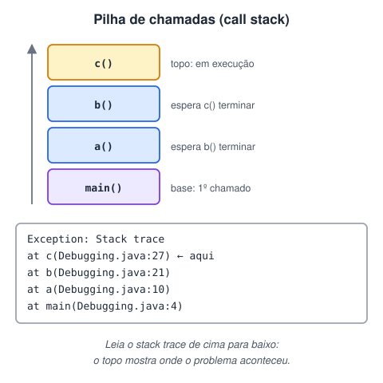

# Debugging

> 🗺️ **Nesta aula:** o que é depurar, como ler a pilha de execução e o stack trace de um erro e os atalhos de debug mais usados nas IDEs.

## De onde paramos

Você já sabe escrever classes, métodos e coleções. Agora vai aprender a descobrir por que o programa se comporta de forma errada, sem adivinhar.

**Debugging** (depuração) é o processo de encontrar e corrigir erros em um código. No Java, as IDEs (IntelliJ IDEA, Eclipse, NetBeans, VS Code) trazem um depurador embutido.

As principais técnicas são:

- **Breakpoints**: pausar a execução numa linha e examinar variáveis e o estado do programa, avançando linha a linha.
- **Inspeção de variáveis**: ver (e até alterar) valores em tempo de execução.
- **Logging**: registrar mensagens em níveis de gravidade (`DEBUG`, `INFO`, `WARN`, `ERROR`) para descobrir onde algo dá errado — útil quando não dá para pausar o programa, como em produção.
- **Profiling**: medir tempo e memória para achar gargalos de desempenho.

> 💡 **Analogia:** rodar o programa normalmente é assistir a um filme; o modo debug é ter o controle remoto na mão — pausar, avançar quadro a quadro e dar zoom em qualquer detalhe da cena.

### Depuração

Linguagens de alto nível facilitam a depuração porque oferecem mais ferramentas para identificar erros, como o tratamento de exceções.

O depurador assume o controle da execução do programa e deixa você observá-lo e controlá-lo. Ele mostra a pilha do programa e permite navegar por ela em qualquer direção — uma visão mais completa de cada chamada do que a que se tem lendo um stack trace num log.

## Pilha de execução e stack trace

### Pilha de execução

Toda chamada de método é **empilhada** numa estrutura que isola a área de memória de cada um (variáveis locais e parâmetros). Quando um método termina, ele sai do topo e a execução volta para o método que o chamou.

### Stack trace

É o **retrato da pilha de execução** no momento em que uma exceção aconteceu: a lista dos métodos que estavam em andamento, com classe, arquivo e número da linha de cada um. A **primeira linha** mostra onde o erro ocorreu; as seguintes mostram quem chamou quem, até o `main`.



Exemplo de leitura:

```
Exception in thread "main"
  java.lang.ArithmeticException: / by zero
    at Calc.dividir(Calc.java:12)
    at Calc.media(Calc.java:7)
    at Calc.main(Calc.java:3)
```

1. A primeira linha diz **qual** erro: divisão inteira por zero.
2. `at Calc.dividir(Calc.java:12)` diz **onde**: linha 12 do método `dividir`.
3. As linhas abaixo mostram o caminho: `main` chamou `media`, que chamou `dividir`.

> 💡 Em stack traces longos, cheios de linhas de bibliotecas, procure a **primeira linha que aponta para um arquivo seu** — normalmente é ali que está a causa.

> 🛠️ **Ajuste:** o texto original dizia que o stack trace "busca a próxima linha onde a exceção pode surgir". Ele não prevê nada: é um **registro** de onde a execução estava quando o problema ocorreu. Também se lê **de cima para baixo** (a linha do topo é a mais recente), e não de baixo para cima como dizia o comentário do código.

### Analisando a pilha com `Thread.dumpStack`

**Código**

```java
public class Debugging {
  public static void main(String[] args) {
    System.out.println("Entrou em main");
    a();
    System.out.println("Saiu de main");
  }

  public static void a() {
    System.out.println("Entrou em a");
    b();
    System.out.println("Saiu de a");
  }

  public static void b() {
    System.out.println("Entrou em b");
    for (int i = 0; i <= 5; i++) {
      System.out.println(i);
    }
    c();
    System.out.println("Saiu de b");
  }

  public static void c() {
    System.out.println("Entrou em c");
    // Mostra a pilha atual: em cima c,
    // depois b, a e, embaixo, main
    Thread.dumpStack();
    System.out.println("Saiu de c");
  }
}
```

```java
import java.util.Scanner;

public class Main {
  public static void main(String[] args) {
    Scanner scan = new Scanner(System.in);
    String[] alunos =
      {"Ana", "Camila", "Bruna", "Lucas"};

    double media =
      calcularMediaTurma(alunos, scan);
    System.out.printf(
      "Média da turma: %.2f%n", media);
  }

  public static double calcularMediaTurma(
      String[] alunos, Scanner scanner) {
    double soma = 0;
    for (String aluno : alunos) {
      System.out.printf(
        "Nota de %s: ", aluno);
      double nota = scanner.nextDouble();
      soma += nota;
    }
    return soma / alunos.length;
  }
}
```

> 🛠️ **Bugs corrigidos no segundo exemplo:**
>
> - `printf("... %d", media)` com um `double` lança `IllegalFormatConversionException` — `%d` é só para inteiros. O correto é `%.2f` (ou `%f`). É um ótimo caso para praticar o debug: o stack trace aponta exatamente essa linha.
> - As notas eram lidas com `nextInt()`, rejeitando notas como 7,5. Agora usa `nextDouble()`.
> - `class main` → `class Main` e `Calculadora_media_turma` → `calcularMediaTurma` (métodos começam com minúscula e usam camelCase).
> - No primeiro exemplo, o método `c()` imprimia "Entrou no método 'a'".

> ⚠️ O `Scanner` usa o idioma do sistema: num computador em português, a nota 7,5 deve ser digitada com **vírgula**; digitar 7.5 lança `InputMismatchException`. Para forçar o ponto, use `scan.useLocale(Locale.US)`.

### Atalhos de debug mais usados

| Ação | IntelliJ | Eclipse |
| --- | --- | --- |
| Rodar em modo debug | `Shift + F9` | `F11` |
| Criar/remover breakpoint | `Ctrl + F8` | `Ctrl + Shift + B` |
| Próxima linha (*step over*) | `F8` | `F6` |
| Entrar no método (*step into*) | `F7` | `F5` |
| Sair do método (*step out*) | `Shift + F8` | `F7` |
| Continuar até o próximo breakpoint | `F9` | `F8` |

> 💡 Clique com o botão direito num breakpoint para torná-lo **condicional** (ex.: `i == 4`). O programa só para quando a condição for verdadeira — ótimo para laços longos.

### Referências úteis

- [https://www.hostgator.com.br/blog/debug-desenvolvimento-web/](https://www.hostgator.com.br/blog/debug-desenvolvimento-web/)
- [https://www.alura.com.br/conteudo/java-excecoes](https://www.alura.com.br/conteudo/java-excecoes)
- [https://pt.wikipedia.org/wiki/Depura%C3%A7%C3%A3o](https://pt.wikipedia.org/wiki/Depura%C3%A7%C3%A3o)
- [https://www.sentinelone.com/blog/java-stack-trace-understanding/](https://www.sentinelone.com/blog/java-stack-trace-understanding/)
- [https://www.caelum.com.br/apostila-java-orientacao-objetos/excecoes-e-controle-de-erros#exercicio-para-comecar-com-os-conceitos](https://www.caelum.com.br/apostila-java-orientacao-objetos/excecoes-e-controle-de-erros#exercicio-para-comecar-com-os-conceitos)

> ➡️ **Próximo passo:** na próxima aula você vai tratar erros previstos com `try/catch` e criar as suas próprias exceções.

## 🧠 Revisão rápida

**Num stack trace, qual linha mostra onde o erro aconteceu?**

A primeira linha `at ...` (o topo da pilha). As de baixo mostram quem chamou.

**Qual a diferença entre *step over* e *step into*?**

*Step over* executa a linha inteira (inclusive métodos chamados nela); *step into* entra no método chamado para segui-lo por dentro.

**O que acontece com um método na pilha quando ele termina?**

Ele sai do topo e a execução volta para quem o chamou.

## 📌 Resumo

| Item | Em uma frase |
| --- | --- |
| Debugging | Pausar o programa e inspecionar variáveis para achar a causa de um erro. |
| Breakpoint | Ponto onde a execução para no modo debug. |
| Pilha de execução | Métodos em andamento; o último chamado fica no topo. |
| Stack trace | A pilha impressa no erro: leia de cima para baixo e procure a primeira linha do seu código. |
| `Thread.dumpStack()` | Imprime a pilha atual sem precisar de um erro. |
| Passo a passo | Step over (próxima linha), step into (entra no método), step out (sai dele). |
