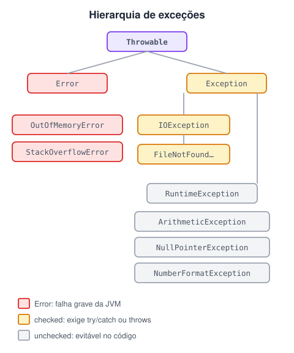
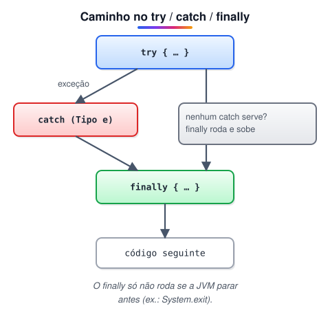

# Tratamento de exceções em Java

> 💡 **Nesta aula:** uma **exceção** é um evento inesperado que interrompe o fluxo normal do programa: dividir por zero, abrir um arquivo que não existe, converter "abc" em número… Tratar exceções é decidir **o que o programa faz quando algo dá errado**, em vez de simplesmente quebrar.

## Palavras reservadas

| Palavra | Para que serve |
| --- | --- |
| `try` | Envolve o código que pode lançar uma exceção. |
| `catch` | Captura e trata um tipo específico de exceção. |
| `finally` | Bloco opcional que roda com ou sem exceção (ideal para liberar recursos). |
| `throw` | **Lança** uma exceção explicitamente. |
| `throws` | **Declara** na assinatura que o método pode lançar exceções. |

## Hierarquia de exceções

Todas as exceções descendem de `Throwable`, que se divide em dois ramos: `Error` e `Exception`.



### 🔴 Error

- Indica problemas graves no ambiente de execução (falta de memória, estouro de pilha). Em geral, o programa **não consegue se recuperar**.
- Não se costuma tratar `Error` — a correção está no código ou na configuração da JVM, não num `catch`.

### 🟠 Unchecked exceptions (não verificadas)

- Herdam de `RuntimeException` (e, tecnicamente, `Error` também é não verificado).
- O compilador **não obriga** a capturar nem a declarar.
- Se ocorrerem e ninguém tratar, o programa termina com o *stack trace* no console.
- Normalmente indicam **erro de lógica** e podem ser evitadas com código correto: checar `null`, validar índices, não dividir por zero.
- Exemplos: `ArithmeticException`, `NullPointerException`, `NumberFormatException`, `ArrayIndexOutOfBoundsException`.

### 🔵 Checked exceptions (verificadas)

- Herdam de `Exception`, mas **não** de `RuntimeException`.
- O compilador impõe a regra **"capture ou declare"**: todo método que pode lançá-las precisa de um `try/catch` ou de um `throws` na assinatura. Caso contrário, o código **não compila**.
- Representam situações externas que fogem do controle do programa: arquivo inexistente, rede fora do ar, banco indisponível.
- Exemplos: `IOException`, `FileNotFoundException`, `SQLException`.

### ✨ Exceções personalizadas

- Você pode criar suas próprias exceções para representar problemas do **seu domínio** (ex.: `SaldoInsuficienteException`).
- Basta estender uma classe existente: `Exception` para criar uma checked ou `RuntimeException` para criar uma unchecked.
- **Antes de criar**, verifique se a biblioteca do Java já tem uma exceção adequada (`IllegalArgumentException`, `IllegalStateException`…). Não reinvente a roda.

## Blocos try / catch / finally



**try**

- Contém o código que pode lançar a exceção.
- Assim que uma exceção ocorre, o resto do `try` é **pulado**.
- Não existe sozinho: precisa de pelo menos um `catch` ou de um `finally`.

**catch**

- Recebe como parâmetro o tipo de exceção que sabe tratar e só roda se esse tipo (ou subtipo) for lançado.
- Pode haver vários `catch`; executa **apenas o primeiro** compatível.
- Coloque sempre do **mais específico para o mais genérico**. Se `Exception` vier primeiro, ela captura tudo e os `catch` seguintes nunca são alcançados — o compilador acusa erro.
- Para tratar tipos diferentes da mesma forma, use o **multi-catch**: `catch (NumberFormatException | ArithmeticException e)`.

**finally**

- Opcional. Executa **com ou sem exceção** — até se houver um `return` no `try`.
- Só deixa de rodar se a JVM for encerrada antes (ex.: `System.exit(0)`).
- Pode conter outros blocos `try/catch/finally`.

### try-with-resources (Java 7+)

Para recursos que precisam ser fechados (arquivos, conexões, `Scanner`), prefira declará-los no próprio `try`. Eles são fechados automaticamente, mesmo se houver exceção — dispensa o `finally` só para chamar `close()`.

```java
try (BufferedReader br = new BufferedReader(new FileReader("dados.txt"))) {
  System.out.println(br.readLine());
} catch (IOException e) {
  System.out.println("Não foi possível ler o arquivo: " + e.getMessage());
} // br.close() é chamado automaticamente
```

## throw x throws

**throws** — na assinatura do método

- Avisa a quem chama que o método pode lançar aquelas exceções.
- Obrigatório apenas para exceções **checked**.
- Quem chama precisa tratar (`try/catch`) ou repassar (outro `throws`).

**throw** — dentro do código

- Lança explicitamente uma exceção: `throw new IllegalArgumentException("idade negativa");`
- Muito usado com exceções personalizadas e para validar parâmetros.

> 🔎 **O que acontece depois de um** `throw`**?** O fluxo normal para na hora. A JVM procura um `catch` compatível no `try` mais próximo; se não achar, sobe para o método que chamou, e assim por diante (*propagação pela pilha de chamadas*). Se ninguém tratar, o manipulador padrão imprime o *stack trace* e encerra a thread.

## Exemplo geral

```java
import java.util.Scanner;

public class Main {
  public static void main(String[] args) {
    Scanner scanner = new Scanner(System.in);
    try {
      System.out.println("Digite um número inteiro:");
      int numero = Integer.parseInt(scanner.nextLine()); // NumberFormatException

      System.out.println("Digite o divisor:");
      int divisor = Integer.parseInt(scanner.nextLine());
      int resultado = numero / divisor;  // ArithmeticException se divisor = 0
      System.out.println("Resultado: " + resultado);

      int[] numeros = new int[5];
      numeros[resultado] = 2;  // ArrayIndexOutOfBoundsException se resultado < 0 ou > 4
      System.out.println("Gravado na posição " + resultado);

    } catch (NumberFormatException e) {
      System.out.println("Erro: digite um número inteiro válido.");
    } catch (ArithmeticException e) {
      System.out.println("Erro: divisão por zero.");
    } catch (ArrayIndexOutOfBoundsException e) {
      System.out.println("Erro: índice inválido do array.");
    } catch (Exception e) {
      // sempre por último: captura qualquer outra exceção
      System.out.println("Erro inesperado: " + e.getMessage());
    } finally {
      scanner.close();
      System.out.println("Fim do programa.");
    }
  }
}
```

> 🛠️ **Ajustes no exemplo geral:**
>
> - Faltava o `import java.util.Scanner;`, então o código não compilava.
> - A linha `10 / 0` lançava a exceção sempre, deixando o teste do array inalcançável. Agora o divisor e o índice dependem da entrada, e cada `catch` pode ser exercitado.
> - O `Scanner` passou a ser fechado no `finally`.

## Análise de cada caso

**Código — unchecked exception**

```java
package tratamento_de_erros.unchecked_exceptions;

import javax.swing.*;

public class Main {

  public static void main(String[] args) {
    boolean continuarLoop = true;

    do {
      String a = JOptionPane.showInputDialog("Numerador: ");
      String b = JOptionPane.showInputDialog("Denominador: ");

      try {
        int resultado = dividir(Integer.parseInt(a), Integer.parseInt(b));
        System.out.println("O resultado é: " + resultado);
        continuarLoop = false;
      }
      // usuário digitou algo que não é número inteiro
      catch (NumberFormatException e) {
        e.printStackTrace(); // pilha de chamadas no console
        JOptionPane.showMessageDialog(null,
            "Erro! Aceitamos apenas números inteiros. " + e.getMessage());
      }
      // denominador igual a zero
      catch (ArithmeticException e) {
        e.printStackTrace();
        JOptionPane.showMessageDialog(null,
            "Erro! O denominador não pode ser zero. " + e.getMessage());
      }
      finally {
        System.out.println("Chegou no finally!");
      }
    } while (continuarLoop);

    System.out.println("O código continua...");
  }

  public static int dividir(int numerador, int denominador) {
    return numerador / denominador;
  }
}
```

**Código — checked exception**

```java
package checked_exception;

import javax.swing.*;
import java.io.*;

public class Main {
  public static void main(String[] args) {
    String nomeArquivo = "romances-Blake-Crouch.txt";
    try {
      imprimirArquivoNoConsole(nomeArquivo);
    }
    // arquivo não encontrado (subtipo de IOException: precisa vir antes)
    catch (FileNotFoundException e) {
      e.printStackTrace();
      JOptionPane.showMessageDialog(null,
          "Erro! O arquivo que deseja imprimir não foi encontrado: " + e.getMessage());
    }
    // qualquer outro problema de leitura/escrita
    catch (IOException e) {
      e.printStackTrace();
      JOptionPane.showMessageDialog(null,
          "Ocorreu um erro inesperado. Procure o suporte. " + e.getMessage());
    }
    finally {
      System.out.println("Chegou no bloco finally!");
    }

    System.out.println("Com ou sem exceção, o programa continua...");
  }

  // "throws" repassa as exceções para quem chamar o método
  public static void imprimirArquivoNoConsole(String nomeArquivo) throws IOException {
    try (BufferedReader br = new BufferedReader(new FileReader(nomeArquivo))) {
      BufferedWriter bw = new BufferedWriter(new OutputStreamWriter(System.out));
      String linha;
      while ((linha = br.readLine()) != null) {
        bw.write(linha);
        bw.newLine();
      }
      bw.flush();
    }
  }
}
```

**Código — exceção personalizada**

**1º estudo — arquivo não encontrado**

```java
package custom_exception;

import javax.swing.*;
import java.io.*;

public class Main {
  public static void main(String[] args) {
    String nomeArquivo = JOptionPane.showInputDialog("Nome do arquivo a ser exibido: ");

    imprimirArquivoNoConsole(nomeArquivo);
    System.out.println("\nCom ou sem exceção, o programa continua...");
  }

  public static void imprimirArquivoNoConsole(String nomeArquivo) {
    try (BufferedReader br = lerArquivo(nomeArquivo)) {
      BufferedWriter bw = new BufferedWriter(new OutputStreamWriter(System.out));
      String linha;
      while ((linha = br.readLine()) != null) {
        bw.write(linha);
        bw.newLine();
      }
      bw.flush();
    }
    // exceção criada por nós, com mensagem amigável
    catch (ImpossivelAberturaDeArquivoException e) {
      JOptionPane.showMessageDialog(null, e.getMessage());
    } catch (IOException e) {
      JOptionPane.showMessageDialog(null,
          "Ocorreu um erro inesperado. Fale com o suporte. " + e.getMessage());
      e.printStackTrace();
    }
  }

  public static BufferedReader lerArquivo(String nomeArquivo) throws ImpossivelAberturaDeArquivoException {
    File file = new File(nomeArquivo);
    try {
      return new BufferedReader(new FileReader(file));
    } catch (FileNotFoundException e) {
      // "traduz" a exceção técnica para uma do nosso domínio, preservando a causa
      throw new ImpossivelAberturaDeArquivoException(file.getName(), file.getAbsolutePath(), e);
    }
  }
}

class ImpossivelAberturaDeArquivoException extends Exception {
  private final String nomeArquivo;
  private final String diretorio;

  public ImpossivelAberturaDeArquivoException(String nomeArquivo, String diretorio, Throwable causa) {
    super("O arquivo " + nomeArquivo + " não foi encontrado em " + diretorio, causa);
    this.nomeArquivo = nomeArquivo;
    this.diretorio = diretorio;
  }

  public String getNomeArquivo() { return nomeArquivo; }
  public String getDiretorio() { return diretorio; }
}
```

**2º estudo — divisão não exata**

```java
package custom_exception;

import javax.swing.*;

public class Main {
  public static void main(String[] args) {
    int[] numeradores   = {4, 5, 8, 10, 9};
    int[] denominadores = {2, 4, 0, 2, 8};

    for (int i = 0; i < numeradores.length; i++) {
      try {
        int resultado = dividirExato(numeradores[i], denominadores[i]);
        System.out.println(numeradores[i] + " / " + denominadores[i] + " = " + resultado);
      } catch (DivisaoNaoExataException e) {
        JOptionPane.showMessageDialog(null, e.getMessage());
      } catch (ArithmeticException e) {
        JOptionPane.showMessageDialog(null, "Não é possível dividir por zero.");
      }
    }
    System.out.println("O programa continua...");
  }

  public static int dividirExato(int numerador, int denominador) throws DivisaoNaoExataException {
    if (numerador % denominador != 0) { // lança ArithmeticException se denominador = 0
      throw new DivisaoNaoExataException("Divisão não exata!", numerador, denominador);
    }
    return numerador / denominador;
  }
}

class DivisaoNaoExataException extends Exception {
  private final int numerador;
  private final int denominador;

  public DivisaoNaoExataException(String mensagem, int numerador, int denominador) {
    super(mensagem + " " + numerador + " / " + denominador + " deixa resto.");
    this.numerador = numerador;
    this.denominador = denominador;
  }

  public int getNumerador() { return numerador; }
  public int getDenominador() { return denominador; }
}
```

> 🛠️ **Ajustes nos estudos de caso:**
>
> - **Leitura de arquivo (checked e 1º estudo):** o `do/while` escrevia a primeira linha antes de testar se ela era `null` — com arquivo vazio, `bw.write(null)` gerava `NullPointerException`. Troquei por `while ((linha = br.readLine()) != null)`. O `BufferedReader` não era fechado quando ocorria erro; agora usa **try-with-resources**. `new FileReader(file.getName())` descartava o caminho do arquivo; agora usa o próprio `File`.
> - **Exceção personalizada:** passou a guardar a **causa** original (`FileNotFoundException`) e a mostrar o caminho absoluto.
> - **2º estudo:** a classe `DivisaoNaoExataExecption` (com erro de digitação) não existia no código; criei `DivisaoNaoExataException`. A regra testava se o *numerador* era ímpar, e não se a divisão era exata (`numerador % denominador`). Os arrays tinham tamanhos diferentes (4 e 5), o que gerava `ArrayIndexOutOfBoundsException`, e o denominador 0 não era tratado — agora há um `catch (ArithmeticException)`.
> - Nomes de métodos e pacotes ajustados para a convenção Java (`dividir`, `imprimirArquivoNoConsole`, pacotes em minúsculas) e mensagens corrigidas ("deseja", "pilha").

## 🔗 Referências

- [DevMedia — Trabalhando com exceções em Java](https://www.devmedia.com.br/trabalhando-com-excecoes-em-java/27601)
- [Vídeo — Tratamento de exceções](https://www.youtube.com/watch?v=ld2C4GcAtsg&t=296s)
- [ProgramCreek — Hierarquia das classes de exceção](https://www.programcreek.com/2009/02/diagram-for-hierarchy-of-exception-classes/)
- [Projeto Java Web — aula sobre exceções](https://www.projetojavaweb.com/certificado-aluno/plataforma-curso/aulaatual/467726283/idcurso/1/idvideoaula/161)
- [Oracle Docs — Error](https://docs.oracle.com/en/java/javase/11/docs/api/java.base/java/lang/Error.html)
- [Oracle Docs — Exception](https://docs.oracle.com/en/java/javase/11/docs/api/java.base/java/lang/Exception.html)
- [Oracle Docs — RuntimeException](https://docs.oracle.com/en/java/javase/11/docs/api/java.base/java/lang/RuntimeException.html)

## 📌 Resumo

| Item | Em uma frase |
| --- | --- |
| `Error` | falha grave da JVM (ex.: `OutOfMemoryError`); não se trata |
| Unchecked | `RuntimeException` e filhas; erro de programação, o compilador não obriga tratar |
| Checked | o compilador obriga tratar (`try/catch`) ou declarar (`throws`) |
| `try / catch / finally` | tenta, trata o erro e executa a limpeza em qualquer caso |
| try-with-resources | fecha sozinho os recursos abertos no `try (...)` |
| `throw` × `throws` | lança uma exceção / avisa que o método pode lançá-la |
| Exceção própria | classe que estende `Exception` ou `RuntimeException` com um nome do domínio |
