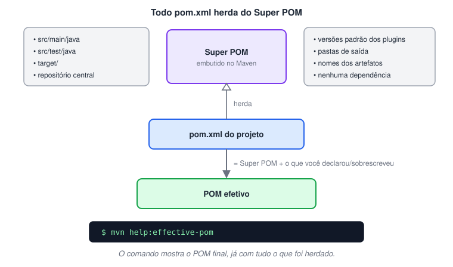
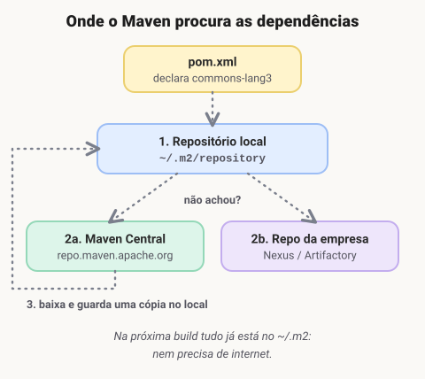
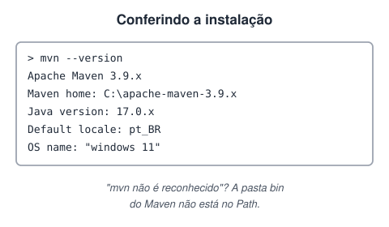
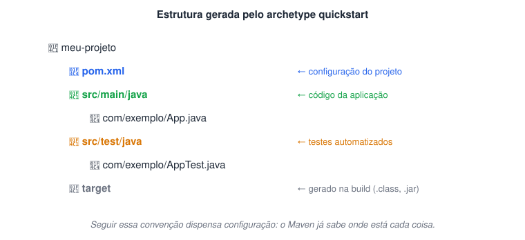
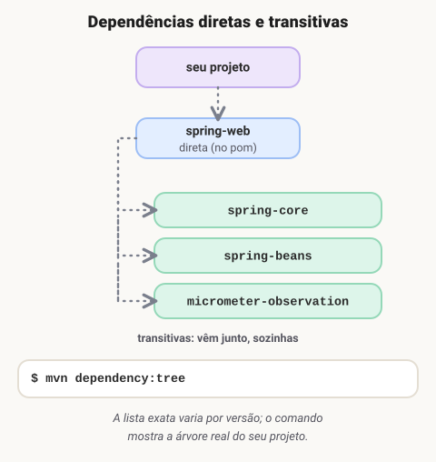
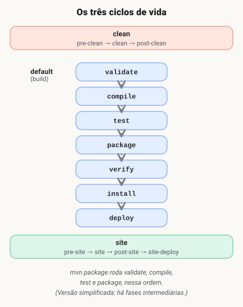
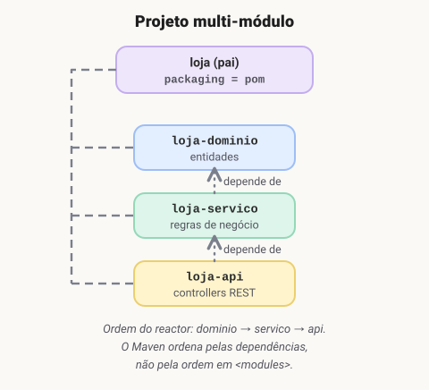
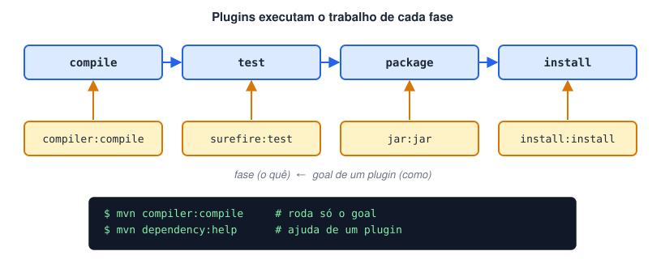

# Gerenciamento de dependências e build em java com Maven

> 🗺️ **Nesta aula:** o que é o Maven e o `pom.xml`, como criar um projeto e adicionar dependências, escopos e exclusões, o ciclo de vida do build, projetos com vários módulos e plugins.

## O que é apache Maven ?

### O que é o Apache Maven?

🔗 [Apache Maven](https://en.wikipedia.org/wiki/Apache_Maven)

O **Apache Maven** é uma ferramenta de **automação de build** e **gerenciamento de dependências** para projetos Java. Em vez de baixar `.jar` manualmente e montar scripts de compilação, você descreve o projeto num único arquivo, o `pom.xml`, e o Maven cuida do resto.

> 💡 A ideia central do Maven é **convenção sobre configuração**: se o projeto segue a estrutura padrão, quase nada precisa ser configurado.

#### Como surgiu?

O Maven nasceu por volta de **2002**, criado por **Jason van Zyl** como um subprojeto do **Jakarta Turbine**, para padronizar as builds dos vários projetos Java da Apache. A versão 1.0 saiu em **2004**; o Maven 2 (2005) reescreveu a ferramenta e o Maven 3 (2010) é a base das versões usadas hoje.

#### Para que serve?

- **Gerenciar dependências:** você declara bibliotecas no `pom.xml` e o Maven as baixa — junto com as dependências delas.
- **Padronizar a estrutura:** todo projeto Maven tem as mesmas pastas (`src/main/java`, `src/test/java`…), então qualquer pessoa se orienta rápido.
- **Automatizar a build:** compilar, testar, empacotar e instalar com um único comando.
- **Gerar artefatos:** empacota o projeto como JAR, WAR, EAR etc.
- **Publicar artefatos:** envia o pacote para repositórios remotos, para que outros projetos o usem.
- **Documentar:** gera relatórios e um site do projeto (`mvn site`).

### Arquivo POM (Project Object Model)

O `pom.xml` é o coração do projeto Maven: um XML que descreve **quem é** o projeto e **do que ele precisa**.

| Elemento | O que define |
| --- | --- |
| `groupId` | Organização ou grupo, normalmente o domínio invertido (`com.empresa`). |
| `artifactId` | Nome do projeto dentro do grupo. |
| `version` | Versão do projeto (`1.0-SNAPSHOT` = versão ainda em desenvolvimento). |
| `packaging` | Tipo de pacote gerado (`jar` por padrão, `war`, `pom`…). |
| `dependencies` | Bibliotecas usadas pelo projeto. |
| `build` / `plugins` | Plugins e configurações da build. |
| `profiles` | Configurações alternativas por ambiente (dev, homologação, produção). |

> 📌 `groupId` + `artifactId` + `version` formam as **coordenadas** de um artefato: o "endereço" único dele em qualquer repositório Maven.

**Exemplo de pom.xml comentado**

```xml
<project xmlns="http://maven.apache.org/POM/4.0.0"
         xmlns:xsi="http://www.w3.org/2001/XMLSchema-instance"
         xsi:schemaLocation="http://maven.apache.org/POM/4.0.0
                             http://maven.apache.org/xsd/maven-4.0.0.xsd">

    <!-- versão do modelo do POM (sempre 4.0.0) -->
    <modelVersion>4.0.0</modelVersion>

    <!-- coordenadas do projeto -->
    <groupId>com.example</groupId>
    <artifactId>my-project</artifactId>
    <version>1.0-SNAPSHOT</version>

    <properties>
        <!-- versão do Java usada para compilar (Java 9+) -->
        <maven.compiler.release>17</maven.compiler.release>
        <project.build.sourceEncoding>UTF-8</project.build.sourceEncoding>
    </properties>

    <dependencies>
        <dependency>
            <groupId>junit</groupId>
            <artifactId>junit</artifactId>
            <version>4.13.2</version>
            <scope>test</scope> <!-- usada só nos testes -->
        </dependency>
    </dependencies>

    <build>
        <plugins>
            <plugin>
                <groupId>org.apache.maven.plugins</groupId>
                <artifactId>maven-compiler-plugin</artifactId>
                <version>3.13.0</version>
            </plugin>
        </plugins>
    </build>
</project>
```

#### Super POM

O **Super POM** é o POM padrão embutido no próprio Maven. Todo `pom.xml` herda dele automaticamente, mesmo sem declarar um `<parent>`. É ele que define as convenções: onde fica o código-fonte, para onde vai o resultado da build, qual é o repositório central e as versões padrão dos plugins principais.

Tudo o que você escreve no seu `pom.xml` **complementa ou sobrescreve** o Super POM. O resultado dessa combinação é o **POM efetivo**.



> 🛠️ **Ajustes:**
>
> - O texto dizia que o Super POM traz "dependências padrão, como o JUnit". Na verdade ele **não declara nenhuma dependência**: só convenções de pastas, repositório central e versões padrão de plugins.
> - O Maven não foi um "substituto do Jakarta Turbine": ele começou como um **subprojeto** do Turbine para organizar as builds, e só depois virou projeto próprio.
> - No exemplo de POM, a versão do Java passou para a propriedade `maven.compiler.release`, a forma recomendada a partir do Java 9, e o JUnit foi para a versão 4.13.2.

### Repositórios

Um **repositório** é onde ficam guardados os artefatos (bibliotecas e plugins) que o Maven usa.

- **Repositório local:** uma pasta na sua máquina, criada pelo Maven na primeira execução. Funciona como cache.
  - Windows: `C:\Users\<seu_usuario>\.m2\repository`
  - Linux/macOS: `/home/<seu_usuario>/.m2/repository` (ou `~/.m2/repository`)
- **Repositórios remotos:** servidores acessados pela internet.
  - **Maven Central:** o repositório público padrão, já configurado no Super POM.
  - **Repositórios privados:** de empresas (Nexus, Artifactory, GitHub Packages), configurados no `pom.xml` ou no `settings.xml`.



### Instalação

🔗 [Maven – Download Apache Maven](https://maven.apache.org/download.cgi)

1. Baixe o arquivo **binary zip** na página oficial e extraia numa pasta (ex.: `C:\apache-maven-3.9.x`).
2. Garanta que o **JDK** está instalado e que a variável `JAVA_HOME` aponta para ele.
3. Adicione o Maven ao **Path** (Windows):
  1. Painel de Controle → **Sistema** → **Configurações avançadas do sistema**.
  2. **Variáveis de ambiente**.
  3. Em *Variáveis do sistema*, selecione **Path** e clique em **Editar**.
  4. Clique em **Novo** e cole o caminho da pasta `bin` do Maven (ex.: `C:\apache-maven-3.9.x\bin`).
4. Abra um **novo** terminal para que a mudança tenha efeito.

#### Conferir a instalação

```bash
mvn --version
```



## Criando projeto com Maven

### Criando um projeto

O jeito mais rápido é usar um **archetype** (modelo de projeto). O comando abaixo gera um projeto Java simples, sem perguntas interativas:

```bash
mvn archetype:generate \
  -DgroupId=com.exemplo \
  -DartifactId=meu-projeto \
  -DarchetypeArtifactId=maven-archetype-quickstart \
  -DarchetypeVersion=1.4 \
  -DinteractiveMode=false
```

> 💡 No Windows (cmd), escreva tudo numa linha só ou troque a barra invertida do fim de cada linha por um acento circunflexo (^). No PowerShell, coloque cada parâmetro -D entre aspas.

### Maven Archetype

Um **archetype** é um modelo pronto de projeto: já vem com a estrutura de pastas padrão, um `pom.xml` inicial e, às vezes, dependências pré-configuradas. Existem archetypes para aplicações de console, bibliotecas, aplicações web e muito mais. Assim você não perde tempo montando a estrutura na mão.



#### Onde encontrar archetypes e dependências

🔗 [Apache Maven Archetypes – Maven Archetypes](https://maven.apache.org/archetypes/)

🔗 [Maven Repository: Search/Browse/Explore](https://mvnrepository.com/)

🔗 [Maven archetypes list (mvn archetype:generate)](https://gist.github.com/zbigniewTomczak/4235871)

🔗 [Guide to Maven Archetype | Baeldung](https://www.baeldung.com/maven-archetype)

### Comandos do dia a dia

| Comando | O que faz |
| --- | --- |
| `mvn compile` | Compila o código de `src/main/java` e copia os recursos para `target/classes`. |
| `mvn test` | Compila e roda os testes de `src/test/java`, mostrando o resultado no console. |
| `mvn package` | Gera o pacote (`.jar`, `.war`…) em `target/`, passando antes por compile e test. |
| `mvn install` | Faz tudo do `package` e copia o pacote para o repositório local (`~/.m2`), deixando-o disponível para outros projetos da sua máquina. |
| `mvn clean` | Apaga a pasta `target/`, removendo tudo o que foi gerado. |
| `mvn clean install` | Limpa e reconstrói do zero: compila, testa, empacota e instala. É o comando mais usado antes de entregar uma versão. |
| `mvn -X compile` | Roda com saída de **depuração** (bem detalhada), útil para investigar erros de build. |

#### Comandos de dependência

| Comando | O que faz |
| --- | --- |
| `mvn dependency:tree` | Mostra a árvore de dependências, incluindo as transitivas. |
| `mvn dependency:build-classpath -DincludeScope=compile` | Imprime o classpath das dependências de escopo `compile`. |
| `mvn dependency:build-classpath -DincludeScope=test` | Classpath usado nos testes (inclui as de `compile`, `provided`, `runtime` e `test`). |
| `mvn dependency:build-classpath -DincludeScope=runtime` | Classpath necessário para executar a aplicação. |

### Adicionando dependências

Para usar uma biblioteca, declare-a dentro de `<dependencies>` no `pom.xml`, com suas coordenadas (`groupId`, `artifactId`, `version`). As coordenadas de qualquer biblioteca podem ser copiadas do [mvnrepository.com](https://mvnrepository.com/).

```xml
<!-- Apache Commons Lang -->
<dependencies>
  <dependency>
    <groupId>org.apache.commons</groupId>
    <artifactId>commons-lang3</artifactId>
    <version>3.12.0</version>
  </dependency>
</dependencies>
```

Na próxima build, o Maven baixa a biblioteca (e as dependências dela) automaticamente.

> 🛠️ **Ajustes:**
>
> - O comando de criação usava `-Darchetype=`, que o Maven ignora; o parâmetro correto é `-DarchetypeArtifactId=`. Também faltavam as barras invertidas para quebrar a linha no terminal.
> - Os blocos de código tinham o texto "bashCopy code" colado junto (resto de cópia do navegador) e estavam marcados como xml/txt; foram limpos.
> - Os comandos foram reunidos em tabelas e a imagem do archetype foi substituída por um diagrama da estrutura gerada.

## Gerenciamento de dependências

### Tipos de dependências

O Maven trabalha com dois tipos de dependência: as **diretas**, que você declara, e as **transitivas**, que chegam junto com elas.

#### Dependências diretas

São as declaradas explicitamente no `pom.xml` do seu projeto.

```xml
<dependencies>
  <dependency>
    <groupId>org.springframework</groupId>
    <artifactId>spring-web</artifactId>
    <version>6.1.14</version>
  </dependency>
</dependencies>
```

#### Dependências transitivas

São as **dependências das suas dependências**. No exemplo acima, o `spring-web` precisa do `spring-core` e do `spring-beans` para funcionar. Você não declarou nenhuma das duas, mas o Maven as baixa e coloca no classpath automaticamente.



> ⚖️ **Conflito de versões:** se duas dependências trazem versões diferentes da mesma biblioteca, o Maven escolhe a **mais próxima** do seu projeto na árvore (*nearest wins*). Para forçar uma versão, declare-a diretamente no seu `pom.xml` ou em `<dependencyManagement>`.

### Escopos

O elemento `<scope>` diz **em que momento** a dependência é necessária: na compilação, nos testes, na execução… e se ela deve ou não ir para o pacote final.

| Escopo | Compilação | Testes | Execução | Vai no pacote final? | Exemplo típico |
| --- | --- | --- | --- | --- | --- |
| `compile` (padrão) | ✅ | ✅ | ✅ | ✅ | commons-lang3 |
| `provided` | ✅ | ✅ | ❌ (o servidor fornece) | ❌ | Servlet API, Lombok |
| `runtime` | ❌ | ✅ | ✅ | ✅ | driver JDBC |
| `test` | ❌ | ✅ | ❌ | ❌ | JUnit, Mockito |
| `system` | ✅ | ✅ | ❌ | ❌ | `.jar` local (evite) |
| `import` | — | — | — | — | BOM em `dependencyManagement` |

**`compile` — o padrão**

Usado quando nenhum escopo é informado. A dependência está disponível em todas as fases e é empacotada junto com a aplicação.

```xml
<dependency>
  <groupId>org.apache.commons</groupId>
  <artifactId>commons-lang3</artifactId>
  <version>3.12.0</version>
  <scope>compile</scope> <!-- pode ser omitido -->
</dependency>
```

**`provided` — fornecida pelo ambiente**

Necessária para compilar e testar, mas quem fornece em produção é o servidor de aplicação (Tomcat, WildFly…). Por isso **não** vai para o WAR/JAR.

```xml
<dependency>
  <groupId>javax.servlet</groupId>
  <artifactId>javax.servlet-api</artifactId>
  <version>4.0.1</version>
  <scope>provided</scope>
</dependency>
```

**`runtime` — só na execução**

O código não usa a biblioteca diretamente (não é preciso para compilar), mas ela precisa existir quando a aplicação roda. Exemplo clássico: o driver do banco, carregado via JDBC. **É empacotada** no WAR / fat JAR.

```xml
<dependency>
  <groupId>com.oracle.database.jdbc</groupId>
  <artifactId>ojdbc8</artifactId>
  <version>19.3.0.0</version>
  <scope>runtime</scope>
</dependency>
```

**`test` — só nos testes**

Disponível apenas para compilar e rodar o código de `src/test/java`. Nunca vai para produção.

```xml
<dependency>
  <groupId>junit</groupId>
  <artifactId>junit</artifactId>
  <version>4.13.2</version>
  <scope>test</scope>
</dependency>
```

**`system` — arquivo local (descontinuado)**

Funciona como `provided`, mas aponta para um `.jar` no disco via `<systemPath>`. Está **depreciado**: quebra em outras máquinas. Prefira instalar o jar no repositório local com `mvn install:install-file` ou publicá-lo num repositório da empresa.

```xml
<dependency>
  <groupId>com.example</groupId>
  <artifactId>my-library</artifactId>
  <version>1.0</version>
  <scope>system</scope>
  <systemPath>${project.basedir}/lib/my-library.jar</systemPath>
</dependency>
```

**`import` — importar um BOM**

Só pode ser usado dentro de `<dependencyManagement>` e com `<type>pom</type>`. Ele **não adiciona bibliotecas ao classpath**: importa a lista de **versões** de outro POM (um *BOM — Bill of Materials*). Depois disso, você declara as dependências sem precisar informar a versão.

```xml
<dependencyManagement>
  <dependencies>
    <dependency>
      <groupId>org.springframework</groupId>
      <artifactId>spring-framework-bom</artifactId>
      <version>6.1.14</version>
      <type>pom</type>
      <scope>import</scope>
    </dependency>
  </dependencies>
</dependencyManagement>

<dependencies>
  <!-- versão vem do BOM -->
  <dependency>
    <groupId>org.springframework</groupId>
    <artifactId>spring-web</artifactId>
  </dependency>
</dependencies>
```

### Dependências opcionais

Marcar uma dependência com `<optional>true</optional>` significa: **meu projeto usa, mas quem depender de mim não vai recebê-la de forma transitiva**. É útil em bibliotecas com recursos extras (ex.: suporte a vários bancos), para não forçar todos os usuários a baixar tudo.

```xml
<dependency>
  <groupId>com.example</groupId>
  <artifactId>my-library</artifactId>
  <version>1.0</version>
  <optional>true</optional>
</dependency>
```

> 💡 Se o projeto que consome a sua biblioteca precisar daquele recurso opcional, ele deve **declarar a dependência diretamente** no próprio `pom.xml`. Não existe uma flag de linha de comando para "incluir opcionais".

### Exclusions

O elemento `<exclusions>` remove uma dependência **transitiva** específica. Use quando ela causa conflito de versão ou incompatibilidade.

Exemplo: o projeto usa `my-library`, que traz `old-library`. Só que o projeto precisa da `new-library`, incompatível com a antiga. A solução é excluir a `old-library`:

```xml
<dependencies>
  <dependency>
    <groupId>com.example</groupId>
    <artifactId>my-library</artifactId>
    <version>1.0</version>
    <exclusions>
      <exclusion>
        <groupId>com.example</groupId>
        <artifactId>old-library</artifactId>
      </exclusion>
    </exclusions>
  </dependency>
  <dependency>
    <groupId>com.example</groupId>
    <artifactId>new-library</artifactId>
    <version>2.0</version>
  </dependency>
</dependencies>
```

> 🛠️ **Ajustes:**
>
> - **runtime:** o texto dizia que essas dependências não vão para o JAR/WAR final. Vão sim — elas não são usadas na compilação, mas precisam estar presentes na execução.
> - **import:** não "inclui dependências no classpath"; ele só importa o **gerenciamento de versões** de um BOM, e só funciona dentro de `dependencyManagement` com `type pom`.
> - **opcionais:** os comandos `mvn install -DincludeOptional=true` e `dependency:resolve -DincludeOptional=true` não existem. O correto é o projeto consumidor declarar a dependência diretamente.
> - **system:** foi marcado como depreciado, e o `systemPath` passou a usar `${project.basedir}` em vez de um caminho absoluto.
> - A versão `5.3.13.RELEASE` não existe (o sufixo `.RELEASE` foi abandonado no Spring 5.1); atualizei para uma versão real do Spring 6.
> - Removido o texto "xmlCopy code" e os comentários com `#` que estavam dentro do XML (no XML, comentário é `<!-- -->`).

## Maven build lifecycle

O **ciclo de vida de build** do Maven é uma sequência fixa de **fases**. Você não diz *como* compilar ou empacotar; só pede uma fase (`mvn package`), e o Maven executa, em ordem, **todas as fases anteriores** daquele ciclo.

Existem três ciclos de vida padrão:

1. `clean` — limpa o que a build anterior gerou (pasta `target/`).
2. `default` — constrói o projeto: valida, compila, testa, empacota, instala e publica.
3. `site` — gera a documentação/site do projeto.



### Fases e o goal que executa cada uma

Uma **fase** é só uma etapa. Quem faz o trabalho de verdade é o **goal** de um plugin vinculado a ela. A tabela mostra os vínculos padrão para um projeto com `packaging` **jar**; fases sem goal padrão (`—`) existem para que você vincule plugins próprios.

| Ciclo | Fase | Goal vinculado por padrão |
| --- | --- | --- |
| **default** | validate | — |
|  | initialize | — |
|  | generate-sources | — |
|  | process-sources | — |
|  | generate-resources | — |
|  | process-resources | `resources:resources` |
|  | compile | `compiler:compile` |
|  | process-classes | — |
|  | generate-test-sources | — |
|  | process-test-sources | — |
|  | generate-test-resources | — |
|  | process-test-resources | `resources:testResources` |
|  | test-compile | `compiler:testCompile` |
|  | process-test-classes | — |
|  | test | `surefire:test` |
|  | prepare-package | — |
|  | package | `jar:jar` |
|  | pre-integration-test | — |
|  | integration-test | — |
|  | post-integration-test | — |
|  | verify | — |
|  | install | `install:install` |
|  | deploy | `deploy:deploy` |
| **clean** | pre-clean | — |
|  | clean | `clean:clean` |
|  | post-clean | — |
| **site** | pre-site | — |
|  | site | `site:site` |
|  | post-site | — |
|  | site-deploy | `site:deploy` |

### Executando

#### Uma fase (e todas as anteriores)

```bash
mvn compile  # validate → … → compile
mvn package  # validate → … → test → package
mvn clean package  # ciclo clean, depois o default até package
```

#### Um goal específico, sem passar pelo ciclo

A sintaxe é `plugin:goal`, sem espaço:

```bash
mvn clean:clean
mvn compiler:compile
mvn dependency:tree
```

> 💡 Para pular os testes numa build rápida: `mvn package -DskipTests` (compila os testes, mas não os executa).

> 🛠️ **Ajustes:**
>
> - A coluna "Metas padrão" só repetia o nome de cada fase. Foi trocada pelos **goals** reais vinculados a cada uma (ex.: `test` → `surefire:test`).
> - A sintaxe para rodar um goal era `mvn fase: meta`, com o exemplo `mvn clean clean`. O certo é `plugin:goal`, sem espaço (`mvn clean:clean`). O comando `mvn clean clean` apenas executaria a fase *clean* duas vezes.
> - Os comandos estavam marcados como XML; agora estão como bash.
> - "Cada fase depende da anterior" foi detalhado: chamar uma fase executa **todas as anteriores do mesmo ciclo**.

## Projetos multi-módulos

Um **projeto multi-módulo** é um projeto dividido em vários **módulos** (subprojetos). Cada módulo é um projeto Maven completo, com o próprio `pom.xml` e o próprio código, e todos ficam agrupados sob um **projeto pai**, que coordena a build.



### Por que dividir em módulos?

- **Organização:** sistemas grandes ficam separados por responsabilidade (domínio, serviço, API…).
- **Reaproveitamento:** um módulo pode virar dependência de vários outros.
- **Builds independentes:** dá para compilar e testar só o módulo alterado.
- **Configuração centralizada:** versões de dependências e plugins ficam num só lugar, no pai.

### Como montar

#### 1. POM do projeto pai

Fica na raiz, usa `packaging` **pom** (ele não gera código) e lista os módulos:

```xml
<project>
  <modelVersion>4.0.0</modelVersion>
  <groupId>com.example</groupId>
  <artifactId>loja</artifactId>
  <version>1.0.0</version>
  <packaging>pom</packaging> <!-- obrigatório no pai -->

  <modules>
    <module>loja-dominio</module>
    <module>loja-servico</module>
    <module>loja-api</module>
  </modules>
</project>
```

#### 2. POM de cada módulo

Cada módulo fica numa subpasta com o mesmo nome e aponta para o pai em `<parent>`. Herdando do pai, ele não precisa repetir `groupId` nem `version`.

```xml
<project>
  <modelVersion>4.0.0</modelVersion>

  <parent>
    <groupId>com.example</groupId>
    <artifactId>loja</artifactId>
    <version>1.0.0</version>
  </parent>

  <artifactId>loja-servico</artifactId>

  <dependencies>
    <!-- um módulo pode depender de outro -->
    <dependency>
      <groupId>com.example</groupId>
      <artifactId>loja-dominio</artifactId>
      <version>${project.version}</version>
    </dependency>
  </dependencies>
</project>
```

#### Estrutura de pastas

```
loja/
├── pom.xml              (pai, packaging pom)
├── loja-dominio/
│   ├── pom.xml
│   └── src/main/java/...
├── loja-servico/
│   ├── pom.xml
│   └── src/main/java/...
└── loja-api/
  ├── pom.xml
  └── src/main/java/...
```

### Construindo

Na pasta raiz:

```bash
mvn install  # constrói e instala todos os módulos
mvn install -pl loja-api -am  # só loja-api e os módulos de que ele depende
```

O componente do Maven que organiza essa build é o **reactor**: ele lê as dependências entre os módulos e decide a ordem. Se `loja-servico` depende de `loja-dominio`, o domínio é sempre construído antes — independentemente da ordem em que aparece em `<modules>`.

> 🛠️ **Ajustes:**
>
> - O texto dizia que os módulos são construídos "na ordem especificada no `pom.xml` do projeto principal". Na verdade, quem define a ordem é o **reactor**, com base nas **dependências entre os módulos**.
> - Faltava mostrar o lado do módulo: cada filho precisa do bloco `<parent>` apontando para o pai. Adicionei esse POM, a estrutura de pastas e o comando `-pl … -am`.
> - Removido o "xmlCopy code" que estava dentro do bloco de código.

## Plugins

No Maven, **quase tudo é feito por plugins**. O núcleo do Maven só sabe ler o POM e seguir o ciclo de vida; compilar, testar, empacotar e gerar documentação são tarefas de plugins. Cada plugin oferece um ou mais **goals** (tarefas), e cada goal pode estar vinculado a uma fase do ciclo de vida.



#### Para que servem?

Para automatizar as etapas da build: compilar (`maven-compiler-plugin`), rodar testes (`maven-surefire-plugin`), gerar o JAR (`maven-jar-plugin`), gerar Javadoc (`maven-javadoc-plugin`), analisar dependências (`maven-dependency-plugin`) e muito mais. Todos são altamente configuráveis.

#### Como são configurados?

No `pom.xml`, dentro de `<build><plugins>`. Cada `<plugin>` informa as coordenadas (`groupId`, `artifactId`, `version`) e, se necessário, um bloco `<configuration>` e `<executions>` para vincular goals a fases.

```xml
<project>
  ...
  <build>
    <plugins>
      <plugin>
        <groupId>org.apache.maven.plugins</groupId>
        <artifactId>maven-compiler-plugin</artifactId>
        <version>3.13.0</version>
        <configuration>
          <release>17</release> <!-- versão do Java -->
        </configuration>
      </plugin>
    </plugins>
  </build>
  ...
</project>
```

#### Como são executados?

- **Pelo ciclo de vida:** ao rodar `mvn package`, o Maven chama automaticamente os goals vinculados a cada fase (ex.: `compiler:compile` na fase *compile*).
- **Diretamente:** pela sintaxe `plugin:goal`, sem passar pelo ciclo.

```bash
mvn compiler:compile
mvn dependency:tree
```

#### Onde encontrar plugins?

- Plugins oficiais: [maven.apache.org/plugins](https://maven.apache.org/plugins/)
- Busca geral por coordenadas: [mvnrepository.com](https://mvnrepository.com/)

O Maven baixa o plugin do repositório na primeira vez que ele é usado, como faz com as dependências.

#### Posso criar meus próprios plugins?

Sim. Um plugin é um projeto com `packaging` **maven-plugin**, e cada goal é uma classe Java chamada **Mojo** (*Maven plain Old Java Object*), anotada com `@Mojo(name = "meu-goal")` e com um método `execute()`. Depois de instalado, ele é usado no `pom.xml` como qualquer outro plugin.

#### Ajuda de um plugin no terminal

```bash
mvn dependency:help
mvn javadoc:help

# detalhes de um goal específico
mvn help:describe -Dplugin=dependency -Dgoal=tree -Ddetail
```

> 🛠️ **Ajustes:**
>
> - Os comandos `mvn dependency: help` tinham um espaço depois dos dois-pontos, o que faz o Maven não reconhecer o goal. O correto é `mvn dependency:help`.
> - O texto dizia que os plugins são baseados no "modelo de Inversão de Controle do Maven". Simplifiquei para o que importa: plugins expõem **goals** que se vinculam às **fases**.
> - Detalhei como criar um plugin (Mojo e packaging `maven-plugin`) e troquei `source`/`target` 1.8 por `release`, a configuração recomendada nas versões atuais do Java.

## 📌 Resumo

| Item | Em uma frase |
| --- | --- |
| Maven | ferramenta de build e de gerenciamento de dependências |
| `pom.xml` | descreve o projeto; `groupId`  • `artifactId`  • `version` são as coordenadas |
| Repositórios | local (`~/.m2`), central e remotos de empresas |
| Escopos | `compile`, `provided`, `runtime`, `test` |
| Ciclo de vida | `validate` → `compile` → `test` → `package` → `verify` → `install` → `deploy` |
| Multi-módulos | um POM pai agrega módulos que são construídos juntos |
| Plugins | executam as tarefas de cada fase (compilar, testar, empacotar) |
