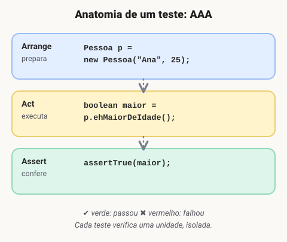
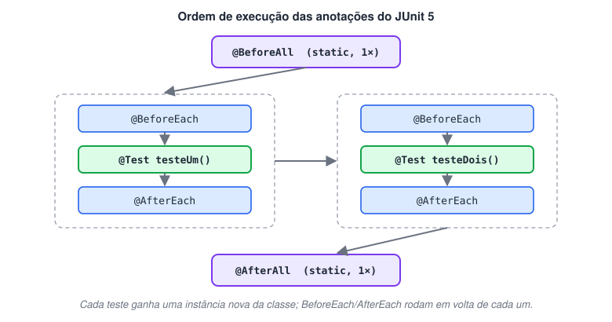
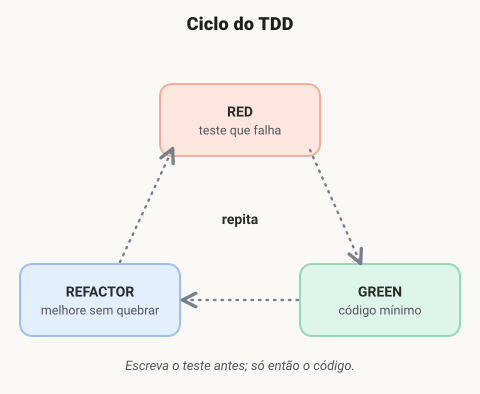

# Testes unitários com JUnit

> 🗺️ **Nesta aula:** o que são testes unitários, como escrever testes com JUnit 5 (assertions, assumptions e ciclo de vida) e boas práticas para manter os testes úteis.

## O que são testes unitários

**Testes unitários** são testes automatizados que verificam se pequenas partes do código — as **unidades**, normalmente um método ou uma classe — funcionam como esperado, **isoladas** do resto do sistema.

Quem escreve é o próprio desenvolvedor, e o objetivo é ter a garantia de que cada unidade continua correta mesmo depois de mudanças no código.

> 💡 **Por que vale a pena?**
>
> - Encontram erros **cedo**, quando são mais baratos de corrigir.
> - Dão **segurança para refatorar**: se algo quebrar, um teste fica vermelho.
> - Funcionam como **documentação viva**: o teste mostra como a unidade deve se comportar.
> - Rodam em segundos e podem ser executados a cada build (ex.: `mvn test`).

Ferramentas como **JUnit** e **TestNG** facilitam escrever e executar os testes, além de gerar relatórios e métricas de cobertura (com JaCoCo, por exemplo).

### Exemplo em código

Todo teste segue a mesma estrutura de três passos, conhecida como **AAA**:



```java
// src/main/java/Pessoa.java
public class Pessoa {
  private final String nome;
  private final int idade;

  public Pessoa(String nome, int idade) {
    this.nome = nome;
    this.idade = idade;
  }

  public String getNome() { return nome; }
  public int getIdade() { return idade; }

  public boolean ehMaiorDeIdade() {
    return idade >= 18;
  }
}
```

```java
// src/test/java/PessoaTest.java
import org.junit.jupiter.api.Test;
import static org.junit.jupiter.api.Assertions.*;

class PessoaTest {

  @Test
  void deveSerMaiorDeIdadeCom25Anos() {
    Pessoa pessoa = new Pessoa("João", 25);  // Arrange
    boolean maior = pessoa.ehMaiorDeIdade();  // Act
    assertTrue(maior);  // Assert
  }

  @Test
  void naoDeveSerMaiorDeIdadeCom17Anos() {
    assertFalse(new Pessoa("Ana", 17).ehMaiorDeIdade());
  }

  @Test
  void deveSerMaiorDeIdadeExatamenteCom18Anos() { // caso de borda
    assertTrue(new Pessoa("Rui", 18).ehMaiorDeIdade());
  }
}
```

> 🛠️ **Ajustes:** o código da `Pessoa` não tinha a declaração da classe nem os atributos `nome` e `idade`, então não compilava. Também acrescentei testes para o caso negativo (17 anos) e para o **caso de borda** (exatamente 18), que é onde costumam se esconder os erros de `>` em vez de `>=`.

### Sobre o JUnit

O **JUnit** é o framework de testes unitários open source mais usado em Java. Foi criado em **1997** por **Kent Beck** e **Erich Gamma** — segundo a história, durante um voo para a conferência OOPSLA. Ele foi inspirado no **SUnit**, framework de testes que Beck havia escrito para a linguagem **Smalltalk**.

O JUnit popularizou a família de frameworks *xUnit* e evoluiu bastante:

| Versão | Destaques |
| --- | --- |
| JUnit 3 | Testes por herança de `TestCase` e métodos começando com `test`. |
| JUnit 4 (2006) | Uso de anotações (`@Test`, `@Before`, `@After`). |
| JUnit 5 (2017) | Arquitetura modular — **Platform**, **Jupiter** (a API de escrita de testes) e **Vintage** (roda testes antigos). Pacote `org.junit.jupiter`. |

Hoje ele é integrado a todas as IDEs principais e às ferramentas de build (Maven, Gradle).

> 🛠️ **Ajuste histórico:** o texto dizia que o JUnit foi criado "num projeto de IDE chamado Smalltalk no ambiente Java". Smalltalk é uma **linguagem de programação**, não uma IDE; o JUnit é uma adaptação para Java do SUnit, que Kent Beck havia criado para Smalltalk.

## Aprofundando nos recursos

### Adicionando o JUnit 5 ao projeto

🔗 [Maven Repository: org.junit.jupiter » junit-jupiter-engine » 5.9.2](https://mvnrepository.com/artifact/org.junit.jupiter/junit-jupiter-engine/5.9.2)

O jeito mais simples é usar o artefato agregador `junit-jupiter`, que já traz a API e o engine:

```xml
<dependency>
  <groupId>org.junit.jupiter</groupId>
  <artifactId>junit-jupiter</artifactId>
  <version>5.9.2</version>
  <scope>test</scope>
</dependency>
```

#### Recomendações

- Os testes ficam em `src/test/java`, espelhando o pacote da classe testada.
- O nome da classe de teste segue a classe testada, com o sufixo `Test` (ex.: `Pessoa` → `PessoaTest`). Esse é o padrão que o Maven Surefire procura para executar.
- Dê nomes que descrevam o comportamento: `deveLancarErroQuandoSaldoForInsuficiente()`.

### Assertions

**Assertions** (afirmações) comparam o resultado obtido com o esperado. Se a afirmação for verdadeira, o teste passa; se for falsa, o teste **falha**.

| Método | Verifica |
| --- | --- |
| `assertEquals(esperado, atual)` | Se os valores são iguais. |
| `assertNotEquals(a, b)` | Se são diferentes. |
| `assertTrue(cond)` / `assertFalse(cond)` | Se a condição é verdadeira / falsa. |
| `assertNull(obj)` / `assertNotNull(obj)` | Se é (ou não) nulo. |
| `assertThrows(Tipo.class, () -> ...)` | Se o código lança a exceção esperada. |
| `assertAll(...)` | Agrupa várias verificações e reporta todas as falhas de uma vez. |

> 📌 Em `assertEquals`, a ordem importa: primeiro o **esperado**, depois o **atual**. Invertidos, as mensagens de falha ficam confusas.

### Assumptions

**Assumptions** (suposições) verificam **pré-condições** antes de o teste rodar. Se a suposição for verdadeira, o teste segue normalmente; se for falsa, o teste é **abortado e marcado como ignorado** (*skipped*), não como falha.

São úteis quando o teste depende do ambiente: sistema operacional, variável de ambiente, conexão de rede, banco disponível…

No JUnit 5, a classe `Assumptions` oferece:

- `assumeTrue(condição)` — continua só se a condição for verdadeira.
- `assumeFalse(condição)` — continua só se a condição for falsa.
- `assumingThat(condição, () -> ...)` — executa aquele trecho apenas se a condição for verdadeira; o resto do teste roda sempre.

```java
import org.junit.jupiter.api.Test;
import static org.junit.jupiter.api.Assertions.*;
import static org.junit.jupiter.api.Assumptions.*;

class ExemploTest {

  @Test
  void deveSomarCorretamente() {
    int resultado = 10 + 5;
    assertEquals(15, resultado);
  }

  @Test
  void deveValidarCondicao() {
    boolean condicao = true;
    assertTrue(condicao);
  }

  @Test
  void soRodaNoWindows() {
    // se não for Windows, o teste é ignorado (não falha)
    assumeTrue(System.getProperty("os.name").startsWith("Windows"));

    String caminhoArquivo = "C:\\arquivo.txt";
    assertNotNull(caminhoArquivo);
  }

  @Test
  void deveLancarExcecaoAoDividirPorZero() {
    assertThrows(ArithmeticException.class, () -> {
      int x = 10 / 0;
    });
  }
}
```

> 🛠️ **Ajuste:** `assumeNotNull` e `assumeThat` pertencem à classe `Assume` do **JUnit 4**; não existem em `Assumptions` do JUnit 5. No JUnit 5, os métodos são `assumeTrue`, `assumeFalse` e `assumingThat`. Também acrescentei `assertThrows` e `assertAll`, muito usados no dia a dia.

### Ciclo de vida: @BeforeAll, @BeforeEach, @AfterEach, @AfterAll

Às vezes é preciso preparar algo antes dos testes e limpar depois. O JUnit 5 oferece quatro **anotações** para isso (o nome do método é livre; o que importa é a anotação):



| Anotação | Quando roda | Uso típico |
| --- | --- | --- |
| `@BeforeAll` | **Uma vez**, antes de todos os testes da classe. Método `static`. | Abrir conexão com banco, subir um servidor de teste. |
| `@BeforeEach` | Antes de **cada** teste. | Criar objetos novos, iniciar transação. |
| `@AfterEach` | Depois de **cada** teste. | Desfazer alterações (rollback), limpar arquivos. |
| `@AfterAll` | **Uma vez**, depois de todos os testes. Método `static`. | Fechar conexão, desligar recursos. |

> 💡 `@BeforeAll` e `@AfterAll` precisam ser `static` porque o JUnit cria **uma instância nova da classe para cada teste**. A exceção é quando a classe usa `@TestInstance(TestInstance.Lifecycle.PER_CLASS)`.

```java
import org.junit.jupiter.api.*;

class ExemploTest {

  private static ConexaoBancoDeDados conexao;

  @BeforeAll
  static void configurarConexao() {
    conexao = new ConexaoBancoDeDados("localhost", "5432", "usuario", "senha");
    conexao.conectar();
  }

  @AfterAll
  static void fecharConexao() {
    conexao.desconectar();
  }

  @BeforeEach
  void antesDeCadaTeste() {
    conexao.iniciarTransacao();  // nova transação para cada teste
  }

  @AfterEach
  void depoisDeCadaTeste() {
    conexao.rollbackTransacao();  // desfaz o que o teste alterou
  }

  @Test
  void testeUm() {
    // usa a conexão aberta no @BeforeAll e a transação do @BeforeEach
  }

  @Test
  void testeDois() {
    // começa com o banco limpo, graças ao rollback do @AfterEach
  }
}
```

> 📌 `ConexaoBancoDeDados` é uma classe ilustrativa, não faz parte do JUnit. No JUnit 4, as anotações equivalentes eram `@BeforeClass`, `@Before`, `@After` e `@AfterClass`.

### Projeto de exemplo com Maven

Para rodar os testes do projeto: `mvn test`.

## Boas práticas

### 🧼 Busque simplicidade

- **Capriche no nome dos testes:** o nome deve dizer o comportamento esperado (`deveRecusarSaqueSemSaldo`), não apenas o método (`testSaque`).
- **Facilite a leitura:** um teste deve verificar **uma coisa só**, com a estrutura Arrange → Act → Assert bem visível.

### ⏱️ Comece a testar cedo

- Escreva o teste o mais perto possível do momento em que escreve o código — de preferência, **antes**.
- Conheça o **TDD** (*Test-Driven Development*), que organiza o desenvolvimento num ciclo curto:



1. **Red:** escreva um teste para o comportamento desejado. Ele falha, porque o código ainda não existe.
2. **Green:** escreva o código mais simples possível para o teste passar.
3. **Refactor:** melhore o código (nomes, duplicações, design), mantendo os testes verdes.

### 🗂️ Busque organização

- **Nomenclatura padronizada:** classes `NomeDaClasseTest`, no mesmo pacote da classe testada.
- **Testes determinísticos:** o mesmo teste deve dar sempre o mesmo resultado. Evite depender de data/hora atual, ordem de execução, aleatoriedade ou serviços externos sem controle.

### 🤖 Economize tempo automatizando

- Meça a **cobertura de código** com ferramentas como o **JaCoCo** — e lembre-se de que cobertura alta não garante testes bons.
- Rode os testes automaticamente a cada build e em cada *pull request* (CI).
- Siga os princípios **FIRST**:

| Letra | Princípio | Significado |
| --- | --- | --- |
| **F** | *Fast* | Rápidos: rodam em milissegundos, para serem executados o tempo todo. |
| **I** | *Independent* | Independentes: um teste não depende de outro nem da ordem de execução. |
| **R** | *Repeatable* | Repetíveis: mesmo resultado em qualquer máquina ou ambiente. |
| **S** | *Self-validating* | Autoverificáveis: passam ou falham sozinhos, sem alguém conferir a saída. |
| **T** | *Timely* | Oportunos: escritos junto com (ou antes do) código de produção. |

### 📚 Exemplos de JUnit 5

🔗 [junit5-exemplos/src/test/java/com/github/willyancaetano/junit at master · willyancaetano/junit5-exemplos](https://github.com/willyancaetano/junit5-exemplos/tree/master/src/test/java/com/github/willyancaetano/junit)

## 📌 Resumo

| Item | Em uma frase |
| --- | --- |
| Teste unitário | testa a menor parte isolada do código, rápido e sem depender de banco ou rede |
| `@Test` | marca o método de teste no JUnit 5 |
| Assertions | `assertEquals(esperado, atual)`, `assertTrue`, `assertThrows` |
| Assumptions | `assumeTrue` pula o teste quando a condição não vale |
| Ciclo de vida | `@BeforeAll`, `@BeforeEach`, `@AfterEach`, `@AfterAll` |
| Boas práticas | um comportamento por teste, nomes claros, testar cedo e rodar no build |
