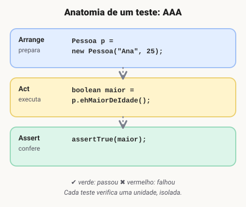
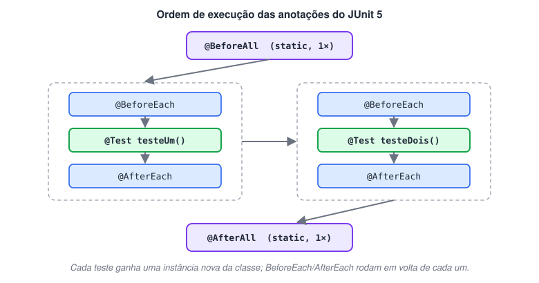
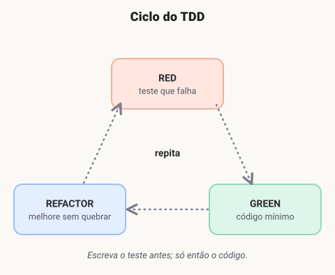

# Testes unitários com JUnit

> 🗺️ **Nesta aula:** o que são testes unitários, como escrever testes com JUnit 5 (assertions, assumptions e ciclo de vida) e boas práticas para manter os testes úteis.

## De onde paramos

Você já sabe montar um projeto com Maven. Agora vai escrever testes automatizados que confirmam se o código faz o esperado.

## O que são testes unitários

> 🗺️ **Nesta aula:** o que é um teste unitário, por que escrever testes, a estrutura AAA com um exemplo completo e a história do JUnit.

### De onde paramos

Você já escreve classes e métodos e roda o programa para ver se funciona. Agora vai aprender a confirmar isso automaticamente, sem depender de você testar à mão.

**Testes unitários** são testes automatizados que verificam se pequenas partes do código — as **unidades**, normalmente um método ou uma classe — funcionam como esperado, **isoladas** do resto do sistema.

Quem escreve é o próprio desenvolvedor, e o objetivo é ter a garantia de que cada unidade continua correta mesmo depois de mudanças no código.

> 💡 **Analogia:** antes de montar um carro, cada peça é testada sozinha na bancada — o freio freia? a lâmpada acende? O teste unitário é essa bancada: se a peça falhar, você sabe exatamente qual é, sem precisar montar o carro inteiro.

> 💡 **Por que vale a pena?**
>
> - Encontram erros **cedo**, quando são mais baratos de corrigir.
> - Dão **segurança para refatorar**: se algo quebrar, um teste fica vermelho.
> - Funcionam como **documentação viva**: o teste mostra como a unidade deve se comportar.
> - Rodam em segundos e podem ser executados a cada build (ex.: `mvn test`).

Ferramentas como **JUnit** e **TestNG** facilitam escrever e executar os testes, além de gerar relatórios e métricas de cobertura (com JaCoCo, por exemplo).

### Exemplo em código

Todo teste segue a mesma estrutura de três passos, conhecida como **AAA**:



```java
// src/main/java/Pessoa.java
public class Pessoa {
  private final String nome;
  private final int idade;

  public Pessoa(String nome, int idade) {
    this.nome = nome;
    this.idade = idade;
  }

  public String getNome() { return nome; }
  public int getIdade() { return idade; }

  public boolean ehMaiorDeIdade() {
    return idade >= 18;
  }
}
```

```java
// src/test/java/PessoaTest.java
import org.junit.jupiter.api.Test;
import static org.junit.jupiter.api.Assertions.*;

class PessoaTest {

  @Test
  void deveSerMaiorDeIdadeCom25Anos() {
    // Arrange
    Pessoa p = new Pessoa("Ana", 25);
    // Act
    boolean maior = p.ehMaiorDeIdade();
    // Assert
    assertTrue(maior);
  }

  @Test
  void naoDeveSerMaiorDeIdadeCom17Anos() {
    assertFalse(
      new Pessoa("Bia", 17).ehMaiorDeIdade());
  }

  // caso de borda
  @Test
  void deveSerMaiorDeIdadeCom18Anos() {
    assertTrue(
      new Pessoa("Rui", 18).ehMaiorDeIdade());
  }
}
```

> 🛠️ **Ajustes:** o código da `Pessoa` não tinha a declaração da classe nem os atributos `nome` e `idade`, então não compilava. Também acrescentei testes para o caso negativo (17 anos) e para o **caso de borda** (exatamente 18), que é onde costumam se esconder os erros de `>` em vez de `>=`.

### Sobre o JUnit

O **JUnit** é o framework de testes unitários open source mais usado em Java. Foi criado em **1997** por **Kent Beck** e **Erich Gamma** — segundo a história, durante um voo para a conferência OOPSLA. Ele foi inspirado no **SUnit**, framework de testes que Beck havia escrito para a linguagem **Smalltalk**.

O JUnit popularizou a família de frameworks *xUnit* e evoluiu bastante:

| Versão | Destaques |
| --- | --- |
| JUnit 3 | Testes por herança de `TestCase` e métodos começando com `test`. |
| JUnit 4 (2006) | Uso de anotações (`@Test`, `@Before`, `@After`). |
| JUnit 5 (2017) | Arquitetura modular — **Platform**, **Jupiter** (a API de escrita de testes) e **Vintage** (roda testes antigos). Pacote `org.junit.jupiter`. |

Hoje ele é integrado a todas as IDEs principais e às ferramentas de build (Maven, Gradle).

> 🛠️ **Ajuste histórico:** o texto dizia que o JUnit foi criado "num projeto de IDE chamado Smalltalk no ambiente Java". Smalltalk é uma **linguagem de programação**, não uma IDE; o JUnit é uma adaptação para Java do SUnit, que Kent Beck havia criado para Smalltalk.

> ➡️ **Próximo passo:** **Aprofundando nos recursos**, com assertions, assumptions e o ciclo de vida dos testes.

### 🧠 Revisão rápida

**O que significam as três letras de AAA?**

Arrange (preparar), Act (executar) e Assert (conferir).

**O que é um caso de borda? Dê um exemplo desta aula.**

Um valor no limite da regra. Aqui, a idade exatamente 18, onde um `>` no lugar de `>=` erraria.

**Qual é o pacote do JUnit 5?**

`org.junit.jupiter`.

### 📌 Resumo

| Item | Em uma frase |
| --- | --- |
| Teste unitário | Verifica uma unidade de código, isolada e automaticamente. |
| AAA | Arrange → Act → Assert. |
| Caso de borda | Testa o limite da regra. |
| JUnit 5 | Platform + Jupiter + Vintage. |

## Aprofundando nos recursos

> 🗺️ **Nesta aula:** como adicionar o JUnit 5 ao projeto, as principais assertions e assumptions e as anotações do ciclo de vida dos testes.

### De onde paramos

Você já sabe o que é um teste unitário e a estrutura AAA. Agora vai usar os recursos do JUnit 5 no dia a dia.

### Adicionando o JUnit 5 ao projeto

🔗 [Maven Repository: org.junit.jupiter » junit-jupiter-engine » 5.9.2](https://mvnrepository.com/artifact/org.junit.jupiter/junit-jupiter-engine/5.9.2)

O jeito mais simples é usar o artefato agregador `junit-jupiter`, que já traz a API e o engine:

```xml
<dependency>
  <groupId>org.junit.jupiter</groupId>
  <artifactId>junit-jupiter</artifactId>
  <version>5.9.2</version>
  <scope>test</scope>
</dependency>
```

#### Recomendações

- Os testes ficam em `src/test/java`, espelhando o pacote da classe testada.
- O nome da classe de teste segue a classe testada, com o sufixo `Test` (ex.: `Pessoa` → `PessoaTest`). Esse é o padrão que o Maven Surefire procura para executar.
- Dê nomes que descrevam o comportamento: `deveLancarErroQuandoSaldoForInsuficiente()`.

> 💡 **Analogia:** antes de um avião decolar, a equipe confere uma lista: motor, combustível, portas. Cada item é uma assertion; se um deles estiver errado, o voo não sai, e a lista mostra exatamente o que falhou.

### Assertions

**Assertions** (afirmações) comparam o resultado obtido com o esperado. Se a afirmação for verdadeira, o teste passa; se for falsa, o teste **falha**.

| Método | Verifica |
| --- | --- |
| `assertEquals(esperado, atual)` | Se os valores são iguais. |
| `assertNotEquals(a, b)` | Se são diferentes. |
| `assertTrue(cond)` / `assertFalse(cond)` | Se a condição é verdadeira / falsa. |
| `assertNull(obj)` / `assertNotNull(obj)` | Se é (ou não) nulo. |
| `assertThrows(Tipo.class, () -> ...)` | Se o código lança a exceção esperada. |
| `assertAll(...)` | Agrupa várias verificações e reporta todas as falhas de uma vez. |

> 📌 Em `assertEquals`, a ordem importa: primeiro o **esperado**, depois o **atual**. Invertidos, as mensagens de falha ficam confusas.

> ⚠️ Para comparar `double`, use a versão com tolerância: `assertEquals(0.3, 0.1 + 0.2, 0.0001)`. Sem ela, o teste falha, porque `0.1 + 0.2` dá `0.30000000000000004`.

### Assumptions

**Assumptions** (suposições) verificam **pré-condições** antes de o teste rodar. Se a suposição for verdadeira, o teste segue normalmente; se for falsa, o teste é **abortado e marcado como ignorado** (*skipped*), não como falha.

São úteis quando o teste depende do ambiente: sistema operacional, variável de ambiente, conexão de rede, banco disponível…

No JUnit 5, a classe `Assumptions` oferece:

- `assumeTrue(condição)` — continua só se a condição for verdadeira.
- `assumeFalse(condição)` — continua só se a condição for falsa.
- `assumingThat(condição, () -> ...)` — executa aquele trecho apenas se a condição for verdadeira; o resto do teste roda sempre.

```java
import org.junit.jupiter.api.Test;
import static org.junit.jupiter.api.Assertions.*;
import static org.junit.jupiter.api.Assumptions.*;

class ExemploTest {

  @Test
  void deveSomarCorretamente() {
    int resultado = 10 + 5;
    assertEquals(15, resultado);
  }

  @Test
  void deveValidarCondicao() {
    boolean condicao = true;
    assertTrue(condicao);
  }

  @Test
  void soRodaNoWindows() {
    // fora do Windows, o teste é
    // ignorado (não falha)
    assumeTrue(System.getProperty("os.name")
      .startsWith("Windows"));

    String caminho = "C:\\arquivo.txt";
    assertNotNull(caminho);
  }

  @Test
  void deveLancarExcecaoAoDividirPorZero() {
    assertThrows(ArithmeticException.class,
      () -> {
        int x = 10 / 0;
      });
  }
}
```

> 🛠️ **Ajuste:** `assumeNotNull` e `assumeThat` pertencem à classe `Assume` do **JUnit 4**; não existem em `Assumptions` do JUnit 5. No JUnit 5, os métodos são `assumeTrue`, `assumeFalse` e `assumingThat`. Também acrescentei `assertThrows` e `assertAll`, muito usados no dia a dia.

### Ciclo de vida: @BeforeAll, @BeforeEach, @AfterEach, @AfterAll

Às vezes é preciso preparar algo antes dos testes e limpar depois. O JUnit 5 oferece quatro **anotações** para isso (o nome do método é livre; o que importa é a anotação):



| Anotação | Quando roda | Uso típico |
| --- | --- | --- |
| `@BeforeAll` | **Uma vez**, antes de todos os testes da classe. Método `static`. | Abrir conexão com banco, subir um servidor de teste. |
| `@BeforeEach` | Antes de **cada** teste. | Criar objetos novos, iniciar transação. |
| `@AfterEach` | Depois de **cada** teste. | Desfazer alterações (rollback), limpar arquivos. |
| `@AfterAll` | **Uma vez**, depois de todos os testes. Método `static`. | Fechar conexão, desligar recursos. |

> 💡 `@BeforeAll` e `@AfterAll` precisam ser `static` porque o JUnit cria **uma instância nova da classe para cada teste**. A exceção é quando a classe usa `@TestInstance(TestInstance.Lifecycle.PER_CLASS)`.

```java
import org.junit.jupiter.api.*;

class ExemploTest {

  private static ConexaoBancoDeDados conexao;

  @BeforeAll
  static void configurarConexao() {
    conexao = new ConexaoBancoDeDados(
      "localhost", "5432",
      "usuario", "senha");
    conexao.conectar();
  }

  @AfterAll
  static void fecharConexao() {
    conexao.desconectar();
  }

  @BeforeEach
  void antesDeCadaTeste() {
    // nova transação para cada teste
    conexao.iniciarTransacao();
  }

  @AfterEach
  void depoisDeCadaTeste() {
    // desfaz o que o teste alterou
    conexao.rollbackTransacao();
  }

  @Test
  void testeUm() {
    // usa a conexão do @BeforeAll e
    // a transação do @BeforeEach
  }

  @Test
  void testeDois() {
    // começa com o banco limpo, graças
    // ao rollback do @AfterEach
  }
}
```

> 📌 `ConexaoBancoDeDados` é uma classe ilustrativa, não faz parte do JUnit. No JUnit 4, as anotações equivalentes eram `@BeforeClass`, `@Before`, `@After` e `@AfterClass`.

> 💡 Outras anotações úteis: `@DisplayName("texto")` dá um nome legível ao teste no relatório; `@Disabled` desliga um teste temporariamente; `@ParameterizedTest` roda o mesmo teste com vários valores.

### Projeto de exemplo com Maven

Para rodar os testes do projeto: `mvn test`.

> ➡️ **Próximo passo:** **Boas práticas**, para escrever testes fáceis de ler e de manter.

### 🧠 Revisão rápida

**Em `assertEquals`, qual argumento vem primeiro?**

O valor **esperado**; depois, o atual.

**Qual a diferença entre uma assertion e uma assumption que falham?**

A assertion falha o teste; a assumption só o marca como ignorado.

**Por que `@BeforeAll` precisa ser `static`?**

Porque o JUnit cria uma instância nova da classe para cada teste; um método que roda uma vez só não pode depender de uma instância.

### 📌 Resumo

| Item | Em uma frase |
| --- | --- |
| `junit-jupiter` | Dependência única com API e engine do JUnit 5. |
| Assertions | Conferem o resultado; falham o teste. |
| Assumptions | Conferem o ambiente; pulam o teste. |
| `@BeforeEach` / `@AfterEach` | Rodam em volta de cada teste. |
| `@BeforeAll` / `@AfterAll` | Rodam uma vez por classe (`static`). |

## Boas práticas

> 🗺️ **Nesta aula:** boas práticas para escrever testes úteis — nomes, simplicidade, TDD, organização, automação e os princípios FIRST.

> 💡 **Analogia:** um bom teste é como uma etiqueta de bagagem clara: diz de quem é a mala e para onde vai, sem precisar abrir. Um nome vago como "testeSaque" é uma etiqueta sem destino.

### De onde paramos

Você já conhece os recursos do JUnit 5. Agora vai aprender a escrever testes que continuam úteis conforme o projeto cresce.

### 🧼 Busque simplicidade

- **Capriche no nome dos testes:** o nome deve dizer o comportamento esperado (`deveRecusarSaqueSemSaldo`), não apenas o método (`testSaque`).
- **Facilite a leitura:** um teste deve verificar **uma coisa só**, com a estrutura Arrange → Act → Assert bem visível.

### ⏱️ Comece a testar cedo

- Escreva o teste o mais perto possível do momento em que escreve o código — de preferência, **antes**.
- Conheça o **TDD** (*Test-Driven Development*), que organiza o desenvolvimento num ciclo curto:



1. **Red:** escreva um teste para o comportamento desejado. Ele falha, porque o código ainda não existe.
2. **Green:** escreva o código mais simples possível para o teste passar.
3. **Refactor:** melhore o código (nomes, duplicações, design), mantendo os testes verdes.

**Exemplo de um ciclo TDD**

```java
// 1. RED: o teste vem primeiro e falha
// (Calculadora ainda não existe)
@Test
void deveSomarDoisNumeros() {
  assertEquals(5,
    new Calculadora().somar(2, 3));
}

// 2. GREEN: o mínimo para passar
class Calculadora {
  int somar(int a, int b) {
    return a + b;
  }
}

// 3. REFACTOR: aqui não há o que melhorar;
// o próximo ciclo começa com outro teste,
// por exemplo deveSomarNegativos().
```

### 🗂️ Busque organização

- **Nomenclatura padronizada:** classes `NomeDaClasseTest`, no mesmo pacote da classe testada.
- **Testes determinísticos:** o mesmo teste deve dar sempre o mesmo resultado. Evite depender de data/hora atual, ordem de execução, aleatoriedade ou serviços externos sem controle.

> ⚠️ Um teste que às vezes passa e às vezes falha (*flaky*) é pior que nenhum: a equipe aprende a ignorá-lo. Se o código usa a data atual, receba um `Clock` como parâmetro para poder fixá-lo no teste.

### 🤖 Economize tempo automatizando

- Meça a **cobertura de código** com ferramentas como o **JaCoCo** — e lembre-se de que cobertura alta não garante testes bons.
- Rode os testes automaticamente a cada build e em cada *pull request* (CI).
- Siga os princípios **FIRST**:

| Letra | Princípio | Significado |
| --- | --- | --- |
| **F** | *Fast* | Rápidos: rodam em milissegundos, para serem executados o tempo todo. |
| **I** | *Independent* | Independentes: um teste não depende de outro nem da ordem de execução. |
| **R** | *Repeatable* | Repetíveis: mesmo resultado em qualquer máquina ou ambiente. |
| **S** | *Self-validating* | Autoverificáveis: passam ou falham sozinhos, sem alguém conferir a saída. |
| **T** | *Timely* | Oportunos: escritos junto com (ou antes do) código de produção. |

### 📚 Exemplos de JUnit 5

🔗 [junit5-exemplos/src/test/java/com/github/willyancaetano/junit at master · willyancaetano/junit5-exemplos](https://github.com/willyancaetano/junit5-exemplos/tree/master/src/test/java/com/github/willyancaetano/junit)

> ➡️ **Próximo passo:** **Testes com Mockito**, para testar classes que dependem de outras.

### 🧠 Revisão rápida

**Quais são as três etapas do TDD, em ordem?**

Red (teste que falha), Green (código mínimo que passa) e Refactor (melhorar sem quebrar).

**O que quer dizer o "I" de FIRST?**

*Independent*: um teste não pode depender de outro nem da ordem de execução.

**Cobertura de 100% garante que o código está correto?**

Não. Ela só diz que as linhas foram executadas; os testes ainda precisam conferir os resultados certos.

### 📌 Resumo

| Item | Em uma frase |
| --- | --- |
| Nome do teste | Descreve o comportamento esperado. |
| Um teste, uma coisa | Facilita achar a causa da falha. |
| TDD | Red → Green → Refactor. |
| Determinístico | Mesmo resultado sempre. |
| FIRST | Fast, Independent, Repeatable, Self-validating, Timely. |

> 💡 **Analogia:** um teste unitário é a checagem de um eletrodoméstico antes de sair da fábrica. Liga-se a peça, confere-se uma função de cada vez e o resultado é aprovado ou reprovado, sem montar o carro inteiro.

> ➡️ **Próximo passo:** **Testes com Mockito**, para testar classes que dependem de outras.

## 🧠 Revisão rápida

**Qual a diferença entre `assertTrue` e `assumeTrue`?**

`assertTrue` reprova o teste quando a condição é falsa; `assumeTrue` só pula o teste.

**Qual anotação roda antes de *cada* teste?**

`@BeforeEach`.

## 📌 Resumo

| Item | Em uma frase |
| --- | --- |
| Teste unitário | testa a menor parte isolada do código, rápido e sem depender de banco ou rede |
| `@Test` | marca o método de teste no JUnit 5 |
| Assertions | `assertEquals(esperado, atual)`, `assertTrue`, `assertThrows` |
| Assumptions | `assumeTrue` pula o teste quando a condição não vale |
| Ciclo de vida | `@BeforeAll`, `@BeforeEach`, `@AfterEach`, `@AfterAll` |
| Boas práticas | um comportamento por teste, nomes claros, testar cedo e rodar no build |
