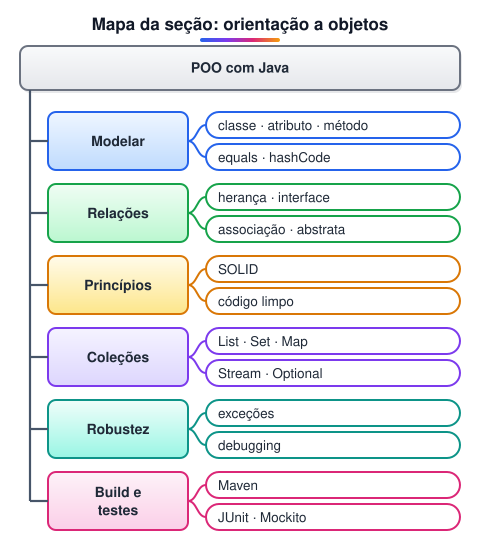

# Desafio POO

> 🗺️ **Nesta aula:** desafio de **Programação Orientada a Objetos**: modelar um domínio com classes, herança, encapsulamento e polimorfismo — e depois refatorar o projeto para usar o **Maven** como ferramenta de build.

## De onde paramos

Você já viu classes, herança, interfaces, polimorfismo, testes e Maven. Agora vai juntar tudo em um projeto só.

## 📦 Código do projeto refatorado com Maven

🔗 [https://www.toptal.com/developers/gitignore/](https://www.toptal.com/developers/gitignore/)

## 🛠️ Ferramenta útil: gerador de .gitignore

O site abaixo monta um `.gitignore` pronto a partir das tecnologias que você usa (ex.: *Java*, *Maven*, *IntelliJ*). Assim, pastas como `target/` e `.idea/` não vão parar no repositório.

> ➡️ **Próximo passo:** **Primeiros passos com SQL**, na seção 5, sobre bancos de dados.

## 🧠 Revisão rápida

Ver resposta: Se uma classe do domínio só precisa mudar quando as regras de negócio mudam, qual princípio do SOLID ela segue?

Responsabilidade única (S): ela tem um só motivo para mudar.

Ver resposta: Qual pilar da POO permite tratar objetos de classes diferentes pelo mesmo tipo comum?

Polimorfismo.

## 📌 Resumo

| Item | O que o desafio pratica |
| --- | --- |
| Modelagem | transformar um domínio em classes com responsabilidades claras |
| Pilares da POO | encapsulamento, herança, abstração e polimorfismo no mesmo projeto |
| Maven | reorganizar o projeto no padrão `src/main/java` e gerenciar o build pelo `pom.xml` |
| `.gitignore` | deixar fora do repositório o que é gerado (`target/`, arquivos da IDE) |

## 🧭 Mapa da seção

