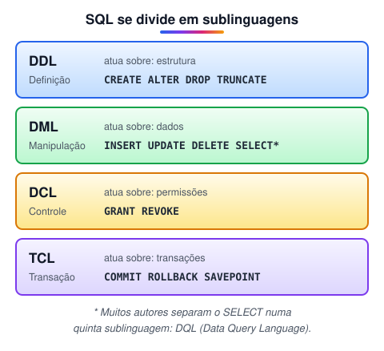
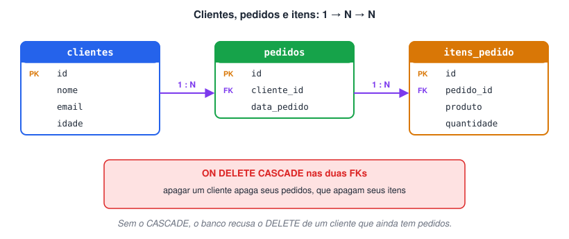
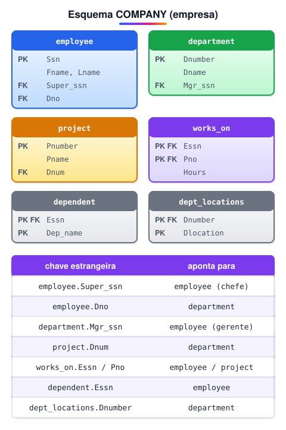

# Primeiros passos com SQL

> 🗺️ **Nesta aula:** o que é SQL e suas sublinguagens (DDL, DML, DCL, TCL), modelos de dados, tipos e restrições (constraints) e a criação de bancos de exemplo com tabelas relacionadas.

## Primeiros passos no SQL

### O que é SQL?

**SQL** (*Structured Query Language*) é a linguagem padrão para criar, consultar e manipular dados em **bancos de dados relacionais** (MySQL, PostgreSQL, SQL Server, Oracle…). É uma linguagem **declarativa**: você descreve *o que* quer ("os clientes com mais de 30 anos") e o banco decide *como* buscar.

#### Como surgiu

O SQL nasceu na **IBM**, no início dos anos 1970, dentro do projeto de pesquisa **System R**, que buscava implementar o modelo relacional proposto por **Edgar F. Codd** (1970). **Donald D. Chamberlin** e **Raymond F. Boyce** criaram uma linguagem de consulta próxima do inglês chamada **SEQUEL** (*Structured English QUEry Language*). Por questões de marca registrada, o nome foi encurtado para **SQL**.

O primeiro SGBD relacional comercial com SQL foi o **Oracle** (1979, da Relational Software Inc.); a IBM lançou seus produtos comerciais logo depois (SQL/DS em 1981 e DB2 em 1983). O SQL virou padrão **ANSI** em 1986 e **ISO** em 1987.

#### Como funciona

O SQL tem como base a **teoria dos conjuntos** e a **álgebra relacional**: cada consulta opera sobre conjuntos de linhas e devolve outro conjunto. Os dados ficam em **tabelas**, onde cada **linha** é um registro e cada **coluna** é um atributo.

Com SQL é possível:

- **Consultar** dados (`SELECT`), **inserir** (`INSERT`), **atualizar** (`UPDATE`) e **excluir** (`DELETE`).
- **Combinar tabelas** com `JOIN`.
- **Agrupar e resumir** com funções de agregação: `COUNT`, `SUM`, `AVG`, `MAX`, `MIN`.
- **Filtrar** com operadores lógicos (`AND`, `OR`, `NOT`) e de comparação:

| Operador | Significado |
| --- | --- |
| `=` | igual |
| `<>` ou `!=` | diferente |
| `<` / `>` | menor / maior |
| `<=` / `>=` | menor ou igual / maior ou igual |

### Sublinguagens do SQL

Os comandos do SQL costumam ser agrupados de acordo com o que fazem:



**DDL — Data Definition Language (estrutura)**

Cria, altera e remove objetos do banco: tabelas, índices, views, procedures. Comandos: `CREATE`, `ALTER`, `DROP`, `TRUNCATE`.

```sql
CREATE TABLE clientes (
  id    INT PRIMARY KEY,       -- chave primária: identifica cada linha
  nome  VARCHAR(50) NOT NULL,  -- obrigatório, até 50 caracteres
  email VARCHAR(50) UNIQUE,    -- não pode repetir
  idade INT                    -- opcional (aceita NULL)
);
```

**DML — Data Manipulation Language (dados)**

Insere, altera, exclui e consulta dados. Comandos: `INSERT`, `UPDATE`, `DELETE` e `SELECT`.

```sql
INSERT INTO clientes (id, nome, email, idade) VALUES
  (1, 'Maria Silva', 'maria@email.com', 30),
  (2, 'João Souza',  'joao@email.com',  25),
  (3, 'Ana Santos',  'ana@email.com',   40);

-- cada parêntese é uma linha; os valores seguem a ordem das colunas listadas

SELECT nome, idade FROM clientes WHERE idade > 28;
```

**DCL — Data Control Language (permissões)**

Concede e retira permissões de usuários. Comandos: `GRANT` e `REVOKE`.

```sql
-- permite ao usuario1 ler, inserir, atualizar e excluir dados da tabela
GRANT SELECT, INSERT, UPDATE, DELETE ON tabela_exemplo TO usuario1;

-- retira a permissão de excluir
REVOKE DELETE ON tabela_exemplo FROM usuario1;
```

**TCL — Transaction Control Language (transações)**

Controla transações: um conjunto de operações que deve ser aplicado **inteiro ou nada**. Comandos: `START TRANSACTION`, `COMMIT`, `ROLLBACK`, `SAVEPOINT`.

```sql
START TRANSACTION;
UPDATE contas SET saldo = saldo - 100 WHERE id = 1;
UPDATE contas SET saldo = saldo + 100 WHERE id = 2;
COMMIT;      -- confirma as duas alterações de forma permanente
-- ROLLBACK; -- desfaria as duas, se algo desse errado
```

### Modelos de dados

#### Modelo relacional

Organiza as informações em **tabelas** (relações) de linhas e colunas. Cada tabela representa uma entidade (cliente, pedido…) e cada coluna, um atributo.

- Os relacionamentos entre tabelas são feitos por **chaves primárias** e **chaves estrangeiras**.
- As operações são feitas em SQL.
- A integridade é garantida por **restrições** (*constraints*).

```sql
CREATE TABLE clientes (
  id_cliente INT PRIMARY KEY,
  nome       VARCHAR(50),
  endereco   VARCHAR(100),
  telefone   VARCHAR(15)
);
```

#### Modelo ER (Entidade-Relacionamento)

É um modelo **conceitual**, usado na fase de projeto para desenhar o banco antes de criá-lo. Na notação clássica de Peter Chen:

- **Entidades** são retângulos; **atributos**, elipses; **relacionamentos**, losangos.
- Os relacionamentos têm **cardinalidade**: 1:1, 1:N ou N:N.

Depois de pronto, o diagrama ER é **mapeado** para o modelo relacional (cada entidade vira tabela, cada relacionamento vira chave estrangeira ou tabela associativa). Em seguida, aplica-se a **normalização** para eliminar redundâncias.

```
[Cliente] 1 ──< possui >── N [Endereço]
```

> 🛠️ **Ajustes:**
>
> - O System R era um **protótipo de pesquisa**, não o "primeiro SGBD comercial"; esse título é do **Oracle** (1979). Acrescentei o motivo da troca de SEQUEL para SQL e o papel de Codd.
> - O texto dizia que o diagrama ER vira modelo relacional "por meio da normalização". A conversão é o **mapeamento**; a normalização é uma etapa posterior.
> - O exemplo de TCL só tinha `COMMIT` solto; agora mostra uma transação completa.
> - No modelo ER, relacionamentos são **losangos** (as linhas só ligam os elementos).

### Tipos de dados (MySQL)

| Categoria | Tipo | Observação |
| --- | --- | --- |
| Inteiros | `TINYINT`, `SMALLINT`, `INT`, `BIGINT` | `INT` vai de −2.147.483.648 a 2.147.483.647; `SMALLINT`, de −32.768 a 32.767. Com `UNSIGNED`, só valores positivos. |
| Decimais exatos | `DECIMAL(p, s)` | Ideal para **dinheiro**: `DECIMAL(10,2)` tem 10 dígitos, 2 após a vírgula. |
| Ponto flutuante | `FLOAT`, `DOUBLE` | Aproximados: evite para valores monetários. |
| Texto fixo | `CHAR(n)` | Sempre ocupa *n* caracteres (bom para siglas, CPF). |
| Texto variável | `VARCHAR(n)` | Até *n* caracteres. |
| Textos longos | `TINYTEXT` (255 B), `TEXT` (64 KB), `MEDIUMTEXT` (16 MB), `LONGTEXT` (4 GB) | Para descrições, artigos, logs. |
| Data e hora | `DATE`, `TIME`, `DATETIME`, `TIMESTAMP`, `YEAR` | `YYYY-MM-DD`, `HH:MM:SS`, `YYYY-MM-DD HH:MM:SS`. |
| Lógico | `BOOLEAN` | Sinônimo de `TINYINT(1)`: 1 = verdadeiro, 0 = falso. |
| Binário | `BLOB` (e variações) | Imagens, arquivos. |
| Listas | `ENUM(...)`, `SET(...)` | `ENUM` aceita **um** valor da lista; `SET`, **vários**. |

**Exemplo de tabela com vários tipos**

```sql
CREATE TABLE exemplo (
  id              INT AUTO_INCREMENT,
  nome            VARCHAR(50) NOT NULL,
  salario         DECIMAL(10,2) NOT NULL,
  data_nascimento DATE,
  ativo           BOOLEAN DEFAULT TRUE,
  descricao       TEXT,
  foto            BLOB,
  cor             ENUM('vermelho', 'azul', 'amarelo'),
  tamanhos        SET('pequeno', 'médio', 'grande'),
  uf              CHAR(2),
  criado_em       DATETIME DEFAULT CURRENT_TIMESTAMP,
  departamento_id INT,

  PRIMARY KEY (id),
  UNIQUE (nome),
  CHECK (salario > 0),
  FOREIGN KEY (departamento_id) REFERENCES departamento(id),
  INDEX idx_data_nascimento (data_nascimento)
);
```

> 🛠️ **Ajustes no bloco de tipos:** o `CREATE TABLE` original não executava. Ele tinha `GROUP BY`, `HAVING` e `ORDER BY` (que são cláusulas de **consulta**, não de criação de tabela), `NOT NULL (salario)` como restrição de tabela (sintaxe inválida), vírgulas faltando, a coluna `ativo` duplicada, uma FK para uma coluna inexistente e um tipo `TEX` que não existe. Também havia informações trocadas: `INT` foi descrito como "sem sinal" (ele é **com sinal**), e os limites de `TEXT` e `MEDIUMTEXT` estavam invertidos. Para valores monetários, troquei `FLOAT(8,2)` por `DECIMAL`.

### Constraints (restrições)

São regras aplicadas às colunas para garantir a **integridade** dos dados, impedindo valores inválidos ou inconsistentes.

| Constraint | Regra |
| --- | --- |
| `PRIMARY KEY` | Valor **único e não nulo**; identifica cada linha. |
| `FOREIGN KEY` | Só aceita valores que existem na tabela referenciada. |
| `UNIQUE` | Não permite valores repetidos (mas aceita `NULL`). |
| `NOT NULL` | Não permite valores nulos. |
| `CHECK` | Só aceita valores que atendem a uma condição. |
| `DEFAULT` | Define um valor padrão quando nenhum é informado. |

**Exemplos de cada constraint**

```sql
-- NOT NULL
CREATE TABLE exemplo_not_null (
  id      INT NOT NULL,
  nome    VARCHAR(50) NOT NULL,
  salario DECIMAL(10,2) NOT NULL
);

-- UNIQUE
CREATE TABLE exemplo_unique (
  id   INT,
  nome VARCHAR(50) UNIQUE
);

-- PRIMARY KEY
CREATE TABLE exemplo_pk (
  id   INT PRIMARY KEY,
  nome VARCHAR(50)
);

-- FOREIGN KEY: a tabela referenciada precisa existir ANTES
CREATE TABLE cliente (
  id   INT PRIMARY KEY,
  nome VARCHAR(50),
  cpf  CHAR(11)
);

CREATE TABLE venda (
  id         INT PRIMARY KEY,
  cliente_id INT,
  valor      DECIMAL(10,2),
  FOREIGN KEY (cliente_id) REFERENCES cliente(id)
);

-- CHECK (respeitado a partir do MySQL 8.0.16)
CREATE TABLE exemplo_check (
  id    INT,
  nome  VARCHAR(50),
  idade INT CHECK (idade >= 18)
);
```

> 🛠️ **Ajuste:** no exemplo de FOREIGN KEY, a tabela `venda` era criada **antes** de `cliente`, e o banco recusava a criação porque a tabela referenciada ainda não existia. Inverti a ordem. Também removi o texto "sqlCopy code" que estava dentro dos blocos de código.

## Criando um banco de dados

### Exemplo completo: clientes, pedidos e itens

Três tabelas encadeadas: um cliente tem vários pedidos, e cada pedido tem vários itens.



```sql
-- 1. Estrutura (DDL)
CREATE TABLE clientes (
  id    INT PRIMARY KEY,
  nome  VARCHAR(50) NOT NULL,
  email VARCHAR(100) UNIQUE,
  idade INT
);

CREATE TABLE pedidos (
  id          INT PRIMARY KEY,
  cliente_id  INT NOT NULL,
  data_pedido DATE,
  CONSTRAINT fk_pedido_cliente FOREIGN KEY (cliente_id)
      REFERENCES clientes(id) ON DELETE CASCADE
);

CREATE TABLE itens_pedido (
  id         INT PRIMARY KEY,
  pedido_id  INT NOT NULL,
  produto    VARCHAR(50),
  quantidade INT,
  CONSTRAINT fk_item_pedido FOREIGN KEY (pedido_id)
      REFERENCES pedidos(id) ON DELETE CASCADE
);

-- 2. Dados (DML)
INSERT INTO clientes (id, nome, email, idade) VALUES
  (1, 'João',  'joao@email.com',  30),
  (2, 'Maria', 'maria@email.com', 25),
  (3, 'Pedro', NULL,              40);

INSERT INTO pedidos (id, cliente_id, data_pedido) VALUES
  (1, 1, '2023-04-01'),
  (2, 2, '2023-04-02'),
  (3, 3, '2023-04-03');

INSERT INTO itens_pedido (id, pedido_id, produto, quantidade) VALUES
  (1, 1, 'Camisa',  2),
  (2, 1, 'Calça',   1),
  (3, 2, 'Blusa',   3),
  (4, 2, 'Shorts',  2),
  (5, 3, 'Jaqueta', 1),
  (6, 3, 'Calça',   1);

-- 3. Exclusão em cascata: remove Pedro, o pedido 3 e os itens 5 e 6
DELETE FROM clientes WHERE id = 3;
```

> 🛠️ **Ajuste:** o comentário prometia que o `DELETE` do cliente 3 apagaria também seus pedidos e itens, mas só a FK de `itens_pedido` tinha `ON DELETE CASCADE`. Sem o cascade em `pedidos`, o banco recusava o comando (o pedido 3 ainda apontava para o cliente). Acrescentei `ON DELETE CASCADE` também em `fk_pedido_cliente`.

**Projeto da aula feito no MySQL Workbench**

```sql
SHOW DATABASES;
CREATE DATABASE IF NOT EXISTS first_example;
USE first_example;

CREATE TABLE person (
  person_id   SMALLINT UNSIGNED,
  fname       VARCHAR(20),
  lname       VARCHAR(20),
  gender      ENUM('M', 'F'),
  birth_date  DATE,
  street      VARCHAR(30),
  city        VARCHAR(20),
  state       VARCHAR(20),
  country     VARCHAR(20),
  postal_code VARCHAR(20),
  CONSTRAINT pk_person PRIMARY KEY (person_id)
);

DESC person;

CREATE TABLE favorite_food (
  person_id SMALLINT UNSIGNED,
  food      VARCHAR(20),
  CONSTRAINT pk_favorite_food PRIMARY KEY (person_id, food),
  CONSTRAINT fk_favorite_food_person_id FOREIGN KEY (person_id)
    REFERENCES person(person_id)
);

DESC favorite_food;

-- lista as constraints criadas no banco
SELECT * FROM information_schema.table_constraints
WHERE constraint_schema = 'first_example';

INSERT INTO person VALUES
  (1, 'Carolina', 'Silva',   'F', '1985-03-10', 'Rua tal', 'Rio de Janeiro', 'RJ', 'Brasil', '20000-000'),
  (2, 'Carlos',   'Daniel',  'M', '1987-08-20', 'Rua tal', 'Rio de Janeiro', 'RJ', 'Brasil', '20000-000'),
  (3, 'Carla',    'Menezes', 'F', '1989-07-15', 'Rua tal', 'Rio de Janeiro', 'RJ', 'Brasil', '20000-000');

SELECT * FROM person;

INSERT INTO favorite_food VALUES
  (1, 'Queijo'),
  (2, 'Carne assada'),
  (3, 'Coxinha');

SELECT * FROM favorite_food;

-- para apagar uma pessoa, antes remova as comidas favoritas dela (a FK não tem CASCADE)
DELETE FROM favorite_food WHERE person_id = 2;
DELETE FROM person WHERE person_id = 2;
```

> 🛠️ **Ajustes no script do Workbench:**
>
> - `favorite_food` recebia comidas das pessoas **1** (que nunca foi cadastrada) e **2** (que tinha acabado de ser excluída). As duas inserções falhavam por violar a chave estrangeira. Cadastrei a pessoa 1 e movi o `DELETE` para o fim, removendo antes as comidas dela.
> - Os IDs eram passados como texto (`'2'`); agora são números. O CEP estava com um dígito a menos (`20000-00`), e a cidade recebia a sigla `RJ`.
> - Removidos o comentário de teste `/*gfgdfgfdgfd*/` e o erro de digitação "Carna assada".
> - O título "Principais tags do SQL" virou "Exemplo completo": SQL tem **comandos**, não tags.

## Criando um banco de dados para organizar uma empresa

Este exercício implementa o esquema **COMPANY**, um exemplo clássico do livro *Sistemas de Banco de Dados* (Elmasri & Navathe). Ele modela uma empresa com funcionários, departamentos, locais, projetos, horas trabalhadas e dependentes.



| Tabela | Guarda | Chave primária |
| --- | --- | --- |
| `employee` | Funcionários | `Ssn` |
| `department` | Departamentos e seus gerentes | `Dnumber` |
| `dept_locations` | Locais de cada departamento | `Dnumber`  • `Dlocation` |
| `project` | Projetos e o departamento responsável | `Pnumber` |
| `works_on` | Horas de cada funcionário em cada projeto (N:N) | `Essn`  • `Pno` |
| `dependent` | Dependentes de cada funcionário | `Essn`  • `Dependent_name` |

**Código**

```sql
-- Criando o banco "company"
CREATE SCHEMA IF NOT EXISTS company;
USE company;

CREATE TABLE employee (
  Fname     VARCHAR(15) NOT NULL,
  Minit     CHAR,
  Lname     VARCHAR(15) NOT NULL,
  Ssn       CHAR(9) NOT NULL,
  Bdate     DATE,
  Address   VARCHAR(30),
  Sex       CHAR,
  Salary    DECIMAL(10,2),
  Super_ssn CHAR(9),
  Dno       INT NOT NULL,
  PRIMARY KEY (Ssn)
);

CREATE TABLE department (
  Dname            VARCHAR(15) NOT NULL,
  Dnumber          INT NOT NULL,
  Mgr_ssn          CHAR(9) NOT NULL,
  Mgr_start_date   DATE,
  Dept_create_date DATE,
  PRIMARY KEY (Dnumber),
  UNIQUE (Dname),
  FOREIGN KEY (Mgr_ssn) REFERENCES employee(Ssn)
);

-- employee referencia ela mesma (supervisor) e department (que só existe agora),
-- por isso essas FKs entram depois, com ALTER TABLE
ALTER TABLE employee
  ADD CONSTRAINT fk_employee_supervisor  FOREIGN KEY (Super_ssn) REFERENCES employee(Ssn),
  ADD CONSTRAINT fk_employee_department FOREIGN KEY (Dno)       REFERENCES department(Dnumber);

CREATE TABLE dept_locations (
  Dnumber   INT NOT NULL,
  Dlocation VARCHAR(15) NOT NULL,
  PRIMARY KEY (Dnumber, Dlocation),
  FOREIGN KEY (Dnumber) REFERENCES department(Dnumber)
);

CREATE TABLE project (
  Pname     VARCHAR(15) NOT NULL,
  Pnumber   INT NOT NULL,
  Plocation VARCHAR(15),
  Dnum      INT NOT NULL,
  PRIMARY KEY (Pnumber),
  UNIQUE (Pname),
  FOREIGN KEY (Dnum) REFERENCES department(Dnumber)
);

CREATE TABLE works_on (
  Essn  CHAR(9) NOT NULL,
  Pno   INT NOT NULL,
  Hours DECIMAL(3,1) NOT NULL,
  PRIMARY KEY (Essn, Pno),
  FOREIGN KEY (Essn) REFERENCES employee(Ssn),
  FOREIGN KEY (Pno)  REFERENCES project(Pnumber)
);

CREATE TABLE dependent (
  Essn           CHAR(9) NOT NULL,
  Dependent_name VARCHAR(15) NOT NULL,
  Sex            CHAR,
  Bdate          DATE,
  Relationship   VARCHAR(8),
  PRIMARY KEY (Essn, Dependent_name),
  FOREIGN KEY (Essn) REFERENCES employee(Ssn)
);

-- conferindo
SHOW TABLES;
DESC department;
```

> 🛠️ **Ajustes:**
>
> - As colunas `Super_ssn` (supervisor) e `Dno` (departamento) de `employee` não tinham chave estrangeira, então o banco aceitava supervisores e departamentos inexistentes. Como `department` é criada depois de `employee`, as duas FKs foram adicionadas com `ALTER TABLE`.
> - A tabela `departament` foi renomeada para `department` (a grafia correta em inglês), e todas as referências foram atualizadas.

## 📌 Resumo

| Item | Em uma frase |
| --- | --- |
| SQL | linguagem padrão para criar, consultar e alterar bancos relacionais |
| DDL | estrutura: `CREATE`, `ALTER`, `DROP` |
| DML | dados: `INSERT`, `UPDATE`, `DELETE`, `SELECT` |
| DCL / TCL | permissões (`GRANT`, `REVOKE`) / transações (`COMMIT`, `ROLLBACK`) |
| Chave primária | identifica cada linha; não repete e não é nula |
| Chave estrangeira | liga uma tabela a outra e garante que o registro referenciado existe |
| Constraints | `NOT NULL`, `UNIQUE`, `CHECK`, `DEFAULT` |

Para consultar os dados (filtros, ordenação, `JOIN` e agrupamentos), veja a aula **Consultas SQL**.
