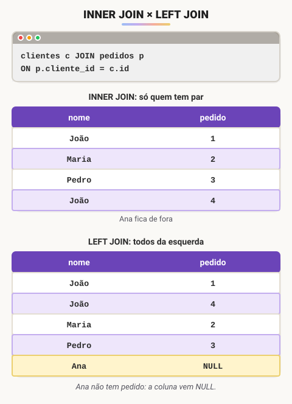
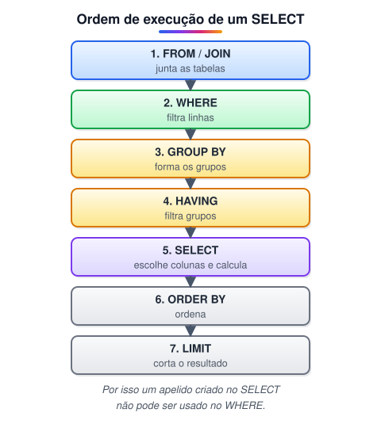

# Consultas SQL: SELECT, JOIN e agrupamentos (Adicionado pelo aluno para melhorar o estudo)

> 🗺️ **Nesta aula:** como escrever consultas com `SELECT`: filtros com `WHERE`, ordenação, `INNER JOIN` e `LEFT JOIN`, funções de agregação com `GROUP BY` e `HAVING`, e como alterar e apagar dados com segurança.

Os exemplos usam as tabelas `clientes`, `pedidos` e `itens_pedido` da aula **Primeiros passos com SQL**, com dois registros a mais: a cliente Ana, que ainda não fez pedidos, e um segundo pedido do João.

```sql
INSERT INTO clientes (id, nome, email, idade) VALUES
  (4, 'Ana', 'ana@email.com', 22);

INSERT INTO pedidos (id, cliente_id, data_pedido) VALUES
  (4, 1, '2023-04-10');

INSERT INTO itens_pedido VALUES
  (7, 4, 'Meia', 5);
```

## 1. Filtrando com WHERE

```sql
SELECT nome, idade
FROM clientes
WHERE idade >= 25 AND email IS NOT NULL;
-- João (30), Maria (25)
```

| Operador | Exemplo | Significa |
| --- | --- | --- |
| `=`, `<>`, `>`, `<=` | `idade > 30` | comparação |
| `AND`, `OR`, `NOT` | `idade > 20 AND idade < 30` | combinar condições |
| `BETWEEN` | `idade BETWEEN 25 AND 35` | intervalo, incluindo os extremos |
| `IN` | `produto IN ('Calça', 'Meia')` | um valor de uma lista |
| `LIKE` | `nome LIKE 'M%'` | padrão: `%` qualquer sequência, `_` um caractere |
| `IS NULL` | `email IS NULL` | campo vazio |

> ⚠️ Para testar campo vazio, use `IS NULL`. A comparação `email = NULL` nunca é verdadeira, porque `NULL` significa "valor desconhecido".

## 2. Ordenando e limitando

```sql
-- os 2 clientes mais velhos
SELECT nome, idade
FROM clientes
ORDER BY idade DESC
LIMIT 2;
-- Pedro (40), João (30)
```

`ASC` (padrão) ordena do menor para o maior e `DESC` do maior para o menor. Para listar valores sem repetição, use `SELECT DISTINCT produto FROM itens_pedido`.

## 3. Juntando tabelas: JOIN

Os dados ficam espalhados em várias tabelas, ligadas por chaves estrangeiras. O `JOIN` junta as linhas que combinam pela condição do `ON`.

```sql
SELECT c.nome, p.id AS pedido, p.data_pedido
FROM clientes c
INNER JOIN pedidos p ON p.cliente_id = c.id;
```

`c` e `p` são **apelidos** das tabelas, para escrever menos. O `AS` dá um apelido à coluna no resultado.



| Tipo | Traz |
| --- | --- |
| `INNER JOIN` | só as linhas que têm par nas duas tabelas |
| `LEFT JOIN` | todas as linhas da tabela da esquerda; sem par, as colunas da direita vêm `NULL` |
| `RIGHT JOIN` | o contrário do `LEFT JOIN` (pouco usado: basta inverter as tabelas) |

Um uso clássico do `LEFT JOIN` é achar quem **não** tem registro relacionado:

```sql
-- clientes sem nenhum pedido
SELECT c.nome
FROM clientes c
LEFT JOIN pedidos p ON p.cliente_id = c.id
WHERE p.id IS NULL;
-- Ana
```

## 4. Agrupando: GROUP BY e HAVING

As funções de agregação resumem várias linhas num valor só: `COUNT`, `SUM`, `AVG`, `MIN` e `MAX`.

```sql
SELECT COUNT(*), AVG(idade), MIN(idade), MAX(idade)
FROM clientes;
-- 4 | 29.25 | 22 | 40
```

Com `GROUP BY`, o resumo é feito por grupo:

```sql
-- quantos pedidos cada cliente fez
SELECT c.nome, COUNT(p.id) AS qtd_pedidos
FROM clientes c
LEFT JOIN pedidos p ON p.cliente_id = c.id
GROUP BY c.id, c.nome
ORDER BY qtd_pedidos DESC;
-- João 2, Maria 1, Pedro 1, Ana 0
```

`COUNT(p.id)` conta só os valores não nulos; por isso a Ana aparece com 0. Com `COUNT(*)` ela apareceria com 1, porque o `LEFT JOIN` gera uma linha para ela.

O `WHERE` filtra **linhas** antes de agrupar; o `HAVING` filtra **grupos** depois:

```sql
-- clientes que compraram mais de 3 peças no total
SELECT c.nome, SUM(i.quantidade) AS pecas
FROM clientes c
JOIN pedidos p ON p.cliente_id = c.id
JOIN itens_pedido i ON i.pedido_id = p.id
GROUP BY c.id, c.nome
HAVING SUM(i.quantidade) > 3;
-- João 8, Maria 5
```



## 5. Alterando e apagando dados

```sql
UPDATE clientes
SET email = 'pedro@email.com'
WHERE id = 3;

DELETE FROM itens_pedido
WHERE produto = 'Meia';
```

> ⚠️ `UPDATE` e `DELETE` sem `WHERE` afetam **todas** as linhas da tabela. Antes de rodar, teste a condição com um `SELECT` usando o mesmo `WHERE` e confira quais linhas seriam atingidas.

## 📌 Resumo

| Item | Em uma frase |
| --- | --- |
| `WHERE` | filtra linhas com comparações, `AND`/`OR`, `IN`, `BETWEEN`, `LIKE` e `IS NULL` |
| `ORDER BY` / `LIMIT` | ordena e corta o resultado |
| `INNER JOIN` | junta só as linhas que combinam |
| `LEFT JOIN` | mantém todas as linhas da esquerda, com `NULL` onde não há par |
| Agregação | `COUNT`, `SUM`, `AVG`, `MIN`, `MAX` |
| `GROUP BY` / `HAVING` | resume por grupo / filtra os grupos |
| `UPDATE` / `DELETE` | sempre com `WHERE`, testado antes com um `SELECT` |
