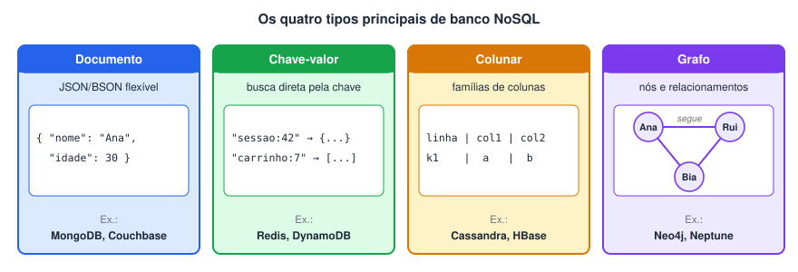
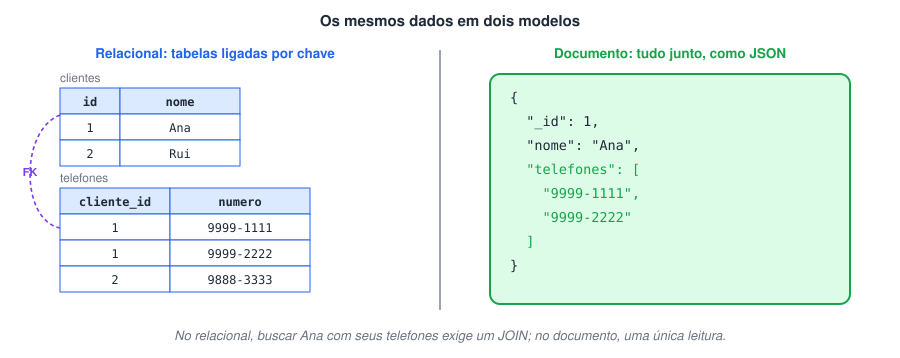
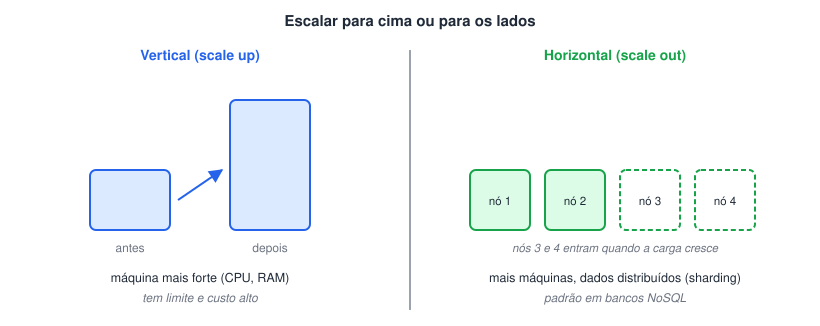
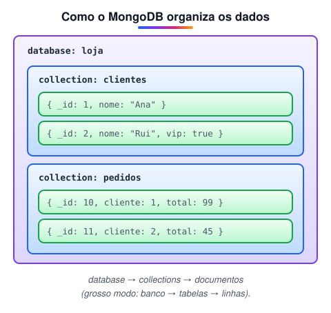
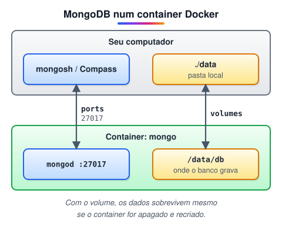
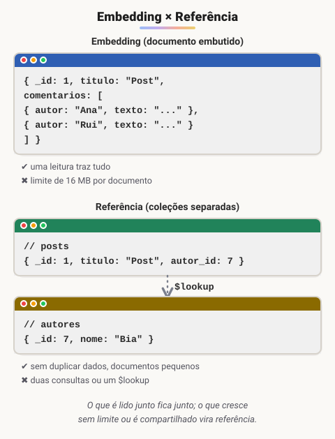
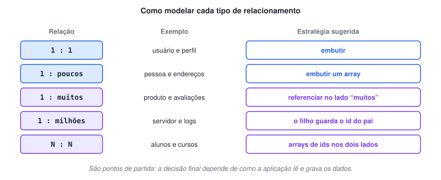
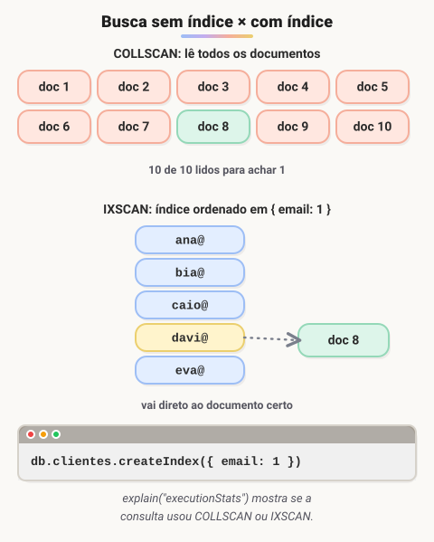
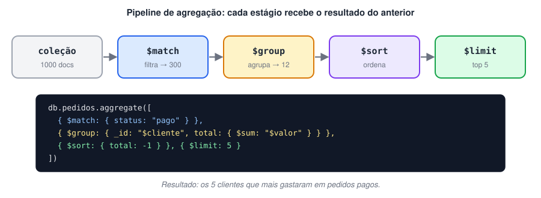

# Introdução ao MongoDB (Banco de dados NoSQL)

> 🗺️ **Nesta aula:** como o NoSQL surgiu e quando usar no lugar do SQL, os conceitos do MongoDB (bancos, coleções e documentos), modelagem, comandos de CRUD, índices e agregações.

## Introdução de NoSQL no mercado

### Como o NoSQL chegou ao mercado

**NoSQL** (*Not Only SQL*) é o nome dado a bancos de dados que **não seguem o modelo relacional** de tabelas. Eles surgiram para atender empresas que precisavam guardar e processar volumes enormes de dados, com escala e flexibilidade difíceis de alcançar nos bancos relacionais tradicionais.

- **Anos 2000:** gigantes como Google, Amazon e Yahoo! passaram a lidar com dados demais para um único servidor relacional. Criaram soluções próprias e publicaram artigos que inspiraram o mercado: o **Bigtable** do Google (2006) e o **Dynamo** da Amazon (2007).
- **2008:** o **Facebook** abre o código do **Cassandra**, banco distribuído projetado para escalar horizontalmente em grandes clusters. Ele passou a ser mantido pela Apache Software Foundation.
- **2009:** o termo **NoSQL** se populariza a partir de um encontro de desenvolvedores em São Francisco sobre bancos distribuídos e não relacionais. No mesmo ano é lançado o **MongoDB**.
- Depois vieram (ou ganharam força) **Redis**, **Couchbase**, **Neo4j** e o **Amazon DynamoDB** (2012), entre outros.

Hoje, bancos NoSQL estão em finanças, saúde, e-commerce, redes sociais, jogos e IoT — muitas vezes **ao lado** de um banco relacional, cada um resolvendo a parte do problema em que é melhor.

#### Tipos de banco NoSQL



### SQL x NoSQL

#### Estrutura dos dados

- **Relacional:** tabelas com linhas (registros) e colunas (campos); entidades relacionadas ficam em tabelas separadas, ligadas por chaves.
- **NoSQL:** sem estrutura única — os dados podem ser documentos, pares chave-valor, colunas ou grafos.



#### Esquema

- **Relacional:** esquema **rígido**, definido antes (tipos e restrições de cada coluna). Mudá-lo exige `ALTER TABLE`.
- **NoSQL:** esquema **flexível**; documentos da mesma coleção podem ter campos diferentes. (Ainda é possível adicionar validação quando necessário.)

#### Consulta

- **Relacional:** SQL, com JOINs e consultas complexas.
- **NoSQL:** cada banco tem sua linguagem ou API (a do MongoDB, por exemplo, usa JSON). Alguns oferecem dialetos parecidos com SQL, como a CQL do Cassandra.

#### Escalabilidade



- **Relacional:** tradicionalmente escala na **vertical** (máquina mais potente). Réplicas de leitura e sharding existem, mas dão mais trabalho.
- **NoSQL:** em geral foi projetado para escalar na **horizontal**, distribuindo os dados entre vários servidores.

#### Transações e consistência

- **Relacional:** transações **ACID** completas são o ponto forte.
- **NoSQL:** muitos priorizam disponibilidade e desempenho, com **consistência eventual**. Vários já oferecem transações (o MongoDB tem transações multidocumento desde a versão 4.0).

#### Quando usar cada um

| Use relacional quando… | Use NoSQL quando… |
| --- | --- |
| os dados têm estrutura previsível e muitos relacionamentos | os dados são semiestruturados ou mudam de formato com frequência |
| a integridade transacional é crítica (financeiro, estoque, pedidos) | o volume e o tráfego exigem escala horizontal |
| há consultas complexas, relatórios e JOINs | o acesso é simples e muito rápido por chave/documento (cache, sessões, catálogos, eventos) |

> 🛠️ **Ajustes:**
>
> - O texto atribuía a "Werner Vogels, engenheiro da Amazon" um artigo de 2009 sobre "escalabilidade evolutiva". Vogels é o **CTO** da Amazon, e o marco reconhecido é o artigo do **Dynamo (2007)**; troquei pela linha do tempo correta, incluindo o Bigtable e a origem do termo NoSQL.
> - "Bancos relacionais escalam verticalmente" e "NoSQL não suporta SQL" eram absolutos demais; acrescentei as nuances (réplicas/sharding, CQL) e uma seção sobre transações.
> - O resumo final virou uma tabela de "quando usar cada um", e as duas imagens foram refeitas como diagramas.

## MongoDB

### Conceitos iniciais

#### O que é o MongoDB?

O **MongoDB** é um banco de dados NoSQL **orientado a documentos**, desenvolvido pela MongoDB Inc. Em vez de tabelas e linhas, ele guarda **documentos** parecidos com JSON — internamente no formato binário **BSON**. Isso deixa os dados num formato muito próximo dos objetos do código, fáceis de ler e manipular.

Foi projetado para ser **flexível** (esquema dinâmico), **escalável** (sharding) e **altamente disponível** (réplicas) em ambientes distribuídos.



| MongoDB | Equivalente aproximado no relacional |
| --- | --- |
| database | banco de dados |
| collection | tabela |
| document | linha (registro) |
| field | coluna |
| `_id` | chave primária |
| documento embutido / `$lookup` | JOIN |

#### Como surgiu?

Foi criado em **2007** por **Dwight Merriman**, **Eliot Horowitz** e **Kevin Ryan** — ex-integrantes da DoubleClick, empresa de publicidade online que sofria para escalar bancos relacionais. A empresa se chamava **10gen** e o MongoDB nasceu como parte de uma plataforma de nuvem; o banco foi aberto ao público em **2009**. Em 2013 a 10gen passou a se chamar **MongoDB Inc.**

O nome vem de *humongous* ("gigantesco"), e o banco é escrito principalmente em **C++**.

#### Para que é usado?

- Aplicações web e mobile modernas, especialmente em nuvem, onde **escala horizontal** e **alta disponibilidade** são essenciais.
- Catálogos de produtos, gestão de conteúdo e perfis de usuário (dados com formatos variados).
- IoT, logs, eventos e análise de dados em tempo real.
- Serviço gerenciado na nuvem: **MongoDB Atlas** (AWS, Azure e Google Cloud).

> 🛠️ **Ajustes:**
>
> - O texto dizia que os criadores "começaram o protótipo em C++, mas logo mudaram para JavaScript". O MongoDB **é escrito em C++**; o JavaScript aparece apenas no shell e em algumas funções do servidor.
> - Acrescentei o terceiro fundador (Kevin Ryan), o nome original da empresa (10gen) e a tabela de equivalências com o modelo relacional.
> - "Código aberto": desde 2018 o MongoDB usa a licença **SSPL**, que tem o código disponível, mas não é considerada open source pela OSI. Removi a lista de empresas usuárias, que não tinha fonte.

### Como instalar

#### Instalando o MongoDB com Docker

Rodar o MongoDB num **container** evita instalar o banco direto no sistema: basta ter o Docker e subir a imagem oficial `mongo`.

**Documentação do Docker**

🔗 [Docker Docs: How to build, share, and run applications](https://docs.docker.com/)

**Imagens prontas (Docker Hub)**

🔗 [Docker Hub Container Image Library | App Containerization](https://hub.docker.com/)



##### 1. Arquivo `docker-compose.yml`

```yaml
services:
  db:
    image: mongo
    container_name: db
    restart: always
    environment:
      - MONGO_INITDB_ROOT_USERNAME=dio
      - MONGO_INITDB_ROOT_PASSWORD=troque-esta-senha
    ports:
      - "27017:27017"  # porta do computador : porta do container
    volumes:
      - ./data:/data/db  # pasta local : pasta onde o Mongo grava
```

##### 2. Subir o container

```bash
docker compose up -d
```

##### 3. Ver os containers em execução

```bash
docker ps
```

##### 4. Conectar ao servidor

O shell atual do MongoDB é o **mongosh**:

```bash
mongosh --host 127.0.0.1 --port 27017 -u dio -p --authenticationDatabase admin
```

Sem valor depois de `-p`, o mongosh pede a senha de forma oculta, sem deixá-la no histórico do terminal.

#### Interfaces gráficas

- **MongoDB Compass** — ferramenta oficial e gratuita: [mongodb.com/products/tools/compass](https://www.mongodb.com/products/tools/compass)
- **Studio 3T Free** — sucessor do antigo Robo 3T:

🔗 [Robo 3T | Free, open-source MongoDB GUI (formerly Robomongo)](https://robomongo.org/)

> 🛠️ **Ajustes:**
>
> - O comando de conexão tinha a porta **271017**; o correto é **27017**.
> - O comando `mongo` foi removido no MongoDB 6.0; o shell atual é o **mongosh**. Também faltava `--authenticationDatabase admin`, necessário para o usuário root criado pelas variáveis de ambiente.
> - O volume apontava para uma pasta da sua área de trabalho no Windows; troquei por `./data`, relativo ao projeto, que funciona em qualquer máquina.
> - A chave `version` do Compose está obsoleta e foi removida; `docker-compose` virou `docker compose`.
> - Troquei a senha "123" por um marcador, para lembrar de usar uma senha forte.
> - Os blocos estavam marcados como JavaScript; agora são YAML e Bash.
> - O **Robo 3T foi descontinuado**; a recomendação atual é o MongoDB Compass ou o Studio 3T Free.

### Schema design e boas práticas

No MongoDB, a principal decisão de modelagem é: **guardar os dados relacionados juntos (embedding) ou separados (referência)?** A resposta depende de **como a aplicação lê e grava** esses dados.



#### Embedding

**Embedding** é guardar os dados relacionados **dentro** do documento principal, como subdocumento ou array de subdocumentos.

Exemplo: num blog, os comentários de cada post podem ficar num array dentro do próprio post. Uma única consulta traz o post com todos os comentários.

**Prós**

- Uma única consulta traz tudo.
- Atualização atômica: o documento inteiro é alterado numa só operação.

**Contras**

- Cada documento tem **limite de 16 MB**.
- Se a mesma informação estiver embutida em vários documentos, cada mudança exige atualizar todos eles.

**Boas práticas**

1. **Embuta o que é lido junto.** Se os dados quase sempre aparecem com o documento pai, eles devem ficar nele.
2. **Evite arrays que crescem sem limite.** Comentários de um post viral, logs, histórico infinito: isso estoura o tamanho e piora o desempenho.
3. **Cuidado com dados duplicados.** Embutir algo que muda muito e aparece em vários lugares (ex.: o nome de um autor em todos os posts) torna as atualizações caras.
4. **Indexe os campos embutidos** que forem usados em filtros (ex.: `comentarios.autor`).

#### Referência

**Referência** é guardar os dados em coleções separadas, ligando-os pelo `_id`, como uma chave estrangeira.

Exemplo: os autores ficam numa coleção própria, e cada post guarda só o `autor_id`. Para montar a tela, a aplicação faz duas consultas ou usa o estágio de agregação `$lookup`.

**Prós**

- Documentos menores.
- Nada de informação duplicada: o autor é atualizado num único lugar.
- Bom para dados que não são necessários em todas as consultas.

**Contras**

- Duas ou mais consultas, ou um `$lookup` (que é mais custoso que ler um documento só).

**Boas práticas**

1. **Crie índices nos campos de referência** (ex.: `autor_id`) para os `$lookup` e buscas serem rápidos.
2. **Evite cadeias longas de referências.** Muitas "junções" seguidas indicam que o modelo está relacional demais.
3. **Use referência para dados compartilhados** entre muitos documentos ou que crescem sem limite.

#### Escolhendo pelo tipo de relacionamento



#### Boas práticas gerais

- **Evite documentos muito grandes:** quanto maior o documento, mais dados trafegam a cada leitura.
- **Use nomes de campos curtos e claros:** o nome de cada campo é gravado em todos os documentos.
- **Analise as consultas com** `explain()`**:** confira se estão usando índice.
- **Atualize só o que mudou:** use `$set` em vez de substituir o documento inteiro.
- **Evite negações nos filtros** (`$ne`, `$nin`, `$not`): elas costumam aproveitar mal os índices e podem forçar a leitura da coleção inteira.
- **Não deixe arrays crescerem sem limite** dentro dos documentos.

#### JSON x BSON

|  | JSON | BSON |
| --- | --- | --- |
| **O que é** | Formato de **texto** com pares chave-valor | Representação **binária** do JSON (*Binary JSON*) |
| **Legibilidade** | Legível por humanos | Não legível diretamente |
| **Uso típico** | Troca de dados entre sistemas (APIs, front-end) | Armazenamento e tráfego interno do MongoDB |
| **Tipos** | string, número, booleano, null, array, objeto | Todos os do JSON **+** `Date`, `ObjectId`, `Decimal128`, `Int32`/`Int64`, `BinData` (binários), `Timestamp` |
| **Desempenho** | Precisa ser interpretado (*parse*) como texto | Rápido de ler e percorrer: guarda tipos e tamanhos dos campos |

> 💡 O BSON **não é necessariamente menor** que o JSON: ele guarda informações extras (tipo e tamanho de cada campo). A vantagem dele está na **velocidade** de leitura e nos **tipos ricos**, como datas e decimais exatos.

> 🛠️ **Ajustes:**
>
> - `$lookup` foi descrito como "método"; ele é um **estágio do pipeline de agregação**.
> - "Evite negações (força o escaneamento completo da query)" virou "pode forçar a leitura da **coleção** inteira", que é o efeito real.
> - "Use nome campos e objetivos curtos" foi corrigido para "nomes de campos curtos", com o motivo.
> - O texto dizia que o BSON permite "melhor compactação"; na prática ele nem sempre é menor que o JSON — a vantagem é a velocidade e os tipos extras.
> - As três imagens de schema design foram substituídas por dois diagramas: embedding x referência e estratégia por tipo de relacionamento.

### Alguns comandos para manipulação de documentos com o MongoDB

#### Documentação oficial

🔗 [Query Documents](https://www.mongodb.com/docs/manual/tutorial/query-documents/)

Os comandos abaixo são executados no **mongosh** (o shell do MongoDB). Lembre da hierarquia: **database → collections → documentos**.

#### Databases e collections

```jsx
// listar os databases
show dbs

// selecionar (ou preparar) um database
use loja
// o database só é criado de fato quando a primeira collection/documento é gravado

// criar uma collection explicitamente, com opções (ex.: validação)
db.createCollection("clientes", {
  validator: { $jsonSchema: { required: ["nome"] } }
})

// listar as collections do database atual
show collections
```

#### Inserir

```jsx
// um documento (retorna o _id gerado)
db.clientes.insertOne({ nome: "Ana", idade: 30 })

// vários documentos
db.clientes.insertMany([
  { nome: "Rui", idade: 25 },
  { nome: "Bia", idade: 41, vip: true }
])
```

#### Consultar

```jsx
db.clientes.find({})  // todos
db.clientes.find({ idade: { $gt: 28 } })  // idade > 28
db.clientes.find({ vip: true }, { nome: 1, _id: 0 })  // só o campo nome
db.clientes.findOne({ nome: "Ana" })  // o primeiro que bater
```

#### Atualizar

```jsx
// alterar campos específicos de UM documento
db.clientes.updateOne(
  { nome: "Ana" },  // filtro: quem atualizar
  { $set: { idade: 31 } }  // o que mudar
)

// alterar VÁRIOS documentos
db.clientes.updateMany(
  { idade: { $gte: 40 } },
  { $set: { faixa: "40+" } }
)

// substituir o documento inteiro (mantém o _id)
db.clientes.replaceOne(
  { _id: ObjectId("...") },
  { nome: "Ana Souza", idade: 31 }
)

// "upsert": atualiza se existir, cria se não existir
db.clientes.updateOne(
  { nome: "Caio" },
  { $set: { idade: 22 } },
  { upsert: true }
)
```

#### Excluir

```jsx
db.clientes.deleteOne({ nome: "Rui" })  // o primeiro que bater
db.clientes.deleteMany({ idade: { $lt: 18 } })  // todos que baterem
```

> 🛠️ **Ajustes:**
>
> - `db.collection.save()` foi **removido** do mongosh; o equivalente é `replaceOne` (substituir) ou `updateOne` com `upsert: true` (criar se não existir).
> - `update()` está depreciado; use `updateOne` ou `updateMany`. O exemplo original também tinha a sintaxe quebrada (faltavam chaves em volta do `$set`).
> - O primeiro argumento de `updateMany` é um **filtro** (quais documentos alterar), e não "a chave que queremos mudar".
> - `use nome_do_database` não cria o banco na hora: ele só passa a existir quando algo é gravado nele.
> - Corrigidos "jason" (era JSON) e os blocos marcados como Bash, que agora estão como JavaScript. Acrescentei `insertMany`, filtros com operadores e `findOne`.

### Performance, índices e agregações

#### Por que usar índices

Sem índice, o MongoDB precisa ler **todos os documentos** da coleção para encontrar os que batem com o filtro (*COLLSCAN*). Com um índice — uma estrutura ordenada sobre um ou mais campos —, ele vai direto aos documentos certos (*IXSCAN*).



##### Tipos de índice

| Tipo | Exemplo | Para quê |
| --- | --- | --- |
| Simples | `{ email: 1 }` | Filtros e ordenação por um campo (1 = crescente, −1 = decrescente). |
| Composto | `{ cliente: 1, data: -1 }` | Filtros por vários campos; a ordem dos campos importa. |
| Único | `{ email: 1 }, { unique: true }` | Impede valores repetidos. |
| Texto | `{ descricao: "text" }` | Busca por palavras (`$text`). |
| Geoespacial | `{ local: "2dsphere" }` | Buscas por proximidade e área. |
| TTL | `{ criadoEm: 1 }, { expireAfterSeconds: 3600 }` | Apaga documentos automaticamente depois de um tempo. |

```jsx
db.clientes.createIndex({ email: 1 }, { unique: true })
db.pedidos.createIndex({ cliente: 1, data: -1 })
db.clientes.getIndexes()

// a consulta usou índice?
db.clientes.find({ email: "davi@email.com" }).explain("executionStats")
// procure "IXSCAN" (usou índice) ou "COLLSCAN" (leu tudo)
```

> ⚖️ Índices **aceleram leituras**, mas ocupam memória e deixam as **escritas** mais lentas (cada insert/update também atualiza o índice). Crie índices para as consultas que a aplicação realmente faz.

##### Medindo o desempenho

- **Vazão (*throughput*):** quantas operações o banco atende por segundo.
- **Latência:** quanto tempo cada operação leva.
- **Uso de recursos:** CPU, memória (o ideal é os índices caberem na RAM) e disco.

Ferramentas: `explain()`, o **Database Profiler**, `mongostat`/`mongotop` e os painéis do **MongoDB Atlas** e do **Compass**.

#### Agregações

##### Documentação

🔗 [https://www.mongodb.com/blog/post/building-with-patterns-a-summary](https://www.mongodb.com/blog/post/building-with-patterns-a-summary)

🔗 [https://www.mongodb.com/docs/manual/aggregation/](https://www.mongodb.com/docs/manual/aggregation/)

##### O que é

Uma **agregação** processa um conjunto de documentos e devolve resultados calculados: totais, médias, contagens, rankings, relatórios. Ela é montada como um **pipeline**: uma lista de **estágios** executados em sequência, em que cada estágio recebe o resultado do anterior.



##### Estágios mais usados

| Estágio | Faz o quê |
| --- | --- |
| `$match` | Filtra documentos (como o `WHERE`). Coloque-o cedo para aproveitar índices. |
| `$group` | Agrupa por um campo e calcula acumuladores (`$sum`, `$avg`, `$min`, `$max`, `$addToSet`…). |
| `$project` | Escolhe, renomeia ou calcula campos. |
| `$sort` | Ordena. |
| `$limit` / `$skip` | Limita / pula documentos (paginação). |
| `$count` | Conta os documentos que chegaram até ele. |
| `$lookup` | Junta documentos de outra coleção (como um `LEFT JOIN`). |
| `$unwind` | "Desmonta" um array, gerando um documento por elemento. |

##### Contar

```jsx
db.collection.aggregate([
  { $match: { status: "active" } },
  { $count: "total_active" }
])

// para uma contagem simples também existe:
db.collection.countDocuments({ status: "active" })
```

##### Valores distintos

```jsx
// forma direta: devolve um array com os valores únicos
db.collection.distinct("field_name", { status: "active" })

// com agregação: agrupar pelo campo já gera um resultado por valor distinto
db.collection.aggregate([
  { $match: { status: "active" } },
  { $group: { _id: "$field_name" } },
  { $project: { _id: 0, field_name: "$_id" } }
])

// ou todos os valores únicos num só documento
db.collection.aggregate([
  { $match: { status: "active" } },
  { $group: { _id: null, uniqueValues: { $addToSet: "$field_name" } } }
])
```

> 🛠️ **Ajustes:**
>
> - No exemplo de *distinct*, o `$group` agrupava por `field_name` e ainda fazia `$addToSet` do mesmo campo, o que gerava um array com **um único valor** em cada grupo. Separei em duas formas corretas: um documento por valor distinto, ou todos os valores num único documento (`_id: null`). Também acrescentei o método `distinct()`.
> - A seção de índices foi completada com os tipos, a criação (`createIndex`), a verificação com `explain()` e o custo dos índices nas escritas.
> - O título da página tinha uma marcação HTML perdida e o erro "agregaões"; foi corrigido.

## 📌 Resumo

| Item | Em uma frase |
| --- | --- |
| NoSQL | bancos não relacionais: documento, chave-valor, coluna e grafo |
| SQL × NoSQL | esquema fixo e relações × esquema flexível e escala horizontal |
| MongoDB | banco de documentos JSON (BSON) agrupados em coleções |
| Modelagem | embutir dados lidos juntos; referenciar quando crescem sem limite |
| CRUD | `insertOne`, `find`, `updateOne`, `deleteOne` |
| Índices | aceleram consultas nos campos filtrados com frequência |
| Agregação | pipeline de etapas (`$match`, `$group`, `$sort`) |
