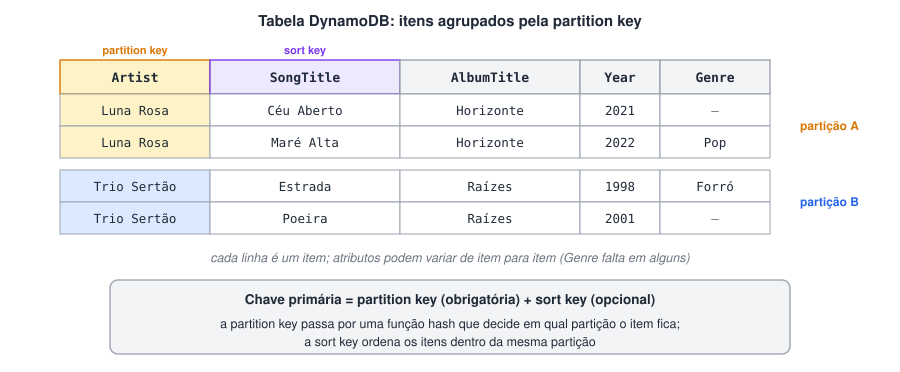
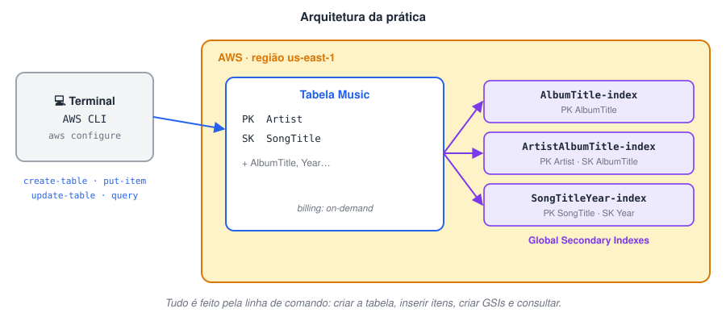

# Desafio: Boas práticas DynamoDB

> 🗺️ **Nesta aula:** os componentes, tipos de dados e modos de capacidade do Amazon DynamoDB e um projeto prático aplicando as boas práticas de modelagem.

## Introdução ao DynamoDB

O **Amazon DynamoDB** é um banco de dados NoSQL de **chave-valor e documentos**, **totalmente gerenciado** e **serverless**, oferecido pela AWS. Você não instala nem administra servidores: cria a tabela e o serviço cuida de escala, replicação, backup e manutenção.

#### Como surgiu

O DynamoDB foi lançado pela AWS em **2012**. Ele herdou os princípios do **Dynamo**, sistema interno que a Amazon criou para o carrinho de compras e descreveu num artigo famoso de **2007** — o mesmo artigo que inspirou bancos como o Apache Cassandra. A ideia era ter um banco distribuído, sempre disponível e tolerante a falhas, capaz de aguentar cargas enormes de leitura e escrita.

#### Vantagens

1. **Escalabilidade:** atende de poucas a milhões de requisições por segundo, absorvendo picos de tráfego.
2. **Alta disponibilidade:** os dados são replicados automaticamente em **três zonas de disponibilidade** da região. Com *Global Tables*, é possível replicar entre regiões.
3. **Desempenho:** latência de poucos milissegundos, seja qual for o tamanho da tabela.
4. **Sem servidor para administrar:** sem instalação, patches ou ajustes de hardware.
5. **Flexibilidade:** suporta tipos escalares, conjuntos e documentos (mapas e listas).
6. **Transações ACID:** desde 2018, `TransactWriteItems` e `TransactGetItems` permitem operações atômicas em vários itens.

#### Outros pontos importantes

1. **Modelo de dados:** chave-valor e documento. Cada tabela tem **exatamente uma** chave primária, que identifica cada item de forma única.
2. **API:** acesso por requisições HTTPS com JSON, pelos **SDKs** (Java, Python, JS…), pela **AWS CLI** ou pela **PartiQL**, uma sintaxe parecida com SQL.
3. **Custos:** paga-se por leitura/escrita (ou capacidade reservada) e por armazenamento; há um nível gratuito.
4. **Integração com a AWS:** Lambda (gatilhos via Streams), S3 (importação/exportação), Kinesis, IAM (permissões), CloudWatch (métricas).
5. **Limites:** cada item pode ter no máximo **400 KB**.

### Componentes

| Componente | O que é |
| --- | --- |
| **Tabela** | Conjunto de itens. Não tem esquema fixo além da chave primária. |
| **Item** | Um registro, identificado pela chave primária (equivale a uma linha). |
| **Atributo** | Um par nome/valor dentro do item (equivale a uma coluna, mas pode variar de item para item). |
| **Partição** | Unidade física de armazenamento. O DynamoDB divide e distribui as partições automaticamente. |
| **Streams** | Registro ordenado das alterações (inserções, atualizações, exclusões) para processar em tempo quase real ou replicar. |

#### Chaves e índices



- **Partition key (chave de partição):** o valor passa por uma **função hash** que decide em qual partição o item será gravado. Sozinha, forma uma **chave primária simples** — precisa ser única.
- **Partition key + Sort key (chave composta):** dois atributos. Vários itens podem ter a mesma partition key, desde que a sort key seja diferente; dentro da partição, eles ficam **ordenados** pela sort key, o que permite consultas por faixa (ex.: músicas de um artista entre 2000 e 2010).
- **Índices secundários:** permitem consultar por outros atributos além da chave primária.
  - **GSI (Global Secondary Index):** partition key e sort key **diferentes** das da tabela. Pode ser criado a qualquer momento.
  - **LSI (Local Secondary Index):** mesma partition key da tabela, com **outra sort key**. Só pode ser criado junto com a tabela.
- **Unidades de capacidade:** no modo provisionado, uma **RCU** permite 1 leitura fortemente consistente por segundo de até 4 KB (ou 2 eventualmente consistentes); uma **WCU** permite 1 escrita por segundo de até 1 KB.

### Tipos de dados

| Categoria | Tipos | Observações |
| --- | --- | --- |
| Escalares | **String (S)**, **Number (N)**, **Binary (B)**, **Boolean (BOOL)**, **Null (NULL)** | Number tem até 38 dígitos de precisão e é exato (não é ponto flutuante). |
| Documento | **Map (M)**, **List (L)** | Map: pares chave-valor aninhados. List: lista ordenada de valores de qualquer tipo. |
| Conjunto | **String Set (SS)**, **Number Set (NS)**, **Binary Set (BS)** | Valores únicos, sem ordem, todos do mesmo tipo. |

### Modos de capacidade

#### Sob demanda (*on-demand*)

Você paga **por requisição** de leitura e escrita, sem planejar capacidade. A tabela se ajusta sozinha ao tráfego.

- **Escala automática:** acompanha picos e quedas sem configuração.
- **Paga só pelo que usar:** ótimo para tráfego imprevisível, projetos novos e ambientes de teste.

#### Provisionado (*provisioned*)

Você define antecipadamente quantas **RCUs** e **WCUs** a tabela terá e paga por essa capacidade reservada.

- **Custo previsível e menor** para tráfego estável e conhecido.
- **Ajuste fino:** a capacidade pode ser alterada a qualquer momento, e o **Auto Scaling** pode aumentá-la ou reduzi-la dentro de limites que você define.
- Se o tráfego passar da capacidade, as requisições excedentes são **limitadas** (*throttling*).

> 🛠️ **Ajustes:**
>
> - O DynamoDB não foi "inspirado no Cassandra e no Bigtable": ele vem do **Dynamo** (artigo de 2007), que foi justamente uma das inspirações do Cassandra. Também não oferece "consultas mais complexas" que esses bancos — as consultas são feitas pela chave e pelos índices.
> - "Cada tabela pode ter uma ou mais chaves primárias" → cada tabela tem **exatamente uma**, simples ou composta. A chave composta tem **dois** atributos, não "dois ou mais".
> - **Number** não é ponto flutuante: é um número exato, com até 38 dígitos.
> - O LSI não "abrange uma única partição": ele usa a **mesma partition key** da tabela com outra sort key, e precisa ser criado junto com a tabela.
> - No modo sob demanda não existe "alterar o nível de capacidade"; isso é do modo **provisionado**, que também tem Auto Scaling.
> - A API não é RESTful (é HTTPS + JSON); a "replicação síncrona" foi detalhada como replicação em três zonas de disponibilidade. Acrescentei o limite de 400 KB por item e o funcionamento de RCUs e WCUs.
> - A lista de componentes estava duplicada (dois blocos "Principais componentes"); juntei tudo numa tabela.

## Mãos à obra

### Projeto

1. Criar uma tabela no DynamoDB usando a **AWS CLI**.
2. Inserir dados.
3. Criar **índices secundários globais (GSI)**.
4. Fazer consultas.

#### Arquitetura da prática



#### Comandos principais

**Exemplos de comandos da AWS CLI**

```bash
# 1. criar a tabela (Artist = partition key, SongTitle = sort key)
aws dynamodb create-table \
  --table-name Music \
  --attribute-definitions \
    AttributeName=Artist,AttributeType=S \
    AttributeName=SongTitle,AttributeType=S \
  --key-schema \
    AttributeName=Artist,KeyType=HASH \
    AttributeName=SongTitle,KeyType=RANGE \
  --billing-mode PAY_PER_REQUEST

# 2. inserir um item
aws dynamodb put-item \
  --table-name Music \
  --item '{"Artist": {"S": "Luna Rosa"}, "SongTitle": {"S": "Mare Alta"}, "AlbumTitle": {"S": "Horizonte"}, "Year": {"N": "2022"}}'

# 3. criar um GSI pelo título do álbum
aws dynamodb update-table \
  --table-name Music \
  --attribute-definitions AttributeName=AlbumTitle,AttributeType=S \
  --global-secondary-index-updates \
    '[{"Create": {"IndexName": "AlbumTitle-index", "KeySchema": [{"AttributeName": "AlbumTitle", "KeyType": "HASH"}], "Projection": {"ProjectionType": "ALL"}}}]'

# 4a. consultar pela chave primária
aws dynamodb query \
  --table-name Music \
  --key-condition-expression "Artist = :artist" \
  --expression-attribute-values '{":artist": {"S": "Luna Rosa"}}'

# 4b. consultar pelo GSI
aws dynamodb query \
  --table-name Music \
  --index-name AlbumTitle-index \
  --key-condition-expression "AlbumTitle = :album" \
  --expression-attribute-values '{":album": {"S": "Horizonte"}}'
```

Os comandos usam a quebra de linha do bash; no PowerShell, troque a barra invertida do fim da linha pelo acento grave.

#### Link do projeto original

#### Como criar a conta na AWS e configurar a CLI

🔗 [Como instalar e configurar o AWS-CLI](https://www.youtube.com/watch?v=hBRnWjz9YxM)

🔗 [Primeiros passos com AWS CLI! Como usar o aws cli ?](https://www.youtube.com/watch?v=nqazfZEj2G0)

> 💰 Ao terminar a prática, apague a tabela (`aws dynamodb delete-table --table-name Music`) para não gerar custos fora do nível gratuito.

#### Arquivos do meu projeto

## 📌 Resumo

| Item | Em uma frase |
| --- | --- |
| DynamoDB | banco NoSQL chave-valor e documento, gerenciado pela AWS |
| Tabela, item, atributo | equivalem a coleção, documento e campo |
| Chave primária | chave de partição, sozinha ou com chave de ordenação |
| Índices secundários | GSI e LSI permitem consultar por outros atributos |
| Capacidade | sob demanda (paga por requisição) ou provisionada (unidades de leitura e escrita) |
| Boa prática | modele a tabela a partir das consultas que a aplicação vai fazer |
