# Principais protocolos de comunicação da internet

> 💡 **Nesta aula:** como a web funciona por baixo: o protocolo **HTTP** e suas versões, a segurança com **HTTPS/TLS**, a comunicação em tempo real com **WebSocket** e os conceitos de rede que sustentam tudo isso.

## Como funciona o protocolo HTTP

### O que é o HTTP?

**HTTP** (*Hypertext Transfer Protocol*) é o protocolo da camada de aplicação usado para trocar dados na web. Ele define como um **cliente** (navegador, app, outro sistema) faz pedidos e como um **servidor** responde.

É usado em praticamente toda interação web: carregar uma página, enviar um formulário, baixar um arquivo e, principalmente, na comunicação entre sistemas por **APIs**.

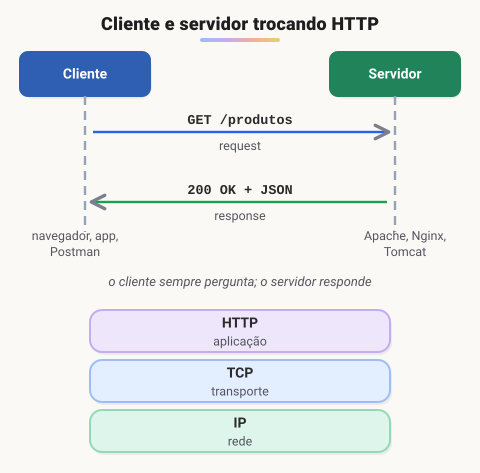

#### Papel do cliente e do servidor

- **Cliente:** inicia a comunicação com uma **requisição** (*request*): método (GET, POST…), recurso desejado (ex.: `/produtos`), cabeçalhos e, se for o caso, um corpo com dados.
- **Servidor:** recebe, processa e devolve uma **resposta** (*response*): código de status (200 OK, 404 Not Found…), cabeçalhos (tipo de conteúdo, data…) e, opcionalmente, um corpo com os dados.

> 💡 O HTTP é **sem estado** (*stateless*): cada requisição é independente, e o servidor não "lembra" da anterior. Para manter uma sessão (como o login), usam-se cookies ou tokens.

### Versões e especificações

| Versão | Especificação | Destaques |
| --- | --- | --- |
| HTTP/1.0 | RFC 1945 (maio de 1996) | Métodos **GET, POST e HEAD**; códigos de status e cabeçalhos. Uma conexão TCP por requisição. |
| HTTP/1.1 | RFC 2068 (jan. 1997), depois RFC 2616 (1999) | **Conexões persistentes** por padrão, cabeçalho `Host` obrigatório (vários sites no mesmo IP), *chunked transfer*, cache mais completo e os métodos **PUT, DELETE, OPTIONS, TRACE e CONNECT** como padrão. |
| HTTP/2 | RFC 7540 (2015), atualizada pela RFC 9113 (2022) | Formato binário, multiplexação e compressão de cabeçalhos. |
| HTTP/3 | RFC 9114 (2022) | Roda sobre **QUIC** (baseado em UDP). |

Hoje a semântica do HTTP (métodos, status, cabeçalhos) está reunida na **RFC 9110** (2022), válida para todas as versões.

### Protocolos de transporte

O HTTP precisa de um protocolo de transporte por baixo. Até o HTTP/2 é o **TCP**; o HTTP/3 usa **QUIC**, que roda sobre **UDP**.

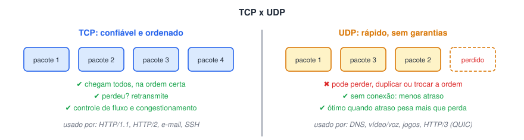

#### TCP (*Transmission Control Protocol*)

- **Confiável:** retransmite pacotes perdidos ou corrompidos.
- **Orientado a conexão:** estabelece a conexão antes de enviar dados (*three-way handshake*).
- **Ordenado e sem duplicatas:** entrega os dados na ordem em que foram enviados.
- **Controle de fluxo:** não envia mais do que o destinatário consegue processar.
- **Controle de congestionamento:** reduz a velocidade quando percebe a rede congestionada.

#### UDP (*User Datagram Protocol*)

- **Sem garantia de entrega:** pacotes perdidos não são retransmitidos.
- **Sem conexão:** envia direto, sem handshake; os pacotes podem chegar fora de ordem ou duplicados.
- **Sem controle de fluxo ou congestionamento** — quem precisar disso implementa por cima (como faz o QUIC).
- Ideal quando **atraso** é pior que **perda**: voz, vídeo ao vivo, jogos, DNS.

### Three-way handshake

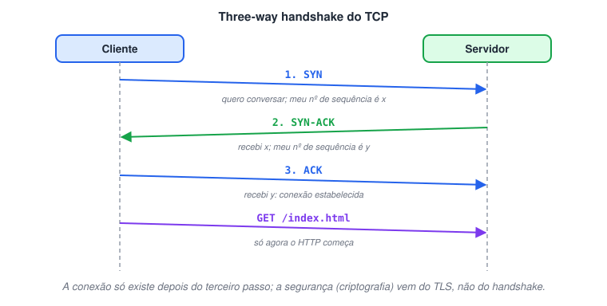

1. **SYN:** o cliente pede para abrir a conexão e informa seu número de sequência inicial.
2. **SYN-ACK:** o servidor confirma o recebimento (ACK) e envia o próprio número de sequência (SYN).
3. **ACK:** o cliente confirma o número do servidor. A conexão está **estabelecida**.

O objetivo é que os dois lados **sincronizem os números de sequência**, base para o TCP detectar perdas, duplicatas e reordenar os dados. Só depois disso a requisição HTTP é enviada.

### Principais métodos HTTP

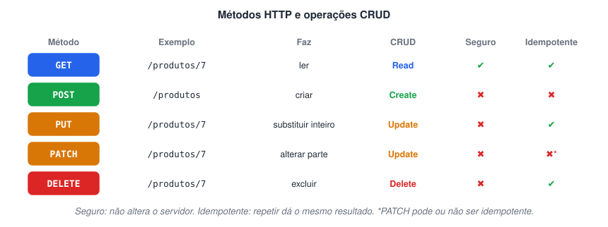

1. **GET:** busca um recurso. Não deve alterar nada no servidor.
2. **POST:** envia dados para o servidor processar — normalmente para **criar** um recurso.
3. **PUT:** **substitui** um recurso inteiro pelo conteúdo enviado (ou o cria naquele endereço, se não existir).
4. **PATCH:** aplica uma alteração **parcial** em um recurso.
5. **DELETE:** remove um recurso.

Outros métodos: **HEAD** (como GET, mas só os cabeçalhos), **OPTIONS** (quais métodos são aceitos; usado no CORS), **CONNECT** (abre um túnel, ex.: via proxy) e **TRACE** (diagnóstico).

### Corpo da mensagem (*body*)

O **corpo** é a parte da mensagem que carrega os dados em si, além dos metadados (linha inicial e cabeçalhos).

- **Na requisição:** dados enviados pelo cliente, como os campos de um formulário ou um JSON num POST/PUT/PATCH. Requisições GET normalmente não têm corpo.
- **Na resposta:** o conteúdo devolvido — HTML, JSON, uma imagem, um arquivo.
- O formato é informado pelo cabeçalho `Content-Type` (ex.: `application/json`, `text/html`, `image/png`) e o tamanho, por `Content-Length`.

### Head-of-line blocking (HOL)

**HOL blocking** é quando o primeiro item de uma fila trava todos os que vêm atrás dele.

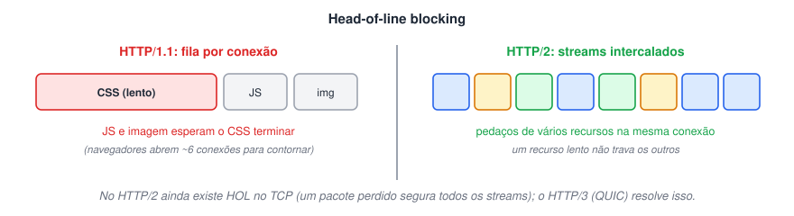

- **No HTTP/1.1:** numa mesma conexão, as respostas saem na ordem dos pedidos. Se a primeira for lenta, as outras esperam. Por isso os navegadores abrem várias conexões paralelas (cerca de 6 por domínio).
- **No HTTP/2:** a **multiplexação** divide as respostas em quadros (*frames*) intercalados numa única conexão — o HOL na camada HTTP desaparece.
- **No TCP:** como ele entrega tudo em ordem, um pacote perdido segura todos os dados seguintes da conexão, inclusive de outros streams do HTTP/2. O **HTTP/3**, sobre QUIC, resolve isso tratando cada stream de forma independente.

> 🛠️ **Ajustes:**
>
> - A especificação do HTTP/1.1 é a **RFC 2068** (janeiro de 1997), depois substituída pela **RFC 2616** (1999). A "RFC 2116" citada não trata de HTTP.
> - A RFC 1945 (HTTP/1.0) padronizou **GET, POST e HEAD**; PUT e DELETE só aparecem num apêndice, como extensões. E os códigos 201 Created e 204 No Content **já existiam** no HTTP/1.0 — não foram novidade do 1.1.
> - O TCP não é usado "por causa do handshake triplo", e sim por ser **confiável e ordenado**. O handshake sincroniza números de sequência; ele não traz segurança (isso é papel do TLS).
> - No passo 2, o SYN-ACK ainda **não** estabelece a conexão: ela só existe depois do ACK final.
> - O PUT **substitui** o recurso inteiro; o PATCH altera só uma parte.
> - O HOL blocking foi reexplicado: ele acontece **dentro de uma mesma conexão**, e não "em múltiplas conexões simultâneas". Incluí como HTTP/2 e HTTP/3 o resolvem.
> - As cinco imagens foram substituídas por diagramas.

## Mensagens HTTP (Request e response)

### Requisição (request)

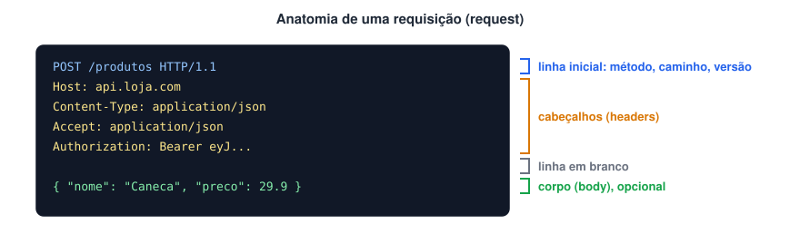

1. **Linha inicial:** traz o **método** (GET, POST, PUT, DELETE…), o **caminho** do recurso (ex.: `/produtos?pagina=2`) e a **versão** do protocolo (`HTTP/1.1`).
2. **Cabeçalhos (*headers*):** pares `Nome: valor` com informações extras. Exemplos: `Host` (domínio do servidor, obrigatório no HTTP/1.1), `Accept` (formatos que o cliente aceita), `Content-Type` (formato do corpo), `Authorization` (credenciais), `User-Agent` (navegador/cliente).
3. **Linha em branco:** marca o fim dos cabeçalhos.
4. **Corpo (*body*), opcional:** os dados enviados — por exemplo, o JSON de um POST ou os campos de um formulário.

> 📌 **URI x URL:** a URI identifica um recurso; a URL é a URI que também diz **onde** encontrá-lo (`https://api.loja.com/produtos/7`). Na linha inicial vai normalmente só o **caminho** (`/produtos/7`); o domínio vai no cabeçalho `Host`.

### Resposta (response)

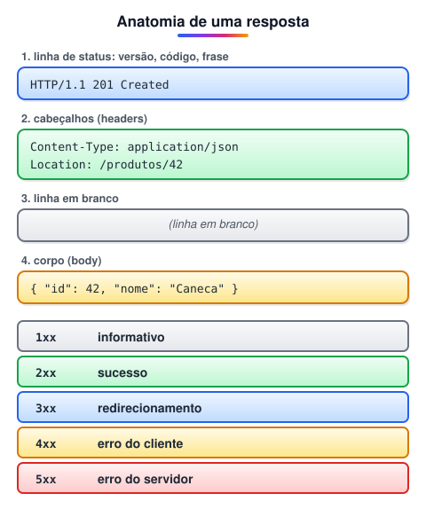

1. **Linha de status:** **versão** do protocolo, **código de status** (três dígitos) e a **frase** correspondente — ex.: `HTTP/1.1 404 Not Found`.
2. **Cabeçalhos:** informações sobre a resposta, como `Content-Type`, `Content-Length`, `Cache-Control`, `Set-Cookie`, `Location`.
3. **Linha em branco.**
4. **Corpo:** o conteúdo devolvido — HTML, JSON, imagem, arquivo…

| Faixa | Significado | Exemplos |
| --- | --- | --- |
| **1xx** | Informativo | `101 Switching Protocols` (usado pelo WebSocket) |
| **2xx** | Sucesso | `200 OK`, `201 Created`, `204 No Content` |
| **3xx** | Redirecionamento | `301 Moved Permanently`, `304 Not Modified` |
| **4xx** | Erro do cliente | `400 Bad Request`, `401 Unauthorized`, `403 Forbidden`, `404 Not Found` |
| **5xx** | Erro do servidor | `500 Internal Server Error`, `502 Bad Gateway`, `503 Service Unavailable` |

#### Referência divertida de status HTTP

🔗 [https://http.cat/](https://http.cat/)

### Texto ou binário?

No **HTTP/1.x**, a linha inicial e os cabeçalhos são **texto** (ASCII), o que facilita ler e depurar as mensagens. O **corpo** pode ser qualquer coisa: texto, JSON ou dados binários, como imagens. Já o **HTTP/2** e o **HTTP/3** enviam tudo em **quadros binários**, mais eficientes — a estrutura lógica (método, cabeçalhos, corpo) continua a mesma.

### Classificação dos métodos

#### Seguros (*safe*)

Não alteram o estado do servidor; servem só para leitura.

- **GET:** busca um recurso.
- **HEAD:** igual ao GET, mas devolve só os cabeçalhos.
- **OPTIONS:** informa os métodos e opções aceitos (usado no *preflight* do CORS).
- **TRACE:** devolve a própria requisição, para diagnóstico.

#### Não seguros (*unsafe*)

Podem alterar dados no servidor.

- **POST:** envia dados para processamento, geralmente para criar recursos.
- **PUT:** substitui um recurso inteiro.
- **PATCH:** altera parte de um recurso.
- **DELETE:** remove um recurso.

#### Idempotentes

Repetir a mesma requisição várias vezes tem o **mesmo efeito** que fazê-la uma vez: **GET, HEAD, OPTIONS, TRACE, PUT e DELETE**. **POST** não é idempotente (cada envio pode criar um novo registro), e o **PATCH** depende da implementação. Isso importa, por exemplo, para decidir se é seguro **repetir** uma requisição que falhou por timeout.

> 🛠️ **Ajustes:**
>
> - O texto dizia que requisições e respostas HTTP "são escritas em ASCII". Isso vale para a linha inicial e os cabeçalhos do **HTTP/1.x**; o corpo pode ser binário, e o HTTP/2 e o HTTP/3 são **binários**.
> - A linha de status começa pela **versão**, seguida do código e da frase; a ordem foi ajustada.
> - **TRACE** também é um método seguro e foi incluído. Acrescentei o conceito de **idempotência**, a tabela de famílias de status e a diferença entre URI e URL.
> - As duas imagens foram substituídas por diagramas anotados.

## Pra que serve cookies e cache

### O que são cookies?

**Cookies** são pequenos pedaços de dados (até cerca de **4 KB** cada) que o **navegador guarda** a pedido de um site e devolve automaticamente nas próximas requisições para aquele site. Eles existem porque o HTTP é **sem estado**: sem cookies (ou tokens), o servidor não saberia que duas requisições vêm da mesma pessoa.

Normalmente o servidor cria o cookie pelo cabeçalho `Set-Cookie` da resposta; o navegador o envia de volta no cabeçalho `Cookie`. Também é possível criá-los via JavaScript.

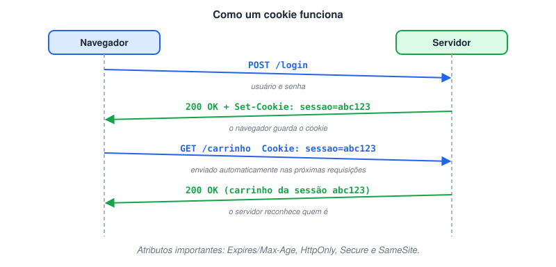

#### Para que servem

1. **Sessão e autenticação:** guardar um **identificador de sessão** que mantém o usuário logado. (A senha nunca deve ficar em cookie.)
2. **Preferências:** idioma, tema, itens no carrinho.
3. **Rastreamento e análise:** usados por ferramentas de métricas e anunciantes — por isso as leis de privacidade (LGPD, GDPR) exigem consentimento para cookies não essenciais.

#### Atributos importantes

| Atributo | Para que serve |
| --- | --- |
| `Expires` / `Max-Age` | Até quando o cookie vale. Sem eles, é um *cookie de sessão*, apagado ao fechar o navegador. |
| `Domain` / `Path` | Para quais endereços o cookie é enviado. |
| `Secure` | Só é enviado por **HTTPS**. |
| `HttpOnly` | Não pode ser lido por JavaScript — protege contra roubo via XSS. |
| `SameSite` | Controla o envio em requisições vindas de outros sites — protege contra CSRF. |

### O que é cache?

**Cache** é guardar **cópias temporárias** de dados para não precisar buscá-los de novo. Na web, isso reduz o tempo de carregamento, o tráfego e a carga no servidor.

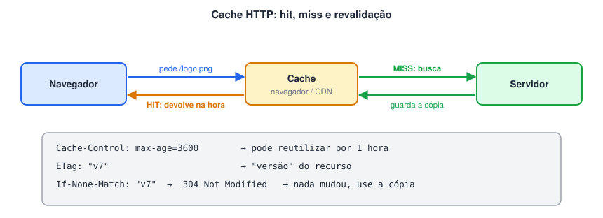

#### Tipos de cache

- **Cache do navegador:** imagens, CSS, scripts e outras respostas ficam no seu computador.
- **Cache em proxies e CDNs:** servidores intermediários, próximos do usuário, guardam cópias compartilhadas.
- **Cache no servidor/aplicação:** resultados de consultas ou páginas prontas em memória (ex.: Redis), para não recalcular.

#### Cabeçalhos que controlam o cache

- `Cache-Control`: a regra principal — `max-age=3600` (válido por 1 hora), `no-cache` (sempre revalidar antes de usar), `no-store` (nunca guardar), `private`/`public`.
- `ETag` e `Last-Modified`: identificam a versão do recurso. Com elas, o navegador pode perguntar "mudou?" (`If-None-Match` / `If-Modified-Since`); se não mudou, o servidor responde `304 Not Modified` sem corpo.

### Servidor proxy

Um **proxy** é um servidor **intermediário** entre o cliente e o servidor de destino: recebe a requisição, a encaminha e devolve a resposta.

Usos comuns:

1. **Desempenho:** guardar em cache respostas frequentes.
2. **Controle de acesso:** liberar ou bloquear sites conforme a política da empresa.
3. **Privacidade:** o servidor de destino vê o IP do proxy, não o do cliente.
4. **Segurança:** filtrar conteúdo malicioso e registrar acessos.

Existem dois sentidos: o **proxy de encaminhamento** (*forward*) representa os **clientes** (ex.: o proxy da rede da empresa) e o **proxy reverso** representa os **servidores** (ex.: Nginx na frente da aplicação). Veja mais em *Outros conceitos importantes*.

> 🛠️ **Ajustes:**
>
> - Cookies não guardam "dados de login": guardam um **identificador de sessão** (ou token). Expliquei como eles são criados (`Set-Cookie`) e enviados (`Cookie`) e acrescentei os atributos de segurança `Secure`, `HttpOnly` e `SameSite`.
> - Na parte de cache, acrescentei os cabeçalhos que de fato controlam o mecanismo (`Cache-Control`, `ETag`, `304 Not Modified`).
> - O proxy ganhou a diferença entre **forward** e **reverso**.
> - As duas imagens foram substituídas por diagramas do fluxo de cookies e de cache.

## HTTP/2: atualização do protocolo

### HTTP/2: o que mudou

O **HTTP/2** foi publicado em **2015** (RFC 7540, hoje RFC 9113), a partir do protocolo experimental **SPDY**, do Google. Ele **não muda o significado** das mensagens — métodos, códigos de status e cabeçalhos continuam os mesmos —, mas muda **como os bytes trafegam**, para carregar páginas mais rápido.

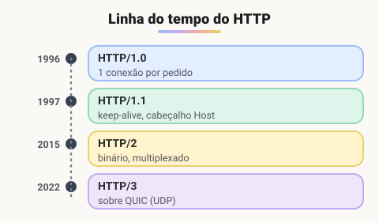

#### Camada de enquadramento binário

No HTTP/1.1 as mensagens são texto. No HTTP/2 elas são divididas em **quadros binários** (*frames*): um `HEADERS` com os cabeçalhos e um ou mais `DATA` com o corpo. Binário é mais compacto e mais rápido de interpretar.

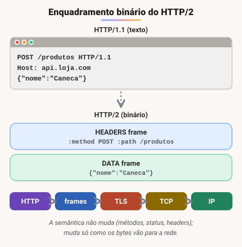

#### Multiplexação

No HTTP/1.1 a conexão pode ser **reaproveitada** (*keep-alive*), mas as respostas saem **uma de cada vez**, em fila. Para baixar vários arquivos em paralelo, o navegador abre várias conexões (cerca de 6 por domínio).

No HTTP/2, uma **única conexão** carrega vários **streams** ao mesmo tempo, com os quadros de recursos diferentes **intercalados**. Isso elimina o *head-of-line blocking* da camada HTTP e economiza conexões.

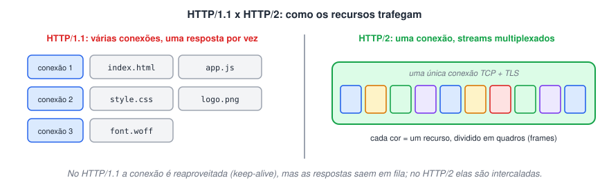

#### Compressão de cabeçalhos (HPACK)

Cabeçalhos se repetem muito entre requisições (`User-Agent`, `Cookie`, `Accept`…). O **HPACK** comprime esses dados e mantém uma tabela dos valores já enviados, mandando só o que mudou. Economiza banda, principalmente em conexões móveis.

#### Priorização de streams

O cliente pode indicar quais recursos são mais importantes (por exemplo, o CSS antes das imagens). O esquema original de prioridades do HTTP/2 foi pouco implementado e acabou **depreciado** na RFC 9113; hoje existe um modelo mais simples (RFC 9218), usado também no HTTP/3.

#### TLS e negociação

- A especificação permite HTTP/2 **sem** criptografia (`h2c`), mas na prática os **navegadores só usam HTTP/2 sobre TLS** (`h2`).
- A versão do protocolo é negociada **durante o handshake TLS**, pela extensão **ALPN**: o cliente informa que fala `h2` e `http/1.1`, e o servidor escolhe. Assim não é preciso uma ida e volta extra.
- A ordem continua a mesma: primeiro a conexão **TCP**, depois o handshake **TLS** (com ALPN), e só então os quadros HTTP/2.

#### Server push

O servidor podia enviar recursos **antes** de serem pedidos (ex.: mandar o CSS junto com o HTML). Na prática trouxe pouco ganho e muitas vezes enviava arquivos que o navegador já tinha em cache. O **Chrome removeu o suporte em 2022** e o recurso é considerado obsoleto; a alternativa atual é a resposta `103 Early Hints`, que só **avisa** o navegador do que ele vai precisar.

### E o HTTP/3?

O **HTTP/3** (RFC 9114, 2022) mantém as ideias do HTTP/2, mas roda sobre o **QUIC**, um transporte construído em cima do **UDP**. Cada stream é independente, então um pacote perdido não trava os outros (o HOL do TCP desaparece), e a conexão já nasce com TLS 1.3, abrindo mais rápido.

> 🛠️ **Ajustes:**
>
> - O texto dizia que no HTTP/1.1 "cada solicitação exigia uma nova conexão". Isso era o HTTP/1.0; o 1.1 já reaproveita conexões (keep-alive) — o problema dele é a **fila** de respostas.
> - O HTTP/2 **não exige** TLS pela especificação; quem exige são os navegadores.
> - O **HPACK** é a compressão de cabeçalhos, e não "uma lista de recursos para o push". E o handshake do HTTP/2 não é separado do TCP: a negociação acontece dentro do handshake **TLS**, via **ALPN**.
> - **Server push** e o esquema original de **priorização** foram descontinuados na prática; atualizei com as alternativas (`103 Early Hints`, RFC 9218).
> - As quatro imagens foram substituídas por três diagramas: linha do tempo, quadros binários e multiplexação.

## Servidores/Sistema de aplicação

Um **servidor web** recebe requisições HTTP e devolve respostas: arquivos estáticos (HTML, CSS, imagens) ou o resultado de uma aplicação (PHP, Java, Python…). Os dois mais usados no mundo são o **Apache** e o **Nginx**, que trabalham de formas bem diferentes.

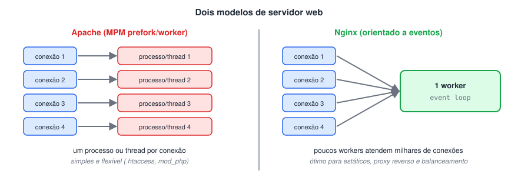

### Apache HTTP Server

#### História

O **Apache HTTP Server** surgiu em **1995**, criado por um grupo de desenvolvedores — o *Apache Group*, do qual Brian Behlendorf fazia parte — a partir do código do servidor **NCSA HTTPd**, que havia parado de ser mantido. Em **1999** o grupo formou a **Apache Software Foundation**, que mantém o projeto até hoje.

Sobre o nome: a fundação explica que ele foi uma homenagem à **nação indígena Apache**. A história de que viria de "*a patchy server*" (um servidor "cheio de remendos", já que começou como um conjunto de patches) é uma brincadeira que ficou popular, mas não é a origem oficial.

Desde 1996 o Apache foi por muitos anos o servidor web mais usado da internet; em **2009** passou a marca de **100 milhões de sites**.

#### Principais características

1. **Código aberto:** gratuito, sob a licença Apache 2.0.
2. **Multiplataforma:** Linux, Windows, macOS, BSDs e outros.
3. **Modular:** recursos ligados/desligados por módulos (`mod_ssl`, `mod_rewrite`, `mod_proxy`, `mod_http2`…).
4. **Configuração flexível:** inclusive por diretório, com arquivos `.htaccess` — muito usado em hospedagens compartilhadas.
5. **Segurança:** suporte a TLS, autenticação e controle de acesso.
6. **HTTP/2:** suportado via `mod_http2`.
7. **Linguagens:** executa PHP, Perl e Python por módulos ou encaminhando para outros processos (FastCGI).

### XAMPP

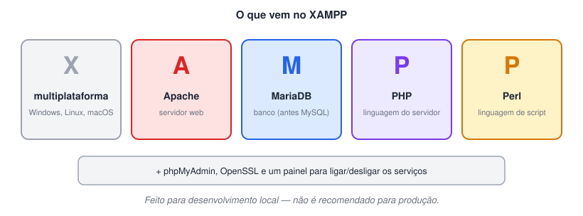

O **XAMPP** é um pacote gratuito que instala de uma só vez um ambiente completo de desenvolvimento web: **Apache**, **MariaDB** (no lugar do MySQL desde 2015), **PHP** e **Perl**, além de **phpMyAdmin** e **OpenSSL**. Foi criado pelo projeto **Apache Friends** em **2002**.

#### Principais características

1. **Instalação fácil:** um instalador e um painel de controle para iniciar/parar cada serviço.
2. **Multiplataforma:** Windows, Linux e macOS.
3. **Configuração ajustável:** portas, `php.ini`, `httpd.conf` e credenciais do banco.
4. **phpMyAdmin incluso:** administração do banco pelo navegador.
5. **Ambiente local completo:** servidor web, banco e linguagem prontos para testar aplicações como WordPress, Joomla e Drupal.

> ⚠️ O XAMPP vem configurado para **desenvolvimento**: senhas padrão vazias e recursos abertos. Não deve ser usado como servidor de produção.

### Nginx

#### História

O **Nginx** (pronuncia-se "engine-x") foi criado pelo engenheiro russo **Igor Sysoev** e lançado publicamente em **2004**. O objetivo era resolver o **problema C10k**: atender **10 mil conexões simultâneas** num único servidor, algo difícil para o modelo de um processo/thread por conexão. Em 2019 a empresa Nginx Inc. foi comprada pela **F5**. Hoje ele divide com o Apache (e, em alguns levantamentos, supera) o posto de servidor web mais usado.

#### Principais características

1. **Alto desempenho:** arquitetura **orientada a eventos e assíncrona** — poucos processos *worker* atendem milhares de conexões com pouca memória.
2. **Excelente para conteúdo estático:** HTML, CSS, JS e imagens servidos diretamente e muito rápido.
3. **Proxy reverso:** fica na frente de aplicações (Spring Boot, Node.js, PHP-FPM…), cuidando de TLS, compressão e cache.
4. **Balanceamento de carga:** distribui as requisições entre vários servidores de aplicação.
5. **Vários protocolos:** HTTP/1.1, HTTP/2, HTTP/3, WebSocket, além de proxy TCP/UDP e de e-mail (SMTP, POP3, IMAP).
6. **Modular e configurável:** um arquivo de configuração claro (`nginx.conf`) com blocos `server` e `location`.

|  | Apache | Nginx |
| --- | --- | --- |
| Modelo | processo/thread por conexão (MPM) | eventos, assíncrono |
| Ponto forte | flexibilidade, `.htaccess`, módulos | conexões simultâneas, estáticos, proxy reverso |
| Configuração por diretório | sim (`.htaccess`) | não (tudo centralizado) |

> 🛠️ **Ajustes:**
>
> - A origem do nome "Apache" como trocadilho com *patch* é uma lenda; a explicação oficial é a homenagem ao povo Apache. Também separei o **Apache Group** (1995) da **Apache Software Foundation**, que só foi criada em 1999.
> - O XAMPP **não tem controle de versão integrado** — esse item foi removido. E o "M" hoje é o **MariaDB**, não mais o MySQL; faltava também o **Perl** (o último "P").
> - O Nginx não foi criado para resolver "problemas do Apache" especificamente, e sim o **problema C10k** de muitas conexões simultâneas.
> - As três imagens foram substituídas por dois diagramas (modelos de servidor e componentes do XAMPP), e acrescentei uma tabela comparando Apache e Nginx.

## Conceitos básicos de segurança da informação

### Criptografia

**Criptografia** transforma uma informação legível em algo ilegível (cifrar) usando um algoritmo e uma **chave**, de modo que só quem tem a chave certa consegue reverter (decifrar). Ela sustenta três garantias:

- **Confidencialidade:** só o destinatário consegue ler.
- **Integridade:** dá para perceber se os dados foram alterados no caminho.
- **Autenticidade:** dá para confirmar quem enviou (com assinaturas e certificados).

Toda criptografia moderna usa chaves; o que muda é **quantas** chaves e **como** são usadas.

#### Criptografia simétrica

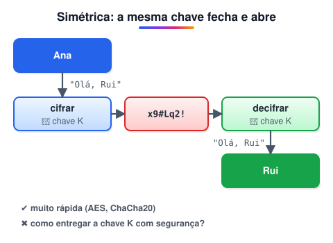

Uma **única chave** é usada para cifrar e para decifrar, e por isso precisa ser compartilhada entre remetente e destinatário.

- **Rápida e eficiente**, ideal para grandes volumes de dados.
- **Desafio:** como combinar a chave com segurança se o canal ainda não é seguro?
- Algoritmos atuais: **AES** e **ChaCha20**. O **DES** (chave de 56 bits) foi quebrado nos anos 1990 e o **3DES** está depreciado — ambos não devem mais ser usados.

#### Criptografia assimétrica (chave pública)

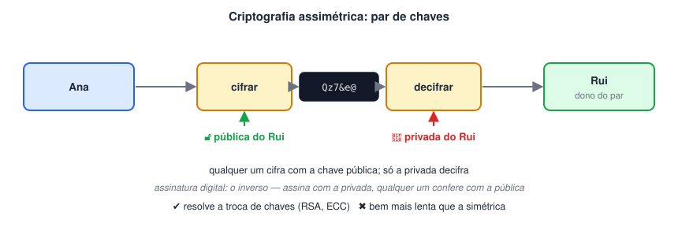

Usa um **par de chaves** matematicamente ligadas: uma **pública**, que pode ser distribuída a qualquer um, e uma **privada**, que fica só com o dono.

- **Para sigilo:** cifra-se com a **pública** do destinatário; só a **privada** dele decifra.
- **Para assinatura digital:** o autor assina com a sua **privada**; qualquer um confere a assinatura com a **pública**. Isso prova autoria e integridade.
- **Resolve o problema da troca de chaves**, mas é **bem mais lenta** que a simétrica.
- Algoritmos: **RSA** e criptografia de curvas elípticas (**ECC**, como ECDSA e ECDHE).

> 💡 **Na prática as duas trabalham juntas.** No HTTPS, a criptografia assimétrica é usada no início para autenticar o servidor e combinar uma chave; depois, todos os dados trafegam com criptografia **simétrica**, que é muito mais rápida.

### Certificado digital

Um **certificado digital** é um documento eletrônico que **associa uma chave pública a uma identidade** — um site, uma empresa ou uma pessoa. Ele contém, entre outros dados, o nome (ex.: `loja.com.br`), a **chave pública**, o período de validade e a **assinatura digital da Autoridade Certificadora** que o emitiu. O padrão mais usado é o **X.509**.

- Serve para **provar a identidade** de quem está do outro lado (ex.: que você está mesmo falando com o seu banco).
- É a peça que torna possível o **HTTPS**, além de assinatura de documentos, e-mails e código.

#### Autoridades certificadoras (AC)

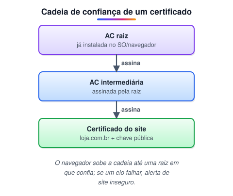

As **ACs** (*Certificate Authorities*) são organizações que **verificam a identidade** de quem pede um certificado e o **assinam**. Navegadores e sistemas operacionais já vêm com uma lista de **ACs raiz** confiáveis; um certificado é aceito quando é possível montar uma **cadeia de assinaturas** até uma dessas raízes.

- **Níveis de validação:** DV (só o domínio), OV (organização) e EV (validação estendida).
- **Exemplos de ACs:** DigiCert, Sectigo, GlobalSign e **Let's Encrypt** (gratuita e automatizada, hoje uma das maiores do mundo).
- **ICP-Brasil:** a infraestrutura de chaves públicas oficial do Brasil, com a AC raiz mantida pelo **ITI**. É ela que dá validade jurídica aos certificados e-CPF e e-CNPJ.
- **CA/Browser Forum:** **não** é uma AC; é o consórcio de ACs e fabricantes de navegadores que define as regras que todas devem seguir.

> 🛠️ **Ajustes:**
>
> - "Criptografia por chave, também conhecida como simétrica" estava errado: **toda** criptografia moderna usa chave. Reorganizei em simétrica e assimétrica, sem repetir o mesmo texto duas vezes.
> - A assimétrica não é "mais segura" que a simétrica: ela resolve outro problema (troca de chaves e assinatura) e é mais lenta. Na prática, as duas são combinadas.
> - **DES** e **3DES** foram mantidos como exemplo histórico, com o aviso de que não devem mais ser usados.
> - O certificado não "garante a integridade da comunicação" sozinho: ele **liga uma chave pública a uma identidade**; a integridade vem do protocolo (TLS).
> - Na lista de ACs, o **CA/Browser Forum** não é uma AC, e a **VeriSign** vendeu esse negócio em 2010 (hoje faz parte da DigiCert). Detalhei o que é a ICP-Brasil.
> - As duas imagens foram substituídas por três diagramas.

## Protocolo SSL (Secure socket layer) e TLS (Transport Layer Security)

### SSL e TLS: o que são

**SSL** (*Secure Sockets Layer*) e seu sucessor **TLS** (*Transport Layer Security*) são protocolos que criam um **canal seguro** entre cliente e servidor, rodando entre a aplicação (HTTP, SMTP, IMAP…) e o transporte (TCP). Eles garantem:

- **Confidencialidade:** os dados viajam criptografados.
- **Integridade:** qualquer alteração no caminho é detectada.
- **Autenticidade:** o certificado prova que o servidor é quem diz ser.

**HTTPS** é simplesmente **HTTP sobre TLS** (porta padrão 443). O mesmo vale para SMTPS, IMAPS, POP3S, FTPS, WSS e outros.

### História: de SSL a TLS

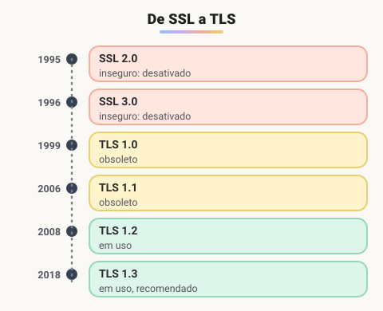

- O **SSL** foi criado pela **Netscape** em **1994**. A versão 1.0 nunca foi lançada; a **2.0** saiu em 1995 e a **3.0** em 1996, ambas com falhas graves (a 3.0 caiu de vez com o ataque POODLE, em 2014).
- Em **1999** a IETF padronizou o protocolo com um novo nome: **TLS 1.0**. Vieram depois o **TLS 1.1** (2006), o **1.2** (2008) e o **1.3** (2018).
- Hoje só o **TLS 1.2** e o **TLS 1.3** devem ser usados; o 1.0 e o 1.1 foram oficialmente depreciados em 2021 (RFC 8996).

> 📌 Por hábito, ainda se fala em "certificado SSL", mas o protocolo em uso é sempre o **TLS**.

### Como a conexão segura é estabelecida

O TLS combina os dois tipos de criptografia: **assimétrica** no início, para autenticar o servidor e combinar uma chave, e **simétrica** depois, para os dados, porque é muito mais rápida.

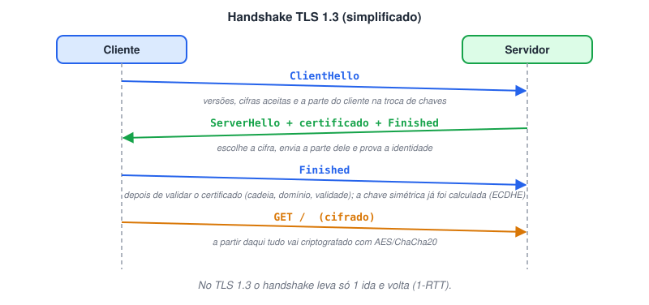

1. **ClientHello:** o cliente informa as versões e os algoritmos que aceita e já envia sua parte da **troca de chaves** (Diffie-Hellman, normalmente ECDHE).
2. **ServerHello + certificado:** o servidor escolhe a versão e o algoritmo, envia a parte dele da troca de chaves e o **certificado digital**, assinado com sua chave privada para provar que é o dono.
3. **Verificação:** o cliente confere o certificado — se a cadeia chega a uma AC confiável, se o domínio bate e se está dentro da validade.
4. **Chave de sessão:** com as duas partes do Diffie-Hellman, cliente e servidor calculam **a mesma chave simétrica**, sem que ela trafegue pela rede.
5. **Dados cifrados:** a partir daí, toda a comunicação usa criptografia simétrica (AES-GCM ou ChaCha20-Poly1305), que protege sigilo e integridade.

#### O que mudou no TLS 1.3

- Handshake mais rápido: **1 ida e volta** (1-RTT), ou zero na retomada de sessão (0-RTT).
- Removeu algoritmos antigos e inseguros (RSA para troca de chaves, RC4, SHA-1, MD5…).
- Exige **sigilo futuro** (*forward secrecy*): mesmo que a chave privada do servidor vaze um dia, as conversas antigas continuam protegidas.

> 🛠️ **Ajustes:**
>
> - As seções de SSL e de TLS repetiam praticamente o mesmo texto e os mesmos 5 passos; juntei tudo numa explicação só.
> - Acrescentei a linha do tempo das versões e o fato de que **todo SSL e o TLS 1.0/1.1 estão desativados** — só TLS 1.2 e 1.3 são aceitos hoje.
> - O passo "negociar uma chave simétrica" foi detalhado: no TLS moderno a chave é **calculada pelos dois lados** (Diffie-Hellman), sem ser enviada pela rede.
> - As duas imagens foram substituídas pela linha do tempo e pelo diagrama do handshake.

## Introdução

### O que é WebSocket?

**WebSocket** é um protocolo de comunicação **bidirecional e em tempo real** entre cliente e servidor, sobre uma **única conexão TCP que fica aberta**. Depois de conectados, **os dois lados podem enviar mensagens a qualquer momento**, sem que o cliente precise fazer uma nova requisição.

Ele resolve uma limitação do HTTP tradicional: lá, é sempre o **cliente** que pergunta e o servidor que responde. Para receber novidades, o cliente precisaria ficar perguntando de tempos em tempos (*polling*).

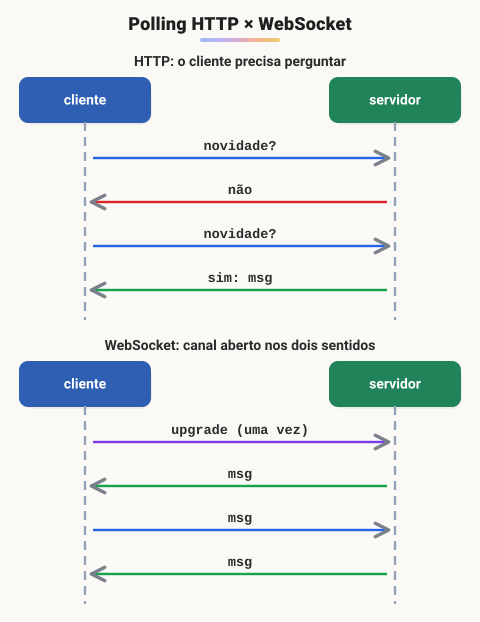

#### Quando foi criado?

O protocolo foi padronizado pela **IETF** em **2011**, na **RFC 6455**, e a API usada no navegador (`new WebSocket(...)`) é padronizada pelo WHATWG/W3C. Ele **não é uma extensão do HTTP**: só **usa o HTTP para abrir** a conexão e, depois disso, fala o seu próprio protocolo.

#### Como funciona?

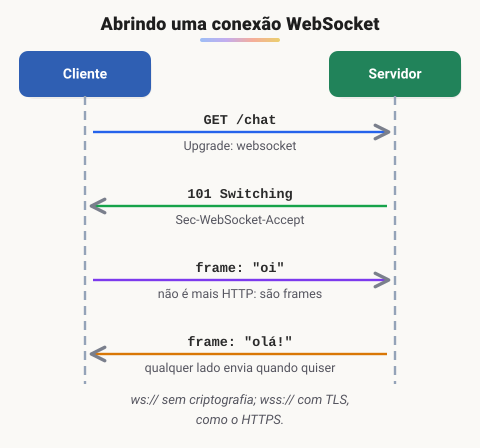

1. **Handshake (abertura):** o cliente envia uma requisição HTTP normal com os cabeçalhos `Upgrade: websocket` e `Connection: Upgrade`, mais uma chave aleatória em `Sec-WebSocket-Key`.
2. **Aceite:** o servidor responde `101 Switching Protocols` com o cabeçalho `Sec-WebSocket-Accept`, um valor calculado a partir da chave do cliente. Isso confirma que ele realmente entende WebSocket.
3. **Troca de mensagens:** a partir daí a conexão TCP continua aberta e os dados circulam em **frames** (texto ou binário) nos dois sentidos.
4. **Encerramento:** qualquer lado envia um frame de fechamento (*close*). Frames de *ping/pong* mantêm a conexão viva.

Os endereços usam `ws://` (sem criptografia) ou `wss://` (com TLS, equivalente ao HTTPS) — em produção, use sempre `wss://`.

```jsx
// no navegador
const socket = new WebSocket("wss://exemplo.com/chat");

socket.onopen    = () => socket.send("oi!");
socket.onmessage = (evento) => console.log("recebido:", evento.data);
socket.onclose   = () => console.log("conexão encerrada");
```

#### Vantagens

- **Bidirecional em tempo real:** o servidor envia assim que algo acontece.
- **Baixa latência:** sem o custo de abrir uma requisição e repetir cabeçalhos a cada mensagem.
- **Eficiência:** menos tráfego e menos trabalho para o servidor do que fazer polling.

#### Limitações e cuidados

- **Conexões abertas consomem recursos:** cada cliente mantém uma conexão; escalar exige servidores preparados (e, com vários servidores, um mecanismo para distribuir mensagens entre eles, como Redis Pub/Sub).
- **Infraestrutura:** proxies, balanceadores e firewalls precisam permitir conexões longas e o `Upgrade`.
- **Segurança:**
  - use `wss://`;
  - **valide o cabeçalho** `Origin` no handshake, para evitar o *Cross-Site WebSocket Hijacking*;
  - autentique a conexão (token/cookie) e trate as mensagens recebidas como entrada não confiável.
- **Reconexão:** se a rede cair, a aplicação precisa reconectar sozinha.

#### Exemplos de uso

- **Chats** e notificações em tempo real.
- **Jogos online** multiplayer.
- **Painéis de monitoramento**, cotações da bolsa, placares ao vivo.
- **Edição colaborativa** de documentos.

### HTTP x WebSocket

|  | HTTP | WebSocket |
| --- | --- | --- |
| **Comunicação** | Requisição → resposta; sempre iniciada pelo cliente | Bidirecional; qualquer lado envia a qualquer momento |
| **Conexão** | Cada troca é uma requisição (a conexão pode ser reaproveitada, mas o modelo é pergunta/resposta) | Uma conexão persistente, aberta uma vez |
| **Overhead** | Cabeçalhos completos em cada requisição | Frames pequenos depois do handshake |
| **Latência para receber novidades** | Depende de polling ou de técnicas como SSE | Imediata |
| **Segurança** | HTTPS (TLS) | WSS (TLS) |
| **Uso típico** | Páginas, APIs REST, downloads | Chat, jogos, tempo real |

> 💡 Se só o **servidor** precisa enviar atualizações (ex.: um feed de notícias), o **Server-Sent Events (SSE)** pode ser uma alternativa mais simples, sobre HTTP comum.

> 🛠️ **Ajustes:**
>
> - O HTTP foi descrito como "unidirecional, do servidor para o cliente". Na verdade ele é **requisição/resposta, iniciado pelo cliente** — e os dados vão nos dois sentidos (o cliente também envia, por exemplo, num POST).
> - O WebSocket não é uma extensão do HTTP: usa o HTTP **só no handshake**. E o servidor não "gera uma chave própria": o `Sec-WebSocket-Accept` é **derivado da chave do cliente**.
> - "Suporte limitado em navegadores antigos" está desatualizado: todos os navegadores suportam WebSocket há mais de uma década.
> - O risco de segurança típico não é XSS, e sim o **Cross-Site WebSocket Hijacking** (validar o `Origin`).
> - O texto dizia que o WebSocket tem "criptografia de ponta a ponta" e o HTTP não. Os dois usam **TLS** da mesma forma (`https://` e `wss://`), e nenhum é ponta a ponta por si só.
> - A latência do HTTP "de alguns segundos" era exagerada; o problema é ter de **perguntar** para receber novidades.
> - A imagem foi substituída por dois diagramas, e incluí um exemplo de código.

## Outros conceitos importantes

### Proxy

Um **proxy** é um servidor **intermediário**: recebe a requisição de um lado e a repassa para o outro, agindo em nome de alguém. Pode trazer segurança, desempenho e controle de acesso.

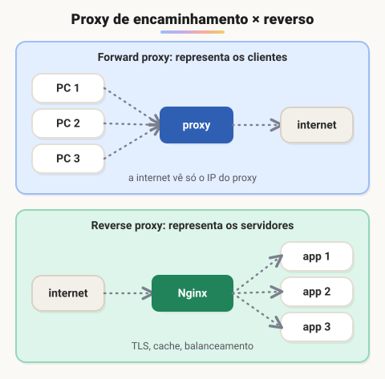

#### Tipos de proxy

- **Proxy de encaminhamento (*forward*):** fica do lado dos **clientes**, como o proxy da rede de uma empresa. Filtra sites, registra acessos e esconde o IP de quem está dentro da rede.
- **Proxy reverso:** fica na frente dos **servidores**. O cliente acha que está falando com o site, mas quem responde é o proxy, que repassa para uma das aplicações. Cuida de TLS, cache, compressão e balanceamento. Ex.: Nginx, HAProxy, Cloudflare.
- **Proxy de cache:** guarda respostas repetidas para entregá-las sem consultar o servidor de origem.
- **Proxy HTTP:** termo genérico para proxies que entendem HTTP/HTTPS (para HTTPS, normalmente via método `CONNECT`, abrindo um túnel).

### DNS

O **DNS** (*Domain Name System*) é a "agenda" da internet: traduz nomes fáceis de lembrar, como `www.exemplo.com`, para **endereços IP**, que é o que a rede usa de fato.

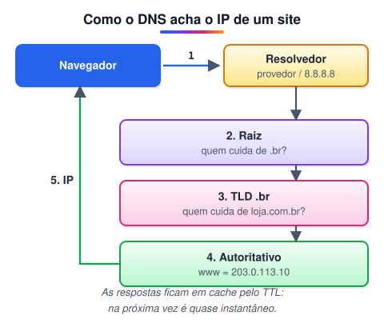

#### Como funciona

1. O navegador pergunta ao **resolvedor DNS** (do provedor, da empresa ou público, como 8.8.8.8 e 1.1.1.1).
2. Se não tiver a resposta em cache, o resolvedor consulta os **servidores raiz**, que indicam quem cuida do domínio de topo (`.br`).
3. O servidor do **TLD** indica quem é o **servidor autoritativo** do domínio (`loja.com.br`).
4. O **autoritativo** responde com o IP. O resolvedor guarda a resposta em **cache** pelo tempo do **TTL** e a devolve ao navegador.

Alguns tipos de registro: **A** (IPv4), **AAAA** (IPv6), **CNAME** (apelido para outro nome), **MX** (servidor de e-mail), **TXT** (verificações, SPF).

### Socket

Um **socket** é o **ponto final** de uma comunicação entre dois processos, na mesma máquina ou em máquinas diferentes. Ele é identificado por **endereço IP + porta + protocolo** (TCP ou UDP), e uma conexão TCP é identificada pelo par de sockets dos dois lados.

#### Tipos de socket

- **TCP (*stream*):** orientado a conexão e confiável — os dados chegam completos e na ordem. É o que HTTP e WebSocket usam.
- **UDP (*datagram*):** sem conexão e sem garantias de entrega ou ordem, mas com menos atraso. Usado em DNS, jogos e streaming.

Em Java, por exemplo, as classes `Socket`/`ServerSocket` trabalham com TCP e `DatagramSocket` com UDP.

### Load balancer

Um **balanceador de carga** distribui as requisições entre vários servidores. Assim nenhum fica sobrecarregado e, se um cair, os outros continuam atendendo — mais **disponibilidade** e **escalabilidade**.

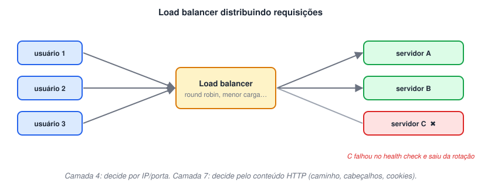

#### Tipos

- **Por hardware:** equipamento dedicado, de alto desempenho, mas caro e menos flexível.
- **Por software:** roda em servidores comuns ou VMs (Nginx, HAProxy, Envoy) — mais flexível e barato.
- **Gerenciado na nuvem:** AWS ELB/ALB, Azure Load Balancer, Google Cloud Load Balancing.
- **Por DNS:** o mesmo nome devolve IPs diferentes; simples, mas reage devagar a falhas por causa do cache.
- **Camada 4 x camada 7:** o de **camada 4** decide só por IP e porta (rápido); o de **camada 7** olha o conteúdo HTTP — caminho, cabeçalhos, cookies — e pode, por exemplo, mandar `/api` para um grupo de servidores e `/imagens` para outro.

Algoritmos comuns: **round robin** (um de cada vez), **menos conexões** e **hash do IP** (o mesmo cliente vai sempre para o mesmo servidor).

### Outros conceitos

#### Firewall

Controla o tráfego de rede **permitindo ou bloqueando** conexões conforme regras (endereço, porta, protocolo e, nos mais modernos, a própria aplicação). Separa a rede interna da externa e também segmenta redes internas.

#### CDN (*Content Delivery Network*)

Rede de servidores espalhados pelo mundo que guardam **cópias** de conteúdo (imagens, vídeos, scripts, páginas) **perto dos usuários**. Reduz a latência e a carga no servidor de origem. Ex.: Cloudflare, Akamai, Amazon CloudFront.

#### API (*Application Programming Interface*)

Um **contrato** que define como um software pode usar as funcionalidades de outro: quais operações existem, que dados enviar e o que esperar de volta. Na web, as mais comuns são APIs **REST** sobre HTTP, trocando JSON.

#### Microsserviços

Arquitetura que divide uma aplicação em **serviços pequenos e independentes**, cada um responsável por uma parte do negócio, com deploy próprio e, em geral, seu próprio banco de dados. Facilita escalar e evoluir partes isoladas, mas aumenta a complexidade de comunicação e monitoramento.

#### Contêineres

Pacotes que reúnem a aplicação **e suas dependências** e rodam isolados, compartilhando o kernel do sistema operacional — mais leves que máquinas virtuais. Garantem que o software rode igual em qualquer ambiente. Ex.: Docker; orquestrados em larga escala com Kubernetes.

### Modelos de camadas

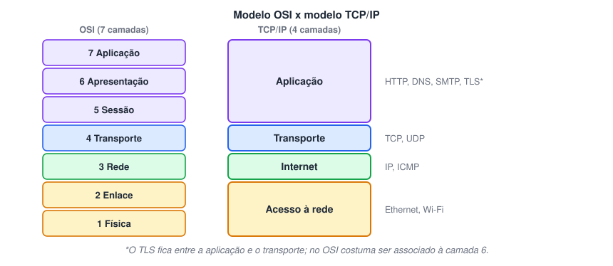

#### Modelo TCP/IP

- É o modelo que **a internet realmente usa**, com quatro camadas:
  1. **Aplicação** — HTTP, DNS, SMTP, FTP.
  2. **Transporte** — TCP, UDP.
  3. **Internet** — IP, ICMP (endereçamento e roteamento).
  4. **Acesso à rede** — Ethernet, Wi-Fi (envio físico pelo meio).
- Cada camada usa os serviços da camada de baixo e oferece serviços à de cima.

#### Modelo OSI

- Modelo de referência da **ISO**, com **sete camadas**: física, enlace, rede, transporte, sessão, apresentação e aplicação.
- Na prática é usado mais como **vocabulário e ferramenta de ensino** — por exemplo, "balanceador de camada 7" ou "switch de camada 2" — do que como implementação.
- Separa em mais detalhes as funções que o TCP/IP agrupa (sessão e apresentação ficam dentro da "aplicação" no TCP/IP).

#### Encapsulamento

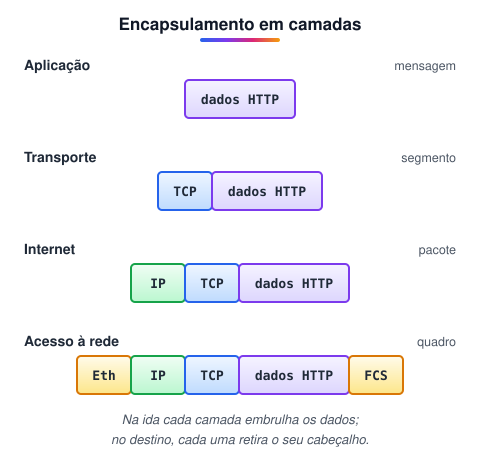

Ao enviar, cada camada **acrescenta seu cabeçalho** aos dados que recebeu da camada de cima; ao receber, cada camada **retira** o seu. Por isso os dados mudam de nome no caminho: **mensagem** (aplicação), **segmento** (transporte), **pacote** (internet) e **quadro** (acesso à rede).

> 🛠️ **Ajustes:**
>
> - O proxy ganhou a diferença entre **forward** e **reverso**, que antes estava pouco clara.
> - No DNS, detalhei o caminho completo da consulta (resolvedor → raiz → TLD → autoritativo) e o papel do cache/TTL.
> - O socket não é identificado só por "IP e porta": inclui também o **protocolo**, e uma conexão é o **par** de sockets dos dois lados.
> - No load balancer, acrescentei a diferença entre **camada 4 e camada 7** e os algoritmos mais comuns.
> - Na camada "de rede" do TCP/IP, o nome usual é **Internet**; e o OSI foi descrito como modelo de referência, mais usado como vocabulário do que implementado.
> - As três imagens (TCP/IP, OSI e comparação) foram substituídas por cinco diagramas: proxy, DNS, load balancer, OSI x TCP/IP e encapsulamento.

## 📌 Resumo

| Item | Em uma frase |
| --- | --- |
| HTTP | protocolo de pedido e resposta entre cliente e servidor, sem estado |
| Métodos | `GET` lê, `POST` cria, `PUT`/`PATCH` alteram, `DELETE` remove |
| Status | 2xx sucesso, 3xx redirecionamento, 4xx erro do cliente, 5xx erro do servidor |
| Cookies e cache | guardam estado no navegador / evitam baixar de novo o que não mudou |
| HTTP/2 e HTTP/3 | multiplexação numa só conexão; o HTTP/3 roda sobre QUIC (UDP) |
| HTTPS | HTTP protegido por TLS: criptografia e certificado digital |
| Servidores | Apache, Nginx e servidores de aplicação recebem as requisições |
