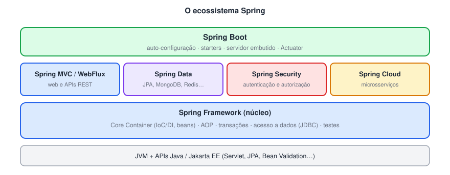
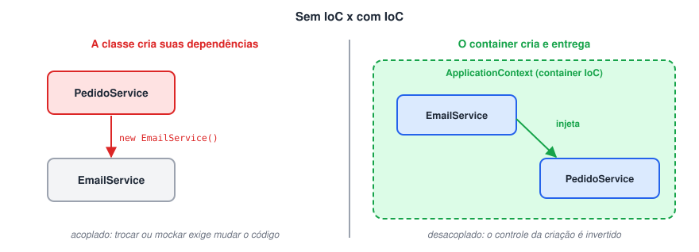
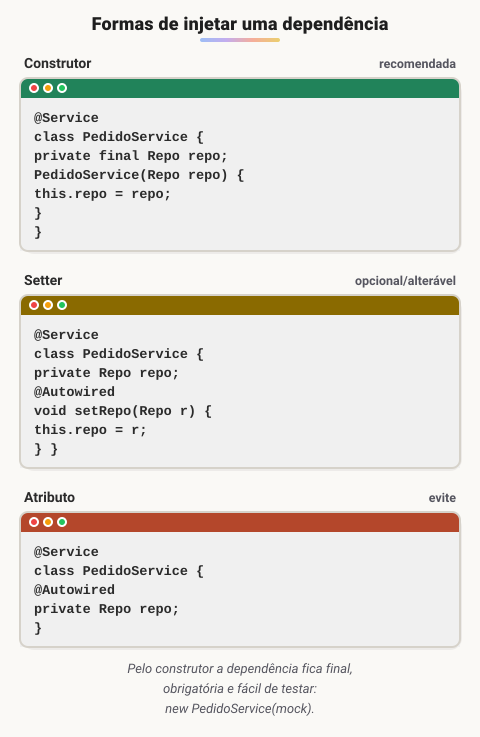
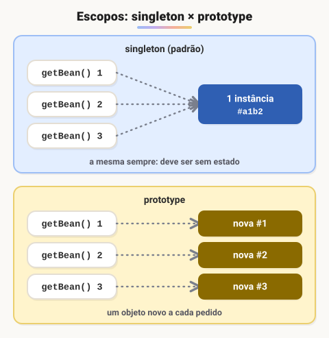
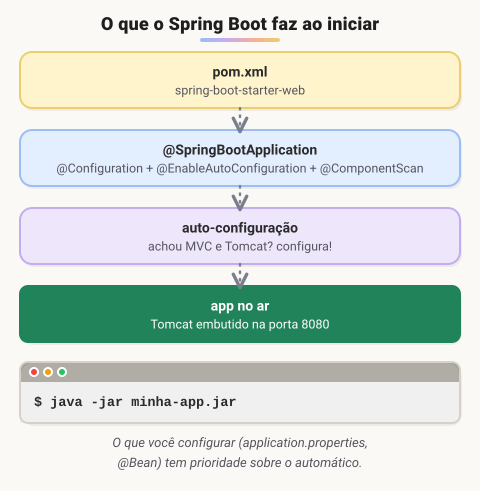
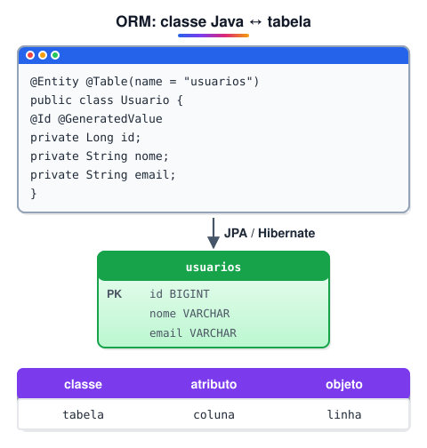
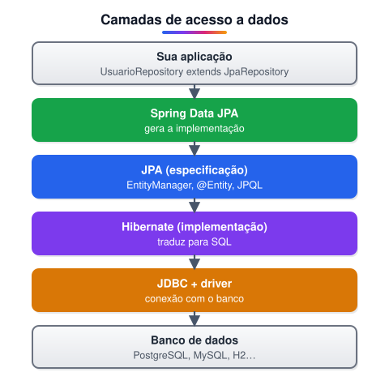

# Imersão no Spring Framework com Spring Boot

> 🗺️ **Nesta aula:** os fundamentos do Spring (inversão de controle, injeção de dependência, beans e escopos), o que o Spring Boot acrescenta com os starters e seis projetos práticos, até o primeiro contato com JPA.

## Fundamentos do Spring

### Spring Framework

O **Spring Framework** é um framework de código aberto para construir aplicações Java, principalmente corporativas. Foi criado por **Rod Johnson** (as ideias aparecem no livro dele de 2002; a versão 1.0 saiu em **2004**) como uma alternativa mais simples ao pesado modelo J2EE/EJB da época. Seu núcleo é um **container** que cria e conecta os objetos da aplicação.



### Principais recursos

- **Inversão de controle (IoC):** o container, e não o seu código, cria e gerencia os objetos.
- **Injeção de dependência (DI):** o container entrega a cada objeto as dependências de que ele precisa — é a forma como o Spring implementa a IoC.
- **AOP (programação orientada a aspectos):** separa preocupações que atravessam o sistema — log, segurança, transações — do código de negócio.
- **Transações:** declarativas (com `@Transactional`) ou programáticas.
- **Facilidade de teste:** com DI, fica simples trocar dependências por *mocks*; o módulo **Spring Test** apoia testes de integração.

### Módulos e projetos

O Spring é organizado em **módulos** que podem ser usados separadamente ou juntos.

- **Spring Core (Core Container):** IoC, DI, beans, `ApplicationContext`, eventos, recursos e internacionalização. É o coração do framework.
- **Spring MVC:** framework web baseado no padrão **MVC** (*Model-View-Controller*), usado para páginas e, sobretudo, **APIs REST** (`@RestController`). Há também o **WebFlux**, para programação reativa.
- **Spring Data:** abstração para acesso a dados. A partir de interfaces de repositório, gera as consultas automaticamente (inclusive pelo nome dos métodos, como `findByEmail`). Suporta JPA, MongoDB, Cassandra, Redis e outros.
- **Spring Security:** autenticação, autorização, proteção contra CSRF, criptografia de senhas, OAuth2 e SSO.
- **Spring Boot:** um **projeto à parte**, construído sobre o Spring Framework, que acelera a criação de aplicações com auto-configuração, *starters* e servidor embutido (veja a próxima página).

### Spring x Java EE (Jakarta EE)

O **Java EE** (hoje **Jakarta EE**, mantido pela Eclipse Foundation) é um conjunto de **especificações** — Servlet, JPA, CDI, EJB, JMS… — implementadas por servidores de aplicação (WildFly, Payara, WebLogic). O **Spring** é um **framework** que usa várias dessas APIs (Servlet, JPA, Bean Validation) e oferece seus próprios recursos por cima.

|  | Java EE / Jakarta EE | Spring |
| --- | --- | --- |
| Natureza | Especificações padronizadas | Framework (implementação única, open source) |
| Onde roda | Servidor de aplicação compatível | Qualquer lugar; com Spring Boot, um `.jar` com servidor embutido |
| Configuração | Anotações (desde o Java EE 5) e alguns XMLs | Anotações, classes Java (`@Configuration`) ou XML |
| Injeção de dependência | CDI | Container do Spring |
| Evolução | Por especificação (mais lenta) | Lançamentos frequentes |

> 📌 Desde o Jakarta EE 9 os pacotes mudaram de `javax.*` para `jakarta.*`. Por isso o Spring Boot 3 usa `jakarta.persistence`, `jakarta.servlet` etc.

### Inversão de controle (IoC)

**IoC** significa tirar da classe a responsabilidade de **criar** e **gerenciar** suas dependências e passá-la para um **container**. Em vez de a classe chamar `new` para cada dependência, ela as **recebe prontas**.



#### Como funciona no Spring

O container é representado pela interface `ApplicationContext` (que estende `BeanFactory`). Na inicialização, ele:

1. **Encontra** as classes que devem virar beans (com `@Component`, `@Service`, `@Repository`, `@Controller` ou métodos `@Bean`);
2. **Cria** as instâncias, usando reflexão;
3. **Injeta** as dependências de cada uma;
4. **Gerencia o ciclo de vida** até o encerramento da aplicação.

#### Benefícios

- **Desacoplamento:** as classes dependem de abstrações, não de como os objetos são criados.
- **Manutenção:** trocar uma implementação não exige alterar quem a usa.
- **Testabilidade:** em testes, é fácil injetar versões falsas (*mocks*).

### Injeção de dependência (DI)

**Injeção de dependência** é a forma prática de aplicar IoC: o container **entrega** a cada objeto aquilo de que ele depende.



- **Por construtor (recomendada):** a dependência é obrigatória, pode ser `final` e o objeto nunca fica "pela metade". Com um único construtor, o `@Autowired` é opcional (desde o Spring 4.3).
- **Por setter:** para dependências opcionais ou que podem ser trocadas depois.
- **Por atributo (**`@Autowired` **no campo):** funciona, mas esconde as dependências e dificulta testes sem o Spring — evite em código novo.

### Beans

Um **bean** é qualquer objeto **criado e gerenciado pelo container** do Spring. Hoje a forma mais comum de declará-los é com anotações:

```java
@Service  // a própria classe vira um bean
public class PedidoService { ... }

@Configuration
public class AppConfig {
  @Bean  // o retorno do método vira um bean
  public RestTemplate restTemplate() {
    return new RestTemplate();
  }
}
```

Use `@Component` (e suas especializações `@Service`, `@Repository`, `@Controller`) para **suas** classes, e `@Bean` para objetos de **bibliotecas de terceiros** ou que exigem configuração na criação.

### Escopos (*scopes*)

O **escopo** define **quantas instâncias** de um bean existem e **por quanto tempo** elas vivem.



| Escopo | Instâncias | Onde vale |
| --- | --- | --- |
| `singleton` (padrão) | Uma por container | Qualquer aplicação |
| `prototype` | Uma nova a cada vez que o bean é pedido | Qualquer aplicação |
| `request` | Uma por requisição HTTP | Aplicações web |
| `session` | Uma por sessão HTTP | Aplicações web |
| `application` | Uma por `ServletContext` | Aplicações web |
| `websocket` | Uma por sessão WebSocket | Aplicações web |

```java
@Component
@Scope("prototype")
public class Carrinho { ... }
```

#### Singleton no Spring

O singleton do Spring significa **uma instância por definição de bean no container** — não é exatamente o padrão de projeto Singleton (que garante uma instância por classe em toda a JVM).

- **Vantagem:** o objeto é criado uma vez e reaproveitado, economizando memória e tempo.
- **Cuidado:** como a mesma instância atende várias requisições ao mesmo tempo, beans singleton devem ser **sem estado** (*stateless*) — não guarde dados de um usuário em atributos.

### `@Autowired` e a resolução de dependências

`@Autowired` pede ao Spring que injete um bean num construtor, setter ou atributo. A resolução segue esta ordem:

1. **Por tipo:** procura um bean do tipo pedido (ex.: `MyDependency`).
2. **Se houver mais de um candidato:** usa `@Primary`, um `@Qualifier` ou, por fim, o **nome** do parâmetro/atributo para desempatar.
3. **Se não houver nenhum:** lança erro na inicialização — a não ser que a injeção seja opcional.

#### Exemplos

**Por construtor (recomendado)**

```java
@Component
public class MyClass {
  private final MyDependency myDependency;

  public MyClass(MyDependency myDependency) { // @Autowired opcional com 1 construtor
    this.myDependency = myDependency;
  }
}
```

**Desempate com @Qualifier**

```java
@Component("emailNotificacao")
class EmailNotificacao implements Notificacao { ... }

@Component("smsNotificacao")
class SmsNotificacao implements Notificacao { ... }

@Component
public class MyClass {
  private final Notificacao notificacao;

  public MyClass(@Qualifier("smsNotificacao") Notificacao notificacao) {
    this.notificacao = notificacao; // recebe o bean chamado "smsNotificacao"
  }
}
```

**Desempate pelo nome**

```java
@Component
public class MyClass {
  @Autowired
  private Notificacao emailNotificacao; // dois candidatos: o nome do atributo decide
}
```

**Injeção opcional**

```java
@Component
public class MyClass {
  @Autowired(required = false)
  private MyDependency myDependency; // fica null se não existir o bean

  // alternativa mais explícita:
  // public MyClass(Optional<MyDependency> dep) { ... }
}
```

> 🛠️ **Ajustes:**
>
> - O **Spring Boot** não é um "módulo" do Spring Framework, e sim um projeto separado construído sobre ele. Ele também **não gera documentação da API** sozinho (isso é feito por bibliotecas como springdoc/Swagger).
> - No Spring MVC, "geração de PDF" e "websockets" foram removidos da descrição: WebSocket é outro módulo (`spring-websocket`).
> - A comparação com o Java EE estava desatualizada: o Java EE usa anotações desde 2006 (Java EE 5), virou **Jakarta EE** e não é "para aplicações maiores" enquanto o Spring seria "para menores" — os dois são usados em sistemas de qualquer porte. Troquei por uma tabela.
> - O `ApplicationContext` **estende** a interface `BeanFactory` (não "implementa"), e beans hoje são declarados principalmente por anotações, não só em XML.
> - O escopo **Global Session** foi removido no Spring 5; acrescentei `application` e `websocket`. O singleton foi corrigido: é uma instância **por container** e deve ser **sem estado**.
> - Os exemplos de "injeção por nome" e "por tipo" eram idênticos. Na verdade, o `@Autowired` resolve **por tipo** e só usa o nome para desempatar. O `@Qualifier("myQualifier")` procura o bean **chamado** `myQualifier`, e não uma anotação `@myQualifier`.
> - Removido o texto "javaCopy code" dos blocos de código, e o conteúdo repetido entre IoC, DI e @Autowired foi enxugado.
> - As seis imagens foram substituídas por quatro diagramas.

## O que é o Spring Boot?

O **Spring Boot** (lançado em **2014**) é um projeto construído sobre o Spring Framework que facilita criar aplicações **autônomas e prontas para produção**. Ele segue a ideia de **convenção sobre configuração**: escolhe padrões sensatos para que você escreva quase nenhuma configuração e foque nas regras de negócio.



### Principais recursos

#### Auto-configuração

Ao iniciar, o Spring Boot olha as bibliotecas presentes no **classpath** e configura automaticamente o que faz sentido. Exemplo: se encontra o Spring MVC e o Tomcat, sobe um servidor web; se encontra um driver de banco e o Spring Data JPA, configura o `DataSource` e o `EntityManager`. Tudo pode ser sobrescrito pelo `application.properties` ou por beans próprios.

#### Gerenciamento de dependências

O Boot mantém uma lista de **versões compatíveis** entre si (o `spring-boot-starter-parent` / BOM `spring-boot-dependencies`). Por isso, no `pom.xml`, você normalmente declara as dependências **sem versão** — e evita conflitos entre bibliotecas.

#### Servidor embutido

A aplicação já vem com um servidor web dentro dela (**Tomcat** por padrão; Jetty ou Undertow como opção). O resultado da build é um `.jar` executável com `java -jar`, sem precisar instalar e configurar um servidor de aplicação à parte.

#### Acesso a dados

Integra-se facilmente com bancos relacionais (JDBC, JPA/Hibernate) e NoSQL (MongoDB, Redis, Cassandra…) por meio do Spring Data. Serviços de nuvem, como Amazon S3 ou Azure, são usados com bibliotecas adicionais (ex.: Spring Cloud AWS, SDKs dos provedores).

#### Testes

O starter de testes traz **JUnit 5**, **Mockito**, **AssertJ** e o **Spring Test**, além de anotações como `@SpringBootTest` (sobe o contexto completo), `@WebMvcTest` e `@DataJpaTest` (sobem só uma fatia da aplicação).

#### Produção

O **Actuator** expõe endpoints de saúde (`/actuator/health`), métricas e informações da aplicação, prontos para monitoramento.

### O que são starters

**Starters** são dependências "pacote" que reúnem tudo o que é preciso para uma funcionalidade. Em vez de procurar e alinhar versões de várias bibliotecas, você adiciona **um starter** e a auto-configuração faz o resto.

```xml
<dependency>
  <groupId>org.springframework.boot</groupId>
  <artifactId>spring-boot-starter-web</artifactId>
  <!-- sem versão: vem do spring-boot-starter-parent -->
</dependency>
```

- Os starters fazem parte do próprio projeto Spring Boot e seguem o padrão de nome `spring-boot-starter-*`.
- O **Spring Initializr** ([start.spring.io](https://start.spring.io/)) é a ferramenta que **gera o projeto inicial**, deixando você escolher os starters numa lista; ele também está integrado ao IntelliJ e ao VS Code.

### Starters mais usados

| Starter | Para quê |
| --- | --- |
| `spring-boot-starter-web` | Aplicações web e APIs REST com Spring MVC e Tomcat embutido. |
| `spring-boot-starter-data-jpa` | Acesso a bancos relacionais com Spring Data JPA e Hibernate. |
| `spring-boot-starter-security` | Autenticação, autorização e proteções do Spring Security. |
| `spring-boot-starter-test` | JUnit 5, Mockito, AssertJ e Spring Test (escopo `test`). |
| `spring-boot-starter-actuator` | Saúde, métricas e informações da aplicação para monitoramento. |
| `spring-boot-starter-data-mongodb` | Integração com MongoDB via Spring Data MongoDB. |
| `spring-boot-starter-validation` | Validação com Bean Validation (`@NotNull`, `@Email`…). |
| `spring-cloud-starter-openfeign`* | Cliente HTTP declarativo: você escreve uma interface com anotações e o Feign implementa as chamadas REST. |

*O OpenFeign faz parte do **Spring Cloud**, não do Spring Boot; exige também a dependência de gerenciamento de versões do Spring Cloud.

> 🛠️ **Ajustes:**
>
> - Os starters **não são gerenciados pelo Spring Initializr**: eles fazem parte do Spring Boot. O Initializr apenas **gera o projeto** com os starters escolhidos.
> - "Suporte a S3 e Azure" não é algo nativo do Spring Boot — depende de bibliotecas adicionais.
> - O OpenFeign é um starter do **Spring Cloud**, não do Spring Boot.
> - "Dependência de gerenciamento" virou **gerenciamento de dependências**, com a explicação de como o parent/BOM alinha as versões. Acrescentei o Actuator, o starter de validação e as anotações de teste por fatia.
> - Incluí um diagrama do que acontece na inicialização.

## Projeto prático

#### Referências

🔗 [https://start.spring.io/](https://start.spring.io/)

🔗 [Spring Data JPA - Reference Documentation](https://docs.spring.io/spring-data/jpa/docs/current/reference/html/)

### 1ª parte — Primeiros passos (`spring-primeiros-passos`)

- Criar um projeto com o **Spring Initializr**.
- Importar o projeto Maven no IntelliJ.
- Conhecer a estrutura de um projeto Spring Boot (`src/main/java`, `src/main/resources/application.properties`, classe com `@SpringBootApplication`).
- **Beans** e `CommandLineRunner`: código executado logo depois que a aplicação sobe.

**Exemplo**

```java
@SpringBootApplication
public class PrimeirosPassosApplication {
  public static void main(String[] args) {
    SpringApplication.run(PrimeirosPassosApplication.class, args);
  }
}

@Component
public class MeuRunner implements CommandLineRunner {
  @Override
  public void run(String... args) {
    System.out.println("Aplicação iniciada!");
  }
}
```

### 2ª parte — Quem são eles? (`spring-ioc-di-beans-autowired`)

- **Quando usar** `@Component`**?** Em classes **suas**, que o Spring deve criar e gerenciar.
- **Quando usar** `@Bean`**?** Em métodos de uma classe `@Configuration`, para registrar objetos de **bibliotecas de terceiros** (que você não pode anotar) ou que precisam de configuração na criação.
- Aplicar **IoC** e **DI** na prática.

**Exemplo**

```java
@Component
public class CalculadoraImc { ... }  // classe nossa

@Configuration
public class BeansConfig {
  @Bean
  public Gson gson() {  // classe de terceiros
    return new GsonBuilder().setPrettyPrinting().create();
  }
}
```

### 3ª parte — Quando vou precisar? (`spring-scopes-singleton-prototype`)

- O conceito de **escopo**.
- Configurar um bean **singleton** (padrão: uma instância compartilhada).
- Configurar um bean **prototype** (uma instância nova a cada injeção/pedido).

**Exemplo**

```java
@Configuration
public class ScopeConfig {
  @Bean
  @Scope("prototype")
  public Remetente remetente() {
    return new Remetente();
  }
}
```

### 4ª parte — Nem tudo é igual (`spring-properties-value`)

- O `application.properties` como lugar central de configuração.
- `@Value` para ler uma propriedade.
- **Valor padrão** quando a propriedade não existe.

**Exemplo**

```
# application.properties
remetente.nome=Ana
remetente.telefones=1111,2222
```

```java
@Component
public class SistemaMensagem {
  @Value("${remetente.nome}")
  private String nome;

  @Value("${remetente.email:nao-informado@dio.me}")  // valor padrão depois dos dois-pontos
  private String email;

  @Value("${remetente.telefones}")
  private List<Long> telefones;
}
```

### 5ª parte — É sério isso? (`spring-configuration-properties`)

- `@ConfigurationProperties(prefix = "...")`: liga um **grupo** de propriedades a uma classe de uma vez, com tipos e validação — melhor que vários `@Value` espalhados.

**Exemplo**

```java
@Configuration
@ConfigurationProperties(prefix = "remetente")
public class Remetente {
  private String nome;
  private String email;
  private List<Long> telefones;
  // getters e setters
}
```

### 6ª parte — ORM e JPA (`dio-spring-data-jpa`)

- **O que é ORM?** *Object-Relational Mapping*: mapear **classes** para **tabelas**, **atributos** para **colunas** e **objetos** para **linhas**, para trabalhar com o banco usando objetos Java em vez de SQL manual.
- **JPA** (*Jakarta Persistence API*): a **especificação** Java de ORM — define anotações (`@Entity`, `@Id`…), o `EntityManager` e a JPQL. O **Hibernate** é a implementação mais usada.
- **Mapeamentos:** `@Entity`, `@Table`, `@Id`, `@GeneratedValue`, `@Column`, `@OneToMany`, `@ManyToOne`…
- **EntityManager:** a interface que gerencia as entidades (`persist`, `find`, `merge`, `remove`). O **Spring Data JPA** usa o `EntityManager` por baixo e gera os repositórios automaticamente.





**Exemplo**

```java
@Entity
@Table(name = "usuarios")
public class Usuario {
  @Id
  @GeneratedValue(strategy = GenerationType.IDENTITY)
  private Long id;
  private String nome;
  private String email;
  // getters e setters
}

public interface UsuarioRepository extends JpaRepository<Usuario, Long> {
  Optional<Usuario> findByEmail(String email);  // consulta gerada pelo nome do método
}
```

### 📦 Pacotes dos projetos

> 🛠️ **Ajustes:** corrigido "ComandLineRunner" para `CommandLineRunner`; cada parte ganhou uma explicação curta e um exemplo de código; as três imagens de ORM/JPA foram substituídas por dois diagramas (mapeamento objeto-tabela e camadas de acesso a dados); o título da página tinha uma marcação HTML perdida.

### 📎 Slides do curso

## 📌 Resumo

| Item | Em uma frase |
| --- | --- |
| IoC | o Spring cria e gerencia os objetos, não o seu código |
| DI | as dependências chegam prontas, de preferência pelo construtor |
| Bean | objeto gerenciado pelo Spring (`@Component`, `@Service`, `@Repository`, `@Bean`) |
| Escopos | `singleton` (padrão, um só) e `prototype` (um novo a cada pedido) |
| Spring Boot | configuração automática, servidor embutido e starters |
| Propriedades | `@Value` lê uma chave; `@ConfigurationProperties` agrupa várias numa classe |
| ORM / JPA | classes viram tabelas; o Hibernate implementa a especificação JPA |
