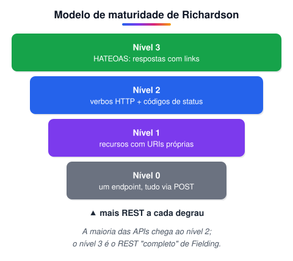
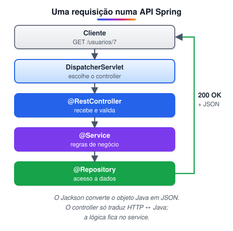
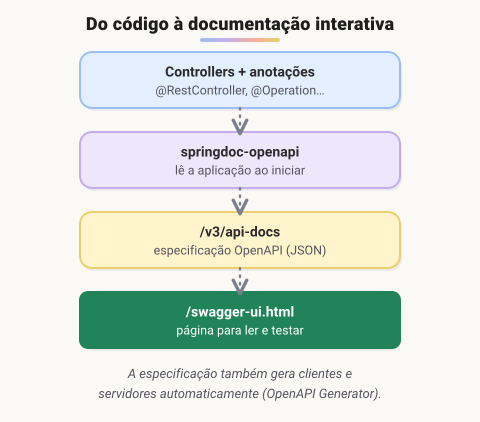
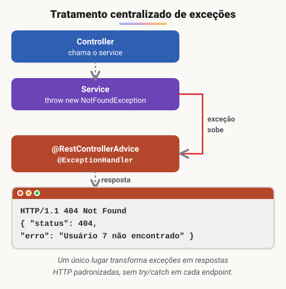

# Criando API REST documentada com Spring Web e Swagger

> 🗺️ **Nesta aula:** o que é REST e o modelo de maturidade de Richardson, como criar endpoints com `@RestController`, documentar a API com Swagger e tratar erros em um só lugar com exception handlers.

## Introdução ao REST e RESTful

### O que é REST?

**REST** (*Representational State Transfer*) é um **estilo de arquitetura** para sistemas distribuídos, descrito por **Roy Fielding** em sua tese de doutorado em **2000**. Na prática, quase sempre é aplicado sobre **HTTP**, e uma "API REST" é uma API que segue esse estilo.

- A API é organizada em **recursos** (usuários, pedidos, produtos), cada um identificado por uma **URI** (ex.: `/usuarios/7`).
- Os recursos são manipulados com os **métodos HTTP**: GET (ler), POST (criar), PUT/PATCH (alterar) e DELETE (remover).
- O cliente recebe **representações** do recurso — normalmente em **JSON**, às vezes XML.
- O servidor usa os **códigos de status** HTTP para indicar o resultado (200, 201, 404…).

#### REST x RESTful

Os termos costumam ser usados como sinônimos. Uma distinção comum é:

- **REST:** o estilo de arquitetura em si.
- **RESTful:** uma API que **aplica** esse estilo. Alguns autores reservam "RESTful" para APIs que seguem **todas** as restrições, inclusive **HATEOAS** (links entre recursos); na prática, a maioria das APIs chamadas de REST não chega a esse ponto.

#### Restrições do REST (segundo Fielding)

1. **Cliente-servidor:** interface e armazenamento de dados ficam separados, e cada lado evolui de forma independente.
2. **Sem estado (*stateless*):** cada requisição traz tudo o que é necessário para ser entendida; o servidor não guarda contexto da sessão entre uma chamada e outra.
3. **Cache:** as respostas informam se podem ser armazenadas em cache, reduzindo carga e latência.
4. **Interface uniforme:**
  - recursos identificados por URIs;
  - manipulação por meio de **representações** (JSON, XML);
  - mensagens **autodescritivas** (método, cabeçalhos e status dizem o que está acontecendo);
  - **HATEOAS** — *Hypermedia as the Engine of Application State*: as respostas trazem links que guiam o cliente para as próximas ações.
5. **Sistema em camadas:** o cliente não sabe se fala direto com o servidor ou com intermediários (proxy, balanceador, cache).
6. **Código sob demanda (opcional):** o servidor pode enviar código executável ao cliente (ex.: JavaScript).

### Modelo de maturidade de Richardson

Leonard Richardson propôs uma escala para medir o quanto uma API adota os princípios do REST.



#### Nível 0 — o HTTP é só um transporte

Um **único endpoint** e um único verbo (geralmente POST); a operação desejada vai dentro do corpo, como uma chamada de procedimento remoto (RPC/SOAP).

| Verbo | URL | Corpo |
| --- | --- | --- |
| POST | `/api` | `{ "acao": "buscarUsuario", "id": 1 }` |
| POST | `/api` | `{ "acao": "salvarUsuario", ... }` |
| POST | `/api` | `{ "acao": "excluirUsuario", "id": 1 }` |

#### Nível 1 — recursos

Cada recurso ganha sua própria URI, mas o verbo ainda não tem significado: as ações aparecem no nome da URL e tudo continua via POST.

| Verbo | URL | Operação |
| --- | --- | --- |
| POST | `/usuarios/1/buscar` | Pesquisar usuário |
| POST | `/usuarios/salvar` | Salvar |
| POST | `/usuarios/1/alterar` | Alterar |
| POST | `/usuarios/1/excluir` | Excluir |

#### Nível 2 — verbos e códigos de status

A URI identifica o **recurso** e o **verbo HTTP** diz a **ação**. As respostas usam os códigos de status corretos (`201 Created`, `204 No Content`, `404 Not Found`…). É o nível da maioria das APIs do mercado.

| Verbo | URL | Operação | Resposta típica |
| --- | --- | --- | --- |
| GET | `/usuarios/1` | Pesquisar | `200 OK` |
| POST | `/usuarios` | Criar | `201 Created`  • `Location` |
| PUT | `/usuarios/1` | Alterar | `200 OK` ou `204` |
| DELETE | `/usuarios/1` | Excluir | `204 No Content` |

> 💡 Uma dúvida comum: o GET não deve ter corpo. Se uma busca precisa de muitos filtros, use **parâmetros de consulta** (`GET /usuarios?nome=ana&ativo=true`) ou, em casos complexos, um `POST /usuarios/busca` — sabendo que isso foge um pouco do nível 2.

#### Nível 3 — HATEOAS

A resposta traz **links** para as ações e recursos relacionados. O cliente só precisa conhecer o ponto de entrada da API; o resto ele descobre navegando pelos links.

```json
{
  "nome": "John Doe",
  "email": "john.doe@example.com",
  "_links": {
    "self":     { "href": "/usuarios/1234" },
    "pedidos":  { "href": "/usuarios/1234/pedidos" },
    "carrinho": { "href": "/usuarios/1234/carrinho" },
    "alterar":  { "href": "/usuarios/1234", "method": "PUT" },
    "excluir":  { "href": "/usuarios/1234", "method": "DELETE" }
  }
}
```

No Spring, o projeto **Spring HATEOAS** ajuda a montar esses links.

> 🛠️ **Ajustes:**
>
> - REST foi descrito como "padrão que utiliza o protocolo HTTP"; ele é um **estilo de arquitetura** (Fielding, 2000), normalmente aplicado sobre HTTP.
> - A lista de "princípios" misturava restrições reais com itens que não são restrições do REST (como "usar o protocolo HTTP" e "interoperabilidade"). Troquei pelas **seis restrições** de Fielding.
> - Os exemplos do modelo de Richardson estavam deslocados: a tabela do nível 1 já usava GET/PUT/DELETE (isso é **nível 2**) e a do nível 0 tinha várias URLs. Refiz os exemplos de cada nível.
> - A imagem foi substituída por um diagrama, e o JSON do nível 3 foi traduzido.

## REST Controller

**REST controllers** são as classes que expõem os **endpoints** da aplicação: recebem as requisições HTTP, chamam a camada de serviço e devolvem a resposta — normalmente em **JSON**.



### Anotações mais usadas

| Anotação | Para que serve |
| --- | --- |
| `@RestController` | Marca a classe como controller REST. É `@Controller`  • `@ResponseBody`: o retorno dos métodos vira o corpo da resposta (JSON). |
| `@RequestMapping("/usuarios")` | Define o **caminho base** (prefixo) da classe ou de um método. Também aceita o método HTTP (`method = RequestMethod.GET`), mas hoje se usam os atalhos abaixo. |
| `@GetMapping` | Mapeia o método para requisições **GET**. |
| `@PostMapping` | Mapeia para **POST**. |
| `@PutMapping` / `@PatchMapping` | Mapeia para **PUT** / **PATCH**. |
| `@DeleteMapping` | Mapeia para **DELETE**. |
| `@PathVariable` | Lê um trecho do **caminho**: em `@GetMapping("/{id}")`, o valor de `{id}`. |
| `@RequestParam` | Lê um **parâmetro de consulta** (`?nome=ana`). Pode ter `required = false` e `defaultValue`. |
| `@RequestBody` | Converte o **corpo** da requisição (JSON) num objeto Java. |
| `@ResponseStatus` | Define o código de status padrão da resposta (ex.: `HttpStatus.CREATED`). |

### Exemplo completo

```java
@RestController
@RequestMapping("/usuarios")
public class UsuarioController {

  private final UsuarioService service;

  public UsuarioController(UsuarioService service) {
    this.service = service;
  }

  @GetMapping
  public List<Usuario> listar(@RequestParam(required = false) String nome) {
    return service.listar(nome);  // GET /usuarios?nome=ana
  }

  @GetMapping("/{id}")
  public Usuario buscar(@PathVariable Long id) {
    return service.buscar(id);  // GET /usuarios/7
  }

  @PostMapping
  public ResponseEntity<Usuario> criar(@RequestBody Usuario usuario) {
    Usuario salvo = service.salvar(usuario);
    URI location = URI.create("/usuarios/" + salvo.getId());
    return ResponseEntity.created(location).body(salvo);  // 201 Created
  }

  @PutMapping("/{id}")
  public Usuario atualizar(@PathVariable Long id, @RequestBody Usuario usuario) {
    return service.atualizar(id, usuario);
  }

  @DeleteMapping("/{id}")
  @ResponseStatus(HttpStatus.NO_CONTENT)  // 204 No Content
  public void excluir(@PathVariable Long id) {
    service.excluir(id);
  }
}
```

> 💡 Use `ResponseEntity` quando precisar controlar o status, os cabeçalhos e o corpo da resposta ao mesmo tempo — como no `201 Created` com o cabeçalho `Location`.

> 🛠️ **Ajustes:** o `@RequestMapping` foi descrito como a anotação que "indica qual verbo deve ser usado"; seu uso principal é definir o **caminho base**, e os verbos ficam com `@GetMapping`, `@PostMapping` etc. Corrigido o erro de digitação "Itilizada", as anotações viraram uma tabela e acrescentei `@PatchMapping`, `@ResponseStatus`, `ResponseEntity`, um exemplo completo de controller e um diagrama do fluxo da requisição.

## Swagger

### Página do Swagger

🔗 [https://swagger.io/](https://swagger.io/)

#### O que é

**Swagger** é um conjunto de ferramentas open source para **projetar, documentar, testar e consumir APIs REST**. Ele nasceu em **2010–2011**, criado por **Tony Tam** na empresa **Wordnik**, e em **2015** foi adquirido pela **SmartBear**.

Também em 2015 a **especificação** do Swagger foi doada à **OpenAPI Initiative** (Linux Foundation) e passou a se chamar **OpenAPI Specification** — a versão 3.0 saiu em 2017. Hoje:

- **OpenAPI** = a especificação (o formato YAML/JSON que descreve a API);
- **Swagger** = as ferramentas da SmartBear que trabalham com essa especificação.



#### Vantagens

- **Documentação sempre atualizada:** gerada a partir do código (ou o código gerado a partir dela).
- **Interatividade:** dá para testar cada endpoint direto na página, sem Postman.
- **Padronização:** um formato único para descrever APIs, que facilita o trabalho entre times.
- **Geração de código:** clientes e servidores em várias linguagens a partir da especificação.

#### Principais ferramentas

- **Swagger Editor:** editor web para escrever especificações OpenAPI, com validação e pré-visualização em tempo real.
- **Swagger UI:** página web que mostra a documentação da API a partir da especificação e permite testar os endpoints.
- **Swagger Codegen** (e o projeto comunitário **OpenAPI Generator**): geram clientes e *stubs* de servidor em diversas linguagens.
- **SwaggerHub:** plataforma na nuvem para hospedar, versionar e colaborar em especificações.

### Swagger num projeto Spring Boot

A biblioteca recomendada hoje é o **springdoc-openapi**. Basta adicionar a dependência:

```xml
<dependency>
  <groupId>org.springdoc</groupId>
  <artifactId>springdoc-openapi-starter-webmvc-ui</artifactId>
  <version>2.6.0</version>
</dependency>
```

Ao subir a aplicação:

- `http://localhost:8080/v3/api-docs` → especificação OpenAPI em JSON;
- `http://localhost:8080/swagger-ui.html` → Swagger UI.

As anotações são opcionais e enriquecem a documentação:

```java
@Tag(name = "Usuários")
@RestController
@RequestMapping("/usuarios")
public class UsuarioController {

  @Operation(summary = "Busca um usuário pelo id")
  @ApiResponse(responseCode = "404", description = "Usuário não encontrado")
  @GetMapping("/{id}")
  public Usuario buscar(@PathVariable Long id) { ... }
}
```

> ⚠️ O antigo **Springfox** (`springfox-swagger2` / `springfox-swagger-ui`) está **abandonado** e não funciona no Spring Boot 3 — e era a origem de muitos erros de dependência (como o do Spring Boot 2.6 com o *path matcher*). Em projetos novos, use o **springdoc-openapi**.

> 🛠️ **Ajustes:**
>
> - O Swagger foi criado na **Wordnik** (por Tony Tam), não "pela Reverb Technologies em 2010"; a SmartBear o adquiriu em 2015. Acrescentei a diferença entre **OpenAPI** (especificação) e **Swagger** (ferramentas).
> - "O Swagger gera a documentação com base nas anotações dos controladores" — quem faz isso em projetos Spring é uma biblioteca de integração (springdoc ou, antigamente, Springfox); o Swagger UI só exibe a especificação.
> - Incluí a configuração com springdoc, os endereços padrão e um diagrama do fluxo.

## Exception handlers

Erros acontecem: dados inválidos enviados pelo cliente, registro inexistente, falha no banco ou num serviço externo. Numa API, o importante é que o cliente receba uma **resposta clara e padronizada** — com o **código de status** certo e uma mensagem útil —, sem expor detalhes internos como *stack traces*.

### O que são exception handlers

**Exception handlers** são métodos que **capturam exceções** lançadas pela aplicação e as transformam em **respostas HTTP**. No Spring, eles costumam ficar numa classe anotada com `@RestControllerAdvice` (ou `@ControllerAdvice`), que vale para **todos** os controllers.



### Como funciona

1. Um controller ou service lança uma exceção (ex.: `UsuarioNaoEncontradoException`).
2. O Spring procura um método `@ExceptionHandler` compatível com o tipo da exceção — primeiro no próprio controller, depois nas classes `@ControllerAdvice`.
3. Se encontrar, executa esse método e devolve a resposta que ele montar.
4. Se não encontrar, o Spring Boot devolve uma resposta de erro padrão (normalmente `500 Internal Server Error`).

### Como criar

```java
// exceção do domínio
public class UsuarioNaoEncontradoException extends RuntimeException {
  public UsuarioNaoEncontradoException(Long id) {
    super("Usuário " + id + " não encontrado");
  }
}

// tratamento centralizado
@RestControllerAdvice
public class GlobalExceptionHandler {

  @ExceptionHandler(UsuarioNaoEncontradoException.class)
  public ResponseEntity<Map<String, Object>> naoEncontrado(UsuarioNaoEncontradoException ex) {
    return ResponseEntity.status(HttpStatus.NOT_FOUND)
        .body(Map.of("status", 404, "erro", ex.getMessage()));
  }

  @ExceptionHandler(IllegalArgumentException.class)
  public ResponseEntity<Map<String, Object>> requisicaoInvalida(IllegalArgumentException ex) {
    return ResponseEntity.badRequest()
        .body(Map.of("status", 400, "erro", ex.getMessage()));
  }

  @ExceptionHandler(Exception.class)  // rede de segurança para o resto
  public ResponseEntity<Map<String, Object>> erroInesperado(Exception ex) {
    // registre o erro completo no log, mas não envie detalhes ao cliente
    return ResponseEntity.status(HttpStatus.INTERNAL_SERVER_ERROR)
        .body(Map.of("status", 500, "erro", "Erro interno. Tente novamente mais tarde."));
  }
}
```

> 💡 A partir do Spring 6 / Spring Boot 3 existe o tipo `ProblemDetail`, que segue a RFC 9457 (*Problem Details for HTTP APIs*) e padroniza o formato do erro: `type`, `title`, `status`, `detail`, `instance`.

### Vantagens

- **Centralização:** um só lugar para o tratamento de erros, sem `try/catch` repetido em cada endpoint.
- **Respostas consistentes:** mesmo formato e códigos de status corretos em toda a API.
- **Segurança:** evita vazar *stack traces*, nomes de tabelas e outros detalhes internos.
- **Observabilidade:** facilita registrar e monitorar os erros num ponto único.

> 🛠️ **Ajustes:** o texto explicava o conceito, mas não tinha nenhum código; acrescentei um exemplo completo com `@RestControllerAdvice`, a ordem em que o Spring procura o handler, o tipo `ProblemDetail` e um diagrama do fluxo no lugar da imagem.

## Projeto REST API

#### Spring Web REST API — o que o projeto cobre

- Criar um projeto web com Spring Boot.
- Configurar os controllers e os endpoints.
- Documentar a API com Swagger/OpenAPI.
- Tratar exceções com handlers centralizados.
- E outros pontos do dia a dia de uma API.

#### Vídeo que me ajudou a resolver o problema das dependências do Swagger

🔗 [Resolvendo problemas no Swagger - Java Spring Boot](https://www.youtube.com/watch?v=pMXnR1T47e0)

#### Issue que me ajudou a achar o vídeo

> 💡 Esse tipo de erro costuma vir do **Springfox**, que deixou de ser mantido e quebra em versões novas do Spring Boot. Em projetos novos, troque pelo **springdoc-openapi** (veja a página *Swagger*).

### 📦 Meu projeto de API com Spring, documentada no Swagger

## 📌 Resumo

| Item | Em uma frase |
| --- | --- |
| REST | estilo de API com recursos identificados por URL e manipulados por métodos HTTP |
| Richardson | níveis 0 a 3: um endpoint, recursos, verbos HTTP e links (HATEOAS) |
| `@RestController` | classe cujos métodos devolvem dados (JSON) |
| Mapeamentos | `@GetMapping`, `@PostMapping`, `@PutMapping`, `@DeleteMapping` |
| Parâmetros | `@PathVariable`, `@RequestParam`, `@RequestBody` |
| `ResponseEntity` | controla o status e o corpo da resposta |
| Swagger / OpenAPI | documentação interativa gerada a partir do código |
| `@RestControllerAdvice` | trata as exceções de todos os controllers num só lugar |
