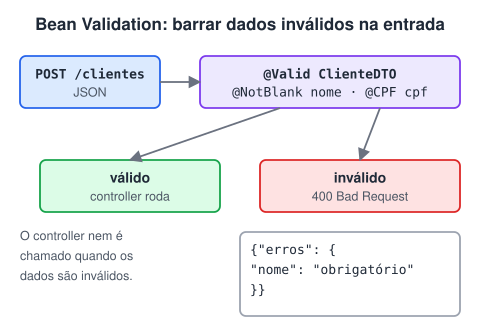

# Validação de dados com Bean Validation (Adicionado pelo aluno para melhorar o estudo)

> 🗺️ **Nesta aula:** como validar os dados que chegam na API com Bean Validation: anotações no DTO, `@Valid` no controller e respostas de erro legíveis.

## O problema

Uma API não pode confiar no que recebe: valor negativo em transferência, CPF vazio, e-mail inválido. Validar tudo com `if` em cada controller gera código repetido. **A Bean Validation (Jakarta Validation) permite declarar as regras com anotações**, e o Spring as aplica automaticamente.



## Dependência

```xml
<dependency>
  <groupId>org.springframework.boot</groupId>
  <artifactId>spring-boot-starter-validation</artifactId>
</dependency>
```

Desde o Spring Boot 2.3 ela **não vem** no `starter-web`. Sem ela, as anotações simplesmente são ignoradas, sem nenhum erro. No Spring Boot 3 o pacote é `jakarta.validation` (antes era `javax.validation`).

## Anotando o DTO

```java
public record NovoClienteRequest(
  @NotBlank(message = "Nome é obrigatório")
  @Size(max = 120)
  String nome,

  @NotBlank @CPF  // org.hibernate.validator.constraints.br.CPF
  String cpf,

  @NotBlank @Email
  String email,

  @NotNull @Past  // a data precisa estar no passado
  LocalDate dataNascimento,

  @NotNull @DecimalMin("0.00") @Digits(integer = 13, fraction = 2)
  BigDecimal rendaMensal,

  @Valid @NotNull  // @Valid: valida também o objeto aninhado
  EnderecoRequest endereco
) { }
```

| Anotação | Valida |
| --- | --- |
| `@NotNull` | não é `null` (mas aceita `""`) |
| `@NotEmpty` | não é null nem vazio (strings, listas) |
| `@NotBlank` | não é null, vazio nem só espaços (strings) |
| `@Size(min, max)` | tamanho de string ou coleção |
| `@Min`, `@Max`, `@Positive`, `@PositiveOrZero` | números |
| `@DecimalMin`, `@Digits` | valores decimais (`BigDecimal`) |
| `@Email`, `@Pattern(regexp = ...)` | formato de texto |
| `@Past`, `@Future`, `@PastOrPresent` | datas |

## Ativando no controller

```java
@PostMapping("/clientes")
public ResponseEntity<ClienteResponse> criar(@RequestBody @Valid NovoClienteRequest req) {
  // só chega aqui se TODAS as regras passarem
  ClienteResponse criado = service.criar(req);
  return ResponseEntity.created(URI.create("/clientes/" + criado.id())).body(criado);
}
```

Sem o `@Valid`, nada é validado. Com ele, se alguma regra falhar, o Spring lança `MethodArgumentNotValidException` e responde **400 Bad Request**.

## Devolvendo erros legíveis

A resposta padrão do Spring é genérica. Com um `@RestControllerAdvice` (veja a página *Exception handlers*), dá para listar campo por campo:

```java
@RestControllerAdvice
public class ValidacaoHandler {

    @ExceptionHandler(MethodArgumentNotValidException.class)
    public ResponseEntity<ProblemDetail> tratar(MethodArgumentNotValidException ex) {
        ProblemDetail pd = ProblemDetail.forStatus(HttpStatus.BAD_REQUEST);
        pd.setTitle("Dados inválidos");
        Map<String, String> erros = new LinkedHashMap<>();
        ex.getBindingResult().getFieldErrors()
          .forEach(e -> erros.put(e.getField(), e.getDefaultMessage()));
        pd.setProperty("erros", erros);
        return ResponseEntity.badRequest().body(pd);
    }
}
```

```json
{
  "title": "Dados inválidos",
  "status": 400,
  "erros": {
    "nome": "Nome é obrigatório",
    "cpf": "invalid Brazilian individual taxpayer registry number (CPF)"
  }
}
```

Para validar `@PathVariable` e `@RequestParam` (por exemplo, `@Positive Long id`), anote o controller com `@Validated`. Nesse caso a falha chega como `ConstraintViolationException` ou, a partir do Spring 6.1, como `HandlerMethodValidationException`.

## Validação de formato × regra de negócio

Bean Validation cuida do **formato** dos dados. Regras que dependem do banco ou do estado do sistema, como "CPF já cadastrado" ou "saldo insuficiente", ficam no **service**, com exceções próprias tratadas no `@RestControllerAdvice` (normalmente 409 Conflict ou 422 Unprocessable Entity).

## 📌 Resumo

| Item | Em uma frase |
| --- | --- |
| Dependência | `spring-boot-starter-validation` |
| Anotações | `@NotNull`, `@NotBlank`, `@Size`, `@Email`, `@Positive`, `@DecimalMin` |
| `@Valid` | no parâmetro do controller, dispara a validação do corpo da requisição |
| Erro | `MethodArgumentNotValidException` vira 400 com a lista de campos inválidos |
| Formato × regra | a anotação valida o formato; regras de negócio ficam no serviço |
