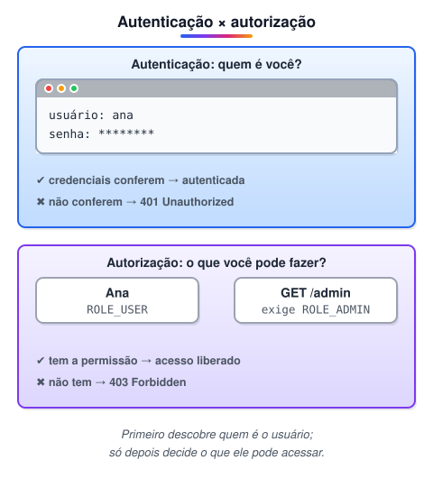
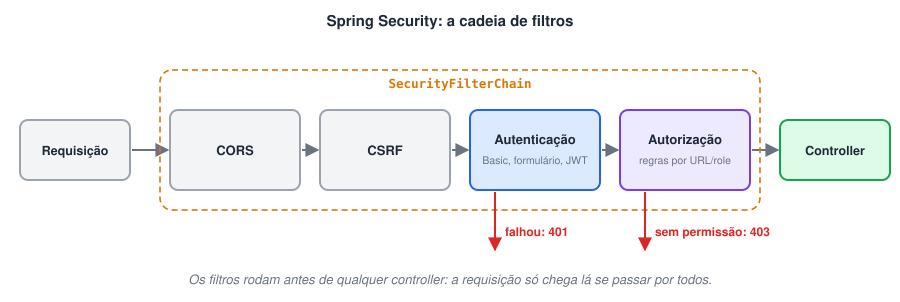
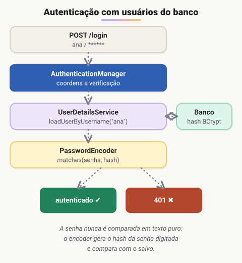
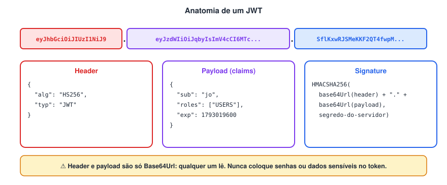
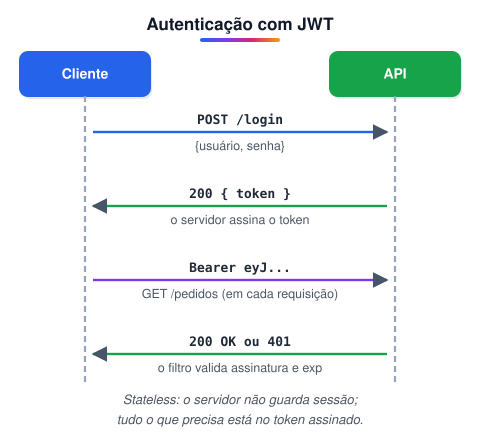

# Adicionando segurança a uma API REST com Spring

> 🗺️ **Nesta aula:** como o Spring Security protege uma API: filtros, autenticação em memória e com banco de dados, codificadores de senha, a configuração atual com `SecurityFilterChain` e autenticação com JWT.

## De onde paramos

Você já valida os dados que chegam à API. Agora vai decidir quem pode acessar cada endpoint.

## Introdução Spring security

> 🗺️ **Nesta aula:** o que o Spring Security faz, a diferença entre autenticação e autorização, a cadeia de filtros, os termos principal, authority e role, e como habilitá-lo no Spring Boot.

### De onde paramos

Você já tem uma API REST funcionando. Agora vai protegê-la, começando por entender autenticação e autorização.

O **Spring Security** é o framework de segurança do ecossistema Spring. Ele cuida de duas perguntas centrais em qualquer aplicação:

- **Quem é você?** Isso é **autenticação**: login com usuário e senha, token (JWT), OAuth2/OpenID Connect, LDAP, certificado (mTLS) ou SSO.
- **O que você pode fazer?** Isso é **autorização**: regras por URL, por método (`@PreAuthorize`) ou por papel (role).

Além disso, ele já vem com proteções contra ataques comuns, como CSRF, session fixation e clickjacking, e com cabeçalhos de segurança. Tudo pode ser estendido: filtros próprios, provedores de autenticação externos e regras de acesso de negócio.



> 💡 **Analogia:** na portaria de um prédio comercial, mostrar o documento é a **autenticação**. O crachá que libera só o 5º andar é a **autorização**. Sem documento você nem entra (401); com documento mas sem permissão, a catraca do 8º andar não abre (403).

### Como funciona por dentro

O Spring Security é implementado como uma **cadeia de filtros** (Servlet Filters) que intercepta toda requisição **antes** de ela chegar ao controller. Cada filtro tem uma responsabilidade: CORS, CSRF, autenticação, autorização e assim por diante. Se algum filtro barrar a requisição, o controller nem é executado.



### Terminologia

#### Autenticação

É o processo pelo qual um usuário **prova sua identidade**. Normalmente envolve usuário e senha, mas também pode usar chaves de segurança, autenticação de dois fatores (2FA) ou certificado digital. Quando falha, a resposta HTTP padrão é **401 Unauthorized**.

#### Autorização

É o processo de decidir se um usuário **já autenticado** tem permissão para acessar um recurso ou executar uma ação. As permissões podem ser atribuídas por usuário ou por grupo, usando listas de controle de acesso (ACL) ou controle baseado em papéis (**RBAC**). Quando falta permissão, a resposta é **403 Forbidden**.

#### Principal

É a **identidade autenticada**: quem está fazendo a requisição. Normalmente é um usuário, mas também pode ser um sistema ou serviço. No Spring Security você obtém o principal pelo `SecurityContextHolder` ou recebendo `Authentication`/`Principal` como parâmetro no controller.

#### Autoridade concedida (GrantedAuthority)

É uma **permissão** concedida ao principal, representada por uma string. Exemplos: `"CREATE_USER"`, `"READ_REPORT"`. As regras de acesso verificam essas strings.

#### Role (papel)

No Spring Security, uma role **é simplesmente uma authority com o prefixo** `ROLE_`. Escrever `.roles("ADMIN")` gera a authority `ROLE_ADMIN`, e `hasRole("ADMIN")` verifica exatamente `ROLE_ADMIN`. Conceitualmente, um papel agrupa permissões: o papel "ADMIN" pode dar direito a `CREATE_USER` e `EDIT_USER`.

> 🛠️ **Correções:**
>
> - O termo correto é **Principal**, não "Princípio".
> - Role não é uma "coleção de authorities" no Spring Security: é uma authority com prefixo `ROLE_`. Agrupar permissões em papéis é um conceito de modelagem (RBAC) que você implementa na sua aplicação.
> - Hoje as regras são configuradas em Java (beans e anotações). Configuração em XML ainda existe, mas é legado.
> - O texto em negrito da seção "Role" tinha asteriscos soltos e foi corrigido.

### Habilitando o Spring Security no Spring Boot

Inclua o starter no `pom.xml` (a versão vem do parent do Spring Boot):

```xml
<dependency>
  <groupId>org.springframework.boot</groupId>
  <artifactId>spring-boot-starter-security
    </artifactId>
</dependency>
```

Só de adicionar a dependência, **todos os endpoints passam a exigir autenticação**. O Boot cria um usuário `user` com uma senha aleatória, impressa no log da inicialização:

```
Using generated security password:
8e557245-73e2-4286-969a-ff57fe326336
```

> 🛠️ **Correção:** o groupId estava escrito `org.springframeworkk.boot` (com dois "k"). O correto é `org.springframework.boot`. Do jeito que estava, o Maven não encontraria a dependência.

> 💡 Também dá para incluir a dependência já na criação do projeto, pelo Spring Initializr (start.spring.io), selecionando **Spring Security**.

> ➡️ **Próximo passo:** **Autenticação simples / em memória**, para configurar usuários e senhas.

### 🧠 Revisão rápida

**401 ou 403: qual indica falta de autenticação?**

401 Unauthorized. O 403 Forbidden indica que o usuário está autenticado, mas sem permissão.

**Qual a relação entre role e authority no Spring Security?**

Uma role é uma authority com o prefixo `ROLE_`.

**O que acontece ao adicionar só o starter de segurança?**

Todos os endpoints passam a exigir login, com um usuário `user` e senha gerada no log.

### 📌 Resumo

| Item | Em uma frase |
| --- | --- |
| Autenticação | Prova quem é o usuário (falha: 401). |
| Autorização | Decide o que ele pode fazer (falha: 403). |
| Cadeia de filtros | Intercepta a requisição antes do controller. |
| Principal | A identidade autenticada. |
| Role | Authority com prefixo `ROLE_`. |

## Autenticação simples/ autenticação em memória

> 🗺️ **Nesta aula:** a autenticação por usuário e senha, a autenticação em memória (com e sem banco de dados), os codificadores de senha e a configuração atual com `SecurityFilterChain`.

### De onde paramos

Você já sabe a diferença entre autenticação e autorização. Agora vai configurar usuários e senhas na prática.

### O que é autenticação simples?

É a forma mais comum de autenticação: o usuário informa **usuário e senha**, e o sistema confere essas credenciais antes de liberar o acesso.

- No Spring Security, um filtro de autenticação intercepta a requisição, extrai as credenciais (de um formulário de login ou do cabeçalho HTTP Basic) e as confere contra um repositório de usuários. Esse repositório pode ficar em memória, em um banco ou em um LDAP.
- Também é possível integrar provedores externos (OAuth2/OpenID Connect, SAML) ou diretórios corporativos (LDAP, Active Directory).

#### O jeito mais rápido: application.properties

Para testes rápidos, dá para definir um único usuário direto no `application.properties`. O Spring Boot lê essas propriedades na inicialização:

```
spring.security.user.name=ana
spring.security.user.password=123
spring.security.user.roles=USERS
```

> 🛠️ **Correção:** esse bloco estava marcado como XML, mas `application.properties` é um arquivo de propriedades (chave=valor).

> 💡 **Analogia:** a autenticação em memória é a lista de convidados que o porteiro tem na prancheta. Serve para uma festa pequena e para ensaios; em um evento grande, a lista precisa vir do sistema da casa, que é o banco de dados.

### Autenticação em memória

A autenticação em memória define usuários, senhas e roles **dentro da própria aplicação**, sem banco de dados. É útil para protótipos, testes e demos. Em produção, os usuários normalmente vêm de um banco ou de um provedor de identidade.

#### Forma atual (Spring Security 5.7+ e 6)

Declare um bean `UserDetailsService` com um `InMemoryUserDetailsManager`, e um bean `SecurityFilterChain` com as regras:

```java
@Configuration
@EnableWebSecurity
public class MemorySecurityConfig {

  @Bean
  public PasswordEncoder passwordEncoder() {
    return PasswordEncoderFactories.createDelegatingPasswordEncoder(); // bcrypt por padrão
  }

  @Bean
  public UserDetailsService users(PasswordEncoder encoder) {
    UserDetails user = User.withUsername("user")
        .password(encoder.encode("password"))
        .roles("USER")
        .build();
    UserDetails admin = User.withUsername("admin")
        .password(encoder.encode("password"))
        .roles("USER", "ADMIN")
        .build();
    return new InMemoryUserDetailsManager(user, admin);
  }

  @Bean
  public SecurityFilterChain filterChain(HttpSecurity http) throws Exception {
    http
      .authorizeHttpRequests(auth -> auth
        .requestMatchers("/admin/**").hasRole("ADMIN")
        .anyRequest().authenticated())
      .httpBasic(Customizer.withDefaults());
    return http.build();
  }
}
```

O que cada parte faz:

- `User.withUsername(...)` monta o usuário. `.roles("ADMIN")` gera a authority `ROLE_ADMIN`.
- As senhas são guardadas **já codificadas** pelo `PasswordEncoder`. Nunca guarde senha em texto puro.
- O `SecurityFilterChain` diz quem acessa o quê: `/admin/**` só para ADMIN, o resto para qualquer usuário autenticado.

#### Forma antiga (até Spring Security 5.6)

Nos cursos mais antigos você vai ver esta versão, que estende `WebSecurityConfigurerAdapter`:

```java
@Configuration
@EnableWebSecurity
public class MemorySecurityConfig extends WebSecurityConfigurerAdapter {

  @Override
  protected void configure(AuthenticationManagerBuilder auth) throws Exception {
    auth.inMemoryAuthentication()
      .withUser("user").password("{noop}password").roles("USER")
      .and()
      .withUser("admin").password("{noop}password").roles("ADMIN");
  }
}
```

O prefixo `{noop}` indica que a senha está em texto puro. Isso só serve para testes.

> 🛠️ **Correção:** `WebSecurityConfigurerAdapter` foi **depreciado no Spring Security 5.7 e removido no 6** (Spring Boot 3). Em projetos novos, use beans de `SecurityFilterChain` e `UserDetailsService`, como no primeiro exemplo.

### Codificadores de senha (PasswordEncoder)

Senhas não são "criptografadas": elas passam por um **hash** de mão única, com salt e custo configurável. No login, o sistema calcula o hash da senha digitada e compara com o hash salvo.

1. `BCryptPasswordEncoder`: usa bcrypt, com salt aleatório e fator de custo (work factor) ajustável. É o **padrão recomendado** e o mais usado.
2. `Argon2PasswordEncoder`: usa Argon2, vencedor da Password Hashing Competition. Consome bastante memória, o que dificulta ataques com GPU. É ótima escolha para sistemas novos.
3. `SCryptPasswordEncoder`: usa scrypt, que também consome muita memória. É mais resistente a hardware dedicado, mas é mais pesado para o servidor.
4. `Pbkdf2PasswordEncoder`: usa PBKDF2 com número de iterações configurável. É indicado quando há exigência de conformidade FIPS.
5. `DelegatingPasswordEncoder`: grava o algoritmo junto com o hash (`{bcrypt}$2a$10$...`). Isso permite trocar de algoritmo no futuro sem invalidar as senhas antigas. É o que `PasswordEncoderFactories.createDelegatingPasswordEncoder()` retorna.
6. `StandardPasswordEncoder`: SHA-256 com salt. **Depreciado**: o SHA-256 é rápido demais, o que facilita a força bruta. Não use.
7. `NoOpPasswordEncoder`: não codifica nada. Serve **apenas para testes** e nunca deve ir para produção.

> 🛠️ **Correções:**
>
> - O texto dizia que o `NoOpPasswordEncoder` serve para "aplicações que usam autenticação baseada em token". Isso está errado: se a aplicação guarda senhas, elas precisam de hash, use ela token ou não. O NoOp é só para testes.
> - `StandardPasswordEncoder` está depreciado no Spring Security.
> - Foram adicionados o Argon2 e o `DelegatingPasswordEncoder`, que é o padrão atual.
> - O nome correto da classe é `SCryptPasswordEncoder`.

> ➡️ **Próximo passo:** **WebSecurityConfigurerAdapter / SecurityFilterChain**, para entender a forma atual de configurar as regras de acesso.

### 🧠 Revisão rápida

**Qual a diferença entre autenticação em memória e com banco?**

Em memória, os usuários são definidos no próprio código ou nas propriedades; com banco, são lidos das tabelas, com senha em hash.

**Por que o `NoOpPasswordEncoder` não vai para produção?**

Porque não aplica hash: a senha fica legível. Serve só para testes.

### 📌 Resumo

| Item | Em uma frase |
| --- | --- |
| Autenticação simples | Usuário e senha conferidos contra um repositório. |
| Em memória | Usuários definidos na aplicação; bom para testes. |
| `PasswordEncoder` | Gera e confere hashes; prefira o `DelegatingPasswordEncoder`. |
| `SecurityFilterChain` | Forma atual de declarar as regras de acesso. |

## WebSecurityConfigurerAdapter e SecurityFilterChain

> 🗺️ **Nesta aula:** o estilo antigo de configurar a segurança (`WebSecurityConfigurerAdapter`), o estilo atual com beans (`SecurityFilterChain`) e a tabela de equivalências entre os dois.

### De onde paramos

Você já sabe configurar usuários em memória. Agora vai entender como as regras de acesso são declaradas, na forma antiga e na atual.

### O que era o WebSecurityConfigurerAdapter?

Até o Spring Security 5.6, a configuração de segurança era feita estendendo a classe abstrata `WebSecurityConfigurerAdapter` e sobrescrevendo três métodos `configure`:

| Método | Para que serve |
| --- | --- |
| `configure(HttpSecurity http)` | Regras de acesso por URL, login, logout, CSRF, CORS, sessão, filtros. |
| `configure(AuthenticationManagerBuilder auth)` | De onde vêm os usuários: memória, JDBC, `UserDetailsService`, LDAP. |
| `configure(WebSecurity web)` | Caminhos totalmente ignorados pela segurança (ex.: arquivos estáticos). |

```java
// Estilo antigo (até 5.6)
@Configuration
@EnableWebSecurity
public class SecurityConfig extends WebSecurityConfigurerAdapter {

  @Override
  protected void configure(HttpSecurity http) throws Exception {
    http.csrf().disable()
      .authorizeRequests()
        .antMatchers("/login").permitAll()
        .antMatchers("/managers").hasRole("MANAGERS")
        .antMatchers("/users").hasAnyRole("USERS", "MANAGERS")
        .anyRequest().authenticated()
      .and()
      .httpBasic();
  }
}
```

> 🛠️ **Correções:**
>
> - Não existe um método chamado `configureAdapter`. Os métodos reais são as três sobrecargas de `configure` mostradas na tabela.
> - `WebSecurityConfigurerAdapter` foi **depreciado no 5.7 e removido no Spring Security 6** (Spring Boot 3). O título da página foi ajustado para refletir isso.

> 💡 **Analogia:** o adapter era como herdar a planta de uma casa vizinha e reformar em cima dela. O `SecurityFilterChain` é um kit de móveis: cada regra é uma peça separada, que você encaixa no lugar certo e troca sem mexer no resto.

### O jeito atual: SecurityFilterChain

Em vez de herança, agora você declara **beans**. Cada responsabilidade vira um bean separado, o que deixa a configuração mais clara e fácil de testar:

```java
// Estilo atual (5.7+ / 6)
@Configuration
@EnableWebSecurity
@EnableMethodSecurity // habilita @PreAuthorize nos métodos
public class SecurityConfig {

  @Bean
  public SecurityFilterChain filterChain(HttpSecurity http) throws Exception {
    http
      .csrf(csrf -> csrf.disable()) // ok para API REST stateless
      .authorizeHttpRequests(auth -> auth
        .requestMatchers("/login").permitAll()
        .requestMatchers("/managers").hasRole("MANAGERS")
        .requestMatchers("/users").hasAnyRole("USERS", "MANAGERS")
        .anyRequest().authenticated())
      .httpBasic(Customizer.withDefaults());
    return http.build();
  }

  // substitui configure(WebSecurity)
  @Bean
  public WebSecurityCustomizer ignorar() {
    return web -> web.ignoring().requestMatchers("/favicon.ico");
  }
}
```

#### Equivalências

| Antes (adapter) | Agora (beans) |
| --- | --- |
| `configure(HttpSecurity)` | `@Bean SecurityFilterChain` |
| `configure(AuthenticationManagerBuilder)` | `@Bean UserDetailsService`  • `@Bean PasswordEncoder` |
| `configure(WebSecurity)` | `@Bean WebSecurityCustomizer` (prefira `permitAll()`) |
| `authorizeRequests()` / `antMatchers()` | `authorizeHttpRequests()` / `requestMatchers()` |
| `.and()` encadeado | DSL com lambdas (`csrf(c -> ...)`) |
| `@EnableGlobalMethodSecurity` | `@EnableMethodSecurity` |

> 💡 **Dica:** a ordem das regras importa. O Spring avalia os `requestMatchers` de cima para baixo e usa a **primeira** que casar. Por isso, `anyRequest()` sempre fica por último.

> ⚠️ Desabilitar CSRF só é seguro em APIs **stateless**, autenticadas por token no cabeçalho. Se a aplicação usa sessão e cookie (login por formulário), mantenha o CSRF ativo.

> ➡️ **Próximo passo:** **Autenticação com banco de dados**, para carregar usuários e senhas do banco.

### 🧠 Revisão rápida

**Qual método do adapter configurava as regras de acesso por URL?**

`configure(HttpSecurity http)`. No estilo atual, o equivalente é um bean `SecurityFilterChain`.

**Por que `anyRequest()` fica por último nas regras?**

Porque o Spring usa a primeira regra que casar; uma regra genérica no início engole as demais.

### 📌 Resumo

| Item | Em uma frase |
| --- | --- |
| Adapter | Estilo antigo, por herança; removido no Spring Security 6. |
| `SecurityFilterChain` | Estilo atual, por beans. |
| `authorizeHttpRequests` | Regras de acesso, da mais específica para a mais genérica. |

## Autenticação com banco de dados (Auth database)

> 🗺️ **Nesta aula:** como autenticar usuários guardados no banco — o fluxo com `UserDetailsService` e `PasswordEncoder` e um exemplo completo com JPA.

### De onde paramos

Você já configura as regras de acesso com `SecurityFilterChain` e sabe o que é um `PasswordEncoder`. Agora vai buscar os usuários num banco de dados real.

### O que é?

Em aplicações reais, os usuários não ficam fixos no código: eles ficam **no banco de dados**, junto com o hash da senha e as roles. Chamamos isso de "auth database". O banco guarda dados sensíveis, então merece cuidado: senhas **sempre** com hash forte (bcrypt/Argon2), nunca em texto puro e nunca com criptografia reversível.

No Spring Security, a autenticação com banco funciona assim:

1. O cliente envia usuário e senha.
2. O `AuthenticationManager` (via `DaoAuthenticationProvider`) pede ao seu `UserDetailsService` que carregue o usuário pelo username.
3. O `PasswordEncoder` compara a senha digitada com o hash salvo.
4. Se conferir, o usuário fica autenticado com as authorities que vieram do banco. Se não conferir, a resposta é 401.



> 💡 **Por que hash e não criptografia?** Um hash é como moer um grão de café: dá para conferir se dois grãos viram o mesmo pó, mas não dá para transformar o pó de volta em grão. Se o banco vazar, as senhas originais não aparecem.

### UserDetailsService

É a interface que diz ao Spring Security **como encontrar um usuário**. Ela tem um único método:

```java
UserDetails loadUserByUsername(
  String username)
  throws UsernameNotFoundException;
```

Você a implementa para buscar o usuário onde quiser: um banco via JPA, uma API ou um LDAP. O retorno é um `UserDetails`, com username, hash da senha, authorities e flags de conta (ativa, bloqueada, expirada).

> 🛠️ **Correção:** o nome da interface é `UserDetailsService` (com "s" em Details). O título da seção estava como "UserDetailService".

### Exemplo completo com JPA

#### 1. Entidade

```java
@Entity
@Table(name = "tab_user")
public class User {
  @Id
  @GeneratedValue(
    strategy = GenerationType.IDENTITY)
  private Long id;

  @Column(nullable = false, unique = true)
  private String username;

  // hash bcrypt, nunca texto puro
  @Column(nullable = false)
  private String password;

  @ElementCollection(fetch = FetchType.EAGER)
  @CollectionTable(name = "tab_user_roles",
    joinColumns =
      @JoinColumn(name = "user_id"))
  @Column(name = "role_id")
  private List<String> roles =
    new ArrayList<>();

  // getters e setters
}
```

#### 2. Repository

```java
public interface UserRepository
    extends JpaRepository<User, Long> {
  Optional<User> findByUsername(
    String username);
}
```

#### 3. Implementação do UserDetailsService

```java
@Service
public class SecurityDatabaseService
    implements UserDetailsService {

  private final UserRepository repository;

  public SecurityDatabaseService(
      UserRepository repository) {
    this.repository = repository;
  }

  @Override
  public UserDetails loadUserByUsername(
      String username) {
    User user = repository
      .findByUsername(username)
      .orElseThrow(() ->
        new UsernameNotFoundException(
          username));

    return org.springframework.security
      .core.userdetails.User
      .withUsername(user.getUsername())
      .password(user.getPassword())
      // vira ROLE_xxx
      .roles(user.getRoles()
        .toArray(String[]::new))
      .build();
  }
}
```

#### 4. Configuração

```java
@Configuration
@EnableWebSecurity
public class WebSecurityConfig {

    @Bean
    public PasswordEncoder passwordEncoder() {
        return new BCryptPasswordEncoder();
    }

    @Bean
    public SecurityFilterChain filterChain(
            HttpSecurity http) throws Exception {
        http
          .csrf(csrf -> csrf.disable())
          .authorizeHttpRequests(auth -> auth
            .requestMatchers(
                HttpMethod.POST, "/users")
              .permitAll()
            .requestMatchers("/managers")
              .hasRole("MANAGERS")
            .anyRequest().authenticated())
          .httpBasic(Customizer.withDefaults());
        return http.build();
    }
}
```

Com um único bean `UserDetailsService` e um `PasswordEncoder` no contexto, o Spring Boot monta o `DaoAuthenticationProvider` sozinho. Não é preciso registrar nada à mão.

#### 5. Cadastrando usuários

Na hora de salvar um usuário, **codifique a senha antes de persistir**:

```java
user.setPassword(
  passwordEncoder.encode(senhaDigitada));
repository.save(user);
```

> 💡 **Segurança:** ao lançar `UsernameNotFoundException`, o Spring responde ao cliente com a mesma mensagem genérica de "credenciais inválidas" usada para senha errada. Isso evita revelar quais usernames existem no sistema.

> ➡️ **Próximo passo:** **JWT - JSON Web Token**, para autenticar sem guardar sessão no servidor.

### 🧠 Revisão rápida

**Qual método o `UserDetailsService` precisa implementar?**

`loadUserByUsername(String username)`.

**Quem compara a senha digitada com a salva?**

O `PasswordEncoder` (ex.: `BCryptPasswordEncoder`), com `matches`.

**O que fazer com a senha antes de salvar o usuário?**

Codificar com `passwordEncoder.encode(...)`.

### 📌 Resumo

| Item | Em uma frase |
| --- | --- |
| `UserDetailsService` | Diz como buscar o usuário. |
| `UserDetails` | Username, hash, authorities e flags. |
| `PasswordEncoder` | Gera e confere hashes de senha. |
| BCrypt | Hash forte e lento de propósito. |
| `SecurityFilterChain` | Define as regras de acesso. |

## JWT - JSON Web Token

> 🗺️ **Nesta aula:** o que é um JWT, suas três partes, o fluxo de autenticação stateless, vantagens, cuidados de segurança e a alternativa pronta do Spring (Resource Server).

### De onde paramos

Você já autentica usuários com login, senha e banco de dados. Agora vai ver um jeito de autenticar sem sessão no servidor, com um token em cada requisição.

### Página do JWT.io

🔗 [JWT.IO](https://jwt.io/)

### O que é?

O **JSON Web Token (JWT)** é um padrão aberto (RFC 7519) para transmitir informações (claims) entre duas partes em formato **compacto e assinado**. A assinatura garante que o conteúdo não foi alterado e que foi emitido por quem tem a chave. Em APIs REST, o JWT é muito usado para autenticação **stateless**: o servidor não guarda sessão, e cada requisição carrega o próprio token.

> 💡 **Analogia:** é a pulseira de um festival com um lacre holográfico. Qualquer segurança lê o que está escrito nela (nome, setor, validade) sem consultar uma lista — e percebe na hora se o lacre foi violado. Mas quem perder a pulseira perde o acesso, e quem achar entra no lugar dela até a validade acabar.

### As três partes do JWT

Um JWT tem três partes em Base64Url, separadas por pontos: `header.payload.signature`.



1. **Header**: indica o tipo do token e o algoritmo de **assinatura**.`{
  "alg": "HS256",
  "typ": "JWT"
}`
2. **Payload**: as *claims*, ou seja, os dados do token. Algumas claims são registradas no padrão: `sub` (quem é o usuário), `iat` (emitido em), `exp` (expira em) e `iss` (emissor). Outras são personalizadas, como as roles.`{
  "sub": "jo",
  "name": "Ana Souza",
  "roles": ["USERS", "MANAGERS"],
  "iat": 1793016000,
  "exp": 1793019600
}`
3. **Signature**: calculada sobre `header.payload` com a chave do servidor. Com HMAC (HS256), uma chave secreta. Com RSA/ECDSA (RS256/ES256), um par de chaves: o servidor assina com a privada e qualquer serviço valida com a pública. Se alguém alterar um único caractere do payload, a assinatura deixa de bater e o token é rejeitado.

> 🛠️ **Correções:**
>
> - O `alg` do header é o algoritmo de **assinatura**, não de "criptografia". Um JWT comum (JWS) é **assinado, não criptografado**: o header e o payload são só Base64Url, e qualquer pessoa os decodifica no jwt.io. Nunca coloque senha ou dados sensíveis no payload. Para sigilo existe o JWE, um token criptografado.
> - No RSA/ECDSA a chave não é "somente do servidor": a chave pública é distribuída justamente para que outros serviços validem o token.
> - O exemplo agora inclui `exp`. Um token sem expiração vale para sempre se vazar.

### Como funciona o fluxo



1. O usuário faz login com usuário e senha.
2. O servidor confere as credenciais, gera o JWT e o **assina**.
3. O cliente guarda o token e o envia em cada requisição, no cabeçalho `Authorization: Bearer <token>`.
4. Um filtro na API valida a assinatura e o `exp`, extrai o usuário e as roles, e preenche o `SecurityContext`. Tudo isso **sem consultar sessão nem banco**.

#### Vantagens

- **Stateless**: escala horizontalmente sem compartilhar sessão entre servidores.
- Funciona bem entre **microsserviços**: com RS256, cada serviço valida o token só com a chave pública.
- Compacto: cabe num cabeçalho HTTP.

#### Cuidados

- **Revogação é difícil**: o token vale até expirar. Use `exp` curto (minutos) e um *refresh token* para renovar. Se precisar de logout imediato, mantenha uma lista de bloqueio.
- **Onde guardar no navegador**: tokens no `localStorage` ficam expostos a ataques XSS. Um cookie `HttpOnly` + `Secure` + `SameSite` protege contra XSS, mas aí você precisa pensar em CSRF.
- Sempre valide o `alg` esperado no servidor. Nunca aceite `alg: none`.
- Use HTTPS sempre: quem intercepta o token se passa pelo usuário.

> 💡 **No Spring hoje:** em vez de escrever o filtro JWT à mão, você pode usar o **Resource Server** do Spring Security (`spring-boot-starter-oauth2-resource-server`). Com `.oauth2ResourceServer(o -> o.jwt(Customizer.withDefaults()))`, ele valida assinatura, `exp` e `iss` sozinho.

> ➡️ **Próximo passo:** **APIs criadas no curso**, com os dois projetos de segurança para estudar.

### 🧠 Revisão rápida

**Quais são as três partes de um JWT?**

Header, payload e signature, separados por pontos.

**O payload de um JWT é criptografado?**

Não. É só Base64Url: qualquer um lê. A assinatura impede alterações, não a leitura.

**Em qual cabeçalho o token é enviado?**

`Authorization: Bearer &lt;token&gt;`.

**Por que usar `exp` curto?**

Porque um token vazado vale até expirar; não há como "deslogar" facilmente.

### 📌 Resumo

| Item | Em uma frase |
| --- | --- |
| JWT | Token compacto e assinado (RFC 7519). |
| Header / payload | Algoritmo / claims, só codificados. |
| Signature | Garante que nada foi alterado. |
| Stateless | O servidor não guarda sessão. |
| Cuidados | `exp` curto, HTTPS, nada sensível no payload. |

## APIs criadas no curso

> 🗺️ **Nesta aula:** onde encontrar os códigos-fonte dos dois projetos de segurança: o primeiro com autenticação em banco e o segundo com JWT.

### De onde paramos

Você já viu autenticação em banco e JWT separadamente. Agora vai abrir os dois projetos completos e comparar as duas abordagens.

Códigos-fonte dos dois projetos desenvolvidos no módulo de segurança.

### 1º projeto: API com autenticação Spring Security

Autenticação com usuário e senha (HTTP Basic), usuários em banco via `UserDetailsService` e regras de acesso por role.

### 2º projeto: API com Spring Security e JWT

Login que devolve um JWT assinado e um filtro que valida o token em cada requisição (autenticação stateless).

> 💡 Se o projeto usar o estilo antigo, com `WebSecurityConfigurerAdapter` (comum em cursos de 2022-2023), adapte a configuração para o bean `SecurityFilterChain` antes de rodar no Spring Boot 3, conforme a página "WebSecurityConfigurerAdapter e SecurityFilterChain".

> ➡️ **Próximo passo:** **Padrões de projeto**, para reconhecer soluções que se repetem em sistemas como estes.

### 🧠 Revisão rápida

**Qual a diferença entre os dois projetos?**

O primeiro usa HTTP Basic com usuários em banco; o segundo emite um JWT no login e valida o token em cada requisição.

### 📌 Resumo

| Item | Em uma frase |
| --- | --- |
| 1º projeto | Login com usuário e senha, usuários em banco e regras por role. |
| 2º projeto | Login com JWT assinado e filtro de validação em cada requisição. |

> ➡️ **Próximo passo:** **Spring Data JPA: repositórios, consultas e transações**, para guardar e consultar dados sem escrever SQL na mão.

## 🧠 Revisão rápida

**Qual pergunta a autenticação responde, e qual a autorização?**

Autenticação: quem é você. Autorização: o que você pode fazer.

**Por que a senha não deve ser guardada em texto puro?**

Se o banco vazar, as senhas ficam expostas. Guarde o hash (por exemplo, BCrypt).

## 📌 Resumo

| Item | Em uma frase |
| --- | --- |
| Autenticação × autorização | quem é você × o que você pode fazer |
| Filtros | o Spring Security intercepta cada requisição numa cadeia de filtros |
| `PasswordEncoder` | guarde senhas com hash (`BCryptPasswordEncoder`), nunca em texto puro |
| `SecurityFilterChain` | forma atual de configurar; o `WebSecurityConfigurerAdapter` foi removido no Spring Security 6 |
| `UserDetailsService` | carrega o usuário do banco pelo nome (`loadUserByUsername`) |
| JWT | token assinado com cabeçalho, payload e assinatura; a API não guarda sessão |
| Fluxo JWT | login devolve o token; o cliente o envia em `Authorization: Bearer ...` |
