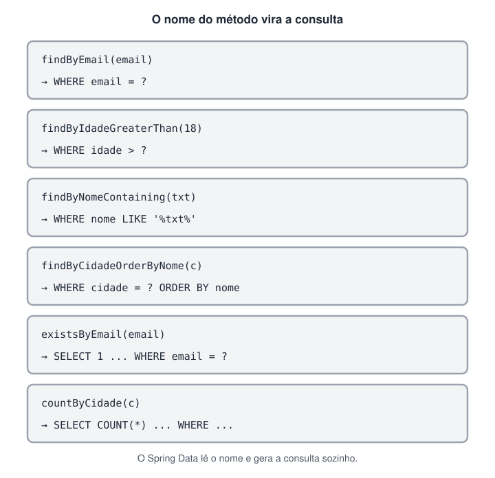

# Spring Data JPA: repositórios, consultas e transações (Adicionado pelo aluno para melhorar o estudo)

> 🗺️ **Nesta aula:** o que um `JpaRepository` já traz pronto, como criar consultas pelo nome do método e com `@Query`, como paginar resultados e como garantir que várias operações aconteçam juntas com `@Transactional`.

## 1. O repositório

Com o Spring Data JPA você não escreve a classe de acesso ao banco: declara uma **interface** e o Spring cria a implementação ao subir a aplicação.

```java
public interface ClienteRepository
  extends JpaRepository<Cliente, Long> {
}
```

Os dois tipos genéricos são a **entidade** (`Cliente`) e o tipo do **id** (`Long`). Só com isso o repositório já tem:

| Método | O que faz |
| --- | --- |
| `save(entidade)` | insere (id nulo) ou atualiza (id existente) |
| `findById(id)` | busca pelo id e devolve um `Optional` |
| `findAll()` | lista todos |
| `deleteById(id)` | apaga pelo id |
| `existsById(id)` / `count()` | existe? / quantos são |

```java
Cliente c = repo.findById(1L)
  .orElseThrow(() -> new ClienteNaoEncontradoException(1L));
```

## 2. Consultas pelo nome do método

Para buscas comuns, basta declarar um método seguindo a convenção de nomes. O Spring Data lê o nome e gera a consulta:

```java
public interface ClienteRepository
    extends JpaRepository<Cliente, Long> {

  Optional<Cliente> findByEmail(String email);

  List<Cliente> findByIdadeGreaterThan(int idade);

  List<Cliente> findByNomeContainingIgnoreCase(String trecho);

  List<Cliente> findByCidadeOrderByNomeAsc(String cidade);

  boolean existsByEmail(String email);

  long countByCidade(String cidade);
}
```



| Palavra no nome | Vira |
| --- | --- |
| `And` / `Or` | `AND` / `OR` |
| `GreaterThan`, `LessThan`, `Between` | `>`, `<`, `BETWEEN` |
| `Containing`, `StartingWith` | `LIKE '%x%'`, `LIKE 'x%'` |
| `IgnoreCase` | compara sem diferenciar maiúsculas |
| `IsNull`, `In` | `IS NULL`, `IN (...)` |
| `OrderBy...Asc/Desc` | `ORDER BY` |

> ⚠️ O nome usa os **atributos da entidade**, não as colunas da tabela. Se o atributo não existir, a aplicação nem sobe: o erro aparece logo na inicialização, o que ajuda a pegar erros de digitação.

## 3. Consultas com @Query e JPQL

Quando o nome do método ficaria enorme, escreva a consulta em **JPQL**, a linguagem de consulta da JPA. Ela parece SQL, mas usa **classes e atributos** em vez de tabelas e colunas:

```java
@Query("SELECT c FROM Cliente c "
     + "WHERE c.cidade = :cidade AND c.idade >= :idade")
List<Cliente> buscarAdultosDaCidade(
    @Param("cidade") String cidade,
    @Param("idade") int idade);
```

Para usar SQL do próprio banco, marque `nativeQuery = true`; aí valem os nomes das tabelas e colunas:

```java
@Query(value = "SELECT * FROM tb_clientes WHERE cidade = ?1",
       nativeQuery = true)
List<Cliente> buscarPorCidadeSql(String cidade);
```

> 💡 **Problema N+1:** relacionamentos `LAZY` são carregados só quando acessados. Listar 100 pedidos e ler o cliente de cada um dispara 1 consulta para os pedidos e mais 100 para os clientes. O `JOIN FETCH` traz tudo numa consulta só:<br />`@Query("SELECT p FROM Pedido p JOIN FETCH p.cliente")`

## 4. Paginação e ordenação

Devolver milhares de registros de uma vez deixa a API lenta. Com um parâmetro `Pageable`, o banco devolve só uma página:

```java
// no repositório
Page<Cliente> findByCidade(String cidade,
                           Pageable pageable);

// no serviço: página 0, 20 itens, ordenado por nome
Pageable pagina =
    PageRequest.of(0, 20, Sort.by("nome"));
Page<Cliente> resultado =
    repo.findByCidade("Recife", pagina);

resultado.getContent();  // os clientes da página
resultado.getTotalElements();  // total no banco
resultado.getTotalPages();  // quantas páginas
```

Num controller, o Spring monta o `Pageable` a partir da URL: `GET /clientes?page=0&size=20&sort=nome,asc`.

## 5. Transações com @Transactional

Uma **transação** agrupa várias operações num bloco **tudo ou nada**: ou todas são gravadas, ou nenhuma. O exemplo clássico é a transferência entre contas: se o débito funcionar e o crédito falhar, o dinheiro não pode sumir.

```java
@Service
public class TransferenciaService {

  private final ContaRepository contas;

  public TransferenciaService(ContaRepository contas) {
    this.contas = contas;
  }

  @Transactional
  public void transferir(Long origemId, Long destinoId,
                         BigDecimal valor) {
    Conta origem = contas.findById(origemId)
        .orElseThrow();
    Conta destino = contas.findById(destinoId)
        .orElseThrow();

    origem.sacar(valor);  // pode lançar exceção
    destino.depositar(valor);
    // não precisa chamar save(): as entidades
    // carregadas na transação são gravadas no commit
  }
}
```

Se `sacar` lançar uma exceção (saldo insuficiente, por exemplo), o Spring faz **rollback** e nada é gravado.

| Regra | Detalhe |
| --- | --- |
| Rollback automático | em `RuntimeException` e `Error` |
| Exceção checked | **não** desfaz, a menos que use `@Transactional(rollbackFor = Exception.class)` |
| Só leitura | `@Transactional(readOnly = true)` em consultas deixa o acesso mais leve |
| Onde colocar | na camada de serviço, que coordena as regras de negócio |

> ⚠️ O `@Transactional` funciona por meio de um **proxy** do Spring, que envolve o bean. Se um método da classe chamar outro método **da mesma classe**, a chamada não passa pelo proxy e a anotação do método chamado é ignorada.

## 📌 Resumo

| Item | Em uma frase |
| --- | --- |
| `JpaRepository<T, ID>` | interface que já traz `save`, `findById`, `findAll`, `deleteById` |
| Consulta derivada | o nome do método vira a consulta (`findByEmail`) |
| `@Query` | JPQL com entidades e atributos; `nativeQuery = true` para SQL puro |
| N+1 | resolva com `JOIN FETCH` |
| `Pageable` / `Page` | busca uma página por vez, com ordenação |
| `@Transactional` | tudo ou nada; rollback em exceções unchecked |
