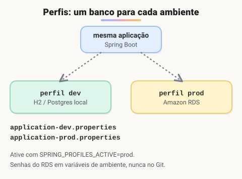

# Criando API REST conectada ao Amazon RDS com Java

> 💡 **Nesta aula:** o **Amazon RDS** (*Relational Database Service*) é o banco relacional **gerenciado** da AWS: você escolhe o motor (MySQL, PostgreSQL, MariaDB, SQL Server, Oracle, Db2 ou Aurora) e a AWS cuida de instalação, backups, atualizações e alta disponibilidade. Neste projeto, uma API REST em Spring Boot usa o RDS no lugar de um banco local — basta apontar a URL de conexão do `application.properties` para o endpoint da instância.

```
# application.properties (exemplo com MySQL no RDS)
spring.datasource.url=jdbc:mysql://<endpoint-da-instancia>.rds.amazonaws.com:3306/meubanco
spring.datasource.username=${DB_USER}
spring.datasource.password=${DB_PASSWORD}
spring.jpa.hibernate.ddl-auto=update
```

> 🔐 Nunca deixe usuário e senha do banco fixos no código ou no repositório: use variáveis de ambiente (como acima) ou um serviço como o AWS Secrets Manager. Libere a porta do banco no *security group* só para os IPs ou serviços que precisam acessá-lo.

## Do banco local para o RDS em 4 passos

1. **Criar a instância** no console da AWS (RDS → Criar banco de dados): escolha o motor, o tamanho da máquina, o usuário administrador e a senha.
2. **Liberar o acesso** no *security group* da instância: abra a porta do banco (3306 no MySQL, 5432 no PostgreSQL) só para o seu IP ou para o servidor da API.
3. **Copiar o endpoint** da instância (algo como `meubanco.abc123.us-east-1.rds.amazonaws.com`) para a URL de conexão.
4. **Passar usuário e senha por variáveis de ambiente** (`DB_USER`, `DB_PASSWORD`) na máquina que roda a API.

A aplicação também precisa do driver do banco no `pom.xml`. Para MySQL:

```xml
<dependency>
  <groupId>com.mysql</groupId>
  <artifactId>mysql-connector-j</artifactId>
  <scope>runtime</scope>
</dependency>
```

## Perfis: um banco para cada ambiente



No dia a dia você desenvolve com um banco local e publica usando o RDS. Os **perfis** (*profiles*) do Spring guardam cada configuração num arquivo próprio:

```
# application-dev.properties (banco em memória)
spring.datasource.url=jdbc:h2:mem:testdb
spring.jpa.hibernate.ddl-auto=create-drop

# application-prod.properties (RDS)
spring.datasource.url=${DB_URL}
spring.datasource.username=${DB_USER}
spring.datasource.password=${DB_PASSWORD}
spring.jpa.hibernate.ddl-auto=validate
```

O perfil ativo é escolhido ao rodar a aplicação, sem mudar o código:

```bash
# pela variável de ambiente
export SPRING_PROFILES_ACTIVE=prod
java -jar api.jar

# ou pela linha de comando
java -jar api.jar --spring.profiles.active=prod
```

## `ddl-auto`: cuidado em produção

| Valor | O que o Hibernate faz com as tabelas |
| --- | --- |
| `create-drop` | cria ao subir e apaga ao desligar (só para testes) |
| `create` | apaga e recria a cada início: perde os dados |
| `update` | tenta ajustar as tabelas às entidades; prático no desenvolvimento |
| `validate` | só confere se tabelas e entidades batem; não altera nada |
| `none` | não mexe no banco |

> ⚠️ Em produção, prefira `validate` ou `none` e crie as tabelas com uma ferramenta de migração como o **Flyway** ou o **Liquibase**. O `update` não remove colunas antigas e pode alterar tabelas de um jeito inesperado num banco com dados reais.

## 📌 Resumo

| Item | Em uma frase |
| --- | --- |
| Amazon RDS | banco relacional gerenciado: a AWS cuida de instalação, backup e atualizações |
| Endpoint | endereço da instância usado na URL JDBC |
| Security group | firewall da instância: libere a porta só para quem precisa |
| Credenciais | sempre por variáveis de ambiente ou Secrets Manager, nunca no código |
| Perfis | `application-{perfil}.properties`  • `spring.profiles.active` |
| `ddl-auto` | `update` no desenvolvimento; `validate` ou `none` com migrações em produção |
