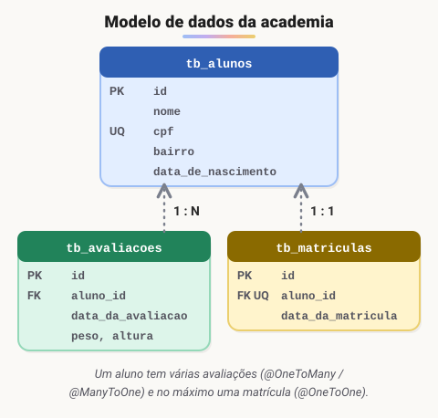
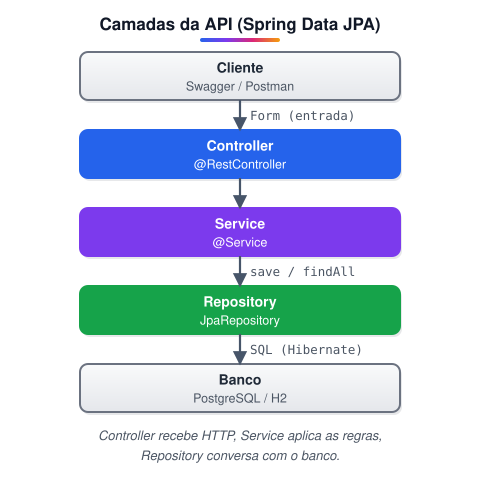

# Projeto: Conhecendo o Spring Data JPA na prática com Java

> 🗺️ **Nesta aula:** um projeto de API para uma academia que aplica o Spring Data JPA na prática: modelo de dados, relacionamentos entre entidades, fluxo do back-end e documentação com Swagger.

## Objetivo do projeto

Conhecer na prática os principais conceitos de **mapeamento objeto-relacional (ORM)** com o **Spring Data JPA**. Para isso, desenvolvemos uma API REST para o domínio de uma **academia de ginástica**, com foco na modelagem das entidades e nos relacionamentos entre elas.

## Modelo de dados

São três entidades:

- **Aluno**: nome, CPF (único), bairro e data de nascimento.
- **AvaliacaoFisica**: peso, altura e data. Um aluno tem **várias** avaliações.
- **Matricula**: data da matrícula. Cada aluno tem **no máximo uma** matrícula.



### Mapeamento dos relacionamentos

```java
@Entity
@Table(name = "tb_alunos")
public class Aluno {
  @Id
  @GeneratedValue(strategy = GenerationType.IDENTITY)
  private Long id;

  private String nome;

  @Column(unique = true)
  private String cpf;

  private String bairro;
  private LocalDate dataDeNascimento;

  @OneToMany(mappedBy = "aluno", fetch = FetchType.LAZY)
  @JsonIgnore // evita recursão infinita ao serializar Aluno -> avaliacoes -> aluno...
  private List<AvaliacaoFisica> avaliacoes = new ArrayList<>();
}

@Entity
@Table(name = "tb_avaliacoes")
public class AvaliacaoFisica {
  @Id
  @GeneratedValue(strategy = GenerationType.IDENTITY)
  private Long id;

  @ManyToOne
  @JoinColumn(name = "aluno_id") // dono do relacionamento: aqui fica a FK
  private Aluno aluno;

  private LocalDateTime dataDaAvaliacao = LocalDateTime.now();
  private double peso;
  private double altura;
}

@Entity
@Table(name = "tb_matriculas")
public class Matricula {
  @Id
  @GeneratedValue(strategy = GenerationType.IDENTITY)
  private Long id;

  @OneToOne
  @JoinColumn(name = "aluno_id", unique = true)
  private Aluno aluno;

  private LocalDateTime dataDaMatricula = LocalDateTime.now();
}
```

> 💡 **Quem é o dono do relacionamento?** O lado com `@JoinColumn` é o dono: é na tabela dele que fica a chave estrangeira. O lado com `mappedBy` só espelha o relacionamento e não gera coluna.

## Fluxo do back-end



- **Controller** (`@RestController`): recebe a requisição HTTP e converte o JSON em um *Form* (DTO de entrada).
- **Service** (`@Service`): aplica as regras de negócio e converte o Form em entidade.
- **Repository** (`interface ... extends JpaRepository<Aluno, Long>`): o Spring Data gera a implementação, com `save`, `findAll`, `findById`, `deleteById` e consultas derivadas do nome do método (ex.: `findByDataDeNascimento`).
- **Banco**: o Hibernate (implementação da JPA) gera o SQL. O curso usa PostgreSQL; para testes, dá para usar H2 em memória.

> ⚠️ **Cuidado com** `spring.jpa.hibernate.ddl-auto`**:** `update` e `create` são práticos no estudo. Em produção, prefira `validate` ou `none` e versione o schema com Flyway ou Liquibase.

## Swagger

Com a dependência `springdoc-openapi-starter-webmvc-ui`, a documentação interativa fica em:

[http://localhost:8080/swagger-ui/index.html](http://localhost:8080/swagger-ui/index.html)

## Materiais

Slides do curso:

Meu projeto:

## 📌 Resumo

| Item | Em uma frase |
| --- | --- |
| Entidades | `Aluno`, `AvaliacaoFisica` e `Matricula`, cada uma numa tabela |
| 1–N | `@OneToMany(mappedBy = ...)` no lado "um" e `@ManyToOne`  • `@JoinColumn` no lado "muitos" |
| 1–1 | `@OneToOne`: cada aluno tem no máximo uma matrícula |
| `@JsonIgnore` | evita a recursão infinita ao transformar entidades ligadas em JSON |
| Camadas | controller → service → repository → banco |
