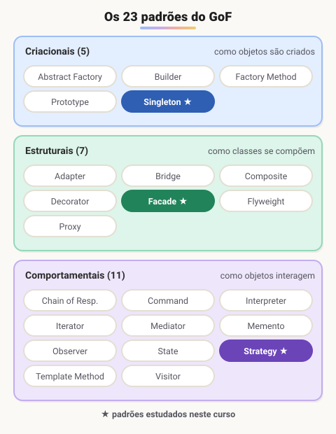
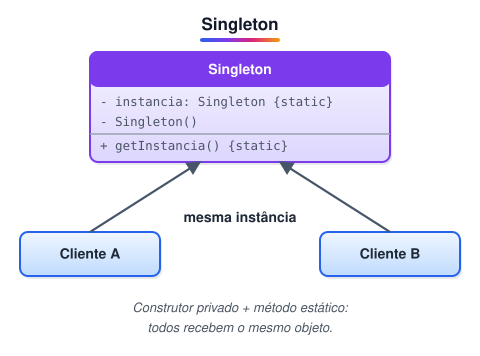
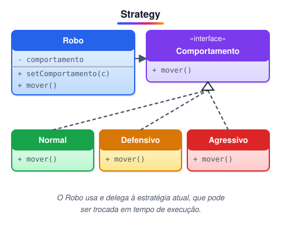
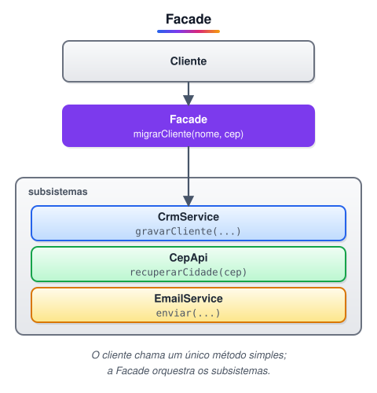
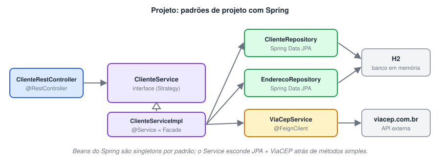

# Explorando Padrões de Projetos na Prática com Java

**Nesta aula:** módulo sobre padrões de projeto do GoF: os conceitos, três padrões clássicos implementados em Java puro (Singleton, Strategy e Facade) e depois os mesmos padrões aplicados em uma API com Spring Boot.

## Introdução

### Padrões de projeto

**Padrões de projeto (design patterns) são soluções consolidadas para problemas recorrentes no desenvolvimento e na manutenção de software orientado a objetos.** Eles não são código pronto: são modelos de solução, com nome, problema, estrutura e consequências, que você adapta ao seu contexto.

A principal referência é o livro ***Design Patterns: Elements of Reusable Object-Oriented Software*** (1994), de **Erich Gamma, Richard Helm, Ralph Johnson e John Vlissides**, autores que ficaram conhecidos como ***Gang of Four*** **(GoF)**. O livro cataloga **23 padrões**, divididos em três categorias:



- **Criacionais**: abstraem *como* os objetos são criados. São eles: Abstract Factory, Builder, Factory Method, Prototype e Singleton.
- **Estruturais**: tratam de *como* classes e objetos se combinam em estruturas maiores. São eles: Adapter, Bridge, Composite, Decorator, Facade, Flyweight e Proxy.
- **Comportamentais**: cuidam da comunicação e da divisão de responsabilidades entre objetos. São eles: Chain of Responsibility, Command, Interpreter, Iterator, Mediator, Memento, Observer, State, Strategy, Template Method e Visitor.

> 🛠️ **Correções:**
>
> - A lista de padrões comportamentais estava incompleta: faltavam Command, Interpreter, Mediator, Memento, State e Visitor. Agora estão os 11.
> - Faltava uma vírgula entre Facade e Flyweight.
> - O livro foi lançado em outubro de 1994. O copyright da edição é de 1995, por isso as duas datas aparecem por aí.

## Singleton

### «Padrão criacional»

**Objetivo:** garantir que uma classe tenha **uma única instância** e oferecer um ponto global de acesso a ela.



**Quando usar:** quando faz sentido existir um único objeto compartilhado, como configuração, cache, pool de conexões ou log.

### Variações em Java

#### Lazy (preguiçoso)

A instância só é criada no primeiro uso.

```java
public class SingletonLazy {
  private static SingletonLazy instancia;

  private SingletonLazy() { }

  public static SingletonLazy getInstancia() {
    if (instancia == null) {
      instancia = new SingletonLazy();
    }
    return instancia;
  }
}
```

> ⚠️ Esta versão **não é thread-safe**: duas threads podem passar pelo `if` ao mesmo tempo e criar duas instâncias.

#### Eager (apressado)

A instância é criada quando a classe é carregada. É thread-safe, porque a JVM garante a inicialização de campos estáticos uma única vez.

```java
public class SingletonEager {
  private static final SingletonEager INSTANCIA = new SingletonEager();

  private SingletonEager() { }

  public static SingletonEager getInstancia() {
    return INSTANCIA;
  }
}
```

#### Lazy Holder

Junta o melhor dos dois: é preguiçoso e thread-safe, sem `synchronized`. A classe interna só é carregada na primeira chamada de `getInstancia()`.

```java
public class SingletonLazyHolder {
  private SingletonLazyHolder() { }

  private static class Holder {
    static final SingletonLazyHolder INSTANCIA = new SingletonLazyHolder();
  }

  public static SingletonLazyHolder getInstancia() {
    return Holder.INSTANCIA;
  }
}
```

> 💡 **Alternativa:** um `enum` com um único valor (`enum Config { INSTANCIA; }`) também é um singleton thread-safe e resistente a serialização e reflexão. Joshua Bloch recomenda essa forma em *Effective Java*.

### Singleton no Spring

Os beans do Spring têm escopo **singleton por padrão**: o container cria **uma instância por contexto** e a injeta onde for pedida (`@Autowired` ou construtor). É o mesmo objetivo do padrão, mas quem controla a instância é o container. A classe não precisa de construtor privado nem de método estático.

> ⚠️ Singletons são compartilhados entre threads. Evite guardar estado mutável neles (ex.: um campo com o "usuário atual"), ou você terá condições de corrida.

## Strategy

### «Padrão comportamental»

**Objetivo:** definir uma família de algoritmos intercambiáveis para resolver o mesmo problema, encapsular cada um em sua própria classe e permitir **trocar o algoritmo em tempo de execução**, sem alterar quem o usa.



### Exemplo: comportamentos de um robô

```java
public interface Comportamento {
  void mover();
}

public class ComportamentoNormal implements Comportamento {
  public void mover() { System.out.println("Movendo-se normalmente..."); }
}

public class ComportamentoDefensivo implements Comportamento {
  public void mover() { System.out.println("Movendo-se defensivamente..."); }
}

public class ComportamentoAgressivo implements Comportamento {
  public void mover() { System.out.println("Movendo-se agressivamente..."); }
}

public class Robo {
  private Comportamento comportamento = new ComportamentoNormal();

  public void setComportamento(Comportamento comportamento) {
    this.comportamento = comportamento;
  }

  public void mover() {
    comportamento.mover(); // delega para a estratégia atual
  }
}
```

Uso:

```java
Robo robo = new Robo();
robo.mover();  // normal
robo.setComportamento(new ComportamentoDefensivo());
robo.mover();  // defensivo
robo.setComportamento(() -> System.out.println("Parado.")); // estratégia via lambda
robo.mover();
```

### Por que usar

- **Elimina ifs e switches** que escolhem o algoritmo: cada variação vive em sua própria classe.
- Segue o princípio **aberto/fechado**: para criar um comportamento novo, você adiciona uma classe, sem mexer no `Robo`.
- Facilita testes: dá para injetar uma estratégia falsa.

> 💡 **Em Java moderno:** se a interface tem um único método, ela é funcional, e a estratégia pode ser um lambda. O `Comparator` passado para `list.sort(...)` é um Strategy do dia a dia.

### Strategy no Spring

Declare uma interface (ex.: `ClienteService`) e uma ou mais implementações anotadas com `@Service`. Quem usa depende só da interface, e o Spring injeta a implementação. Com várias implementações, escolha com `@Qualifier` ou injete todas numa `Map<String, ClienteService>`.

## Facade

### «Padrão estrutural»

**Objetivo:** oferecer uma **interface simples** que reduza a complexidade das integrações com um conjunto de subsistemas. O cliente conversa só com a fachada, que sabe quais subsistemas chamar e em que ordem.



### Exemplo: migrar um cliente

Sem a fachada, quem quisesse cadastrar um cliente teria de conhecer a API de CEP, o CRM e o serviço de e-mail. Com ela, basta uma chamada:

```java
// Subsistemas (complexos, cada um com sua API)
class CepApi {
  String recuperarCidade(String cep) { return "Araraquara"; }
  String recuperarEstado(String cep) { return "SP"; }
}

class CrmService {
  void gravarCliente(String nome, String cep, String cidade, String estado) {
    System.out.printf("Cliente %s salvo no CRM: %s - %s/%s%n", nome, cep, cidade, estado);
  }
}

// Facade
public class Facade {
  private final CepApi cepApi = new CepApi();
  private final CrmService crm = new CrmService();

  public void migrarCliente(String nome, String cep) {
    String cidade = cepApi.recuperarCidade(cep);
    String estado = cepApi.recuperarEstado(cep);
    crm.gravarCliente(nome, cep, cidade, estado);
  }
}

// Cliente
new Facade().migrarCliente("Ana", "14801-788");
```

### Por que usar

- **Desacopla** o cliente dos subsistemas: se a API de CEP mudar, só a Facade é alterada.
- Deixa o código cliente curto e legível.
- Não esconde nada à força: quem precisar pode continuar acessando os subsistemas diretamente.

> 💡 **No dia a dia com Spring:** uma classe `@Service` que orquestra vários repositórios e clientes HTTP, expondo métodos como `inserir(cliente)`, é na prática uma Facade.

## Praticando os padrões de projeto com o Spring

### Os padrões dentro do Spring

- ***Singleton***: os beans (`@Component`, `@Service`, `@Repository`, `@Bean`) são **singletons por padrão**. O container cria uma instância e a injeta com `@Autowired` ou pelo construtor.
- ***Strategy***: definimos a interface `ClienteService` e a implementação `ClienteServiceImpl` (`@Service`). O controller depende só da interface, então a implementação pode ser trocada sem tocar nele. Os repositórios (`@Repository`, interfaces do Spring Data) seguem a mesma ideia.
- ***Facade***: a API REST esconde atrás de métodos simples (`inserir`, `atualizar`, `buscarPorId`...) a integração com o **Spring Data JPA** (banco **H2** em memória) e com a API pública **ViaCEP**, consumida via **OpenFeign**.

> 🛠️ **Correção:** `@Autowired` não *cria* singletons. Ele só injeta o bean. O que define a instância única é o **escopo** do bean, que é `singleton` por padrão.

### Arquitetura do projeto



#### Cliente Feign para o ViaCEP

```java
@FeignClient(name = "viacep", url = "https://viacep.com.br/ws")
public interface ViaCepService {

  @GetMapping("/{cep}/json/")
  Endereco consultarCep(@PathVariable("cep") String cep);
}
```

Para ativar, anote a classe principal com `@EnableFeignClients` e inclua a dependência `spring-cloud-starter-openfeign`.

#### Lógica do serviço (Facade)

```java
@Service
public class ClienteServiceImpl implements ClienteService {

  private final ClienteRepository clienteRepository;
  private final EnderecoRepository enderecoRepository;
  private final ViaCepService viaCepService;

  // injeção por construtor (dispensa @Autowired)
  public ClienteServiceImpl(ClienteRepository c, EnderecoRepository e, ViaCepService v) {
    this.clienteRepository = c;
    this.enderecoRepository = e;
    this.viaCepService = v;
  }

  @Override
  public void inserir(Cliente cliente) {
    String cep = cliente.getEndereco().getCep();
    // reaproveita o endereço salvo; se não existir, consulta o ViaCEP e salva
    Endereco endereco = enderecoRepository.findById(cep)
        .orElseGet(() -> enderecoRepository.save(viaCepService.consultarCep(cep)));
    cliente.setEndereco(endereco);
    clienteRepository.save(cliente);
  }
}
```

### Ferramentas úteis

ViaCEP, a API pública e gratuita de consulta de CEP:

🔗 [ViaCEP - Webservice CEP e IBGE gratuito](https://viacep.com.br/)

jsonschema2pojo, que gera as classes Java a partir de um JSON de exemplo (útil para montar a classe `Endereco`):

🔗 [https://www.jsonschema2pojo.org/](https://www.jsonschema2pojo.org/)

## Repositórios

> "Alguém está sentado à sombra hoje porque alguém plantou uma árvore há muito tempo." (Warren Buffett)

> "Falar é fácil. Mostre-me o código." (Linus Torvalds)

> 🛠️ **Correções:** "sobra" → "sombra", "Mostre me" → "Mostre-me" e "TOrvalds" → "Torvalds".

## 📌 Resumo

| Padrão | Em uma frase |
| --- | --- |
| Padrões GoF | soluções conhecidas para problemas comuns: criacionais, estruturais e comportamentais |
| Singleton | garante uma única instância (no Spring, todo bean é singleton por padrão) |
| Strategy | troca o algoritmo em tempo de execução por meio de uma interface |
| Facade | uma interface simples na frente de subsistemas complexos |
| No Spring | `@Bean`/`@Component` (Singleton), interfaces de serviço (Strategy), serviços que orquestram outros (Facade) |
