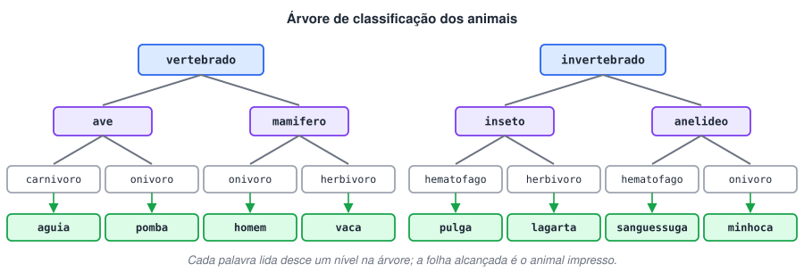

# Desafio animal

> 🗺️ **Nesta aula:** desafio de decisões encadeadas: descobrir o animal a partir de três palavras, com `if` aninhados ou com um `Map`. Tente resolver antes de abrir a resolução.

## Desafio

Leia 3 palavras que classificam um animal, seguindo a árvore abaixo de cima para baixo, e descubra qual animal foi escolhido.



## Entrada

Três palavras, uma por linha, todas em minúsculas.

## Saída

O nome do animal correspondente.

| Entrada | Saída |
| --- | --- |
| vertebrado / mamifero / onivoro | homem |
| vertebrado / ave / carnivoro | aguia |
| invertebrado / anelideo / onivoro | minhoca |

## Resolução

1. Ler as três palavras com `Scanner.nextLine()`.
2. Usar a 1ª e a 2ª palavra para descer até o grupo certo (ave, mamífero, inseto ou anelídeo).
3. Usar a 3ª palavra (alimentação) para escolher entre os dois animais do grupo.
4. Imprimir o animal.

## Código

<details>
<summary>Ver resposta</summary>

```java
import java.util.Scanner;

public class Main {
  public static void main(String[] args) {
    Scanner sc = new Scanner(System.in);

    String an1 = sc.nextLine().trim();
    String an2 = sc.nextLine().trim();
    String an3 = sc.nextLine().trim();

    if (an1.equals("vertebrado") && an2.equals("ave")) {
      if (an3.equals("carnivoro")) {
        System.out.println("aguia");
      } else if (an3.equals("onivoro")) {
        System.out.println("pomba");
      }
    } else if (an1.equals("vertebrado") && an2.equals("mamifero")) {
      if (an3.equals("onivoro")) {
        System.out.println("homem");
      } else if (an3.equals("herbivoro")) {
        System.out.println("vaca");
      }
    } else if (an1.equals("invertebrado") && an2.equals("inseto")) {
      if (an3.equals("hematofago")) {
        System.out.println("pulga");
      } else if (an3.equals("herbivoro")) {
        System.out.println("lagarta");
      }
    } else if (an1.equals("invertebrado") && an2.equals("anelideo")) {
      if (an3.equals("hematofago")) {
        System.out.println("sanguessuga");
      } else if (an3.equals("onivoro")) {
        System.out.println("minhoca");
      }
    }
  }
}
```

</details>

> 🛠️ **Ajustes no código:**
>
> - Removido o `import java.io.IOException`, que não era usado.
> - Variáveis renomeadas de `AN1`, `AN2`, `AN3` para `an1`, `an2`, `an3`. Em Java, nomes só em maiúsculas são convenção para constantes.
> - Adicionado `.trim()`, que remove espaços extras no fim da linha (causa comum de "resposta errada" em juízes online).

### Alternativa: tabela em vez de ifs

Como cada combinação leva a exatamente um animal, dá para trocar os ifs aninhados por um `Map`:

<details>
<summary>Ver resposta alternativa</summary>

```java
Map<String, String> animais = Map.of(
  "vertebrado ave carnivoro", "aguia",
  "vertebrado ave onivoro", "pomba",
  "vertebrado mamifero onivoro", "homem",
  "vertebrado mamifero herbivoro", "vaca",
  "invertebrado inseto hematofago", "pulga",
  "invertebrado inseto herbivoro", "lagarta",
  "invertebrado anelideo hematofago", "sanguessuga",
  "invertebrado anelideo onivoro", "minhoca");

System.out.println(animais.get(an1 + " " + an2 + " " + an3));
```

</details>

Os dados ficam separados da lógica: incluir um animal novo é só adicionar uma linha.

## 📌 Resumo

| Item | O que o desafio pratica |
| --- | --- |
| `nextLine().trim()` | ler uma palavra por linha sem espaços sobrando |
| `equals` | comparar textos pelo conteúdo, nunca com `==` |
| `if` aninhados | descer na árvore de decisão: ramo, classe e alimentação |
| `Map.of` | trocar a cadeia de `if` por uma tabela chave → resposta |
