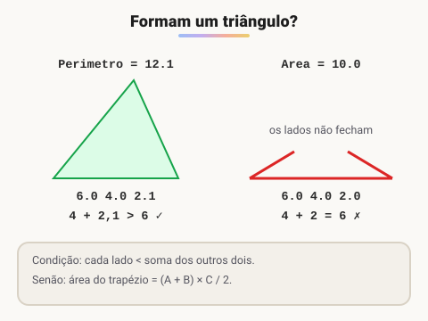

# Desafio triângulo

> 🗺️ **Nesta aula:** desafio de geometria com condição: verificar se três medidas formam um triângulo (desigualdade triangular) e calcular o perímetro ou a área do trapézio. Tente resolver antes de abrir a resolução.

## Desafio

Leia 3 valores reais (A, B e C) e verifique se eles formam um triângulo.

- **Se formarem**, calcule o perímetro (soma dos lados) e mostre `Perimetro = XX.X`.
- **Se não formarem**, calcule a área do trapézio com bases A e B e altura C, e mostre `Area = XX.X`.

Fórmula da área do trapézio: **AREA = ((A + B) × C) / 2**

## Entrada

Três valores reais.

## Saída

O resultado com uma casa decimal.

| Entrada | Saída |
| --- | --- |
| 6.0 4.0 2.0 | Area = 10.0 |
| 6.0 4.0 2.1 | Perimetro = 12.1 |



## Resolução

Três medidas formam um triângulo quando **cada lado é menor que a soma dos outros dois** (desigualdade triangular): `A < B + C`, `B < A + C` e `C < A + B`.

- No 1º exemplo, 6 não é menor que 4 + 2 = 6. Os lados "deitam" em linha reta, então não há triângulo. Calculamos o trapézio: ((6 + 4) × 2) / 2 = **10.0**.
- No 2º exemplo, 6 < 4 + 2,1 = 6,1. Há triângulo, e o perímetro é 6 + 4 + 2,1 = **12.1**.

Basta testar as três desigualdades. Não é preciso descobrir qual é o maior lado.

## Código

<details>
<summary>Ver resposta</summary>

```java
import java.util.Locale;
import java.util.Scanner;

public class Main {
  public static void main(String[] args) {
    Scanner leitor = new Scanner(System.in).useLocale(Locale.US);
    double a = leitor.nextDouble();
    double b = leitor.nextDouble();
    double c = leitor.nextDouble();

    boolean formaTriangulo = a < b + c && b < a + c && c < a + b;

    if (formaTriangulo) {
      double perimetro = a + b + c;
      System.out.println(String.format(Locale.US, "Perimetro = %.1f", perimetro));
    } else {
      double area = ((a + b) * c) / 2;
      System.out.println(String.format(Locale.US, "Area = %.1f", area));
    }
  }
}
```

</details>

> 🛠️ **Ajustes no código:**
>
> - O cálculo do `maior` lado era feito, mas o valor nunca era usado. O mesmo valia para a variável `triangulo`. Ambos foram removidos.
> - A variável `soma` guardava ora o perímetro, ora a área. Agora cada valor tem seu próprio nome.
> - `String.format` sem `Locale` imprime `12,1` (com vírgula) em computadores em português. Com `Locale.US` sai `12.1`, como o juiz espera.
> - Removido o `import java.io.IOException`, que não era usado, e a linha duplicada da tabela de exemplos.

## 📌 Resumo

| Item | O que o desafio pratica |
| --- | --- |
| Desigualdade triangular | cada lado é menor que a soma dos outros dois |
| `&&` | as três condições precisam valer ao mesmo tempo |
| Perímetro | soma dos três lados |
| Área do trapézio | `((A + B) × C) / 2` |
| Saída | `String.format(Locale.US, "%.1f")`: uma casa decimal com ponto |
