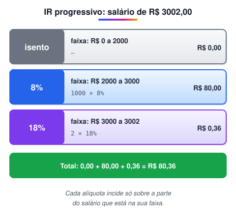

# Desafio taxa de Imposto de Renda

> 🗺️ **Nesta aula:** desafio de faixas progressivas: calcular o imposto de renda somando a parte de cada faixa, com `if`/`else if` e saída formatada. Tente resolver antes de abrir a resolução.

## Desafio

No país de Lolipad, todos pagam seus impostos com alegria: lá não há corrupção e todo o dinheiro arrecadado volta para a população. A moeda é o Loli, cujo símbolo é R$.

Leia um salário com duas casas decimais e calcule o Imposto de Renda devido, segundo a tabela:

| Faixa de renda | Alíquota |
| --- | --- |
| R$ 0,00 a R$ 2.000,00 | Isento |
| R$ 2.000,01 a R$ 3.000,00 | 8% |
| R$ 3.000,01 a R$ 4.500,00 | 18% |
| Acima de R$ 4.500,00 | 28% |

O imposto é **progressivo**: cada alíquota incide apenas sobre a parte do salário dentro da sua faixa. Para R$ 3.002,00, são 8% sobre R$ 1.000,00 mais 18% sobre R$ 2,00, totalizando **R$ 80,36**.



## Entrada

Um valor de ponto flutuante com duas casas decimais.

## Saída

`R$` seguido de um espaço e do imposto com duas casas decimais, separadas por **ponto**. Se o salário for menor ou igual a 2000, imprima `Isento`.

| Entrada | Saída |
| --- | --- |
| 3002.00 | R$ 80.36 |
| 1701.12 | Isento |
| 4520.00 | R$ 355.60 |

## Resolução

1. Ler o salário.
2. Descobrir em que faixa ele cai e somar o imposto de cada faixa completa abaixo dela:
  - até 2000: 0;
  - até 3000: `(renda - 2000) × 8%`;
  - até 4500: `(renda - 3000) × 18%` + R$ 80 (a faixa de 8% cheia);
  - acima: `(renda - 4500) × 28%` + R$ 270 (a faixa de 18% cheia) + R$ 80.
3. Imprimir `Isento` ou o valor formatado.

Conferindo o 3º exemplo: (4520 − 4500) × 0,28 + 270 + 80 = 5,60 + 350 = **355,60**. ✔

## Código

<details>
<summary>Ver resposta</summary>

```java
import java.util.Locale;
import java.util.Scanner;

public class Main {
  public static void main(String[] args) {
    Scanner leitor = new Scanner(System.in).useLocale(Locale.US);
    double renda = leitor.nextDouble();
    double imposto;

    if (renda <= 2000.0) {
      imposto = 0.0;
    } else if (renda <= 3000.0) {
      imposto = (renda - 2000.0) * 0.08;
    } else if (renda <= 4500.0) {
      imposto = (renda - 3000.0) * 0.18 + 1000.0 * 0.08;
    } else {
      imposto = (renda - 4500.0) * 0.28 + 1500.0 * 0.18 + 1000.0 * 0.08;
    }

    if (imposto == 0.0) {
      System.out.println("Isento");
    } else {
      System.out.println(String.format(Locale.US, "R$ %.2f", imposto));
    }
  }
}
```

</details>

> 🛠️ **Correções no código:**
>
> - `String.format("R$ %.2f", ...)` usa o idioma do sistema: num computador em português, imprime `R$ 80,36`, com vírgula, e a resposta é considerada errada. Passar `Locale.US` garante o ponto. Pelo mesmo motivo, o `Scanner` recebeu `useLocale(Locale.US)`, para ler `3002.00`.
> - Removidos o `import java.io.IOException` e o `throws IOException`, que não eram usados.

> 💡 Em sistemas reais de dinheiro, use `BigDecimal` em vez de `double`. O `double` tem erros de arredondamento binário (por exemplo, `0.1 + 0.2` dá `0.30000000000000004`).

## 📌 Resumo

| Item | O que o desafio pratica |
| --- | --- |
| Imposto progressivo | cada alíquota incide só sobre a parte do salário dentro da sua faixa |
| `if` / `else if` | testar as faixas da menor para a maior |
| Faixas cheias | somar o imposto das faixas anteriores: R$ 80 (8%) e R$ 270 (18%) |
| Saída | `String.format(Locale.US, "R$ %.2f", valor)` garante o ponto decimal |
