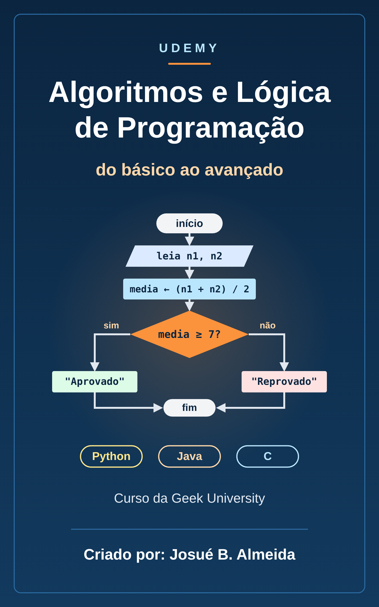

# Udemy: Algoritmos e Lógica de Programação do básico ao avançado - Geek University

📥 **[Baixar o EPUB](https://github.com/Joshpcbrrj/biblioteca-de-estudos/releases/download/epubs/geek-university-logica.epub)**

A base da programação antes de qualquer linguagem: lógica, algoritmos, pseudocódigo, fluxogramas, variáveis, tipos, operadores e entrada e saída, com exemplos em Python, Java e C. Nos exercícios, as respostas ficam recolhidas em **Ver resposta**.

- [Sobre o curso](aulas/00-sobre-o-curso.md)

## 🛠️ 1. Preparando o ambiente

- [Configurando o ambiente no Windows](aulas/01-configurando-o-ambiente-no-windows.md)

## 🧠 2. Introdução à lógica de programação

- [Lógica](aulas/02-logica.md)
- [Sequência lógica](aulas/03-sequencia-logica.md)
- [Instruções lógicas](aulas/04-instrucoes-logicas.md)
- [Algoritmo](aulas/05-algoritmo.md)
- [Programas](aulas/06-programas.md)
- [Recapitulando](aulas/07-recapitulando.md)

## 📝 3. Desvendando algoritmos

- [Pseudocódigo](aulas/08-pseudocodigo.md)
- [Fluxograma](aulas/09-fluxograma.md)
- [Regra para construção de algoritmos](aulas/10-regra-para-construcao-de-algoritmos.md)
- [Fases de um algoritmo](aulas/11-fases-de-um-algoritmo.md)

## 📦 4. Constantes, variáveis e tipos de dados

- [Constantes](aulas/12-constantes.md)
- [Variáveis](aulas/13-variaveis.md)
- [Tipos de dados](aulas/14-tipos-de-dados.md)

## ➗ 5. Operadores, entrada e saída

- [Operadores e expressões](aulas/15-operadores-e-expressoes.md)
- [Entrada e saída de dados](aulas/16-entrada-e-saida-de-dados.md)

## 🏋️ 6. Prática

- [Exercícios de fixação](aulas/17-exercicios-de-fixacao.md)
