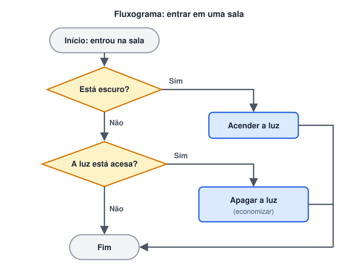

# Lógica

> 🗺️ **Nesta aula:** o que é lógica (premissas e conclusão), como ela vira lógica de programação, as três ferramentas básicas (sequência, decisão e repetição) e um primeiro fluxograma traduzido para Python.

## O que é lógica

**Lógica** é o estudo das regras do raciocínio correto: como chegar a uma **conclusão** válida a partir de informações conhecidas (as **premissas**).

O exemplo clássico:

1. Premissa: todo ser humano é mortal.
2. Premissa: Sócrates é um ser humano.
3. Conclusão: logo, Sócrates é mortal.

Se as premissas são verdadeiras e o raciocínio segue as regras, a conclusão também é verdadeira. A lógica é a base da filosofia, da matemática e da computação.

Usamos lógica o tempo todo sem perceber:

- "A gaveta está fechada. A caneta está dentro da gaveta. Logo, preciso abrir a gaveta para pegar a caneta."
- "Se chover, levo guarda-chuva. Está chovendo. Logo, levo o guarda-chuva."

### Lógica de programação

**Lógica de programação** é a aplicação desse raciocínio para escrever programas: organizar, em uma ordem coerente, os passos que o computador deve seguir para resolver um problema.

O computador não "entende" a intenção de quem programa: ele executa exatamente o que foi escrito. Por isso é preciso pensar em três coisas:

- **O que o programa recebe** (dados de entrada).
- **Que passos transformam esses dados** no resultado esperado, e em que ordem.
- **O que o programa entrega** (saída).

Para isso, a lógica de programação usa três ferramentas básicas, que aparecem ao longo de todo o curso:

| Ferramenta | O que faz | Exemplo do dia a dia |
| --- | --- | --- |
| **Sequência** | Executa os passos um após o outro | Abrir a porta → entrar → fechar a porta |
| **Decisão** (condicional) | Escolhe um caminho conforme uma condição | Se estiver escuro, acender a luz |
| **Repetição** (laço) | Repete passos enquanto uma condição for verdadeira | Enquanto houver louça suja, lavar um prato |

Uma forma comum de visualizar a lógica é o **fluxograma**: retângulos são ações, losangos são decisões (com saídas "Sim" e "Não") e as setas mostram a ordem.

**Exemplo de fluxograma usando pensamento lógico:**



A mesma lógica escrita em Python:

```python
esta_escuro = False
luz_acesa = True

if esta_escuro:
  print("Acender a luz")
elif luz_acesa:
  print("Apagar a luz para economizar")

print("Fim")
```

Repare que o código segue exatamente o fluxograma: primeiro testa se está escuro e só testa a luz quando a primeira resposta é "Não".

## 📌 Resumo da aula

| Conceito | Em uma frase |
| --- | --- |
| Lógica | regras do raciocínio que levam de premissas verdadeiras a conclusões válidas |
| Lógica de programação | organizar esse raciocínio em passos que o computador consegue seguir |
| O computador | executa exatamente o que foi escrito; não deduz intenções |
| Três ferramentas | sequência, decisão e repetição |
| Fluxograma | desenho do raciocínio: retângulo = ação, losango = decisão, setas = ordem |
