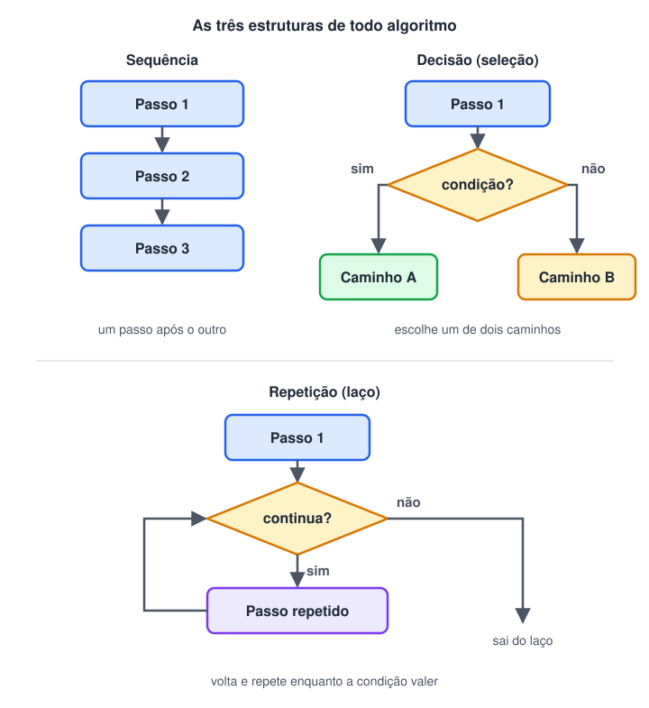

# Sequência lógica

> 🗺️ **Nesta aula:** o que é uma sequência lógica, por que a ordem dos passos importa (no dia a dia e no código), os dois tipos de erro de ordem, o teste de mesa para acompanhar a execução e as três estruturas básicas de todo algoritmo. No fim há exercícios com resposta.

## 1. O que é uma sequência lógica

Uma **sequência lógica** é um conjunto de passos executados **em uma ordem definida** para atingir um objetivo. A ordem não é um detalhe: cada passo depende do que foi feito antes.

**Exemplo do dia a dia: trocar uma lâmpada queimada**

1. Desligar o interruptor.
2. Pegar uma escada.
3. Posicionar a escada embaixo da lâmpada.
4. Subir na escada.
5. Retirar a lâmpada queimada.
6. Colocar a lâmpada nova.
7. Descer da escada.
8. Ligar o interruptor para testar.

| Se trocarmos… | O resultado fica… |
| --- | --- |
| o passo 1 para o final | **perigoso**: mexer na lâmpada com a energia ligada |
| o passo 6 antes do 5 | **impossível**: não dá para colocar a nova sem tirar a velha |
| o passo 8 antes do 7 | **funciona**: alguns passos são independentes e podem mudar de lugar |

O último caso mostra que nem todo passo depende de todos os outros. Para montar uma boa sequência, pergunte a cada passo: *"o que precisa estar pronto antes deste?"*

## 2. Sequência lógica na programação

Em um programa, a sequência lógica é a ordem das instruções. Por padrão, o computador executa **de cima para baixo, uma instrução por vez**, e cada linha pode usar o resultado das linhas anteriores.

Uma sequência típica tem três etapas:

1. **Entrada**: criar variáveis e ler valores.
2. **Processamento**: fazer cálculos e tomar decisões.
3. **Saída**: mostrar o resultado.

```python
# 1. Entrada
preco = 50.0
quantidade = 3

# 2. Processamento
total = preco * quantidade

# 3. Saída
print("Total a pagar:", total)  # Total a pagar: 150.0
```

## 3. Os dois tipos de erro de ordem

### Erro que trava o programa

Usar algo **antes de ele existir**. O computador avisa com uma mensagem de erro.

```python
print("Total a pagar:", total)  # ❌ NameError: name 'total' is not defined
total = 50.0 * 3
```

São as mesmas instruções do exemplo anterior, só que fora de ordem.

### Erro silencioso: o programa roda, mas o resultado está errado

Este é o mais perigoso, porque **não aparece mensagem nenhuma**. Exemplo: um salário de R$ 2.000 recebe 10% de aumento e depois tem 10% de imposto descontado sobre o **novo** valor.

```python
# ✅ Ordem certa
salario = 2000
salario = salario * 1.10  # aumento primeiro → 2200
imposto = salario * 0.10  # imposto sobre o novo salário → 220
print(salario - imposto)  # 1980.0
```

```python
# ❌ Ordem trocada: o imposto é calculado antes do aumento
salario = 2000
imposto = salario * 0.10  # 200 (sobre o salário antigo)
salario = salario * 1.10  # 2200
print(salario - imposto)  # 2000.0 → R$ 20 a mais, sem nenhum aviso
```

> ⚠️ Quando o resultado parece estranho mas não há mensagem de erro, desconfie da **ordem** das instruções. O teste de mesa, logo abaixo, é a ferramenta para encontrar esse tipo de problema.

## 4. Teste de mesa

O **teste de mesa** é executar o algoritmo "no papel": você anota numa tabela o valor de cada variável depois de cada linha. É assim que se descobre o que o programa realmente faz, e não o que você acha que ele faz.

```python
a = 5
b = 3
a = a + b
b = a - b
a = a - b
print(a, b)
```

| Linha | Instrução | `a` | `b` |
| --- | --- | --- | --- |
| 1 | `a = 5` | 5 | – |
| 2 | `b = 3` | 5 | 3 |
| 3 | `a = a + b` | 8 | 3 |
| 4 | `b = a - b` | 8 | 5 |
| 5 | `a = a - b` | 3 | 5 |
| 6 | `print(a, b)` | **3** | **5** |

O resultado mostra que essa sequência **troca os valores** de `a` e `b` sem usar uma terceira variável. Se você mudar a ordem das linhas 3, 4 e 5, a troca deixa de funcionar. Faça o teste de mesa para conferir.

## 5. As três estruturas de todo algoritmo

A sequência é a estrutura mais básica, mas não é a única. Todo algoritmo, por maior que seja, é montado combinando apenas três estruturas:



| Estrutura | O que faz | Exemplo na lâmpada |
| --- | --- | --- |
| **Sequência** | executa os passos um após o outro | os 8 passos da troca |
| **Decisão** | escolhe um caminho conforme uma condição | *se* a lâmpada não acender, verificar a instalação |
| **Repetição** | repete passos enquanto uma condição valer | *enquanto* houver lâmpadas queimadas, repetir a troca |

As decisões e as repetições sempre ficam **encaixadas dentro** de uma sequência. Elas serão estudadas em detalhe nas próximas seções do curso.

## 6. Exercícios

**1. Coloque em ordem os passos para sacar dinheiro em um caixa eletrônico:**

Retirar o dinheiro · Inserir o cartão · Escolher o valor · Retirar o cartão · Digitar a senha · Escolher a opção "Saque"

<details>
<summary>Ver resposta</summary>

1. Inserir o cartão.
2. Digitar a senha.
3. Escolher a opção "Saque".
4. Escolher o valor.
5. Retirar o cartão.
6. Retirar o dinheiro.<br />Os passos 1 → 2 → 3 → 4 dependem uns dos outros. A ordem de 5 e 6 varia conforme o banco (muitos caixas devolvem o cartão antes do dinheiro justamente para você não esquecê-lo).

</details>

**2. O que este programa mostra na tela? Faça o teste de mesa antes de abrir a resposta.**

```python
x = 2
x = x * 3
y = x + 1
x = y * 2
print(x, y)
```

<details>
<summary>Ver resposta</summary>

| Linha | `x` | `y` |
| --- | --- | --- |
| `x = 2` | 2 | – |
| `x = x * 3` | 6 | – |
| `y = x + 1` | 6 | 7 |
| `x = y * 2` | 14 | 7 |

A saída é `14 7`.

</details>

**3. Encontre e corrija o erro de sequência:**

```python
nota1 = 7
media = (nota1 + nota2) / 2
nota2 = 9
print("Média:", media)
```

<details>
<summary>Ver resposta</summary>

`nota2` é usada na linha 2, mas só é criada na linha 3. O Python mostra `NameError: name 'nota2' is not defined`. A correção é criar as duas notas antes do cálculo:

```python
nota1 = 7
nota2 = 9
media = (nota1 + nota2) / 2
print("Média:", media)  # Média: 8.0
```

</details>

**4. Escreva a sequência de passos para fazer um café coado. Depois, marque quais passos poderiam trocar de lugar sem problema.**

<details>
<summary>Ver uma resposta possível</summary>

1. Colocar água para ferver.
2. Colocar o filtro no suporte.
3. Colocar o pó de café no filtro.
4. Despejar a água quente sobre o pó.
5. Esperar a água passar pelo filtro.
6. Servir o café na xícara.<br />Os passos 2 e 3 podem ser feitos antes ou durante o passo 1 (enquanto a água esquenta). Já o 4 só pode vir depois de 1, 2 e 3, e o 6 só depois do 5.

</details>

## 📌 Resumo da aula

| Conceito | Em uma frase |
| --- | --- |
| Sequência lógica | passos em uma ordem definida, em que cada um depende dos anteriores |
| Ordem de execução | o computador lê de cima para baixo, uma instrução por vez |
| Entrada → processamento → saída | a forma típica de uma sequência |
| Erro que trava | usar algo antes de existir (ex.: `NameError`) |
| Erro silencioso | ordem trocada que roda, mas dá resultado errado |
| Teste de mesa | anotar o valor de cada variável linha a linha |
| Três estruturas | sequência, decisão e repetição; as duas últimas ficam dentro da primeira |
