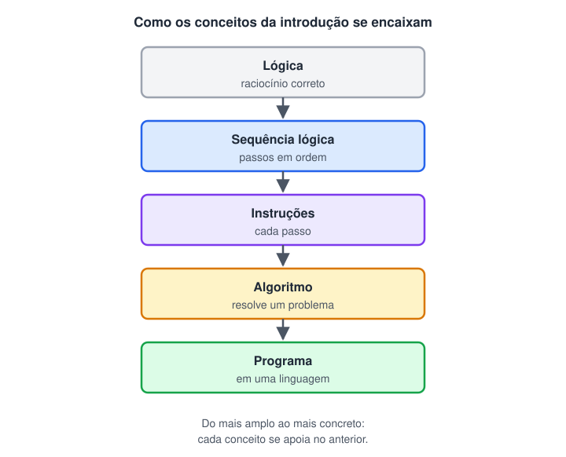

# Recapitulando

> 🗺️ **Nesta página:** revisão da seção de introdução (Lógica, Sequência lógica, Instruções lógicas, Algoritmo e Programas) com o mapa dos conceitos, uma tabela-resumo, os pontos para não esquecer e um teste rápido com respostas.

Resumo da seção **Introdução à lógica de programação**: como os conceitos se encaixam, do mais amplo ao mais concreto.



## Conceitos-chave

| Conceito | Definição curta | Exemplo |
| --- | --- | --- |
| **Lógica** | Regras do raciocínio que levam a conclusões válidas | "Se chover, levo guarda-chuva. Choveu. Logo, levo." |
| **Lógica de programação** | Organizar o raciocínio em passos que o computador consegue seguir | Pensar entrada → processamento → saída |
| **Sequência lógica** | Passos executados em uma ordem em que cada um depende dos anteriores | Desligar o interruptor antes de trocar a lâmpada |
| **Instrução** | Uma ação elementar: ler, atribuir, calcular, mostrar, decidir, repetir | `total <- preco * quantidade` |
| **Algoritmo** | Sequência finita e bem definida de instruções que resolve um problema | Encontrar o maior entre três números |
| **Programa** | Algoritmo escrito em uma linguagem de programação e executado pelo computador | O mesmo algoritmo em Python, Java ou C |

## Pontos para não esquecer

- O computador executa **exatamente** o que foi escrito, de cima para baixo. Ele não deduz intenções.
- A **ordem** das instruções faz parte da solução. As mesmas instruções em outra ordem podem dar erro ou resultado errado.
- Toda solução combina três estruturas: **sequência**, **decisão** e **repetição**.
- O algoritmo é independente da linguagem. Primeiro se resolve o problema (algoritmo); depois se escolhe como escrevê-lo (programa).
- Um algoritmo precisa ser **finito**, **sem ambiguidade** e **testado** com casos variados, incluindo empates, zeros e negativos.
- Erros de **sintaxe** impedem o programa de rodar; erros de **lógica** deixam o programa rodar com o resultado errado.

## Teste rápido

**1. Qual a diferença entre algoritmo e programa?**

<details>
<summary>Ver resposta</summary>

O algoritmo é a sequência de passos que resolve o problema, independente de linguagem. O programa é esse algoritmo escrito em uma linguagem de programação específica, pronto para ser executado.

</details>

**2. Por que "mexa até ficar bom" não é um passo válido de algoritmo?**

<details>
<summary>Ver resposta</summary>

Porque é ambíguo: não há um critério objetivo para saber quando parar. Um passo válido precisa ser bem definido, como "mexa por 5 minutos".

</details>

**3. O código abaixo dá erro. Qual princípio foi violado?**

```python
print(total)
total = 10 * 2
```

<details>
<summary>Ver resposta</summary>

A sequência lógica: `total` é usado antes de ser criado. A instrução de atribuição precisa vir antes da instrução de saída.

</details>

**4. Quais são as três estruturas básicas da lógica de programação?**

<details>
<summary>Ver resposta</summary>

Sequência (passos em ordem), decisão (escolher um caminho com `se/senão`) e repetição (repetir passos com laços como `enquanto`).

</details>
