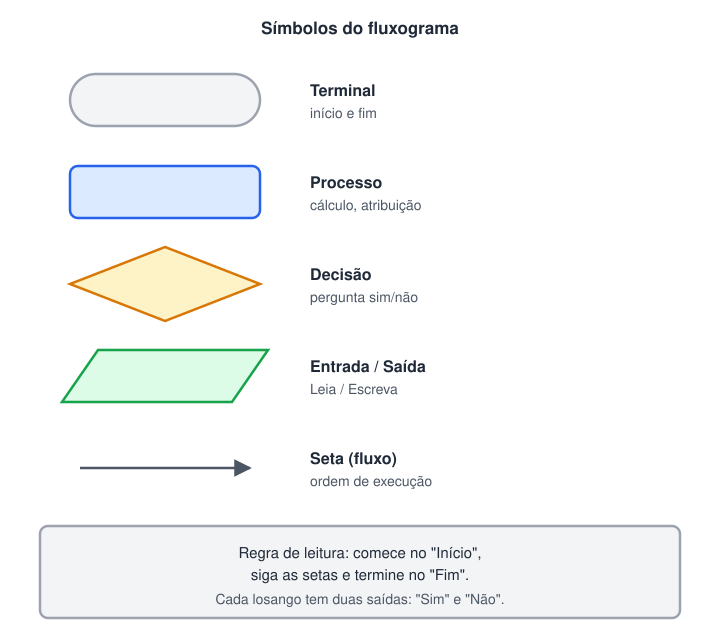
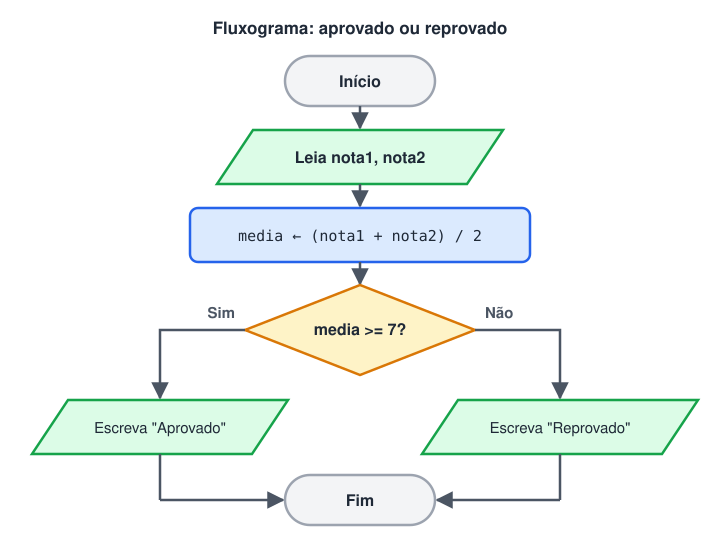

# Fluxograma

> ✨ **Página nova:** o fluxograma aparece nas aulas de Lógica e Pseudocódigo, mas não tinha uma aula própria. Aqui estão os símbolos, as regras de desenho e o passo a passo para converter entre fluxograma, pseudocódigo e código.

> 🗺️ **Nesta aula:** os cinco símbolos básicos, as regras para desenhar um fluxograma correto, um exemplo completo (aprovado ou reprovado), como desenhar decisões e repetições e quando vale a pena usar fluxograma em vez de pseudocódigo.

## 1. O que é um fluxograma

Um **fluxograma** é a representação **gráfica** de um algoritmo. Cada tipo de passo tem um formato próprio, e setas mostram a ordem de execução. Ele deixa visíveis os **caminhos** que o algoritmo pode seguir, o que é difícil de enxergar só lendo texto.

## 2. Os símbolos



| Símbolo | Formato | Uso | Equivalente no pseudocódigo |
| --- | --- | --- | --- |
| Terminal | retângulo arredondado (oval) | início e fim | `Início` / `Fim` |
| Processo | retângulo | cálculo ou atribuição | `media <- (n1 + n2) / 2` |
| Decisão | losango | pergunta com resposta sim ou não | `Se ... então` |
| Entrada / Saída | paralelogramo | ler ou mostrar dados | `Leia` / `Escreva` |
| Seta | linha com ponta | ordem de execução | a ordem das linhas |

> 💡 Alguns materiais usam símbolos diferentes para entrada (teclado) e para saída (tela ou documento). O paralelogramo para os dois casos é o padrão mais comum e o mais simples para começar.

## 3. Regras para um fluxograma correto

1. Existe **um** início e **um** fim.
2. O fluxo vai de **cima para baixo** (ou da esquerda para a direita).
3. Cada símbolo tem **uma** ação curta.
4. Todo losango tem **exatamente duas** saídas, rotuladas **Sim** e **Não**.
5. Toda seta tem um destino: nenhum caminho fica "solto".
6. Os caminhos de uma decisão se **reúnem** antes de seguir (ou terminam no Fim).
7. Evite setas que se cruzam; se ficar confuso, divida o problema em partes.

## 4. Exemplo completo

Problema: ler duas notas, calcular a média e informar se o aluno foi aprovado (média maior ou igual a 7).



**Lendo o fluxograma**

1. Começa no Início.
2. Lê as duas notas (entrada).
3. Calcula a média (processamento).
4. Pergunta: média >= 7?
5. Mostra o resultado (saída) por um dos dois caminhos.
6. Os caminhos se juntam no Fim.

**O mesmo algoritmo em pseudocódigo e em Python**

```
Algoritmo Aprovacao
Início
  Declare nota1, nota2, media: Real
  Leia nota1
  Leia nota2
  media <- (nota1 + nota2) / 2
  Se media >= 7 então
    Escreva "Aprovado"
  Senão
    Escreva "Reprovado"
  FimSe
Fim
```

```python
nota1 = float(input("Nota 1: "))
nota2 = float(input("Nota 2: "))
media = (nota1 + nota2) / 2

if media >= 7:
  print("Aprovado")
else:
  print("Reprovado")
```

Cada símbolo do fluxograma vira uma linha (ou um bloco) do pseudocódigo e do código: paralelogramo → `Leia`/`input`, retângulo → atribuição, losango → `Se`/`if`.

## 5. Desenhando decisões e repetições

| Estrutura | Como aparece no fluxograma |
| --- | --- |
| Decisão simples (`Se` sem `Senão`) | o lado "Não" do losango vai direto para o ponto de encontro, sem nenhuma ação |
| Decisão composta (`Se ... Senão`) | cada saída do losango tem suas ações; depois os caminhos se juntam |
| Decisões encadeadas (`Senão se`) | um losango dentro do caminho "Não" do anterior |
| Repetição (`Enquanto`) | uma seta **volta para cima**, até o losango da condição; o lado "Não" sai do laço |

**Exemplo: repetição descrita passo a passo (contar de 1 a 5)**

1. **Terminal:** Início.
2. **Processo:** `contador <- 1`.
3. **Decisão:** `contador <= 5?`
4. **Sim → Saída:** `Escreva contador`.
5. **Processo:** `contador <- contador + 1`.
6. **Seta de volta** para o losango do passo 3.
7. **Não → Terminal:** Fim.

```python
contador = 1
while contador <= 5:
  print(contador)
  contador = contador + 1
```

Se a seta do passo 6 voltasse para o passo 2, o contador seria zerado a cada volta e o laço nunca terminaria. Em fluxogramas, esse erro fica fácil de ver.

## 6. Fluxograma ou pseudocódigo?

|  | Fluxograma | Pseudocódigo |
| --- | --- | --- |
| Ponto forte | mostra os caminhos e as decisões de forma visual | é mais rápido de escrever e fica perto do código |
| Ponto fraco | fica enorme em algoritmos grandes | caminhos complexos ficam menos visíveis |
| Melhor para | entender, explicar e revisar lógicas com muitas decisões | planejar o código linha a linha |

> ✅ Para desenhar fluxogramas no computador, ferramentas gratuitas como o **[draw.io](http://draw.io)** ([diagrams.net](http://diagrams.net)) e o **Miro** já trazem os símbolos prontos. No papel, um lápis e uma borracha resolvem.

## 📌 Resumo da aula

| Conceito | Lembre |
| --- | --- |
| Fluxograma | algoritmo em desenho; mostra os caminhos possíveis |
| Oval | início e fim |
| Retângulo | processamento (cálculo, atribuição) |
| Losango | decisão; sempre duas saídas, Sim e Não |
| Paralelogramo | entrada e saída de dados |
| Repetição | seta que volta para o losango da condição |
| Conversão | cada símbolo vira uma linha do pseudocódigo e do código |
