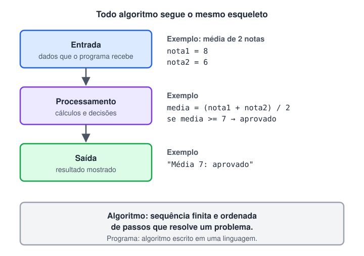

# Fases de um algoritmo

> 🗺️ **Nesta aula:** as três fases de todo algoritmo (entrada, processamento e saída), como quebrar um problema respondendo a três perguntas e o mesmo algoritmo de média escrito em pseudocódigo, Java, C e Python.

Todo algoritmo pode ser dividido em três fases:



### Fase de entrada

Os dados chegam ao algoritmo. Podem vir do usuário (teclado), de arquivos, de um banco de dados ou de outro sistema. Em pseudocódigo, a instrução típica é `Leia`.

### Fase de processamento

Os dados de entrada são transformados: cálculos, comparações, decisões e repetições. É aqui que está a "inteligência" do algoritmo.

### Fase de saída

O resultado é entregue em uma forma útil: uma mensagem na tela, um arquivo gerado, um valor enviado a outro sistema. Em pseudocódigo, a instrução típica é `Escreva`.

**Analogia:** em uma cozinha, os ingredientes são a entrada, o preparo é o processamento e o prato servido é a saída.

## Demonstrando as fases com um exemplo

```
Algoritmo CalculadoraDeIdade
Início
  Declare anoDeNascimento, anoAtual, idade: Inteiro

  // Fase de entrada: ler os dados
  Escreva "Digite o ano de nascimento: "
  Leia anoDeNascimento
  Escreva "Digite o ano atual: "
  Leia anoAtual

  // Fase de processamento: calcular a idade
  idade <- anoAtual - anoDeNascimento

  // Fase de saída: exibir o resultado
  Escreva "Você completa ", idade, " anos neste ano."
Fim
```

O ano atual é lido como entrada em vez de ficar fixo no código (`anoAtual <- 2023`), senão o algoritmo fica errado a cada virada de ano. A conta dá a idade que a pessoa **completa** no ano: se ela ainda não fez aniversário, a idade atual é 1 a menos.

## Quebrando o problema em partes

**Problema:** calcule a média final de um aluno do ensino médio que fez 4 provas. Com média igual ou maior que 7, o aluno é aprovado. Com média de 5 até abaixo de 7, fica em recuperação. Com média abaixo de 5, é reprovado.

Antes de escrever qualquer linha, responda às três perguntas:

1. **Quais são os dados de entrada?**
  - As 4 notas. Logo, as variáveis `p1`, `p2`, `p3` e `p4`.
2. **Qual é o processamento?**
  1. Somar as 4 notas: `total <- p1 + p2 + p3 + p4`.
  2. Dividir pela quantidade de notas: `media <- total / 4`.
  3. Classificar a média:
    - `media >= 7` → aprovado.
    - `media >= 5` (e menor que 7) → recuperação.
    - abaixo de 5 → reprovado.
3. **Qual é a saída?**
  - Mostrar a média e a situação: "Sua média é X e você foi aprovado / está em recuperação / foi reprovado".

### O algoritmo completo

```
Algoritmo CalculoMediaAluno
Início
  Declare p1, p2, p3, p4, total, media: Real

  // Passo 1: Entrada
  Escreva "Digite a nota da prova 1: "
  Leia p1
  Escreva "Digite a nota da prova 2: "
  Leia p2
  Escreva "Digite a nota da prova 3: "
  Leia p3
  Escreva "Digite a nota da prova 4: "
  Leia p4

  // Passo 2: Processamento
  total <- p1 + p2 + p3 + p4
  media <- total / 4

  // Passo 3: Saída
  Escreva "Sua média é ", media

  Se media >= 7 então
    Escreva "Você foi aprovado!"
  Senão se media >= 5 então
    Escreva "Você está em recuperação."
  Senão
    Escreva "Você foi reprovado."
  FimSe
Fim
```

Na classificação, a ordem dos testes importa: como `media >= 7` é testado primeiro, quando o algoritmo chega em `media >= 5` já se sabe que a média é menor que 7.

### Código em Java a partir do algoritmo

Cada fase virou uma função (método), o que deixa o `main` com a mesma estrutura do algoritmo:

```java
import java.util.Locale;
import java.util.Scanner;

public class CalculoMediaAluno {

  public static void main(String[] args) {
    double[] notas = obterNotas();  // Passo 1: entrada
    double media = calcularMedia(notas);  // Passo 2: processamento
    exibirResultado(media);  // Passo 3: saída
  }

  // Lê as 4 notas digitadas pelo usuário
  public static double[] obterNotas() {
    Scanner scanner = new Scanner(System.in).useLocale(Locale.US); // aceita ponto decimal: 7.5
    double[] notas = new double[4];

    System.out.println("Digite as notas das 4 provas:");
    for (int i = 0; i < notas.length; i++) {
      System.out.print("Nota da prova " + (i + 1) + ": ");
      notas[i] = scanner.nextDouble();
    }
    return notas;
  }

  // Soma as notas e divide pela quantidade
  public static double calcularMedia(double[] notas) {
    double total = 0;
    for (double nota : notas) {
      total += nota;
    }
    return total / notas.length;
  }

  // Mostra a média com 2 casas decimais e a situação do aluno
  public static void exibirResultado(double media) {
    System.out.printf("Sua média é %.2f%n", media);

    if (media >= 7) {
      System.out.println("Você foi aprovado!");
    } else if (media >= 5) {
      System.out.println("Você está em recuperação.");
    } else {
      System.out.println("Você foi reprovado.");
    }
  }
}
```

> 💡 O `Scanner` usa o idioma do sistema para ler números. Em um Windows em português, ele espera vírgula (`7,5`) e dá erro com ponto. O `.useLocale(Locale.US)` fixa o ponto como separador decimal.

### Código em C com a mesma funcionalidade

```c
#include <stdio.h>

#define QTD_NOTAS 4

// Protótipos: avisam ao compilador que as funções existem (estão definidas abaixo do main)
void obterNotas(double notas[]);
double calcularMedia(double notas[]);
void exibirResultado(double media);

int main(void) {
  double notas[QTD_NOTAS];

  obterNotas(notas);  // Passo 1: entrada
  double media = calcularMedia(notas);  // Passo 2: processamento
  exibirResultado(media);  // Passo 3: saída

  return 0;
}

// Lê as notas digitadas pelo usuário
void obterNotas(double notas[]) {
  printf("Digite as notas das %d provas:\n", QTD_NOTAS);
  for (int i = 0; i < QTD_NOTAS; i++) {
    printf("Nota da prova %d: ", i + 1);
    scanf("%lf", &notas[i]); // %lf lê um double; & passa o endereço da posição
  }
}

// Soma as notas e divide pela quantidade
double calcularMedia(double notas[]) {
  double total = 0;
  for (int i = 0; i < QTD_NOTAS; i++) {
    total += notas[i];
  }
  return total / QTD_NOTAS;
}

// Mostra a média com 2 casas decimais e a situação do aluno
void exibirResultado(double media) {
  printf("Sua média é %.2f\n", media);

  if (media >= 7) {
    printf("Você foi aprovado!\n");
  } else if (media >= 5) {
    printf("Você está em recuperação.\n");
  } else {
    printf("Você foi reprovado.\n");
  }
}
```

`#define QTD_NOTAS 4` cria uma constante: se o número de provas mudar, basta alterar uma linha.

### Código em Python com a mesma funcionalidade

```python
QTD_NOTAS = 4

def obter_notas():
  notas = []
  for i in range(QTD_NOTAS):
    nota = float(input(f"Nota da prova {i + 1}: "))
    notas.append(nota)
  return notas

def calcular_media(notas):
  return sum(notas) / len(notas)

def exibir_resultado(media):
  print(f"Sua média é {media:.2f}")
  if media >= 7:
    print("Você foi aprovado!")
  elif media >= 5:
    print("Você está em recuperação.")
  else:
    print("Você foi reprovado.")

notas = obter_notas()  # Passo 1: entrada
media = calcular_media(notas)  # Passo 2: processamento
exibir_resultado(media)  # Passo 3: saída
```

Nas três linguagens, a estrutura é a mesma do algoritmo. Só a sintaxe muda: é isso que significa dizer que o algoritmo é independente da linguagem.

## 📌 Resumo da aula

| Fase | Pergunta a responder | Instrução típica |
| --- | --- | --- |
| Entrada | Quais dados eu preciso receber? | `Leia` · `input()` · `Scanner` · `scanf` |
| Processamento | Que cálculos e decisões transformam esses dados? | atribuição `<-`, `Se`, laços |
| Saída | O que eu entrego, e em que formato? | `Escreva` · `print()` · `System.out.println` · `printf` |

- Responda às três perguntas **antes** de escrever o algoritmo.
- Dados que mudam com o tempo (como o ano atual) devem ser **lidos**, não fixados no código.
- Separar cada fase em uma função deixa o programa com a mesma estrutura do algoritmo, em qualquer linguagem.
