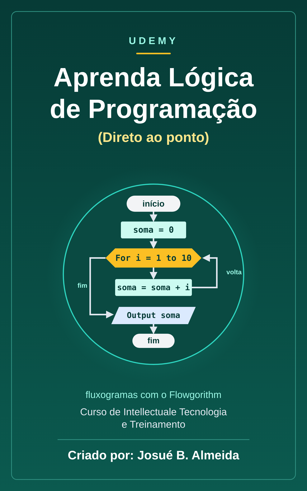

# Udemy: Aprenda Lógica de Programação (Direto ao ponto) - Intellectuale Tecnologia e Treinamento

📥 **[Baixar o EPUB](https://github.com/Joshpcbrrj/biblioteca-de-estudos/releases/download/epubs/intellectuale-logica-flowgorithm.epub)**

Lógica de programação direto ao ponto com o Flowgorithm: algoritmos e fluxogramas, variáveis e operações, decisões, operadores lógicos, laços de repetição, vetores e funções. Cada aula traz projetos com fluxograma e pseudocódigo; nos exercícios, as respostas ficam recolhidas em **Ver resposta**.

- [Sobre o curso e cola rápida do Flowgorithm](aulas/00-sobre-o-curso.md)

## 1. Conceitos básicos e ambiente de trabalho

- [Definições importantes/ Instalando o flowgorithm](aulas/01-definicoes-importantes-instalando-o-flowgorithm.md)
- [Detalhando ambiente de trabalho/ tipo de dados/ pseudocódigo](aulas/02-detalhando-ambiente-de-trabalho-tipo-de-dados.md)

## 2. Operações básicas

- [Estudo de operações básicas](aulas/03-estudo-de-operacoes-basicas.md)

## 3. Estruturas de decisão

- [Estudo de estrutura de decisão](aulas/04-estudo-de-estrutura-de-decisao.md)
- [Estudo de operadores lógicos](aulas/05-estudo-de-operadores-logicos.md)

## 4. Estruturas de repetição

- [Estudo das estruturas de repetição](aulas/06-estudo-das-estruturas-de-repeticao.md)

## 5. Arranjos de dados

- [Estudo de vetores](aulas/07-estudo-de-vetores.md)

## 6. Sub-rotinas e funções

- [Estudo de sub programas](aulas/08-estudo-de-sub-programas.md)

