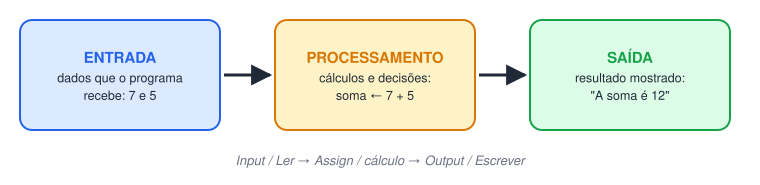
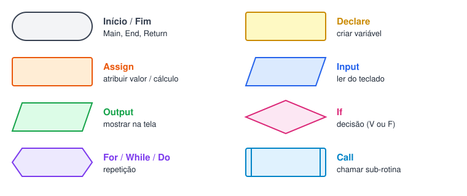
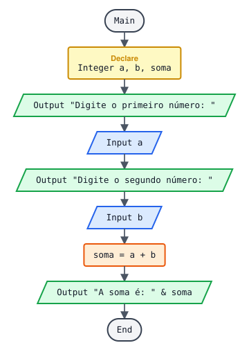
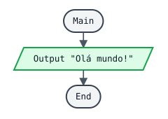

# Definições importantes/ Instalando o flowgorithm

> 🗺️ **Nesta aula:** o que são lógica de programação e algoritmo, as três formas de representar um algoritmo (descrição narrativa, fluxograma e pseudocódigo), a instalação do Flowgorithm e o primeiro programa.

## 1. Lógica de programação

É a técnica de organizar, numa **sequência lógica**, as ações necessárias para resolver um problema, de forma que um computador consiga executá-las. O computador não "entende" a intenção: ele segue exatamente os passos que recebe, na ordem em que recebe. Por isso a lógica vem antes da linguagem: quem sabe montar os passos consegue escrever em qualquer linguagem (Python, Java, C...).

## 2. Algoritmo

Um **algoritmo** é uma sequência **finita** de passos, bem definidos, que leva a um objetivo. Uma receita de bolo é um algoritmo; um programa é um algoritmo escrito numa linguagem que o computador entende.

Exemplo do dia a dia, fazer café:

```
1. Esquentar a água
2. Colocar o filtro no suporte
3. Colocar 2 colheres de pó no filtro
4. Despejar a água quente sobre o pó
5. Esperar coar
6. Servir
```

Características de um bom algoritmo:

| Característica | Significado |
| --- | --- |
| Finito | Tem começo e fim; não roda para sempre |
| Preciso | Cada passo tem um só significado ("2 colheres", não "um pouco") |
| Ordenado | A ordem importa: servir antes de coar não funciona |
| Entrada | Pode receber dados (ex.: quantidade de xícaras) |
| Saída | Produz um resultado (o café) |

**Entrada → Processamento → Saída** é o esqueleto de quase todo programa: por exemplo, recebe 2 números (entrada), soma os dois (processamento) e mostra o resultado (saída).



## 3. Formas de representar um algoritmo

### 3.1 Descrição narrativa

Os passos escritos em português comum, como no exemplo do café. É fácil de ler, mas pode ser ambígua.

### 3.2 Fluxograma (diagrama de blocos)

Representação **gráfica**: cada tipo de ação tem um símbolo, ligados por setas que mostram a ordem.

| Símbolo | Forma | Uso |
| --- | --- | --- |
| Terminal | Oval (elipse) | Início e fim |
| Processo | Retângulo | Cálculo, declaração ou atribuição de variável |
| Entrada / Saída | Paralelogramo | Ler dado do usuário ou mostrar na tela |
| Decisão | Losango | Pergunta com resposta verdadeiro/falso |
| Repetição | Hexágono | Laços (enquanto, para, faça) |
| Seta | Linha com seta | Indica o próximo passo |



Exemplo: somar dois números. O oval marca o início e o fim, os paralelogramos a entrada (ler A e B) e a saída (mostrar a soma), e o retângulo o processamento (soma ← A + B).



### 3.3 Pseudocódigo

O mesmo algoritmo escrito com palavras-chave e regras fixas, parecido com uma linguagem de programação, mas sem se preocupar com detalhes de uma linguagem real. É o meio-termo entre o português e o código.

Em **Portugol** (pseudocódigo em português):

```
algoritmo "soma"
var
   a, b, soma : inteiro
inicio
   escreva("Digite o primeiro número: ")
   leia(a)
   escreva("Digite o segundo número: ")
   leia(b)
   soma <- a + b
   escreva("A soma é: ", soma)
fimalgoritmo
```

No **Flowgorithm** (ferramenta usada no curso), o pseudocódigo gerado é em inglês:

```
Function Main
  Declare Integer a
  Declare Integer b
  Declare Integer soma

  Output "Digite o primeiro número: "
  Input a
  Output "Digite o segundo número: "
  Input b
  Assign soma = a + b
  Output "A soma é: " & soma
End
```

E o mesmo algoritmo em **Python**, para comparar:

```python
a = int(input("Digite o primeiro número: "))
b = int(input("Digite o segundo número: "))
soma = a + b
print("A soma é:", soma)
```

Repare que os três fazem a mesma coisa: entrada (`leia` / `Input` / `input`), processamento (`soma ← a + b`) e saída (`escreva` / `Output` / `print`).

## 4. Ferramentas

### 4.1 Flowgorithm

Programa gratuito para montar fluxogramas e **executá-los**, vendo o resultado no console. Ele também converte o fluxograma em pseudocódigo e em várias linguagens (menu **Tools → Source Code Viewer**). Disponível só para Windows.

🔗 [Download Flowgorithm](http://www.flowgorithm.org/download/index.html)

Dica: em **Tools → Change Language** dá para colocar a interface em português.

### 4.2 Editores de fluxograma online

Para desenhar (não executam o algoritmo):

- Visual Paradigm Online

🔗 [https://online.visual-paradigm.com/diagrams/features/flowchart-tool/](https://online.visual-paradigm.com/diagrams/features/flowchart-tool/)

- [draw.io](http://draw.io) ([diagrams.net](http://diagrams.net))

🔗 [Flowchart Maker & Online Diagram Software](https://app.diagrams.net/)

## 5. Projeto: "Olá mundo!"

O primeiro programa de toda linguagem: só mostra uma mensagem na tela. Serve para testar se o ambiente funciona.



**Pseudocódigo (Flowgorithm)**

```
Function Main
  Output "Olá mundo!"
End
```

**Saída no console**

```
Olá mundo!
```

**O mesmo em outras linguagens**

```python
# Python
print("Olá mundo!")
```

```jsx
// JavaScript
console.log("Olá mundo!");
```

```java
// Java
public class Main {
  public static void main(String[] args) {
    System.out.println("Olá mundo!");
  }
}
```

## 📌 Resumo

| Item | Em uma frase |
| --- | --- |
| Lógica de programação | Organizar passos numa ordem que resolve o problema |
| Algoritmo | Sequência finita, precisa e ordenada desses passos |
| Fluxograma | O algoritmo em desenho, com um símbolo por tipo de ação |
| Pseudocódigo | O algoritmo em texto estruturado, perto de uma linguagem |
| Flowgorithm | Monta, executa e converte fluxogramas |
| Todo programa | Entrada → processamento → saída |
