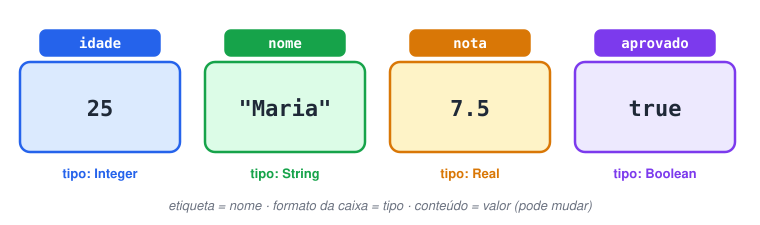
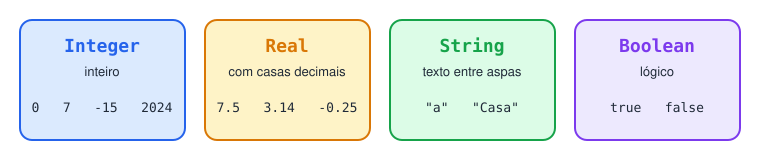
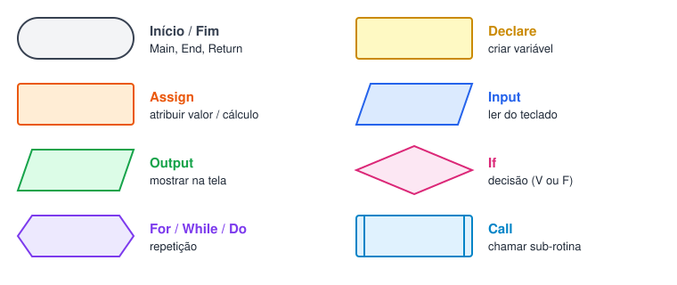
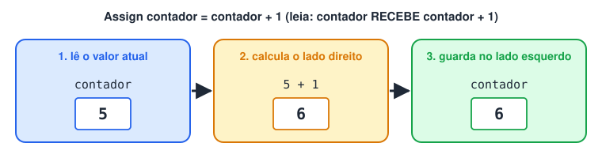
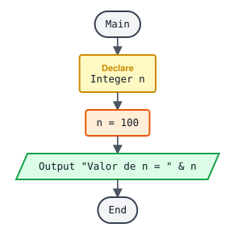
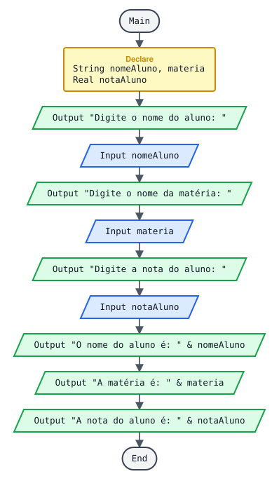

# Detalhando ambiente de trabalho/ tipo de dados/ pseudocódigo

> 🗺️ **Nesta aula:** variáveis e os 4 tipos de dados do Flowgorithm, regras de nomes, os comandos (Declare, Assign, Output, Input, If, Call, While, For, Do), comentários e dois projetos de entrada e saída.

## 1. Variáveis

Uma **variável** é um espaço na memória com um **nome** e um **tipo**, onde o programa guarda um valor que pode mudar durante a execução. Pense numa caixa etiquetada: a etiqueta é o nome, o formato da caixa é o tipo e o conteúdo é o valor. Por exemplo, `idade` (Integer) guarda `25`, `nome` (String) guarda `"Maria"` e `aprovado` (Boolean) guarda `true`.



### 1.1 Tipos de dados

| Flowgorithm | Português | Guarda | Exemplos |
| --- | --- | --- | --- |
| `Integer` | Inteiro | Números sem casas decimais | `0`, `7`, `-15`, `2024` |
| `Real` | Real | Números com ou sem casas decimais | `7.5`, `3.14`, `-0.25`, `10` |
| `String` | Caractere / texto | Letras, palavras, frases (entre aspas) | `"a"`, `"Casa"`, `"Olá mundo"` |
| `Boolean` | Lógico | Só dois valores | `true`, `false` |

> ⚠️ No código, o separador decimal é o **ponto**: escreva `7.5`, não `7,5`. A vírgula separa outras coisas (como parâmetros de funções).



Como escolher o tipo:

| Dado | Tipo | Por quê |
| --- | --- | --- |
| Idade de uma pessoa | Integer | Ninguém tem 25,7 anos no cadastro |
| Nota de prova | Real | Pode ser 7.5 |
| Preço | Real | Tem centavos (19.90) |
| Nome, matéria, cidade | String | É texto ("João") |
| CEP, telefone, CPF | String | Não se faz conta e podem ter zeros à esquerda |
| Está matriculado? | Boolean | Só true ou false |

### 1.2 Regras para nomes de variáveis

- Começa com letra; depois pode ter letras, números e `_`.
- Sem espaços, acentos ou símbolos: `nomeAluno` ✅, `nome aluno` ❌, `média` ❌, `2nota` ❌.
- Use nomes que expliquem o conteúdo: `notaFinal` é melhor que `x`.
- Padrão mais usado: **camelCase** (primeira palavra minúscula, as seguintes com maiúscula): `valorHora`, `qtdHorasTrabalhadas`.

## 2. Comandos (símbolos) do Flowgorithm

Cada comando do Flowgorithm é um símbolo no fluxograma e uma linha no pseudocódigo.

| Comando | Símbolo | Para que serve |
| --- | --- | --- |
| Declare (Declarar) | Retângulo | Criar uma variável |
| Assign (Atribuir) | Retângulo | Guardar um valor numa variável |
| Output (Saída) | Paralelogramo | Mostrar informação no console |
| Input (Entrada) | Paralelogramo | Ler um valor digitado pelo usuário |
| If (Se) | Losango | Decidir entre dois caminhos |
| Call (Chamar) | Retângulo com barras laterais | Executar uma função (sub-rotina) |
| While (Enquanto) | Hexágono | Repetir enquanto a condição for verdadeira |
| For (Para) | Hexágono | Repetir um número definido de vezes |
| Do (Faça) | Hexágono | Executar e só depois testar se repete |



### 2.1 Declare: criar variável

Toda variável precisa ser declarada antes de ser usada, informando o tipo e o nome.

```
Declare Integer idade
Declare Real nota
Declare String nomeAluno
Declare Boolean aprovado
```

Várias variáveis do mesmo tipo podem ser declaradas juntas, separadas por vírgula:

```
Declare Real nota1, nota2, nota3
```

### 2.2 Assign: atribuir valor

Guarda um valor na variável. O lado **esquerdo** é a variável que recebe; o lado **direito** é o valor ou a conta.

```
Assign idade = 25
Assign nota = 7.5
Assign nomeAluno = "Maria"
Assign aprovado = true
Assign media = (nota1 + nota2) / 2  ... primeiro calcula, depois guarda
Assign contador = contador + 1  ... pega o valor atual, soma 1 e guarda de volta
```

> 💡 O `=` do Assign não é "igual" da matemática; leia como **"recebe"**: `contador = contador + 1` significa "contador recebe contador mais 1". Em Portugol isso se escreve `contador <- contador + 1`.



### 2.3 Output: mostrar na tela

```
Output "Bem-vindo!"
Output idade
Output "Sua idade é: " & idade
Output "Aluno: " & nomeAluno & " | Nota: " & nota
```

O `&` **concatena** (junta) textos e valores numa só mensagem. Lembre de colocar espaços dentro das aspas:

```
Output "Nota:" & 7  → Nota:7
Output "Nota: " & 7  → Nota: 7
```

### 2.4 Input: ler do teclado

O programa para e espera o usuário digitar. O valor digitado vai para a variável indicada. Sempre mostre antes uma mensagem dizendo o que digitar:

```
Output "Digite sua idade: "
Input idade
```

> ⚠️ O valor digitado precisa combinar com o tipo da variável. Se `idade` é `Integer` e o usuário digita `abc` ou `25.5`, o Flowgorithm acusa erro.

### 2.5 If: decisão (detalhes na página de estruturas de decisão)

```
If idade >= 18
  Output "Maior de idade"
False:
  Output "Menor de idade"
End
```

No pseudocódigo exportado pelo Flowgorithm, `False:` é o "senão" (o caminho quando a condição é falsa).

### 2.6 Call: chamar uma função (detalhes na página de sub-rotinas)

```
Call mostrarMenu
Call calcularMedia(nota1, nota2)
```

### 2.7 While, For e Do: repetição (detalhes na página de estruturas de repetição)

```
... While: testa ANTES de cada volta
While contador <= 10
  Output contador
  Assign contador = contador + 1
End

... For: número de voltas definido (i vai de 1 a 10)
For i = 1 to 10
  Output i
End

... Do: executa pelo menos uma vez e testa DEPOIS
... (no pseudocódigo do Flowgorithm aparece como Loop ... Do condição)
Loop
  Output "Digite um número positivo: "
  Input numero
Do numero < 0
```

## 3. Comentários

Comentários são anotações para quem lê o código; o computador ignora. No Flowgorithm, use o símbolo de comentário; no pseudocódigo exportado eles aparecem com `...` no início.

```
... Calculando a média das 3 notas
Assign media = (nota1 + nota2 + nota3) / 3
```

## 4. Projeto: criar variável e mostrar o valor concatenado com texto



**Pseudocódigo**

```
Function Main
  Declare Integer n

  Assign n = 100
  Output "Valor de n = " & n
End
```

**Saída no console**

```
Valor de n = 100
```

**Em Python**

```python
n = 100
print("Valor de n =", n)
```

## 5. Projeto: pedir os dados do aluno e mostrar tudo no final

Passo a passo: declarar → perguntar → ler → (repetir para cada dado) → mostrar.



**Pseudocódigo**

```
Function Main
  ... Declarando as variáveis no início (boa prática)
  Declare String nomeAluno
  Declare String materia
  Declare Real notaAluno

  ... Entrada de dados
  Output "Digite o nome do aluno: "
  Input nomeAluno
  Output "Digite o nome da matéria: "
  Input materia
  Output "Digite a nota do aluno: "
  Input notaAluno

  ... Saída
  Output "O nome do aluno é: " & nomeAluno
  Output "A matéria é: " & materia
  Output "A nota do aluno é: " & notaAluno
End
```

**Exemplo de execução**

```
Digite o nome do aluno: Ana
Digite o nome da matéria: Matemática
Digite a nota do aluno: 8.5
O nome do aluno é: Ana
A matéria é: Matemática
A nota do aluno é: 8.5
```

**Em Python**

```python
nome_aluno = input("Digite o nome do aluno: ")
materia = input("Digite o nome da matéria: ")
nota_aluno = float(input("Digite a nota do aluno: "))

print("O nome do aluno é:", nome_aluno)
print("A matéria é:", materia)
print("A nota do aluno é:", nota_aluno)
```

Em Python o `input` sempre devolve texto; por isso a nota passa por `float(...)` para virar número real (`int(...)` para inteiro).

## 📌 Resumo

| Item | Em uma frase |
| --- | --- |
| Variável | Nome, tipo e valor guardados na memória |
| Tipos | `Integer`, `Real`, `String`, `Boolean` |
| Nomes | Começam com letra, sem espaços nem acentos (camelCase) |
| `Declare` / `Assign` | Cria a variável / guarda um valor nela |
| `Input` / `Output` | Lê do teclado / mostra no console |
| `&` | Junta textos e valores numa mensagem |
| `If`, `While`, `For`, `Do`, `Call` | Decidem, repetem e chamam funções |
