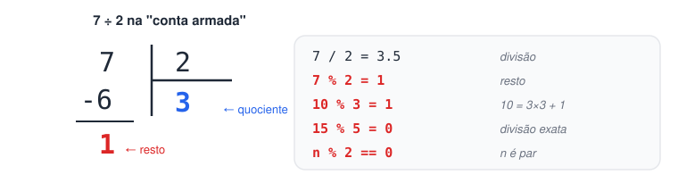
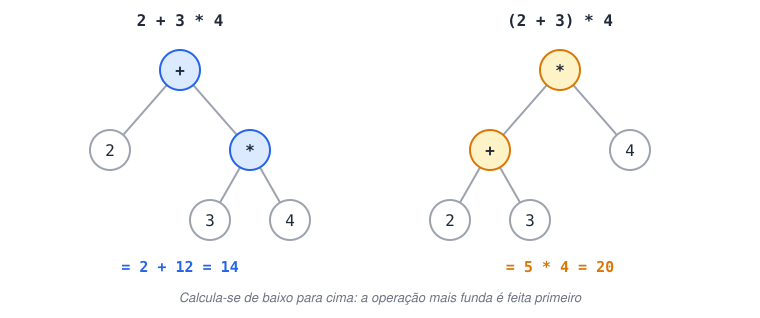
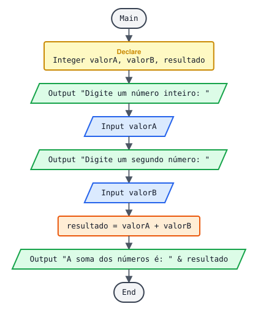
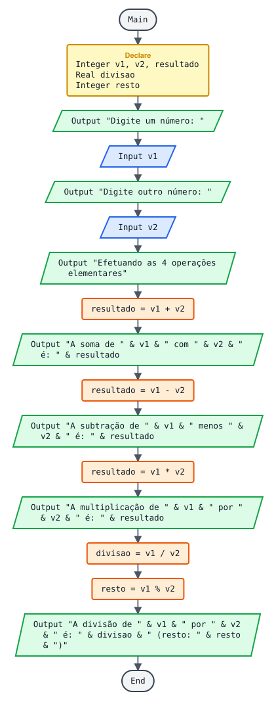
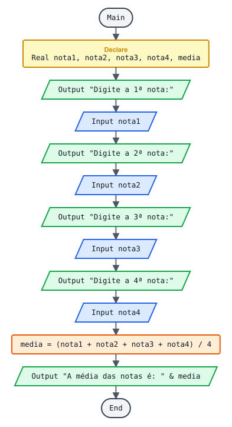
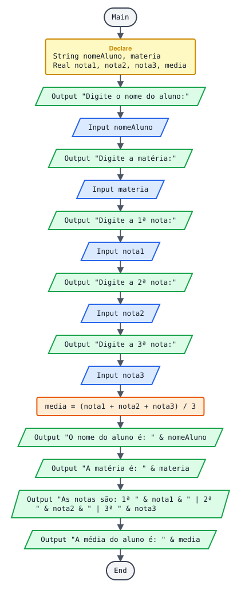
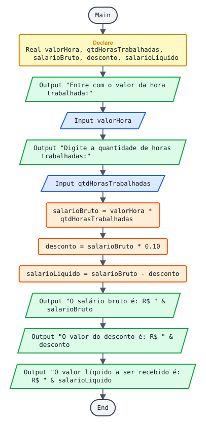
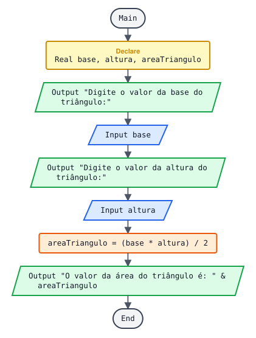
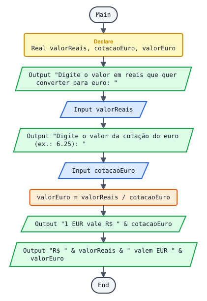

# Estudo de operações básicas

> 🗺️ **Nesta aula:** os operadores aritméticos, o resto da divisão, a ordem de precedência, inteiro × real e porcentagem, com sete projetos e dois exercícios.

## 1. Operadores aritméticos

| Operador | Operação | Exemplo | Resultado |
| --- | --- | --- | --- |
| `+` | Soma | `7 + 2` | `9` |
| `-` | Subtração | `7 - 2` | `5` |
| `*` | Multiplicação | `7 * 2` | `14` |
| `/` | Divisão | `7 / 2` | `3.5` |
| `%` ou `mod` | Resto da divisão (módulo) | `7 % 2` | `1` |
| `^` | Potência | `2 ^ 3` | `8` |

### 1.1 O resto da divisão (`%`)

É o que sobra numa divisão inteira. Lembre da "conta armada":

```
  7 | 2
 -6   3  ← quociente
  1  ← resto  →  7 % 2 = 1
```



Mais exemplos:

```
10 % 3 = 1      (10 = 3×3 + 1)
15 % 5 = 0      (divisão exata, não sobra nada)
 4 % 7 = 4      (7 não cabe em 4, sobra o próprio 4)
```

Usos clássicos do `%`:

```
numero % 2 == 0  → o número é par
numero % 2 == 1  → o número é ímpar
numero % 5 == 0  → o número é múltiplo de 5
segundos % 60  → segundos que sobram depois de tirar os minutos inteiros
```

### 1.2 Ordem de precedência

Igual à matemática: primeiro parênteses, depois potência, depois multiplicação/divisão/resto e por último soma/subtração. Operadores do mesmo nível são resolvidos da esquerda para a direita.

```
2 + 3 * 4        = 2 + 12  = 14
(2 + 3) * 4      = 5 * 4   = 20
10 - 4 / 2       = 10 - 2  = 8
nota1 + nota2 / 2  ← ERRADO para média: divide só a nota2
(nota1 + nota2) / 2  ← CERTO
```

> 💡 Na dúvida, use parênteses. Eles não atrapalham e deixam a intenção clara.



### 1.3 Inteiro × real

Quando o resultado pode ter casas decimais (médias, divisões, porcentagens, dinheiro), guarde numa variável **Real**. Se guardar num `Integer`, a parte decimal se perde.

```
Declare Integer mediaErrada
Declare Real mediaCerta

Assign mediaCerta = (7 + 8) / 2  → 7.5
Assign mediaErrada = (7 + 8) / 2  → perde o .5 (ou dá erro, dependendo da ferramenta)
```

Outro cuidado: **divisão por zero** não existe. Se o divisor vem do usuário, verifique antes (com um `If`, assunto da próxima página).

### 1.4 Porcentagem

```
10% de um valor  → valor * 0.10
valor com 10% de desconto  → valor - (valor * 0.10)   ou   valor * 0.90
valor com 10% de aumento  → valor * 1.10
```

## 2. Projetos

### 2.1 Soma de 2 valores



**Pseudocódigo**

```
Function Main
  Declare Integer valorA
  Declare Integer valorB
  Declare Integer resultado

  Output "Digite um número inteiro: "
  Input valorA
  Output "Digite um segundo número: "
  Input valorB
  Assign resultado = valorA + valorB
  Output "A soma dos números é: " & resultado
End
```

**Exemplo de execução**

```
Digite um número inteiro: 12
Digite um segundo número: 30
A soma dos números é: 42
```

### 2.2 As 4 operações com 2 valores



**Pseudocódigo (revisado)**

```
Function Main
  Declare Integer v1
  Declare Integer v2
  Declare Integer resultado
  Declare Real divisao
  Declare Integer resto

  Output "Digite um número: "
  Input v1
  Output "Digite outro número: "
  Input v2
  Output "Efetuando as 4 operações elementares"

  Assign resultado = v1 + v2
  Output "A soma de " & v1 & " com " & v2 & " é: " & resultado

  Assign resultado = v1 - v2
  Output "A subtração de " & v1 & " menos " & v2 & " é: " & resultado

  Assign resultado = v1 * v2
  Output "A multiplicação de " & v1 & " por " & v2 & " é: " & resultado

  ... A divisão vai para uma variável Real para não perder as casas decimais
  Assign divisao = v1 / v2
  Assign resto = v1 % v2
  Output "A divisão de " & v1 & " por " & v2 & " é: " & divisao & " (resto da divisão inteira: " & resto & ")"
End
```

**O que mudou:** a divisão agora vai para `divisao` (Real). Na versão original ela ia para `resultado` (Integer), e `7 / 2` perderia o `.5`.

**Exemplo de execução**

```
Digite um número: 7
Digite outro número: 2
Efetuando as 4 operações elementares
A soma de 7 com 2 é: 9
A subtração de 7 menos 2 é: 5
A multiplicação de 7 por 2 é: 14
A divisão de 7 por 2 é: 3.5 (resto da divisão inteira: 1)
```

### 2.3 Média de 4 notas



**Pseudocódigo**

```
Function Main
  ... Receber 4 notas e calcular a média
  Declare Real nota1
  Declare Real nota2
  Declare Real nota3
  Declare Real nota4
  Declare Real media

  Output "Digite a 1ª nota:"
  Input nota1
  Output "Digite a 2ª nota:"
  Input nota2
  Output "Digite a 3ª nota:"
  Input nota3
  Output "Digite a 4ª nota:"
  Input nota4

  ... Os parênteses garantem que a soma é feita antes da divisão
  Assign media = (nota1 + nota2 + nota3 + nota4) / 4
  Output "A média das notas é: " & media
End
```

**Exemplo de execução**

```
Digite a 1ª nota: 7
Digite a 2ª nota: 8.5
Digite a 3ª nota: 6
Digite a 4ª nota: 9
A média das notas é: 7.625
```

### 2.4 Dados do aluno + média de 3 notas



**Pseudocódigo (revisado)**

```
Function Main
  Declare String nomeAluno
  Declare String materia
  Declare Real nota1
  Declare Real nota2
  Declare Real nota3
  Declare Real media

  Output "Digite o nome do aluno:"
  Input nomeAluno
  Output "Digite a matéria:"
  Input materia
  Output "Digite a 1ª nota:"
  Input nota1
  Output "Digite a 2ª nota:"
  Input nota2
  Output "Digite a 3ª nota:"
  Input nota3

  Assign media = (nota1 + nota2 + nota3) / 3

  Output "O nome do aluno é: " & nomeAluno
  Output "A matéria é: " & materia
  Output "As notas são: 1ª " & nota1 & " | 2ª " & nota2 & " | 3ª " & nota3
  Output "A média do aluno é: " & media
End
```

**O que mudou:** `nota3` e `media` eram `Integer`. Como notas e médias têm casas decimais, as duas passaram a `Real`.

### 2.5 Salário de horista com 10% de desconto



**Pseudocódigo**

```
Function Main
  ... Salário líquido de um horista, com 10% de desconto sobre o bruto
  Declare Real valorHora
  Declare Real qtdHorasTrabalhadas
  Declare Real salarioBruto
  Declare Real desconto
  Declare Real salarioLiquido

  ... Entrada
  Output "Entre com o valor da hora trabalhada:"
  Input valorHora
  Output "Digite a quantidade de horas trabalhadas:"
  Input qtdHorasTrabalhadas

  ... Processamento
  Assign salarioBruto = valorHora * qtdHorasTrabalhadas
  Assign desconto = salarioBruto * 0.10
  Assign salarioLiquido = salarioBruto - desconto

  ... Saída
  Output "O salário bruto é: R$ " & salarioBruto
  Output "O valor do desconto é: R$ " & desconto
  Output "O valor líquido a ser recebido é: R$ " & salarioLiquido
End
```

**Teste de mesa (acompanhando as variáveis)**

Entrada: `valorHora = 50` e `qtdHorasTrabalhadas = 160`.

| Passo | salarioBruto | desconto | salarioLiquido |
| --- | --- | --- | --- |
| Bruto | 8000 |  |  |
| Desconto | 8000 | 800 |  |
| Líquido | 8000 | 800 | 7200 |

Fazer o teste de mesa (anotar o valor de cada variável a cada linha) é a melhor forma de achar erros de lógica sem o computador.

### 2.6 Área do triângulo



Fórmula: `área = (base × altura) / 2`

**Pseudocódigo**

```
Function Main
  Declare Real base
  Declare Real altura
  Declare Real areaTriangulo

  Output "Digite o valor da base do triângulo:"
  Input base
  Output "Digite o valor da altura do triângulo:"
  Input altura

  Assign areaTriangulo = (base * altura) / 2

  Output "O valor da área do triângulo é: " & areaTriangulo
End
```

**Exemplo de execução**

```
Digite o valor da base do triângulo: 10
Digite o valor da altura do triângulo: 5
O valor da área do triângulo é: 25
```

### 2.7 Conversão de reais para euros



O usuário informa quantos reais quer converter e quanto vale 1 euro em reais. `euros = reais / cotação`.

**Pseudocódigo (revisado)**

```
Function Main
  Declare Real valorReais
  Declare Real cotacaoEuro
  Declare Real valorEuro

  Output "Digite o valor em reais que quer converter para euro: "
  Input valorReais
  Output "Digite o valor da cotação do euro (ex.: 6.25): "
  Input cotacaoEuro

  Assign valorEuro = valorReais / cotacaoEuro

  Output "1 EUR vale R$ " & cotacaoEuro
  Output "R$ " & valorReais & " valem EUR " & valorEuro
End
```

**O que mudou:** `cotacaoEuro` era `Integer`, o que impedia digitar uma cotação como `6.25`. Passou a `Real`.

**Exemplo de execução**

```
Digite o valor em reais que quer converter para euro: 500
Digite o valor da cotação do euro (ex.: 6.25): 6.25
1 EUR vale R$ 6.25
R$ 500 valem EUR 80
```

## 3. Exercícios extras para praticar

### Exercício 1: Celsius para Fahrenheit

Leia uma temperatura em Celsius e mostre o valor em Fahrenheit. Fórmula: `F = C × 1.8 + 32`.

<details>
<summary>Ver resposta</summary>

```
Function Main
  Declare Real celsius
  Declare Real fahrenheit

  Output "Temperatura em Celsius: "
  Input celsius
  Assign fahrenheit = celsius * 1.8 + 32
  Output celsius & " °C = " & fahrenheit & " °F"
End
```

```
Temperatura em Celsius: 25
25 °C = 77 °F
```

</details>

### Exercício 2: segundos em horas, minutos e segundos

Leia um total de segundos e mostre quantas horas, minutos e segundos ele representa. Dica: use `/` e `%`.

<details>
<summary>Ver resposta</summary>

```
Function Main
  Declare Integer total
  Declare Integer horas
  Declare Integer minutos
  Declare Integer segundos

  Output "Total de segundos: "
  Input total

  ... Int() pega só a parte inteira de um número
  Assign horas = Int(total / 3600)  ... 3725 / 3600 = 1.03 → 1
  Assign minutos = Int((total % 3600) / 60)  ... sobra 125 → 125 / 60 = 2.08 → 2
  Assign segundos = total % 60  ... 3725 % 60 = 5

  Output horas & "h " & minutos & "min " & segundos & "s"
End
```

```
Total de segundos: 3725
1h 2min 5s
```

Aqui queremos de propósito só a parte inteira das horas e dos minutos; a função `Int()` do Flowgorithm faz isso. Em Python, a divisão inteira é `//`: `horas = total // 3600`.

</details>

## 4. As operações em Python

**Código**

```python
a, b = 7, 2
print(a + b)  # 9
print(a - b)  # 5
print(a * b)  # 14
print(a / b)  # 3.5  (divisão real)
print(a // b)  # 3    (divisão inteira)
print(a % b)  # 1    (resto)
print(a ** b)  # 49   (potência)
```

## 📌 Resumo

| Item | Em uma frase |
| --- | --- |
| Operadores | Soma, subtração, multiplicação e divisão como na matemática; `%` dá o resto e `^` é potência |
| Precedência | Parênteses, depois potência, depois multiplicação, divisão e resto, por último soma e subtração |
| Resto `%` | O que sobra da divisão inteira; `n % 2 == 0` indica par |
| Inteiro × real | Resultado com casas decimais vai numa variável `Real` |
| Porcentagem | 10% de x é `x * 0.10`; com desconto, `x * 0.90` |
| Cuidado | Divisão por zero não existe |
