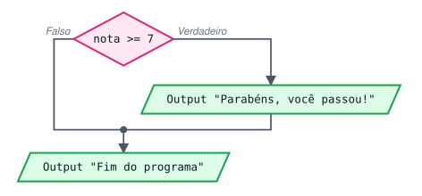
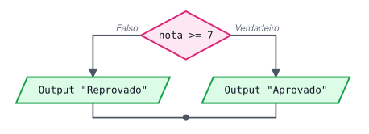
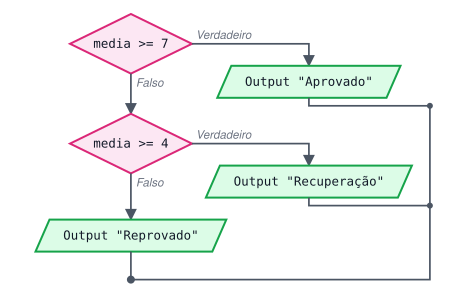
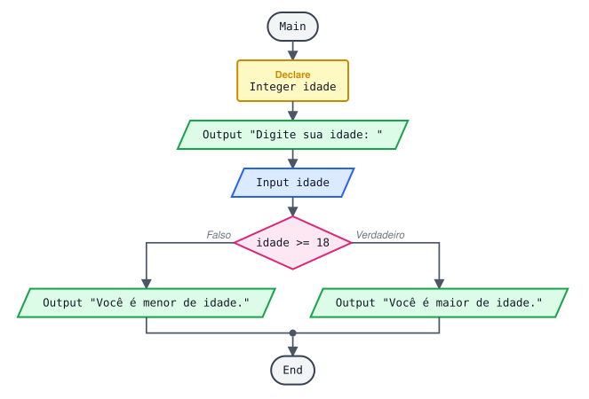
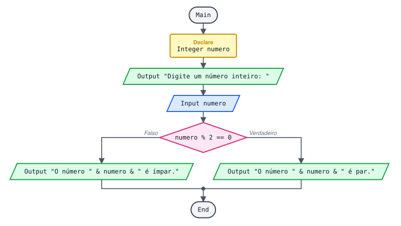
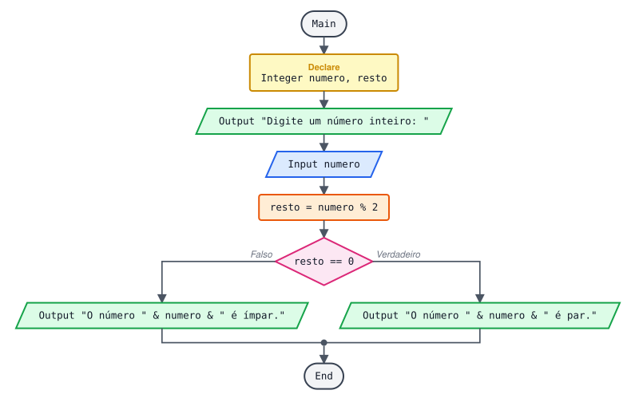
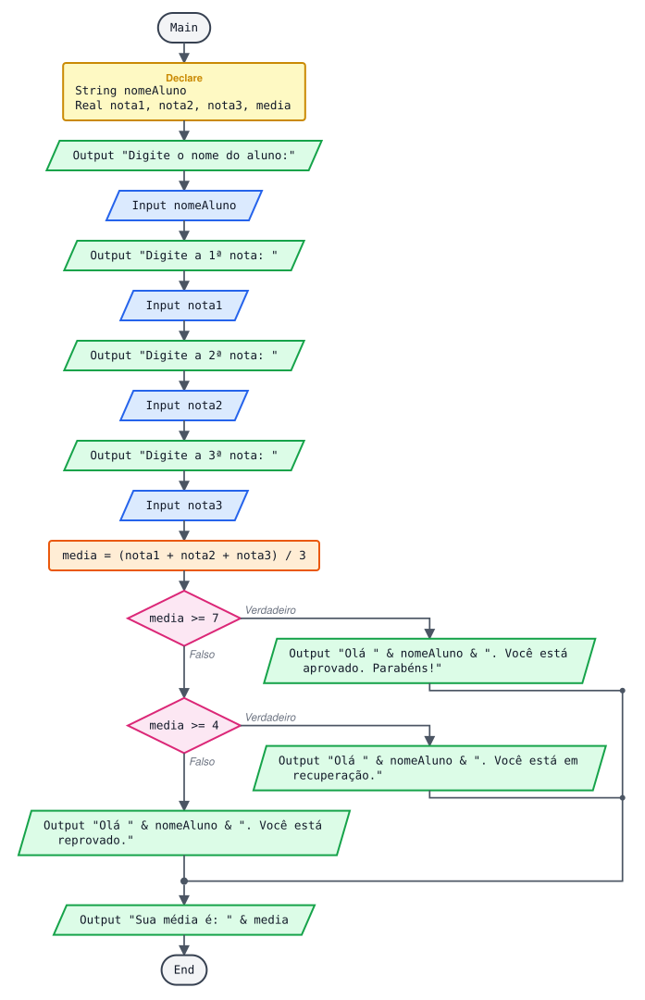
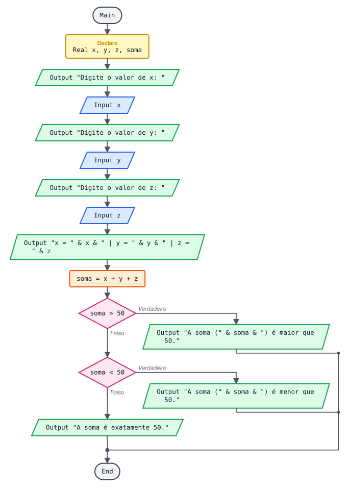
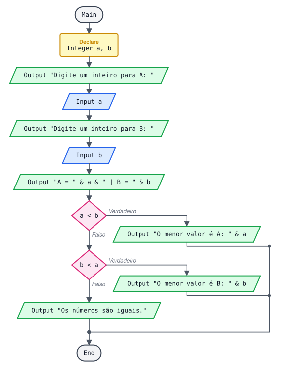

# Estudo de estrutura de decisão

> 🗺️ **Nesta aula:** condições e operadores relacionais, as decisões simples, composta e encadeada, a comparação com Portugol e Python e cinco projetos.

## 1. Para que serve

Até aqui os programas executavam todas as linhas, de cima para baixo. Uma **estrutura de decisão** permite que o programa escolha um caminho dependendo de uma **condição**: uma pergunta cuja resposta é sempre **verdadeiro** ou **falso**.

```
"A idade é maior ou igual a 18?"  → verdadeiro ou falso
"O número é par?"  → verdadeiro ou falso
```

## 2. Operadores relacionais (comparação)

São eles que montam as condições.

| Operador | Significado | Exemplo | Resultado (com idade = 20) |
| --- | --- | --- | --- |
| `==` | igual a | `idade == 18` | falso |
| `!=` | diferente de | `idade != 18` | verdadeiro |
| `>` | maior que | `idade > 18` | verdadeiro |
| `<` | menor que | `idade < 18` | falso |
| `>=` | maior ou igual a | `idade >= 18` | verdadeiro |
| `<=` | menor ou igual a | `idade <= 18` | falso |

> ⚠️ `=` atribui (guarda valor); `==` compara. Na condição de um `If`, use sempre `==`.

Também dá para comparar textos: `resposta == "sim"`. A comparação diferencia maiúsculas de minúsculas: `"Sim"` não é igual a `"sim"`.

## 3. Decisão simples (Se)

Executa o bloco **só se** a condição for verdadeira. Se for falsa, pula o bloco e segue o programa.

```
If nota >= 7
  Output "Parabéns, você passou!"
End
Output "Fim do programa"
```

```
nota = 8  →  Parabéns, você passou!
             Fim do programa
nota = 5  →  Fim do programa
```



## 4. Decisão composta (Se / Senão)

Um bloco para quando a condição é verdadeira e **outro** para quando é falsa. Sempre um dos dois é executado, nunca os dois.

```
If nota >= 7
  Output "Aprovado"
False:
  Output "Reprovado"
End
```

No pseudocódigo exportado pelo Flowgorithm, `False:` é o **senão** (em outras ferramentas aparece como `Else`).



## 5. Decisão encadeada (Se / Senão se / Senão)

Quando há **mais de duas** possibilidades, coloca-se um `If` dentro do senão do anterior. As condições são testadas em ordem; a **primeira** verdadeira é executada e as demais são ignoradas.

```
If media >= 7
  Output "Aprovado"
False:
  If media >= 4
    Output "Recuperação"
  False:
    Output "Reprovado"
  End
End
```

Repare que no segundo `If` não é preciso escrever `media >= 4 && media < 7`: se o programa chegou ali, já se sabe que a média é menor que 7.

```
media = 8.0  →  Aprovado
media = 5.5  →  Recuperação
media = 2.0  →  Reprovado
```

> 💡 **Dica de ordem:** nas faixas de valores, teste da maior para a menor (ou da menor para a maior), sem pular faixas. Assim cada condição fica simples e nenhum valor fica sem resposta.



## 6. Comparando com outras linguagens

**Portugol e Python**

```
// Portugol
se (media >= 7) entao
   escreva("Aprovado")
senao
   se (media >= 4) entao
      escreva("Recuperação")
   senao
      escreva("Reprovado")
   fimse
fimse
```

```python
# Python (elif = "senão se")
if media >= 7:
  print("Aprovado")
elif media >= 4:
  print("Recuperação")
else:
  print("Reprovado")
```

## 7. Projetos

### 7.1 Maior ou menor de idade



**Pseudocódigo**

```
Function Main
  Declare Integer idade

  Output "Digite sua idade: "
  Input idade
  If idade >= 18
    Output "Você é maior de idade."
  False:
    Output "Você é menor de idade."
  End
End
```

**Exemplos de execução**

```
Digite sua idade: 17
Você é menor de idade.

Digite sua idade: 18
Você é maior de idade.
```

Teste sempre o **valor da fronteira** (aqui, 18): é onde a maioria dos erros de `>` × `>=` aparece.

### 7.2 Número par ou ímpar

Um número é par quando o resto da divisão por 2 é zero.

**Forma 1:** resto calculado direto na condição.



**Pseudocódigo**

```
Function Main
  Declare Integer numero

  Output "Digite um número inteiro: "
  Input numero
  If numero % 2 == 0
    Output "O número " & numero & " é par."
  False:
    Output "O número " & numero & " é ímpar."
  End
End
```

**Forma 2:** resto guardado numa variável antes (mais fácil de ler e de depurar).



**Pseudocódigo**

```
Function Main
  Declare Integer numero
  Declare Integer resto

  Output "Digite um número inteiro: "
  Input numero

  Assign resto = numero % 2
  If resto == 0
    Output "O número " & numero & " é par."
  False:
    Output "O número " & numero & " é ímpar."
  End
End
```

**Exemplos de execução**

```
Digite um número inteiro: 10
O número 10 é par.

Digite um número inteiro: 7
O número 7 é ímpar.
```

### 7.3 Aprovado, recuperação ou reprovado

Regras: média ≥ 7 → aprovado; média entre 4 e 7 → recuperação; média abaixo de 4 → reprovado.



**Pseudocódigo (revisado)**

```
Function Main
  Declare String nomeAluno
  Declare Real nota1
  Declare Real nota2
  Declare Real nota3
  Declare Real media

  Output "Digite o nome do aluno:"
  Input nomeAluno
  Output "Digite a 1ª nota: "
  Input nota1
  Output "Digite a 2ª nota: "
  Input nota2
  Output "Digite a 3ª nota: "
  Input nota3

  Assign media = (nota1 + nota2 + nota3) / 3

  ... Faixas testadas da maior para a menor
  If media >= 7
    Output "Olá " & nomeAluno & ". Você está aprovado. Parabéns!"
  False:
    If media >= 4
      Output "Olá " & nomeAluno & ". Você está em recuperação. Não desista!"
    False:
      Output "Olá " & nomeAluno & ". Infelizmente você está reprovado."
    End
  End
  Output "Sua média é: " & media
End
```

**O que mudou:** o enunciado original deixava um buraco entre 3 e 4 (reprovado "até 3" e recuperação "a partir de 4"). Testando `>= 7` e depois `>= 4`, toda média tem uma resposta e médias como 3.5 ficam como reprovado.

### 7.4 Soma de 3 valores comparada com 50



**Pseudocódigo (revisado)**

```
Function Main
  ... O enunciado pede valores reais
  Declare Real x
  Declare Real y
  Declare Real z
  Declare Real soma

  Output "Digite o valor de x: "
  Input x
  Output "Digite o valor de y: "
  Input y
  Output "Digite o valor de z: "
  Input z

  Output "x = " & x & " | y = " & y & " | z = " & z
  Assign soma = x + y + z

  ... Três possibilidades: maior, menor ou igual
  If soma > 50
    Output "A soma (" & soma & ") é maior que 50."
  False:
    If soma < 50
      Output "A soma (" & soma & ") é menor que 50."
    False:
      Output "A soma é exatamente 50."
    End
  End
End
```

**O que mudou:** as variáveis eram `Integer`, mas o enunciado fala em valores reais.

### 7.5 Menor de dois valores



**Pseudocódigo (revisado)**

```
Function Main
  Declare Integer a
  Declare Integer b

  Output "Digite um inteiro para A: "
  Input a
  Output "Digite um inteiro para B: "
  Input b

  Output "A = " & a & " | B = " & b

  If a < b
    Output "O menor valor é A: " & a
  False:
    If b < a
      Output "O menor valor é B: " & b
    False:
      Output "Os números são iguais."
    End
  End
End
```

**O que mudou:** o enunciado pede o **menor** valor, e a versão original mostrava qual era o maior. A lógica é a mesma; basta inverter a comparação.

**Exemplos de execução**

```
Digite um inteiro para A: 9
Digite um inteiro para B: 4
A = 9 | B = 4
O menor valor é B: 4
```

## 8. Erros comuns

```
If nota = 7          ❌  usa = (atribuição) em vez de == (comparação)
If nota == 7         ✅

If idade > 18        ❌  deixa quem tem exatamente 18 de fora de "maior de idade"
If idade >= 18       ✅

If resposta == sim   ❌  texto sem aspas vira nome de variável
If resposta == "sim" ✅
```

## 📌 Resumo

| Item | Em uma frase |
| --- | --- |
| Condição | Pergunta que dá verdadeiro ou falso, com `== != > < >= <=` |
| `=` × `==` | `=` guarda valor; `==` compara |
| Decisão simples | `If` sozinho: executa o bloco ou pula |
| Decisão composta | `If` e `False:` (senão): um caminho ou o outro |
| Decisão encadeada | `If` dentro do senão, testando as faixas em ordem |
| Testes | Confira os valores de fronteira (18, 7, 4) |
