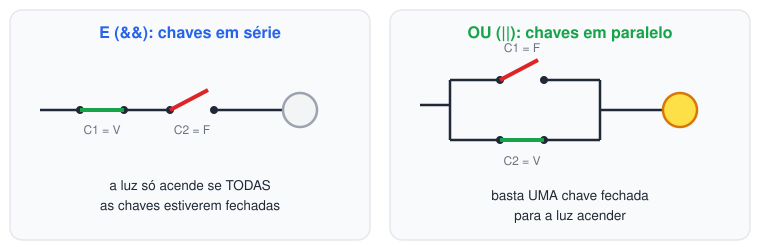
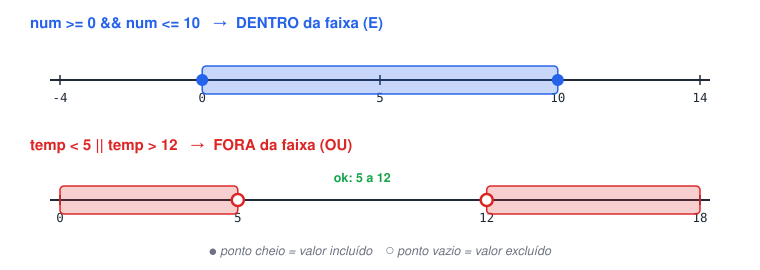
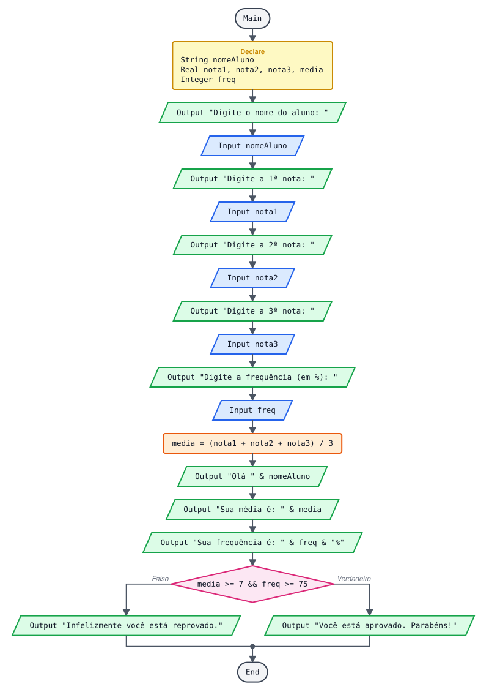
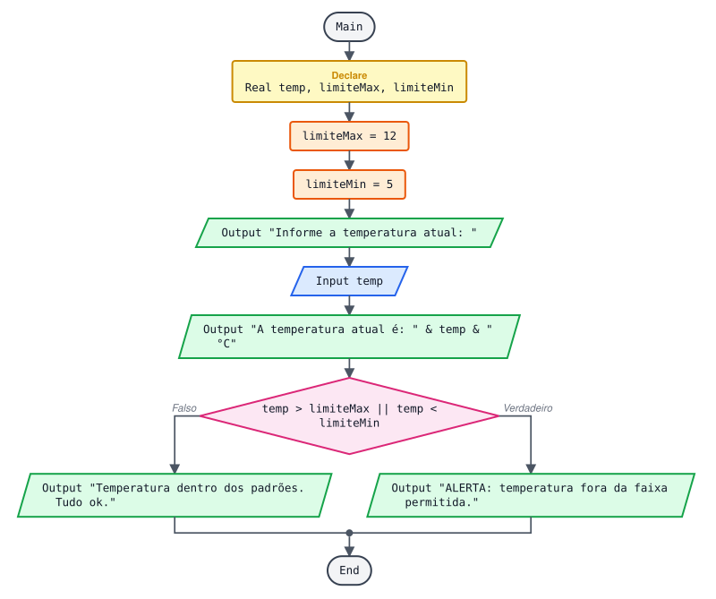
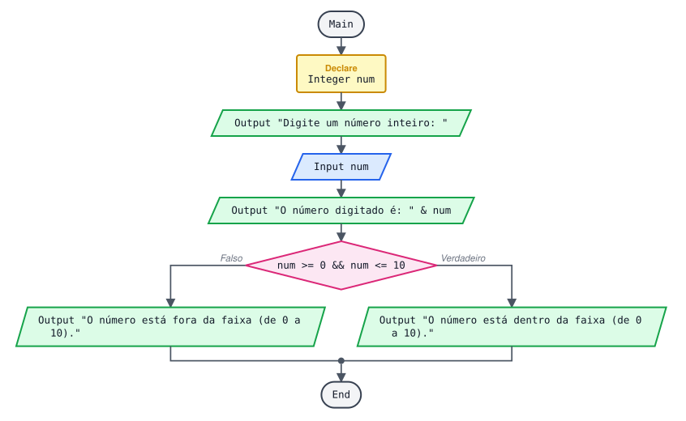
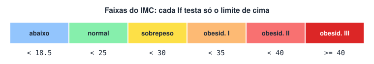
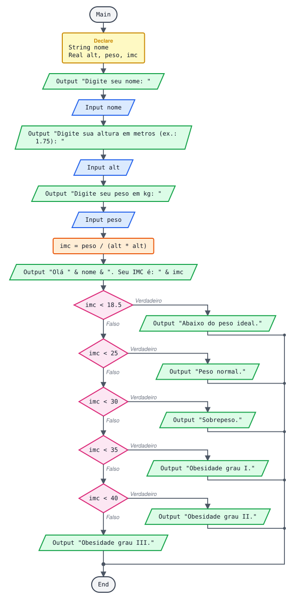

# Estudo de operadores lógicos

> 🗺️ **Nesta aula:** como juntar condições com E, OU e NÃO, as tabelas-verdade, faixas de valores, precedência e quatro projetos, incluindo o cálculo do IMC.

## 1. Para que servem

Os operadores lógicos **juntam duas ou mais condições** numa só. Exemplo: "passou se a média é pelo menos 7 **E** a frequência é pelo menos 75%".

| Operador | Flowgorithm | Também aceito (e Python) | Leitura |
| --- | --- | --- | --- |
| E | `&&` | `and` | as duas precisam ser verdadeiras |
| OU | `\|\|` | `or` | basta uma ser verdadeira |
| NÃO | `!` | `not` | inverte o resultado |



## 2. Operador E (`&&`)

Só dá verdadeiro quando **todas** as condições são verdadeiras.

| Condição 1 (C1) | Condição 2 (C2) | C1 && C2 |
| --- | --- | --- |
| V | V | **V** |
| V | F | F |
| F | V | F |
| F | F | F |

```
media >= 7 && freq >= 75

media = 8, freq = 90  →  V && V  →  verdadeiro  (aprovado)
media = 8, freq = 60  →  V && F  →  falso
media = 5, freq = 90  →  F && V  →  falso
```

Uso típico: verificar se um valor está **dentro de uma faixa**.

```
numero >= 0 && numero <= 10  ... entre 0 e 10, incluindo os dois
```

> ⚠️ Não existe `0 <= numero <= 10` no Flowgorithm (nem na maioria das linguagens). Escreva as duas comparações e junte com `&&`.

## 3. Operador OU (`||`)

Só dá falso quando **todas** as condições são falsas.

| Condição 1 (C1) | Condição 2 (C2) | C1 \|\| C2 |
| --- | --- | --- |
| V | V | V |
| V | F | V |
| F | V | V |
| F | F | **F** |

```
temp < 5 || temp > 12

temp = 3  →  V || F  →  verdadeiro  (fora da faixa)
temp = 15  →  F || V  →  verdadeiro  (fora da faixa)
temp = 8  →  F || F  →  falso       (dentro da faixa)
```

Uso típico: verificar se um valor está **fora de uma faixa**, ou aceitar várias respostas.

```
resposta == "s" || resposta == "S"
```



## 4. Operador NÃO (`!`)

Inverte o resultado: verdadeiro vira falso e falso vira verdadeiro.

| C | !C |
| --- | --- |
| V | F |
| F | V |

```
Declare Boolean chovendo
Assign chovendo = false

If !chovendo
  Output "Pode sair sem guarda-chuva."
End
```

"Dentro da faixa" e "fora da faixa" são o contrário uma da outra:

```
!(numero >= 0 && numero <= 10)   é o mesmo que   numero < 0 || numero > 10
```

## 5. Precedência e parênteses

O `!` é resolvido primeiro, depois o `&&` e por último o `||`. Para não depender disso, **use parênteses** sempre que misturar `&&` e `||`:

```
... Aprovado se: tem curso superior OU (mais de 21 anos E experiência)
(superior == "sim") || ((idade > 21) && (experiencia == "sim"))
```

## 6. Projetos

### 6.1 Aprovado por média e frequência



Critério: média ≥ 7 **e** frequência ≥ 75%.

**Pseudocódigo (revisado)**

```
Function Main
  Declare String nomeAluno
  Declare Real nota1
  Declare Real nota2
  Declare Real nota3
  Declare Real media
  Declare Integer freq

  Output "Digite o nome do aluno: "
  Input nomeAluno
  Output "Digite a 1ª nota: "
  Input nota1
  Output "Digite a 2ª nota: "
  Input nota2
  Output "Digite a 3ª nota: "
  Input nota3
  Output "Digite a frequência (em %): "
  Input freq

  Assign media = (nota1 + nota2 + nota3) / 3

  Output "Olá " & nomeAluno
  Output "Sua média é: " & media
  Output "Sua frequência é: " & freq & "%"

  ... As DUAS condições precisam ser verdadeiras
  If media >= 7 && freq >= 75
    Output "Você está aprovado. Parabéns!"
  False:
    Output "Infelizmente você está reprovado."
  End
End
```

**O que mudou:** `media` era `Integer`; passou a `Real` para não perder as casas decimais (uma média 6.9 viraria 6 ou daria erro).

**Exemplos de execução**

```
Média 8.0, frequência 90%  →  Você está aprovado. Parabéns!
Média 8.0, frequência 70%  →  Infelizmente você está reprovado.
Média 6.5, frequência 95%  →  Infelizmente você está reprovado.
```

### 6.2 Monitor de temperatura (5 a 12 °C)



Dispara alerta se a temperatura estiver abaixo de 5 **ou** acima de 12.

**Pseudocódigo**

```
Function Main
  Declare Real temp
  Declare Real limiteMax
  Declare Real limiteMin

  ... Limites guardados em variáveis: para mudar a faixa, basta mudar aqui
  Assign limiteMax = 12
  Assign limiteMin = 5

  Output "Informe a temperatura atual: "
  Input temp
  Output "A temperatura atual é: " & temp & " °C"

  If temp > limiteMax || temp < limiteMin
    Output "ALERTA: a temperatura está fora da faixa permitida."
  False:
    Output "A temperatura está dentro dos padrões de normalidade. Tudo ok."
  End
End
```

**Exemplos de execução**

```
temp = 3  →  ALERTA: a temperatura está fora da faixa permitida.
temp = 5  →  A temperatura está dentro dos padrões de normalidade. Tudo ok.
temp = 12  →  A temperatura está dentro dos padrões de normalidade. Tudo ok.
temp = 13  →  ALERTA: a temperatura está fora da faixa permitida.
```

### 6.3 Valor dentro da faixa de 0 a 10



**Pseudocódigo**

```
Function Main
  Declare Integer num

  Output "Digite um número inteiro: "
  Input num
  Output "O número digitado é: " & num

  If num >= 0 && num <= 10
    Output "O número está dentro da faixa (de 0 a 10)."
  False:
    Output "O número está fora da faixa (de 0 a 10)."
  End
End
```

### 6.4 Cálculo do IMC

`IMC = peso / (altura × altura)`

| IMC (adultos) | Condição |
| --- | --- |
| Abaixo de 18,5 | Abaixo do peso ideal |
| 18,5 a 24,9 | Peso normal |
| 25,0 a 29,9 | Sobrepeso |
| 30,0 a 34,9 | Obesidade grau I |
| 35,0 a 39,9 | Obesidade grau II |
| 40,0 ou mais | Obesidade grau III |

**Pseudocódigo (versão original, com &&)**

```
Function Main
  Declare String nome
  Declare Real alt
  Declare Real peso
  Declare Real imc

  Output "Calculando seu IMC"
  Output "Digite seu nome: "
  Input nome
  Output "Digite sua altura em metros (ex.: 1.75): "
  Input alt
  Output "Digite seu peso em kg: "
  Input peso

  Assign imc = peso / (alt * alt)

  Output "Olá " & nome
  Output "Seu índice de massa corporal é: " & imc

  If imc < 18.5
    Output "Você está abaixo do peso ideal."
  False:
    If imc >= 18.5 && imc < 25
      Output "Seu peso é normal."
    False:
      If imc >= 25 && imc < 30
        Output "Você está com sobrepeso."
      False:
        If imc >= 30 && imc < 35
          Output "Você está com obesidade grau I."
        False:
          If imc >= 35 && imc < 40
            Output "Você está com obesidade grau II."
          False:
            Output "Você está com obesidade grau III."
          End
        End
      End
    End
  End
End
```

**Versão simplificada (sem &&)**

Como cada `If` só é testado quando o anterior foi falso, a parte de baixo da faixa já está garantida. Basta testar o limite de cima:

```
  If imc < 18.5
    Output "Você está abaixo do peso ideal."
  False:
    If imc < 25
      Output "Seu peso é normal."
    False:
      If imc < 30
        Output "Você está com sobrepeso."
      False:
        If imc < 35
          Output "Você está com obesidade grau I."
        False:
          If imc < 40
            Output "Você está com obesidade grau II."
          False:
            Output "Você está com obesidade grau III."
          End
        End
      End
    End
  End
```

Em Python, com `elif`, fica bem mais curto:

```python
if imc < 18.5:
  print("Abaixo do peso ideal")
elif imc < 25:
  print("Peso normal")
elif imc < 30:
  print("Sobrepeso")
elif imc < 35:
  print("Obesidade grau I")
elif imc < 40:
  print("Obesidade grau II")
else:
  print("Obesidade grau III")
```

**Exemplo de execução**

```
Calculando seu IMC
Digite seu nome: Carlos
Digite sua altura em metros (ex.: 1.75): 1.80
Digite seu peso em kg: 81
Olá Carlos
Seu índice de massa corporal é: 25
Você está com sobrepeso.
```





## 📌 Resumo

| Operador | Em uma frase |
| --- | --- |
| `&&` (E) | Verdadeiro só se tudo for verdadeiro; bom para "dentro da faixa" |
| `\|\|` (OU) | Falso só se tudo for falso; bom para "fora da faixa" |
| `!` (NÃO) | Inverte o resultado |
| Faixa | `x >= 0 && x <= 10`; não existe `0 <= x <= 10` |
| Parênteses | Use sempre que misturar `&&` com `\|\|` |
