# Estudo das estruturas de repetição

> 🗺️ **Nesta aula:** os laços For, While e Do, quando usar cada um, contadores e acumuladores, erros comuns e projetos com cada tipo de laço, terminando com um cadastro de candidatos.

## 1. Para que servem

Uma **estrutura de repetição** (ou **laço**, **loop**) executa o mesmo bloco de comandos várias vezes. Em vez de escrever 10 vezes "peça uma nota", escreve-se uma vez dentro de um laço que roda 10 vezes. Cada execução do bloco é chamada de **iteração** (ou volta).

Existem três tipos:

| Laço | Quando testa a condição | Executa no mínimo | Use quando |
| --- | --- | --- | --- |
| **For** (Para) | Antes de cada volta | 0 vezes | Você sabe **quantas vezes** vai repetir |
| **While** (Enquanto) | Antes de cada volta | 0 vezes | Repete **enquanto** algo for verdade, sem saber quantas vezes |
| **Do** (Faça) | Depois de cada volta | 1 vez | Precisa executar **pelo menos uma vez** (menus, validar entrada) |

## 2. For (Para)

Usa uma variável **contadora** que vai de um valor inicial até um valor final, aumentando 1 a cada volta. A quantidade de voltas fica definida desde o início.

```
Declare Integer i

For i = 1 to 5
  Output "Volta número " & i
End
```

```
Volta número 1
Volta número 2
Volta número 3
Volta número 4
Volta número 5
```

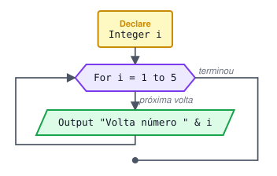

No Flowgorithm, os dois limites estão incluídos: `1 to 5` dá 5 voltas; `0 to 4` também dá 5 voltas (0, 1, 2, 3, 4). Para contar para trás, marque **Decreasing** no símbolo:

```
For i = 5 to 1 decreasing
  Output i
End
... 5 4 3 2 1
```

O que o `For` faz por baixo dos panos:

```
1. i recebe o valor inicial (1)
2. i é menor ou igual ao final (5)?  Se não → sai do laço
3. Executa o bloco
4. i aumenta 1
5. Volta para o passo 2
```

## 3. While (Enquanto)

Testa a condição **antes** de cada volta. Enquanto ela for verdadeira, executa o bloco; quando ficar falsa, sai. Se já começar falsa, o bloco nunca executa.

Você é responsável por fazer a condição mudar dentro do bloco; senão o laço não termina.

```
Declare Integer contador
Assign contador = 1  ... 1. valor inicial

While contador <= 5  ... 2. condição
  Output contador
  Assign contador = contador + 1  ... 3. atualização (sem isso, laço infinito!)
End
```

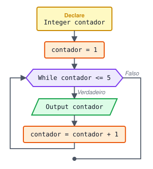

Teste de mesa:

| Volta | contador (mostrado) | contador <= 5 ? | contador depois |
| --- | --- | --- | --- |
| 1 | 1 | V | 2 |
| 2 | 2 | V | 3 |
| 3 | 3 | V | 4 |
| 4 | 4 | V | 5 |
| 5 | 5 | V | 6 |
| — | 6 | **F** → sai |  |

Um uso em que o `While` brilha, quando não se sabe quantas voltas serão:

```
... Soma números até o usuário digitar 0
Declare Integer numero
Declare Integer soma
Assign soma = 0

Output "Digite um número (0 para sair): "
Input numero
While numero != 0
  Assign soma = soma + numero
  Output "Digite um número (0 para sair): "
  Input numero
End
Output "Soma total: " & soma
```

## 4. Do (Faça)

Executa o bloco **primeiro** e só depois testa a condição. Se for verdadeira, repete. Por isso roda **pelo menos uma vez**.

No pseudocódigo exportado pelo Flowgorithm o `Do` aparece assim (repete **enquanto** a condição do final for verdadeira):

```
Loop
  ... bloco
Do condição
```

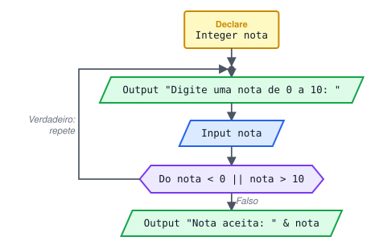

Exemplo clássico, validar entrada (pede de novo enquanto o valor for inválido):

```
Declare Integer nota

Loop
  Output "Digite uma nota de 0 a 10: "
  Input nota
Do nota < 0 || nota > 10

Output "Nota aceita: " & nota
```

```
Digite uma nota de 0 a 10: 15
Digite uma nota de 0 a 10: -2
Digite uma nota de 0 a 10: 8
Nota aceita: 8
```

## 5. Contadores e acumuladores

Dois padrões que aparecem em quase todo laço:

```
... CONTADOR: conta QUANTAS vezes algo aconteceu (soma 1)
Assign aprovados = 0  ... sempre começa em 0, ANTES do laço
...
Assign aprovados = aprovados + 1  ... dentro do laço, quando acontece

... ACUMULADOR: soma VALORES (soma o próprio valor)
Assign somaNotas = 0  ... começa em 0, ANTES do laço
...
Assign somaNotas = somaNotas + nota  ... dentro do laço
```

> ⚠️ Esqueceu de zerar antes do laço? O valor começa com lixo ou dá erro. Zerou **dentro** do laço? Ele volta a zero a cada volta e no fim só sobra o último valor.

Para a média de N valores: acumule a soma no laço e divida **depois** que ele terminar.

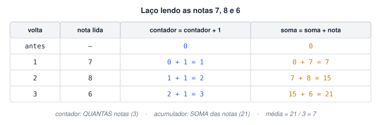

## 6. Erros comuns

```
... Laço infinito: a condição nunca fica falsa
Assign i = 1
While i <= 10
  Output i
End                      ❌ esqueceu  Assign i = i + 1

... Uma volta a mais ou a menos
For i = 0 to 10          ❌ 11 voltas (0 a 10), não 10
For i = 1 to 10          ✅ 10 voltas
For i = 0 to 9           ✅ 10 voltas (bom para vetores, que começam no índice 0)
```

## 7. Os três laços em Python

**Comparação**

```python
# for: quantidade definida (range(1, 6) gera 1, 2, 3, 4, 5)
for i in range(1, 6):
  print("Volta", i)

# while: enquanto a condição for verdadeira
contador = 1
while contador <= 5:
  print(contador)
  contador += 1

# Python não tem "do...while"; o padrão equivalente é:
while True:
  nota = int(input("Digite uma nota de 0 a 10: "))
  if 0 <= nota <= 10:
    break
print("Nota aceita:", nota)
```

## 8. Projetos com For

### 8.1 Contar de 1 a 10

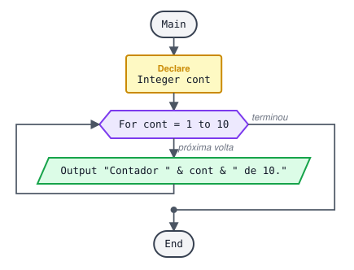

**Pseudocódigo**

```
Function Main
  Declare Integer cont

  ... Versão original: contador de 0 a 9, mostrando cont + 1
  For cont = 0 to 9
    Output "Contador " & cont + 1 & " de 10."
  End
End
```

Versão mais direta, com o contador de 1 a 10:

```
For cont = 1 to 10
  Output "Contador " & cont & " de 10."
End
```

### 8.2 Tabuada de um número

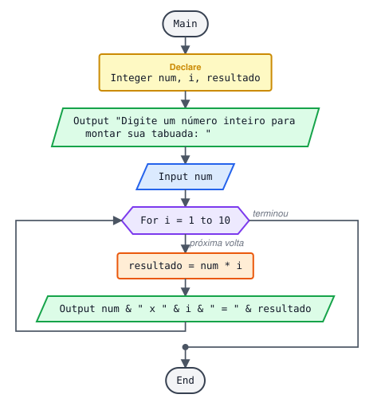

**Pseudocódigo**

```
Function Main
  Declare Integer num
  Declare Integer i
  Declare Integer resultado

  Output "Digite um número inteiro para montar sua tabuada: "
  Input num

  For i = 1 to 10
    Assign resultado = num * i
    Output num & " x " & i & " = " & resultado
  End
End
```

**Exemplo de execução**

```
Digite um número inteiro para montar sua tabuada: 7
7 x 1 = 7
7 x 2 = 14
7 x 3 = 21
...
7 x 10 = 70
```

### 8.3 Grupo de 5 alunos: aprovados e reprovados

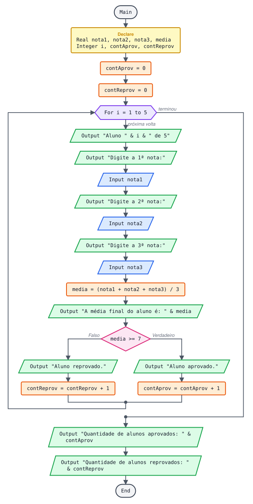

Para cada um dos 5 alunos: pede 3 notas, calcula a média, diz se passou. No fim mostra quantos foram aprovados e reprovados (dois **contadores**).

**Pseudocódigo**

```
Function Main
  Declare Real nota1
  Declare Real nota2
  Declare Real nota3
  Declare Real media
  Declare Integer i

  ... Contadores começam em zero, antes do laço
  Declare Integer contAprov
  Declare Integer contReprov
  Assign contAprov = 0
  Assign contReprov = 0

  For i = 1 to 5
    Output "Aluno " & i & " de 5"
    Output "Digite a 1ª nota:"
    Input nota1
    Output "Digite a 2ª nota:"
    Input nota2
    Output "Digite a 3ª nota:"
    Input nota3

    Assign media = (nota1 + nota2 + nota3) / 3
    Output "A média final do aluno é: " & media

    If media >= 7
      Output "Aluno aprovado."
      Assign contAprov = contAprov + 1
    False:
      Output "Aluno reprovado."
      Assign contReprov = contReprov + 1
    End
  End

  ... Resultados só depois que o laço termina
  Output "Quantidade de alunos aprovados: " & contAprov
  Output "Quantidade de alunos reprovados: " & contReprov
End
```

### 8.4 Classe de 10 alunos + média geral da turma

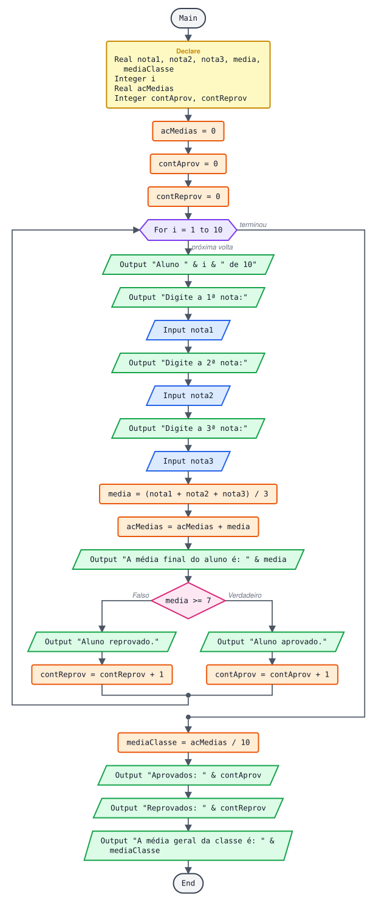

Igual ao anterior, com um **acumulador** que soma as médias de todos os alunos. A média da turma é calculada depois do laço.

**Pseudocódigo**

```
Function Main
  Declare Real nota1
  Declare Real nota2
  Declare Real nota3
  Declare Real media
  Declare Real mediaClasse
  Declare Integer i

  ... Acumulador e contadores começam em zero
  Declare Real acMedias
  Declare Integer contAprov
  Declare Integer contReprov
  Assign acMedias = 0
  Assign contAprov = 0
  Assign contReprov = 0

  For i = 1 to 10
    Output "Aluno " & i & " de 10"
    Output "Digite a 1ª nota:"
    Input nota1
    Output "Digite a 2ª nota:"
    Input nota2
    Output "Digite a 3ª nota:"
    Input nota3

    Assign media = (nota1 + nota2 + nota3) / 3
    Assign acMedias = acMedias + media  ... acumula
    Output "A média final do aluno é: " & media

    If media >= 7
      Output "Aluno aprovado."
      Assign contAprov = contAprov + 1
    False:
      Output "Aluno reprovado."
      Assign contReprov = contReprov + 1
    End
  End

  Assign mediaClasse = acMedias / 10
  Output "Aprovados: " & contAprov
  Output "Reprovados: " & contReprov
  Output "A média geral da classe é: " & mediaClasse
End
```

### 8.5 Média de 10 valores

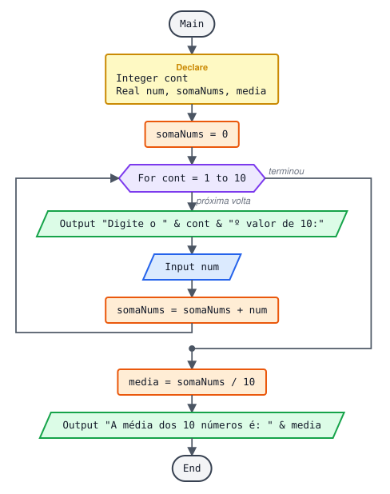

**Pseudocódigo**

```
Function Main
  Declare Integer cont
  Declare Real num
  Declare Real somaNums
  Declare Real media

  Assign somaNums = 0

  For cont = 1 to 10
    Output "Digite o " & cont & "º valor de 10:"
    Input num
    Assign somaNums = somaNums + num
  End

  Assign media = somaNums / 10
  Output "A média dos 10 números é: " & media
End
```

### 8.6 Quantos pares e quantos ímpares (e suas somas)

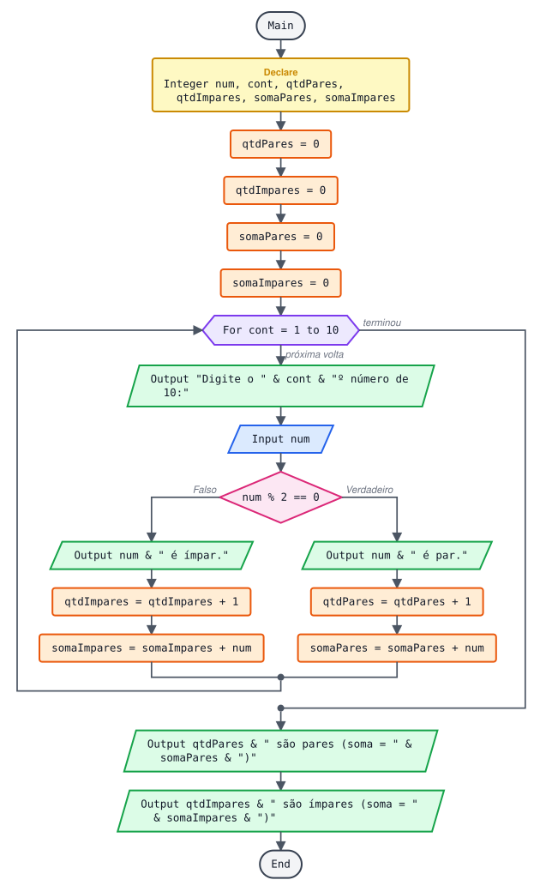

**Pseudocódigo**

```
Function Main
  Declare Integer num
  Declare Integer cont

  ... 2 contadores (quantos) e 2 acumuladores (soma), todos começando em zero
  Declare Integer qtdPares
  Declare Integer qtdImpares
  Declare Integer somaPares
  Declare Integer somaImpares
  Assign qtdPares = 0
  Assign qtdImpares = 0
  Assign somaPares = 0
  Assign somaImpares = 0

  For cont = 1 to 10
    Output "Digite o " & cont & "º número de 10:"
    Input num

    If num % 2 == 0
      Output num & " é par."
      Assign qtdPares = qtdPares + 1
      Assign somaPares = somaPares + num
    False:
      Output num & " é ímpar."
      Assign qtdImpares = qtdImpares + 1
      Assign somaImpares = somaImpares + num
    End
  End

  Output "Dentre os 10 números:"
  Output qtdPares & " são pares (soma = " & somaPares & ")"
  Output qtdImpares & " são ímpares (soma = " & somaImpares & ")"
End
```

---

## 9. Projetos com Do

### 9.1 Uma saudação usando um laço

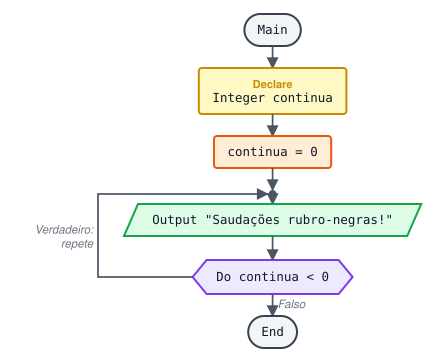

O `Do` executa uma vez e testa `continua < 0`, que é falso; então não repete.

**Pseudocódigo**

```
Function Main
  Declare Integer continua

  Assign continua = 0
  Loop
    Output "Saudações rubro-negras!"
  Do continua < 0
End
```

### 9.2 Saudação que pergunta se deve repetir

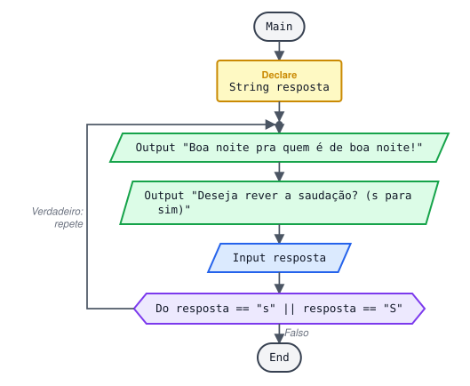

**Pseudocódigo**

```
Function Main
  Declare String resposta

  Loop
    Output "Boa noite pra quem é de boa noite!"
    Output "Deseja rever a saudação? (s para sim, outra letra para não)"
    Input resposta
  Do resposta == "s" || resposta == "S"
End
```

**Exemplo de execução**

```
Boa noite pra quem é de boa noite!
Deseja rever a saudação? (s para sim, outra letra para não) s
Boa noite pra quem é de boa noite!
Deseja rever a saudação? (s para sim, outra letra para não) n
```

### 9.3 Validar valor entre 0 e 10 (pede de novo se estiver fora)

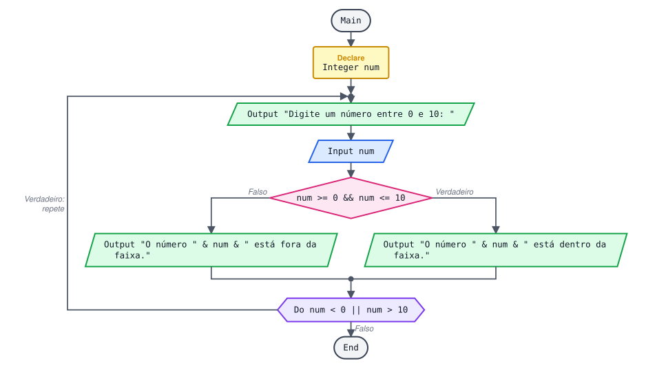

**Pseudocódigo**

```
Function Main
  Declare Integer num

  Loop
    Output "Digite um número entre 0 e 10: "
    Input num
    If num >= 0 && num <= 10
      Output "O número " & num & " está dentro da faixa. Programa encerrado."
    False:
      Output "O número " & num & " está fora da faixa. Digite um número de 0 a 10."
    End
  Do num < 0 || num > 10
End
```

A condição do `Do` é o **contrário** da condição de "valor válido": repete enquanto estiver fora da faixa.

---

## 10. Projetos com While

### 10.1 Contar até 100

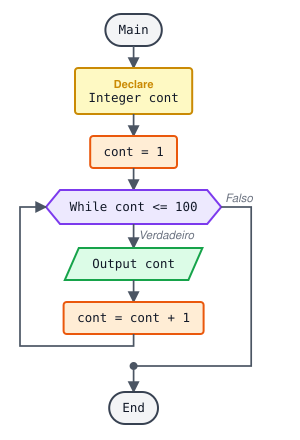

**Pseudocódigo**

```
Function Main
  Declare Integer cont

  Assign cont = 1
  While cont <= 100
    Output cont
    Assign cont = cont + 1
  End
End
```

### 10.2 Cadastro e seleção de candidatos

Uma empresa de recrutamento cadastra candidatos. É selecionado quem atender a **pelo menos um** critério:

- ter nível superior em qualquer área;
- ser maior de 21 anos e ter experiência;
- falar inglês ou espanhol.

Cadastro: número, nome, idade, experiência (S/N), sexo (M/F), fala inglês (S/N), fala espanhol (S/N). Após cada cadastro, mostrar se foi selecionado. No final: quantidade de cadastrados, de selecionados e a média de idade.

Este projeto junta tudo: `For` para cadastrar, `Do` para validar cada resposta, `If` com `&&` e `||` para o critério, contadores, acumulador e vetores (assunto da próxima página) para guardar os cadastros.

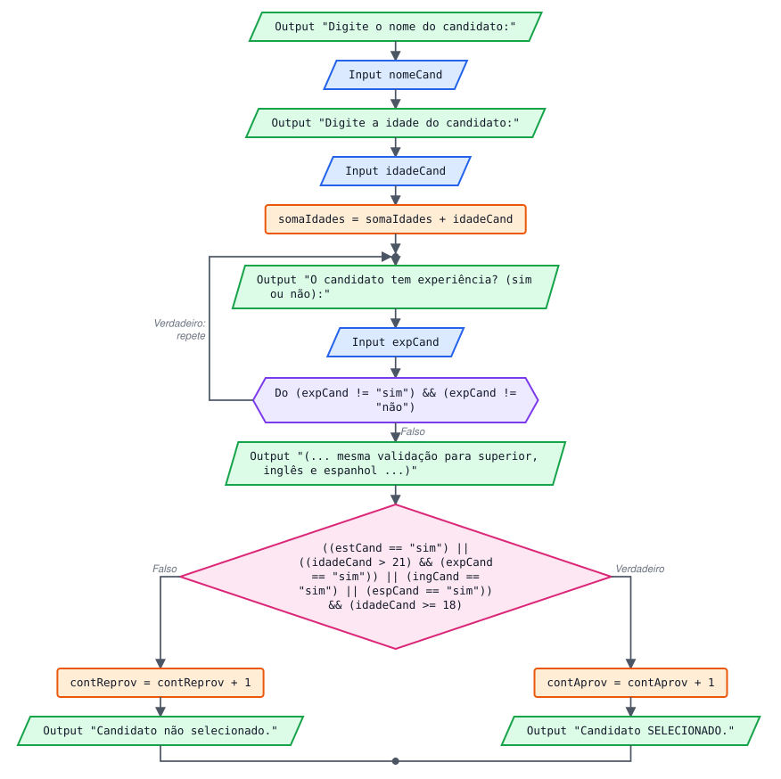

**O critério de seleção, isolado**

```
... Selecionado se: superior OU (mais de 21 E experiência) OU inglês OU espanhol
... (e, por regra da empresa, maior de idade)
... Cada critério numa variável Boolean deixa o If curto
Assign temSuperior = estCand == "sim"
Assign temExperiencia = idadeCand > 21 && expCand == "sim"
Assign falaIdioma = ingCand == "sim" || espCand == "sim"

If (temSuperior || temExperiencia || falaIdioma) && idadeCand >= 18
  Assign contAprov = contAprov + 1
False:
  Assign contReprov = contReprov + 1
End
```

**Pseudocódigo completo**

```
Function Main
  ... Quantidade de candidatos a cadastrar
  Declare Integer numCand
  Output "Digite quantos candidatos vamos cadastrar: "
  Input numCand

  Declare Integer i
  Declare String nomeCand
  Declare Integer idadeCand
  Declare String sexoCand
  Declare String expCand
  Declare String estCand
  Declare String areaFormCand
  Declare String ingCand
  Declare String espCand
  Declare Boolean temSuperior
  Declare Boolean temExperiencia
  Declare Boolean falaIdioma

  ... Vetores para guardar os dados de cada candidato
  Declare String Array arrayNomes[numCand]
  Declare Integer Array arrayIdades[numCand]
  Declare String Array arrayGenero[numCand]
  Declare String Array arrayExp[numCand]
  Declare String Array arrayEst[numCand]
  Declare String Array arrayAform[numCand]
  Declare String Array arrayIng[numCand]
  Declare String Array arrayEsp[numCand]
  Declare String Array arrayCondCand[numCand]

  ... Contadores e acumulador (todos começam em zero)
  Declare Integer contH
  Declare Integer contM
  Declare Integer contAprov
  Declare Integer contReprov
  Declare Integer somaIdades
  Assign contH = 0
  Assign contM = 0
  Assign contAprov = 0
  Assign contReprov = 0
  Assign somaIdades = 0

  For i = 0 to numCand - 1
    Output "Digite o nome do " & i + 1 & "º candidato de " & numCand & ":"
    Input nomeCand
    Assign arrayNomes[i] = nomeCand

    Output "Digite a idade do candidato: "
    Input idadeCand
    Assign arrayIdades[i] = idadeCand
    Assign somaIdades = somaIdades + idadeCand

    ... Do para aceitar só "masculino" ou "feminino"
    Loop
      Output "Digite o sexo do candidato (masculino ou feminino):"
      Input sexoCand
    Do (sexoCand != "masculino") && (sexoCand != "feminino")
    Assign arrayGenero[i] = sexoCand
    If sexoCand == "masculino"
      Assign contH = contH + 1
    False:
      Assign contM = contM + 1
    End

    Loop
      Output "O candidato tem experiência? (sim ou não):"
      Input expCand
    Do (expCand != "sim") && (expCand != "não") && (expCand != "nao")
    Assign arrayExp[i] = expCand

    Loop
      Output "O candidato tem formação superior? (sim ou não):"
      Input estCand
    Do (estCand != "sim") && (estCand != "não") && (estCand != "nao")
    Assign arrayEst[i] = estCand

    If estCand == "sim"
      Output "Digite a área de formação do candidato:"
      Input areaFormCand
      Assign arrayAform[i] = areaFormCand
    False:
      Assign arrayAform[i] = "Não possui formação superior."
    End

    Loop
      Output "O candidato fala inglês? (sim ou não):"
      Input ingCand
    Do (ingCand != "sim") && (ingCand != "não") && (ingCand != "nao")
    Assign arrayIng[i] = ingCand

    Loop
      Output "O candidato fala espanhol? (sim ou não):"
      Input espCand
    Do (espCand != "sim") && (espCand != "não") && (espCand != "nao")
    Assign arrayEsp[i] = espCand

    ... Critério de seleção: um Boolean por critério
    Assign temSuperior = estCand == "sim"
    Assign temExperiencia = idadeCand > 21 && expCand == "sim"
    Assign falaIdioma = ingCand == "sim" || espCand == "sim"
    If (temSuperior || temExperiencia || falaIdioma) && idadeCand >= 18
      Assign contAprov = contAprov + 1
      Assign arrayCondCand[i] = "Selecionado"
      Output "Candidato SELECIONADO."
    False:
      Assign contReprov = contReprov + 1
      Assign arrayCondCand[i] = "Não selecionado"
      Output "Candidato não selecionado."
    End
  End

  ... Resultados (Real para manter as casas decimais)
  Declare Real mediaIdade
  Declare Real porcAprov
  Declare Real porcH
  Declare Real porcM
  Assign mediaIdade = somaIdades / numCand
  Assign porcAprov = (contAprov * 100) / numCand
  Assign porcH = (contH * 100) / numCand
  Assign porcM = (contM * 100) / numCand

  Output "Candidatos cadastrados: " & numCand
  Output "Selecionados: " & contAprov & " (" & porcAprov & "%)"
  Output "Não selecionados: " & contReprov
  Output "Média de idade: " & mediaIdade
  Output "Homens: " & contH & " (" & porcH & "%)"
  Output "Mulheres: " & contM & " (" & porcM & "%)"

  ... Listar os cadastros, se o usuário quiser
  Declare String continua
  Loop
    Output "Deseja imprimir os cadastros? (sim ou não):"
    Input continua
  Do (continua != "sim") && (continua != "não") && (continua != "nao")

  If continua == "sim"
    For i = 0 to numCand - 1
      Output "Nome: " & arrayNomes[i]
      Output "Idade: " & arrayIdades[i]
      Output "Sexo: " & arrayGenero[i]
      Output "Experiência profissional: " & arrayExp[i]
      Output "Formação superior: " & arrayEst[i]
      Output "Área de formação: " & arrayAform[i]
      Output "Fala inglês: " & arrayIng[i]
      Output "Fala espanhol: " & arrayEsp[i]
      Output "Situação: " & arrayCondCand[i]
    End
  End
  Output "Obrigado por usar o nosso software."
End
```

**O que mudou:** o critério de seleção foi dividido em três variáveis `Boolean`, que deixam o `If` curto e fácil de ler; médias e porcentagens passaram a `Real`; o resultado (selecionado ou não) agora é mostrado logo após cada cadastro, como pede o enunciado; e a situação aparece na listagem final.

## 📌 Resumo

| Item | Em uma frase |
| --- | --- |
| `For` | Repete um número conhecido de vezes |
| `While` | Repete enquanto a condição vale, testando antes |
| `Do` | Executa pelo menos uma vez e testa depois |
| Laço infinito | Acontece se a variável da condição não muda dentro do laço |
| Contador | Soma 1; começa em zero antes do laço |
| Acumulador | Soma valores; começa em zero antes do laço |
| Resultados | Totais e médias vão depois do laço |
