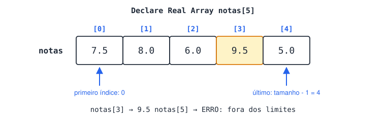
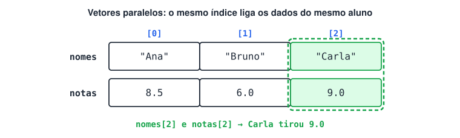
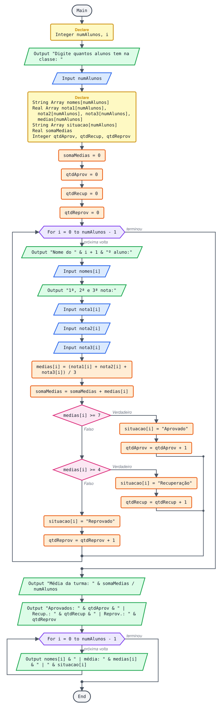
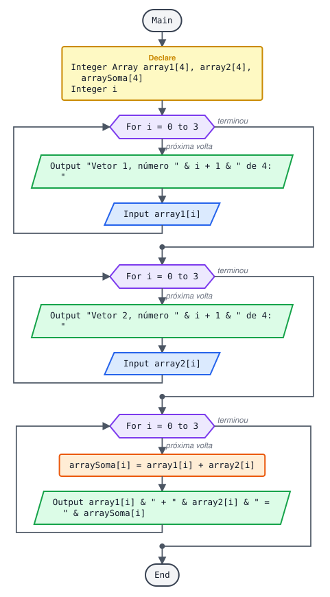
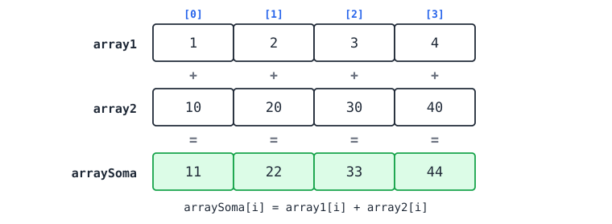
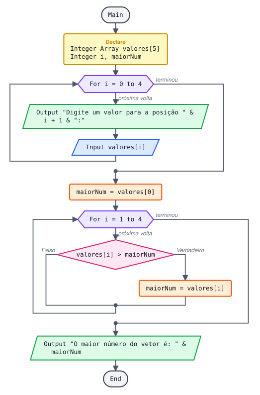
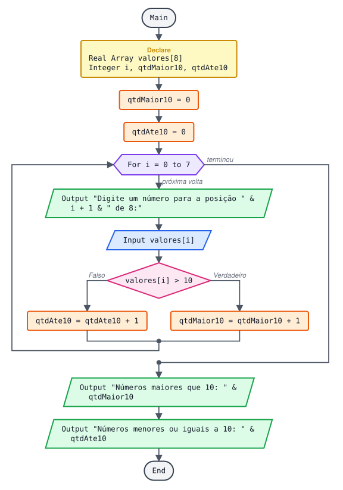
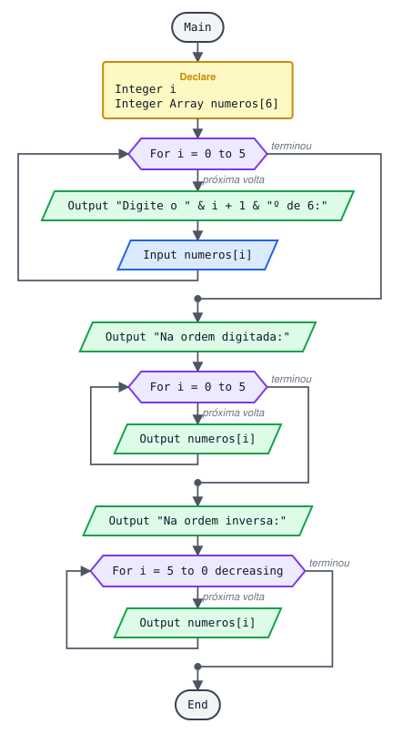
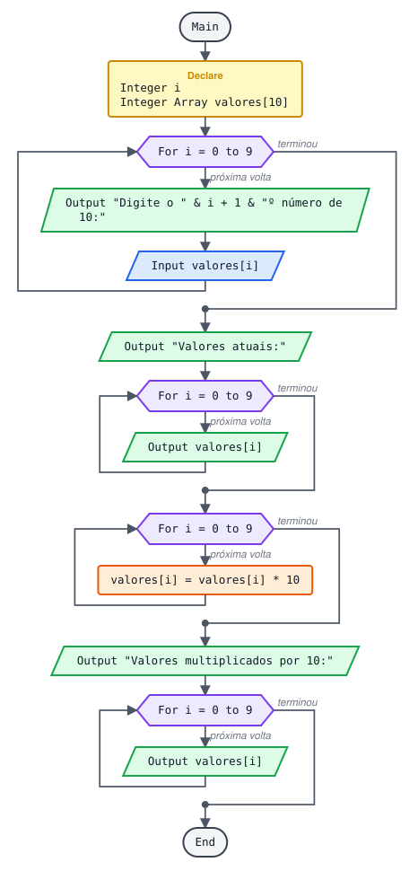

# Estudo de vetores

> 🗺️ **Nesta aula:** o que é um vetor e como funcionam os índices, declarar, preencher e mostrar com `For`, os algoritmos clássicos (soma, maior valor, busca, vetores paralelos) e seis projetos.

## 1. O que é um vetor (array)

Uma variável comum guarda **um** valor. Um **vetor** (array, arranjo) é uma variável com **várias posições**, todas do mesmo tipo, e cada posição guarda seu próprio valor. Em vez de criar `nota1`, `nota2`, ..., `nota30`, cria-se um vetor `notas` com 30 posições.

Cada posição é identificada por um número, o **índice**, escrito entre colchetes. **O primeiro índice é sempre 0**, e o último é o tamanho menos 1: em `Declare Real Array notas[5]`, as posições vão de `notas[0]` a `notas[4]`.



Regras principais:

- Todas as posições têm o **mesmo tipo** (Integer, Real, String ou Boolean).
- No Flowgorithm, o **tamanho** é informado na declaração e não muda depois.
- Um vetor de tamanho N tem índices de `0` a `N - 1`. Acessar `notas[5]` num vetor de 5 posições é erro ("fora dos limites").
- Para ler ou mostrar todos os valores, usa-se um laço `For` que percorre os índices.

## 2. Operações básicas

### 2.1 Declarar

```
Declare Integer Array idades[10]  ... 10 inteiros (índices 0 a 9)
Declare String Array nomes[3]  ... 3 textos
Declare Real Array precos[qtd]  ... tamanho vindo de uma variável (lida antes)
```

### 2.2 Gravar e ler uma posição

```
Assign nomes[0] = "Ana"
Assign nomes[1] = "Bruno"
Assign nomes[2] = "Carla"

Output nomes[1]  ... mostra: Bruno
```

### 2.3 Preencher com um laço

O índice do vetor é a própria variável do `For`:

```
Declare Integer Array numeros[5]
Declare Integer i

For i = 0 to 4
  Output "Digite o " & i + 1 & "º número: "
  Input numeros[i]
End
```

O `i + 1` serve só para a mensagem: o usuário vê "1º, 2º, 3º...", enquanto o vetor usa os índices 0, 1, 2...

### 2.4 Mostrar todos os valores

```
For i = 0 to 4
  Output "Posição " & i & ": " & numeros[i]
End
```

## 3. Algoritmos clássicos com vetores

**Somar todos os valores e calcular a média**

```
Assign soma = 0
For i = 0 to 4
  Assign soma = soma + numeros[i]
End
Assign media = soma / 5
```

**Encontrar o maior valor**

Começa supondo que o maior é o primeiro elemento; depois compara com cada um dos outros.

```
Assign maior = numeros[0]
For i = 1 to 4
  If numeros[i] > maior
    Assign maior = numeros[i]
  End
End
Output "Maior valor: " & maior
```

Teste de mesa com `numeros = [4, 9, 2, 9, 7]`:

| i | numeros[i] | numeros[i] > maior ? | maior |
| --- | --- | --- | --- |
| início |  |  | 4 |
| 1 | 9 | V | 9 |
| 2 | 2 | F | 9 |
| 3 | 9 | F | 9 |
| 4 | 7 | F | 9 |

**Por que não começar com **`maior = 0`**?** Se todos os valores forem negativos (ex.: -5, -3, -8), o 0 nunca seria superado e o resultado estaria errado.

**Contar quantos valores atendem a uma condição**

```
Assign qtdAcimaDe10 = 0
For i = 0 to 4
  If numeros[i] > 10
    Assign qtdAcimaDe10 = qtdAcimaDe10 + 1
  End
End
```

**Procurar um valor (busca sequencial)**

```
Declare Boolean encontrado
Assign encontrado = false

Output "Qual número deseja procurar? "
Input procurado
For i = 0 to 4
  If numeros[i] == procurado
    Output "Encontrado na posição " & i
    Assign encontrado = true
  End
End
If !encontrado
  Output "Número não encontrado."
End
```

**Percorrer de trás para frente**

```
For i = 4 to 0 decreasing
  Output numeros[i]
End
```

**Vetores paralelos (dados de uma mesma pessoa em vetores diferentes)**

O mesmo índice liga os dados: `nomes[2]` e `notas[2]` são do mesmo aluno.

```
nomes  →  [ "Ana" , "Bruno", "Carla" ]
notas  →  [  8.5  ,   6.0  ,   9.0   ]
             [0]      [1]      [2]

For i = 0 to 2
    Output nomes[i] & " tirou " & notas[i]
End
```

**Em Python (listas)**

```python
numeros = []  # lista vazia
for i in range(5):
  numeros.append(int(input(f"Digite o {i + 1}º número: ")))

print(numeros[0])  # primeiro elemento
print(numeros[-1])  # último elemento
print(sum(numeros))  # soma
print(max(numeros))  # maior
print(sum(numeros) / len(numeros)) # média
for n in reversed(numeros):  # ordem inversa
  print(n)
```

Em Python a lista cresce com `append`, sem tamanho fixo; mas a ideia de índice começando em 0 é a mesma.



## 4. Projetos

### 4.1 Situação de uma classe (notas, média, aprovado/recuperação/reprovado)

O usuário informa quantos alunos tem a classe; para cada um, nome e 3 notas. No final, mostra a situação de cada aluno e os totais da turma.



**Pseudocódigo (revisado)**

```
Function Main
  Declare Integer numAlunos
  Declare Integer i

  Output "Digite quantos alunos tem na classe: "
  Input numAlunos

  ... Vetores paralelos: o mesmo índice é o mesmo aluno
  Declare String Array nomes[numAlunos]
  Declare Real Array nota1[numAlunos]
  Declare Real Array nota2[numAlunos]
  Declare Real Array nota3[numAlunos]
  Declare Real Array medias[numAlunos]
  Declare String Array situacao[numAlunos]

  ... Acumulador e contadores
  Declare Real somaMedias
  Declare Integer qtdAprov
  Declare Integer qtdRecup
  Declare Integer qtdReprov
  Assign somaMedias = 0
  Assign qtdAprov = 0
  Assign qtdRecup = 0
  Assign qtdReprov = 0

  For i = 0 to numAlunos - 1
    Output "Nome do " & i + 1 & "º aluno de " & numAlunos & ":"
    Input nomes[i]
    Output "1ª nota: "
    Input nota1[i]
    Output "2ª nota: "
    Input nota2[i]
    Output "3ª nota: "
    Input nota3[i]

    Assign medias[i] = (nota1[i] + nota2[i] + nota3[i]) / 3
    Assign somaMedias = somaMedias + medias[i]

    If medias[i] >= 7
      Assign situacao[i] = "Aprovado"
      Assign qtdAprov = qtdAprov + 1
    False:
      If medias[i] >= 4
        Assign situacao[i] = "Recuperação"
        Assign qtdRecup = qtdRecup + 1
      False:
        Assign situacao[i] = "Reprovado"
        Assign qtdReprov = qtdReprov + 1
      End
    End
  End

  Output "=== Dados da classe ==="
  Output "Total de alunos: " & numAlunos
  Output "Média da turma: " & somaMedias / numAlunos
  Output "Aprovados: " & qtdAprov
  Output "Em recuperação: " & qtdRecup
  Output "Reprovados: " & qtdReprov

  Output "=== Dados de cada aluno ==="
  For i = 0 to numAlunos - 1
    Output nomes[i] & " | " & situacao[i]
    Output "  notas: " & nota1[i] & ", " & nota2[i] & ", " & nota3[i]
    Output "  média: " & medias[i]
  End
End
```

**O que mudou:**

- Na versão original, `somaNotas = nota1 + nota2 + nota3` **substituía** a soma a cada volta, em vez de acumular (`somaNotas = somaNotas + ...`). A média da turma saía só com o último aluno.
- A média de cada aluno ficava numa variável comum, então a listagem final mostrava a média do último aluno para todos. Agora existe o vetor `medias`.

**Exemplo de execução**

```
Digite quantos alunos tem na classe: 3
Nome do 1º aluno de 3: Ana
1ª nota: 8
2ª nota: 9
3ª nota: 7
Nome do 2º aluno de 3: Bruno
1ª nota: 5
2ª nota: 6
3ª nota: 4
Nome do 3º aluno de 3: Carla
1ª nota: 2
2ª nota: 3
3ª nota: 4
=== Dados da classe ===
Total de alunos: 3
Média da turma: 5.333
Aprovados: 1
Em recuperação: 1
Reprovados: 1
=== Dados de cada aluno ===
Ana | Aprovado
  notas: 8, 9, 7
  média: 8
Bruno | Recuperação
  notas: 5, 6, 4
  média: 5
Carla | Reprovado
  notas: 2, 3, 4
  média: 3
```

### 4.2 Soma das posições equivalentes de 2 vetores





`soma[i] = vetor1[i] + vetor2[i]` para cada índice.

**Pseudocódigo**

```
Function Main
  Declare Integer Array array1[4]
  Declare Integer Array array2[4]
  Declare Integer Array arraySoma[4]
  Declare Integer i

  For i = 0 to 3
    Output "Vetor 1, número " & i + 1 & " de 4: "
    Input array1[i]
  End

  For i = 0 to 3
    Output "Vetor 2, número " & i + 1 & " de 4: "
    Input array2[i]
  End

  For i = 0 to 3
    Assign arraySoma[i] = array1[i] + array2[i]
    Output array1[i] & " + " & array2[i] & " = " & arraySoma[i]
  End
End
```

**Visualizando**

```
array1     [ 1 ][ 2 ][ 3 ][ 4 ]
             +    +    +    +
array2     [10 ][20 ][30 ][40 ]
             =    =    =    =
arraySoma  [11 ][22 ][33 ][44 ]
```

### 4.3 Maior valor de um vetor de 5 posições



**Pseudocódigo**

```
Function Main
  Declare Integer Array valores[5]
  Declare Integer i
  Declare Integer maiorNum

  For i = 0 to 4
    Output "Digite um valor para a posição " & i + 1 & " do vetor:"
    Input valores[i]
  End

  ... Começa com uma posição válida do vetor (a primeira)
  Assign maiorNum = valores[0]

  For i = 1 to 4
    If valores[i] > maiorNum
      Assign maiorNum = valores[i]
    End
  End

  Output "O maior número do vetor é: " & maiorNum
End
```

### 4.4 Quantos valores são maiores que 10



**Pseudocódigo**

```
Function Main
  Declare Real Array valores[8]
  Declare Integer i
  Declare Integer qtdMaior10
  Declare Integer qtdAte10

  Assign qtdMaior10 = 0
  Assign qtdAte10 = 0

  For i = 0 to 7
    Output "Digite um número para a posição " & i + 1 & " de 8:"
    Input valores[i]

    If valores[i] > 10
      Assign qtdMaior10 = qtdMaior10 + 1
    False:
      Assign qtdAte10 = qtdAte10 + 1
    End
  End

  Output "Números maiores que 10: " & qtdMaior10
  Output "Números menores ou iguais a 10: " & qtdAte10
End
```

Observação: o 10 cai no grupo "menores ou iguais a 10". A versão original chamava esse grupo de "menores que 10", o que não incluía o próprio 10.

### 4.5 Mostrar na ordem digitada e na ordem inversa



**Pseudocódigo**

```
Function Main
  Declare Integer i
  Declare Integer Array numeros[6]

  For i = 0 to 5
    Output "Digite o " & i + 1 & "º de 6:"
    Input numeros[i]
  End

  Output "Na ordem digitada:"
  For i = 0 to 5
    Output numeros[i]
  End

  Output "Na ordem inversa:"
  For i = 5 to 0 decreasing
    Output numeros[i]
  End
End
```

**Exemplo de execução**

```
(digitados: 3, 8, 1, 6, 2, 9)
Na ordem digitada:
3 8 1 6 2 9
Na ordem inversa:
9 2 6 1 8 3
```

### 4.6 Multiplicar cada elemento por 10



**Pseudocódigo**

```
Function Main
  Declare Integer i
  Declare Integer Array valores[10]

  For i = 0 to 9
    Output "Digite o " & i + 1 & "º número de 10:"
    Input valores[i]
  End

  Output "Valores atuais:"
  For i = 0 to 9
    Output valores[i]
  End

  ... Altera o próprio vetor: cada posição recebe ela mesma vezes 10
  For i = 0 to 9
    Assign valores[i] = valores[i] * 10
  End

  Output "Valores multiplicados por 10:"
  For i = 0 to 9
    Output valores[i]
  End
End
```

## 5. Erros comuns

```
Declare Integer Array v[5]

Assign v[5] = 10           ❌ índice 5 não existe (vai de 0 a 4)
For i = 1 to 5 ...         ❌ pula v[0] e tenta acessar v[5]
For i = 0 to 4 ...         ✅

Output v                   ❌ não mostra o vetor inteiro
For i = 0 to 4             ✅ mostra posição por posição
  Output v[i]
End
```

## 📌 Resumo

| Item | Em uma frase |
| --- | --- |
| Vetor | Várias posições do mesmo tipo, acessadas por índice entre `[ ]` |
| Índices | Vão de `0` a `tamanho - 1` |
| Laço padrão | `For i = 0 to tamanho - 1` para preencher, mostrar e processar |
| Maior valor | Comece com `v[0]` e compare com os outros |
| Vetores paralelos | O mesmo índice liga dados da mesma pessoa |
