# Estudo de sub programas

> 🗺️ **Nesta aula:** sub-rotinas, parâmetros, argumentos e retorno, função × procedimento, escopo, recursão e onze projetos com funções.

## 1. O que são sub-rotinas

Uma **sub-rotina** (também chamada de subprograma, função ou procedimento) é um bloco de código com **nome próprio**, separado da função principal (`Main`), que pode ser executado sempre que for chamado.

Por que usar:

- **Dividir** um problema grande em partes menores, cada uma com uma tarefa.
- **Reaproveitar**: escreve uma vez, chama quantas vezes quiser.
- **Organizar**: o `Main` fica curto e fácil de ler, como um índice do programa.

```
Function Main  ← o programa começa aqui
  ...
  Assign m = calculaMedia(n1, n2, n3)  ← chama a sub-rotina
  ...
End

Function calculaMedia (...)  ← executa e devolve o resultado
  ...
Return Real m
```

## 2. Parâmetros, argumentos e retorno

```
... a e b são os parâmetros (o que a função recebe)
Function calculaMedia (Real a, Real b)
  Declare Real m
  Assign m = (a + b) / 2
... m é o retorno (o que a função devolve)
Return Real m

... nota1 e nota2 são os argumentos (enviados na chamada)
Assign media = calculaMedia(nota1, nota2)
```

| Termo | O que é |
| --- | --- |
| Parâmetro | Variável declarada no cabeçalho da função, que recebe um valor |
| Argumento | Valor (ou variável) passado na chamada |
| Retorno | Valor que a função devolve para quem chamou |

Os argumentos são copiados para os parâmetros **na ordem**: o 1º argumento vai para o 1º parâmetro, e assim por diante. Os nomes não precisam ser iguais (`nota1` → `a`).

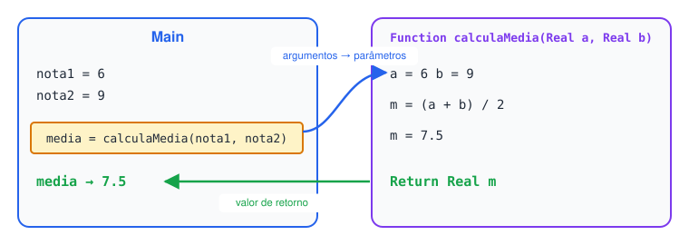

## 3. Função × procedimento

|  | Função (com retorno) | Procedimento (sem retorno) |
| --- | --- | --- |
| Devolve valor? | Sim | Não |
| Como chamar | Dentro de uma expressão: `Assign x = dobro(5)` | Com o comando `Call`: `Call mostraMenu` |
| Exemplo de uso | Calcular algo (média, maior valor, fatorial) | Fazer algo (mostrar uma tabela, ordenar um vetor) |

```
... Função: devolve um valor
Function dobro (Integer n)
  Declare Integer r
  Assign r = n * 2
Return Integer r

... Procedimento: só executa
Function mostraLinha
  Output "--------------------"
End

Function Main
  Declare Integer x
  Assign x = dobro(5)  ... x recebe 10
  Call mostraLinha
  Output x
  Call mostraLinha
End
```

```
--------------------
10
--------------------
```

## 4. Escopo: cada função tem suas variáveis

Uma variável declarada dentro de uma função só existe **dentro dela** (variável local). A `Main` não enxerga as variáveis da sub-rotina e vice-versa. Por isso os dados entram por parâmetros e saem pelo retorno.

```
Function Main
  Declare Integer x
  Assign x = 5
  Assign y = 10         ❌ y não existe na Main
End

Function teste
  Output x              ❌ x é da Main; aqui não existe
End
```

> 💡 **Vetores são uma exceção:** no Flowgorithm, um vetor passado como argumento é o **mesmo** vetor dentro da função (passagem por referência). Se a função altera o vetor, a alteração aparece na `Main`. É isso que permite o procedimento de ordenação do projeto 7.6 funcionar sem retorno.

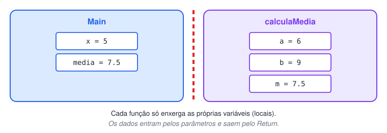

## 5. Recursão

Uma função **recursiva** chama a si mesma, resolvendo o problema com uma versão menor dele mesmo. Precisa sempre de um **caso base** (que para a recursão); sem ele, as chamadas nunca terminam.

Fatorial: `5! = 5 × 4 × 3 × 2 × 1`, ou seja, `n! = n × (n - 1)!` e `0! = 1! = 1`.

```
Function fatorial (Integer n)
  Declare Integer r
  If n <= 1
    Assign r = 1  ... caso base
  False:
    Assign r = n * fatorial(n - 1)  ... chama a si mesma com n menor
  End
Return Integer r
```

Como `fatorial(4)` é resolvido:

```
fatorial(4) = 4 * fatorial(3)
fatorial(3) = 3 * fatorial(2)
fatorial(2) = 2 * fatorial(1)
fatorial(1) = 1  ← caso base: agora volta
fatorial(2) = 2 * 1 = 2
fatorial(3) = 3 * 2 = 6
fatorial(4) = 4 * 6 = 24
```

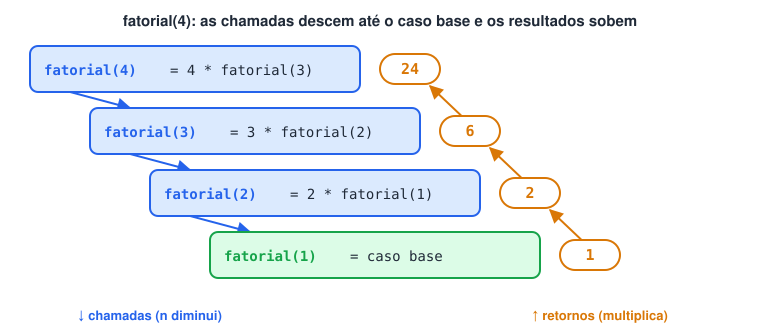

## 6. Em Python

**Funções em Python**

```python
def calcula_media(a, b, c):  # parâmetros
  return (a + b + c) / 3  # retorno

def mostra_linha():  # "procedimento": não tem return
  print("-" * 20)

def fatorial(n):  # recursiva
  if n <= 1:
    return 1
  return n * fatorial(n - 1)

media = calcula_media(7, 8, 9)  # argumentos
mostra_linha()
print(media)  # 8.0
print(fatorial(5))  # 120
```

## 7. Projetos

### 7.1 Potenciação (base e expoente escolhidos pelo usuário)

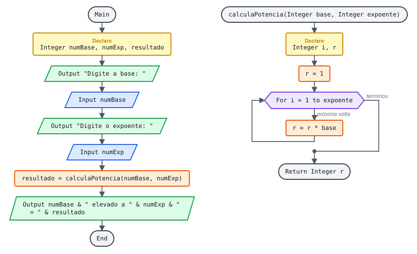

Potência = multiplicar a base por ela mesma "expoente" vezes. `2³ = 2 × 2 × 2 = 8`.

**Pseudocódigo**

```
Function Main
  Declare Integer numBase
  Declare Integer numExp
  Declare Integer resultado

  Output "Digite a base: "
  Input numBase
  Output "Digite o expoente: "
  Input numExp

  Assign resultado = calculaPotencia(numBase, numExp)
  Output numBase & " elevado a " & numExp & " = " & resultado
End

Function calculaPotencia (Integer base, Integer expoente)
  Declare Integer i
  Declare Integer r

  ... Começa em 1 (elemento neutro da multiplicação), não em 0
  Assign r = 1
  For i = 1 to expoente
    Assign r = r * base
  End
Return Integer r
```

Com expoente 0 o laço não executa e a função devolve 1, que é o resultado certo (`n⁰ = 1`). O Flowgorithm também tem o operador pronto: `base ^ expoente`.

**Teste de mesa: calculaPotencia(2, 3)**

| i | r antes | r = r × base |
| --- | --- | --- |
| início |  | 1 |
| 1 | 1 | 2 |
| 2 | 2 | 4 |
| 3 | 4 | 8 |

### 7.2 Menor de dois valores

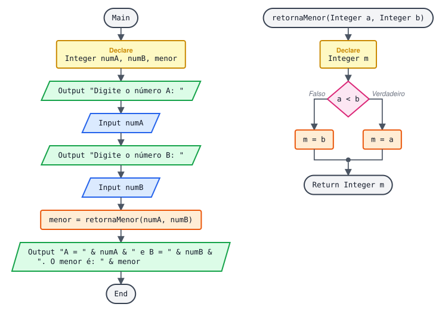

**Pseudocódigo (revisado)**

```
Function Main
  Declare Integer numA
  Declare Integer numB
  Declare Integer menor

  Output "Digite o número A: "
  Input numA
  Output "Digite o número B: "
  Input numB

  Assign menor = retornaMenor(numA, numB)
  Output "A = " & numA & " e B = " & numB & ". O menor é: " & menor
End

Function retornaMenor (Integer a, Integer b)
  Declare Integer m
  If a < b
    Assign m = a
  False:
    Assign m = b  ... se forem iguais, tanto faz: devolve b
  End
Return Integer m
```

**O que mudou:** o enunciado pede o **menor** valor; a versão original (e o arquivo do fluxograma) devolvia o maior. Para o maior, basta trocar `<` por `>`.

### 7.3 Média simples ou ponderada, escolhida por letra

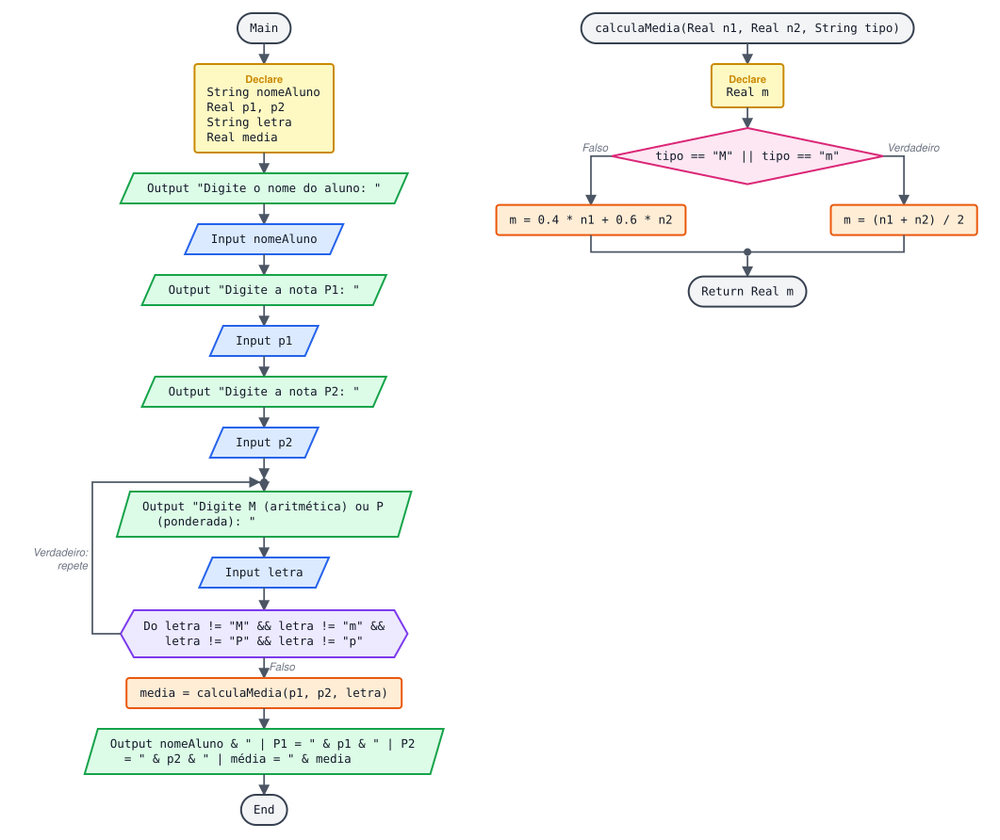

Enunciado: a sub-rotina recebe 2 notas e uma letra. Se a letra for **M**, calcula a média aritmética; se for **P**, a ponderada: `média = 0.4 × P1 + 0.6 × P2`.

**Pseudocódigo (conforme o enunciado)**

```
Function Main
  Declare String nomeAluno
  Declare Real p1
  Declare Real p2
  Declare String letra
  Declare Real media

  Output "Digite o nome do aluno: "
  Input nomeAluno
  Output "Digite a nota P1: "
  Input p1
  Output "Digite a nota P2: "
  Input p2

  ... Validação da letra fica na Main, que é quem conversa com o usuário
  Loop
    Output "Digite M (média aritmética) ou P (média ponderada): "
    Input letra
  Do letra != "M" && letra != "m" && letra != "P" && letra != "p"

  Assign media = calculaMedia(p1, p2, letra)
  Output nomeAluno & " | P1 = " & p1 & " | P2 = " & p2 & " | média = " & media
End

Function calculaMedia (Real n1, Real n2, String tipo)
  Declare Real m
  If tipo == "M" || tipo == "m"
    Assign m = (n1 + n2) / 2
  False:
    Assign m = 0.4 * n1 + 0.6 * n2
  End
Return Real m
```

**O que mudou:** a versão original usava 3 notas e pesos 4, 6 e 8, diferente do enunciado (2 notas, pesos 0.4 e 0.6). Também aceitava só letras minúsculas na validação.

**Exemplo de execução**

```
P1 = 5, P2 = 8, letra M  →  média = 6.5
P1 = 5, P2 = 8, letra P  →  média = 0.4×5 + 0.6×8 = 2 + 4.8 = 6.8
```

### 7.4 Conceito a partir da nota (A a E)

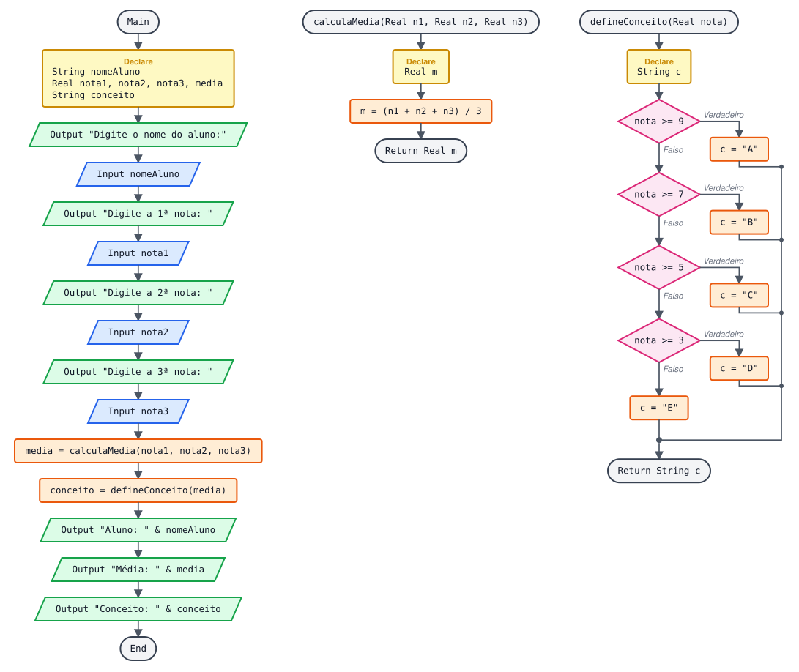

| Nota | Conceito |
| --- | --- |
| 9.0 a 10.0 | A |
| 7.0 a 8.9 | B |
| 5.0 a 6.9 | C |
| 3.0 a 4.9 | D |
| 0 a 2.9 | E |

**Pseudocódigo**

```
Function Main
  Declare String nomeAluno
  Declare Real nota1
  Declare Real nota2
  Declare Real nota3
  Declare Real media
  Declare String conceito

  Output "Digite o nome do aluno:"
  Input nomeAluno
  Output "Digite a 1ª nota: "
  Input nota1
  Output "Digite a 2ª nota: "
  Input nota2
  Output "Digite a 3ª nota: "
  Input nota3

  ... Uma função usa o resultado da outra
  Assign media = calculaMedia(nota1, nota2, nota3)
  Assign conceito = defineConceito(media)

  Output "Aluno: " & nomeAluno
  Output "Média: " & media
  Output "Conceito: " & conceito
End

Function calculaMedia (Real n1, Real n2, Real n3)
  Declare Real m
  Assign m = (n1 + n2 + n3) / 3
Return Real m

Function defineConceito (Real nota)
  Declare String c
  If nota >= 9
    Assign c = "A"
  False:
    If nota >= 7
      Assign c = "B"
    False:
      If nota >= 5
        Assign c = "C"
      False:
        If nota >= 3
          Assign c = "D"
        False:
          Assign c = "E"
        End
      End
    End
  End
Return String c
```

### 7.5 Par ou ímpar (retorna 0 ou 1)

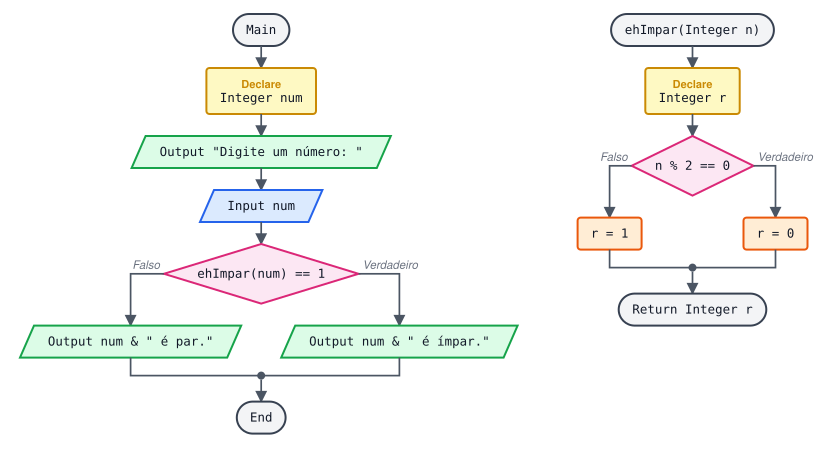

Enunciado: a função recebe um inteiro e **retorna 1 se for ímpar e 0 se for par**.

**Pseudocódigo (conforme o enunciado)**

```
Function Main
  Declare Integer num

  Output "Digite um número: "
  Input num

  ... A Main decide o que mostrar a partir do 0 ou 1 devolvido
  If ehImpar(num) == 1
    Output num & " é ímpar."
  False:
    Output num & " é par."
  End
End

Function ehImpar (Integer n)
  Declare Integer r
  If n % 2 == 0
    Assign r = 0
  False:
    Assign r = 1
  End
Return Integer r
```

**O que mudou:** a versão original devolvia um texto (" é par (0)"); o enunciado pede um número. Separar o cálculo (função) da mensagem (Main) deixa a função reaproveitável em outros programas.

### 7.6 Ordenar 5 números (procedimento, sem retorno)

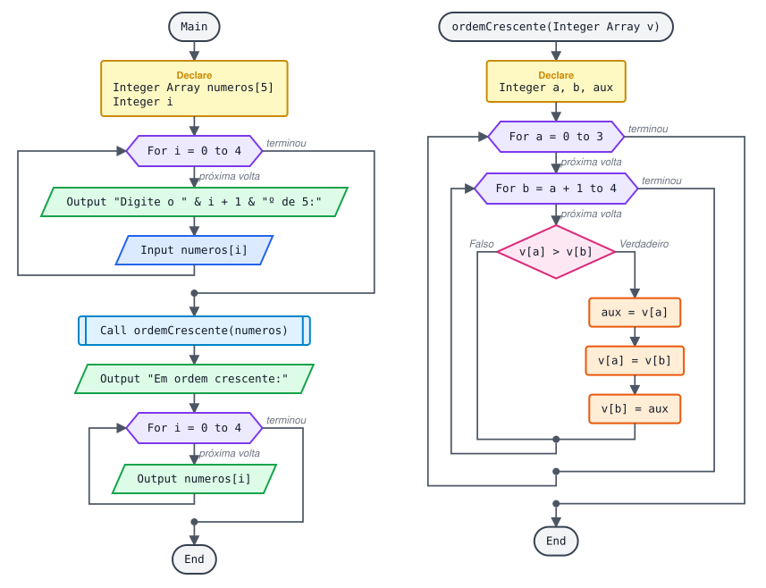

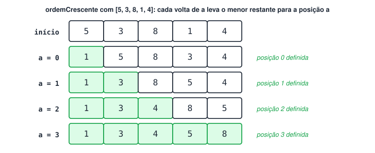

**Pseudocódigo**

```
Function Main
  Declare Integer Array numeros[5]
  Declare Integer i

  For i = 0 to 4
    Output "Digite o " & i + 1 & "º de 5:"
    Input numeros[i]
  End

  ... Procedimento: altera o próprio vetor (passagem por referência)
  Call ordemCrescente(numeros)

  Output "Em ordem crescente:"
  For i = 0 to 4
    Output numeros[i]
  End
End

Function ordemCrescente (Integer Array v)
  Declare Integer a
  Declare Integer b
  Declare Integer aux

  For a = 0 to 3
    For b = a + 1 to 4
      ... Se o da frente é maior que um de trás, troca os dois
      If v[a] > v[b]
        Assign aux = v[a]
        Assign v[a] = v[b]
        Assign v[b] = aux
      End
    End
  End
End
```

**Como funciona a troca (e o laço dentro de laço)**

Para trocar dois valores é preciso uma variável auxiliar; senão um deles se perde:

```
aux  = v[a]  ... guarda o primeiro
v[a] = v[b]  ... copia o segundo para o lugar do primeiro
v[b] = aux  ... coloca o primeiro (guardado) no lugar do segundo
```

O laço externo fixa uma posição `a`; o interno compara essa posição com todas as seguintes e traz o menor valor para ela. Com `[5, 3, 8, 1, 4]`:

```
a = 0:  [1, 5, 8, 3, 4]  → o menor (1) foi para a posição 0
a = 1:  [1, 3, 8, 5, 4]  → o 2º menor (3) foi para a posição 1
a = 2:  [1, 3, 4, 8, 5]
a = 3:  [1, 3, 4, 5, 8]  → ordenado
```

### 7.7 Fatorial

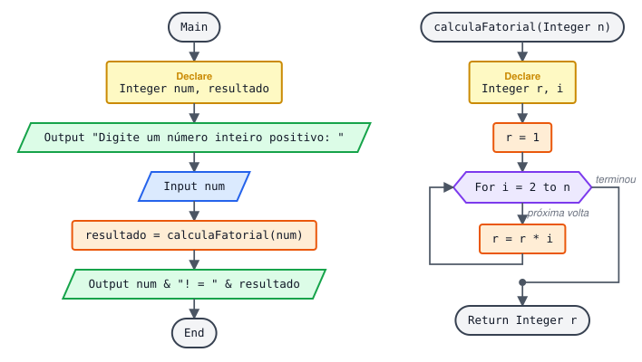

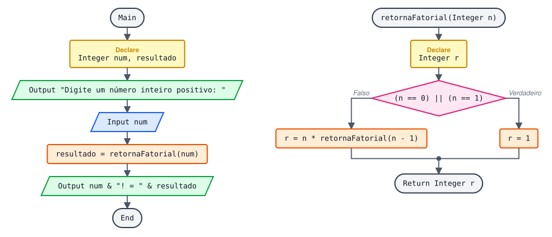

**Forma 1**, com laço:

**Pseudocódigo**

```
Function Main
  Declare Integer num
  Declare Integer resultado

  Output "Digite um número inteiro positivo: "
  Input num
  Assign resultado = calculaFatorial(num)
  Output num & "! = " & resultado
End

Function calculaFatorial (Integer n)
  Declare Integer r
  Declare Integer i

  ... Para n = 0 o laço não executa e r continua 1 (0! = 1)
  Assign r = 1
  For i = 2 to n
    Assign r = r * i
  End
Return Integer r
```

**Forma 2**, recursiva (ver seção 5):

**Pseudocódigo**

```
Function Main
  Declare Integer num
  Declare Integer resultado

  Output "Digite um número inteiro positivo: "
  Input num
  Assign resultado = retornaFatorial(num)
  Output num & "! = " & resultado
End

Function retornaFatorial (Integer n)
  Declare Integer r
  If (n == 0) || (n == 1)
    Assign r = 1
  False:
    Assign r = n * retornaFatorial(n - 1)
  End
Return Integer r
```

**Exemplo de execução**

```
Digite um número inteiro positivo: 5
5! = 120
```

Cuidado: o fatorial cresce muito rápido. `13!` já passa de 6 bilhões e pode estourar o limite de um `Integer`.

### 7.8 Os 3 lados formam um triângulo? Qual tipo?

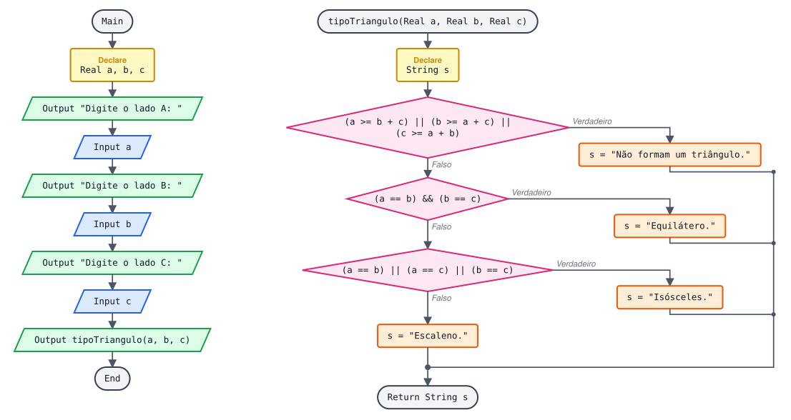

Regra: cada lado tem que ser **menor** que a soma dos outros dois. Tipos: **equilátero** (3 lados iguais), **isósceles** (2 iguais), **escaleno** (3 diferentes).

**Pseudocódigo (revisado)**

```
Function Main
  Declare Real a
  Declare Real b
  Declare Real c

  Output "Digite o lado A: "
  Input a
  Output "Digite o lado B: "
  Input b
  Output "Digite o lado C: "
  Input c

  Output tipoTriangulo(a, b, c)
End

Function tipoTriangulo (Real a, Real b, Real c)
  Declare String s
  ... Não é triângulo se algum lado for maior OU IGUAL à soma dos outros dois
  If (a >= b + c) || (b >= a + c) || (c >= a + b)
    Assign s = "Esses valores não formam um triângulo."
  False:
    If (a == b) && (b == c)
      Assign s = "Triângulo equilátero."
    False:
      If (a == b) || (a == c) || (b == c)
        Assign s = "Triângulo isósceles."
      False:
        Assign s = "Triângulo escaleno."
      End
    End
  End
Return String s
```

**O que mudou:** a regra usava `>`; com lados 2, 3 e 5 (5 = 2 + 3) a versão original dizia que formava triângulo, mas as três "pontas" ficam numa linha reta. O enunciado também fala em valores reais, então os lados passaram a `Real`.

**Exemplos**

```
3, 3, 3  →  Triângulo equilátero.
5, 5, 8  →  Triângulo isósceles.
3, 4, 5  →  Triângulo escaleno.
2, 3, 5  →  Esses valores não formam um triângulo.
1, 2, 10  →  Esses valores não formam um triângulo.
```

### 7.9 Maior de 3 valores

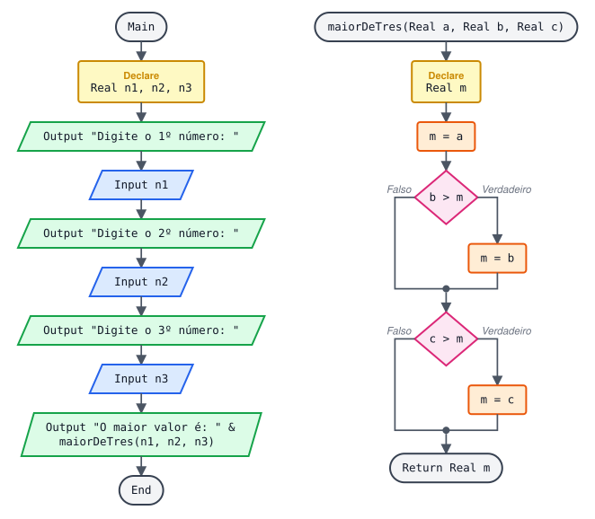

**Pseudocódigo (revisado)**

```
Function Main
  Declare Real n1
  Declare Real n2
  Declare Real n3

  Output "Digite o 1º número: "
  Input n1
  Output "Digite o 2º número: "
  Input n2
  Output "Digite o 3º número: "
  Input n3

  Output "O maior valor é: " & maiorDeTres(n1, n2, n3)
End

Function maiorDeTres (Real a, Real b, Real c)
  Declare Real m
  ... Mesma técnica do "maior do vetor": supõe o primeiro e compara com os outros
  Assign m = a
  If b > m
    Assign m = b
  End
  If c > m
    Assign m = c
  End
Return Real m
```

**O que mudou:** a versão original testava `(n1 > n2) && (n1 > n3)` para cada número. Com empates como 5, 5, 3, nenhuma condição era verdadeira e o programa respondia "os números são iguais", o que estava errado. A função também passou a devolver um número (`Real`) em vez de uma frase, ficando reaproveitável.

### 7.10 Soma de 1 até N

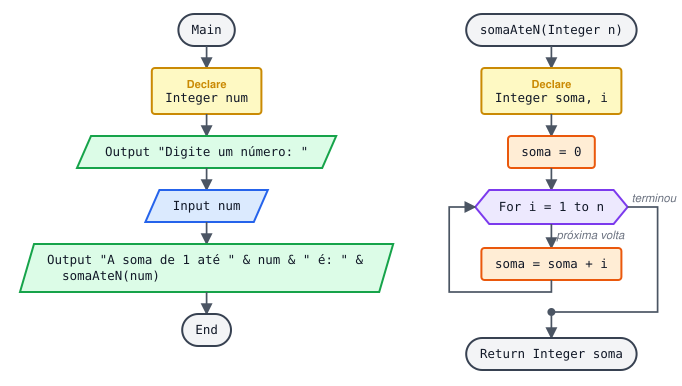

**Pseudocódigo**

```
Function Main
  Declare Integer num

  Output "Digite um número: "
  Input num
  Output "A soma de 1 até " & num & " é: " & somaAteN(num)
End

Function somaAteN (Integer n)
  Declare Integer soma
  Declare Integer i

  Assign soma = 0
  For i = 1 to n
    Assign soma = soma + i
  End
Return Integer soma
```

Curiosidade: existe uma fórmula que dá o mesmo resultado sem laço, `n × (n + 1) / 2`. Para n = 100: `100 × 101 / 2 = 5050`.

### 7.11 Tabuada de N (procedimento)

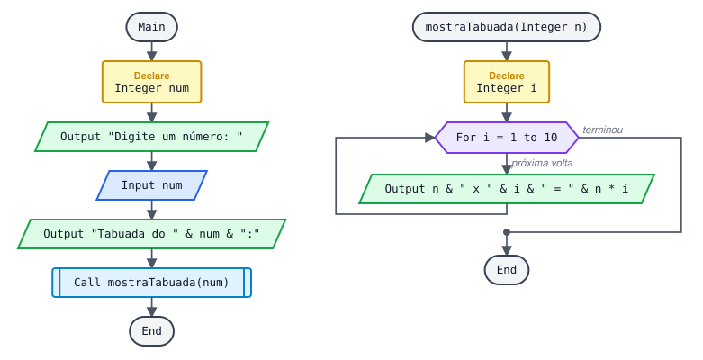

**Pseudocódigo**

```
Function Main
  Declare Integer num

  Output "Digite um número: "
  Input num
  Output "Tabuada do " & num & ":"
  Call mostraTabuada(num)
End

Function mostraTabuada (Integer n)
  Declare Integer i
  For i = 1 to 10
    Output n & " x " & i & " = " & n * i
  End
End
```

A versão original guardava as linhas num vetor e depois mostrava; mostrar direto dentro do laço dá o mesmo resultado com menos código.

## 📌 Resumo

| Item | Em uma frase |
| --- | --- |
| Sub-rotina | Bloco com nome, chamado quando necessário |
| Parâmetros / argumentos | Parâmetros recebem; argumentos são enviados na chamada |
| `Return` | Devolve o resultado para quem chamou |
| Função × procedimento | Função devolve valor (`Assign x = f(...)`); procedimento só executa (`Call`) |
| Escopo | Variáveis são locais; vetores passados como argumento são alterados de verdade |
| Recursão | A função chama a si mesma e precisa de um caso base |
