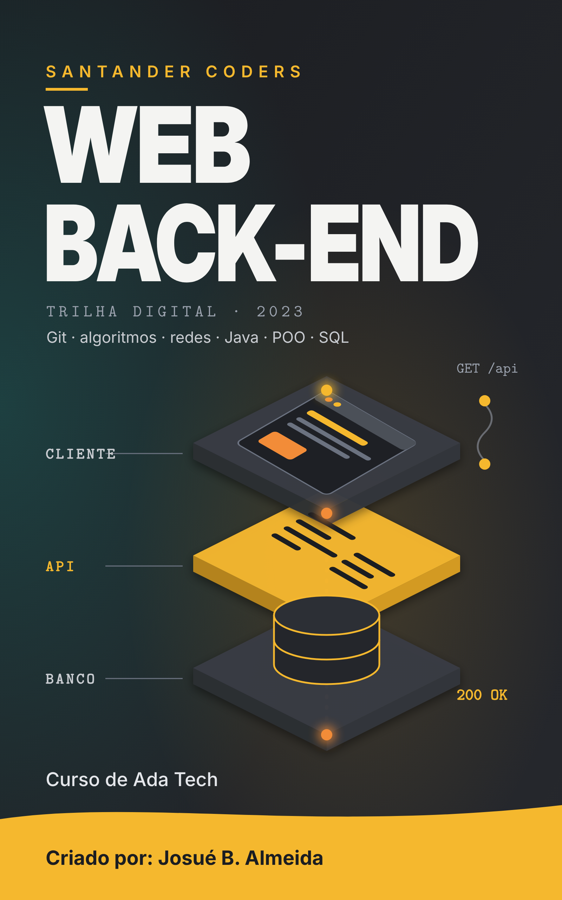

# Santander Coders: Trilha Digital Web Back-End - Ada Tech

📥 **[Baixar o EPUB](https://github.com/Joshpcbrrj/biblioteca-de-estudos/releases/download/epubs/santander-coders-backend.epub)**

Resumo do curso online da trilha Web Back-End do Santander Coders 2023, aplicado pela Ada Tech: Git, lógica e algoritmos, redes e HTTP, Java, orientação a objetos e banco de dados com PostgreSQL. Cada aula segue o mesmo roteiro (Nesta aula → De onde paramos → conteúdo → Exercício → Revisão rápida → Próximo passo → Resumo), e as respostas dos exercícios ficam recolhidas em **Ver resposta**. As páginas com "(Adicionado pelo aluno para melhorar o estudo)" no título foram criadas para completar a proposta do curso.

- [Sobre o curso](aulas/00-sobre-o-curso.md)

## 📅 Sobre o bootcamp

- [Sobre o bootcamp e cronograma](aulas/01-sobre-o-bootcamp-e-cronograma.md)

## 🌿 Git e versionamento

- [O que é versionamento](aulas/02-o-que-e-versionamento.md)
- [Instalação e configuração inicial do Git](aulas/03-instalacao-e-configuracao-inicial-do-git.md)
- [Estudo de fluxo do Git](aulas/04-estudo-de-fluxo-do-git.md)
- [Git diff e retorno de estado](aulas/05-git-diff-e-retorno-de-estado.md)
- [Repositórios remotos](aulas/06-repositorios-remotos.md)
- [Branches, gitignore e merge](aulas/07-branches-gitignore-e-merge.md)

## 🧭 Introdução a algoritmos

- [Fluxo simples sequencial](aulas/08-fluxo-simples-sequencial.md)
- [Tipos de dados](aulas/09-tipos-de-dados.md)
- [Estruturas de decisão](aulas/10-estruturas-de-decisao.md)
- [Estruturas de repetição](aulas/11-estruturas-de-repeticao.md)
- [Exercícios 1](aulas/12-exercicios-1.md)
- [Listas e Arrays](aulas/13-listas-e-arrays.md)
- [Funções](aulas/14-funcoes.md)
- [Projeto: caixa eletrônico em pseudocódigo](aulas/15-projeto-caixa-eletronico-em-pseudocodigo.md)
- [Desempenho de algoritmos: busca binária e Big O](aulas/16-desempenho-de-algoritmos-busca-binaria-e-big-o.md)
- [Exercícios 2](aulas/17-exercicios-2.md)

## 🌐 Redes e sistemas

- [Definição e breve história das redes](aulas/18-definicao-e-breve-historia-das-redes.md)
- [Infraestrutura de redes e principais equipamentos](aulas/19-infraestrutura-de-redes-e-principais.md)
- [Cabeamento estruturado](aulas/20-cabeamento-estruturado.md)
- [Modelo OSI e modelo TCP-IP](aulas/21-modelo-osi-e-modelo-tcp-ip.md)
- [IPv4 e IPv6](aulas/22-ipv4-e-ipv6.md)
- [Exercícios I](aulas/23-exercicios-i.md)
- [Cálculo de sub-rede](aulas/24-calculo-de-sub-rede.md)
- [Domínios, DNS, DHCP e latência](aulas/25-dominios-dns-dhcp-e-latencia.md)
- [HTTP e HTTPS (Adicionado pelo aluno para melhorar o estudo)](aulas/26-http-e-https.md)
- [Principais comandos de configuração](aulas/27-principais-comandos-de-configuracao.md)
- [Segurança](aulas/28-seguranca.md)
- [Simulando redes com packet tracer](aulas/29-simulando-redes-com-packet-tracer.md)
- [Exercícios II](aulas/30-exercicios-ii.md)

## ☕ Introdução ao Java

- [Setup](aulas/31-setup.md)
- [Variáveis](aulas/32-variaveis.md)
- [Tabela verdade](aulas/33-tabela-verdade.md)
- [Estruturas condicionais](aulas/34-estruturas-condicionais.md)
- [Manipulando Strings e datas](aulas/35-manipulando-strings-e-datas.md)
- [Laços de repetição](aulas/36-lacos-de-repeticao.md)
- [Arrays e matrizes](aulas/37-arrays-e-matrizes.md)
- [Funções](aulas/38-funcoes.md)

## 🧱 Programação orientada a objetos

- [Classe e objeto](aulas/39-classe-e-objeto.md)
- [Métodos e atributos da classe](aulas/40-metodos-e-atributos-da-classe.md)
- [Modificadores de acesso, construtor, getters e setters e encapsulamento](aulas/41-modificadores-de-acesso-construtor-getters-e.md)
- [Exercícios I](aulas/42-exercicios-i.md)
- [Modelagem orientada a objetos](aulas/43-modelagem-orientada-a-objetos.md)
- [Herança](aulas/44-heranca.md)
- [Polimorfismo](aulas/45-polimorfismo.md)
- [Herança, composição e acoplamento](aulas/46-heranca-composicao-e-acoplamento.md)
- [Coleções: List, Set e Map (Adicionado pelo aluno para melhorar o estudo)](aulas/47-colecoes-list-set-e-map.md)
- [Exceções (Adicionado pelo aluno para melhorar o estudo)](aulas/48-excecoes.md)
- [Exercícios II](aulas/49-exercicios-ii.md)

## 🐘 Banco de dados com PostgreSQL

- [Baixar e instalar o PostgreSQL](aulas/50-baixar-e-instalar-o-postgresql.md)
- [Tipos de dados e custo de armazenamento](aulas/51-tipos-de-dados-e-custo-de-armazenamento.md)
- [Modelagem de entidade](aulas/52-modelagem-de-entidade.md)
- [Normalização dos dados](aulas/53-normalizacao-dos-dados.md)
- [Consultas SQL: SELECT, filtros, agregações e JOIN (Adicionado pelo aluno para melhorar o estudo)](aulas/54-consultas-sql-select-filtros-agregacoes-e-join.md)
- [Índices](aulas/55-indices.md)
- [Projeto: banco de dados de uma escola](aulas/56-projeto-banco-de-dados-de-uma-escola.md)
- [Exercícios I](aulas/57-exercicios-i.md)
- [Exercícios II](aulas/58-exercicios-ii.md)
