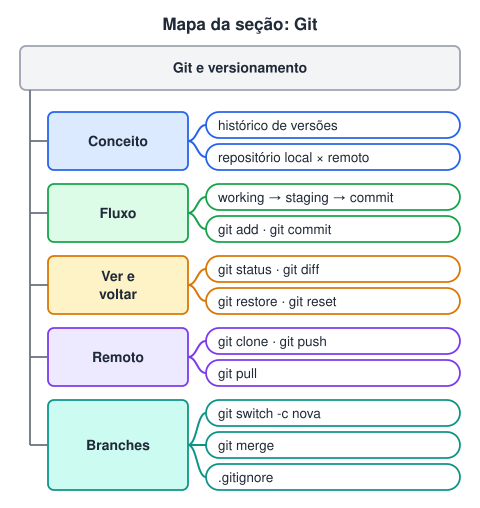
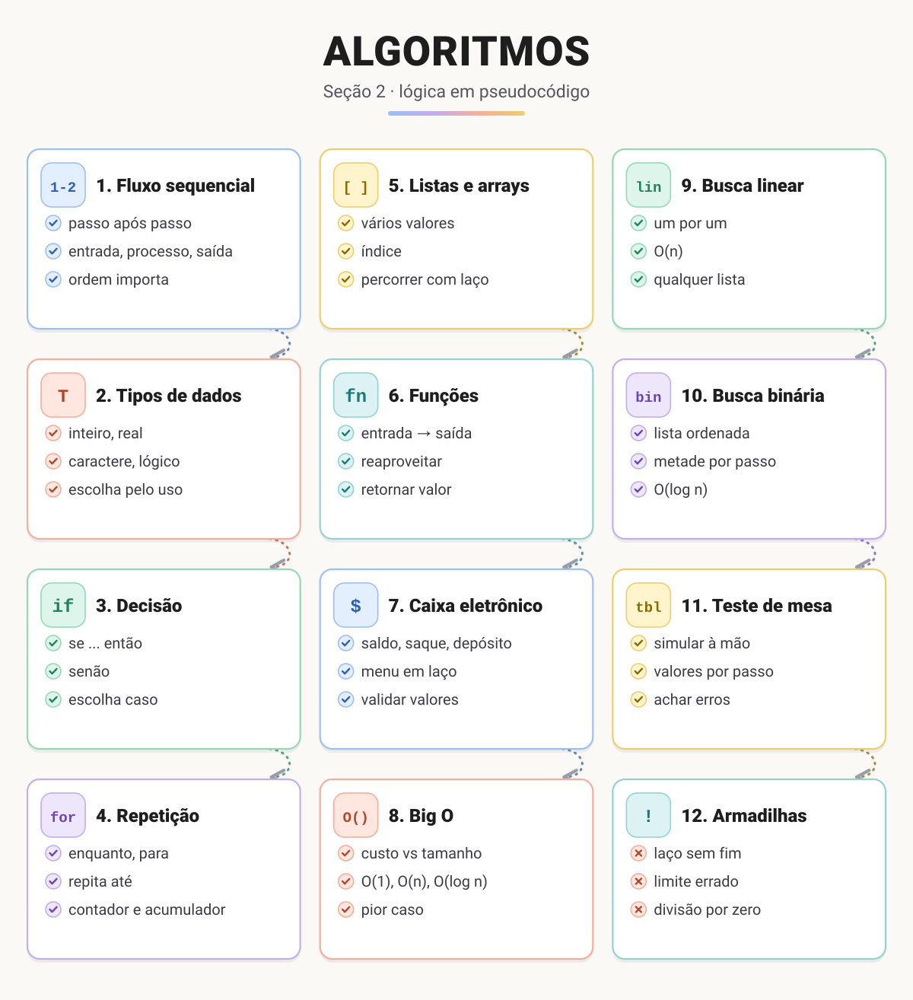
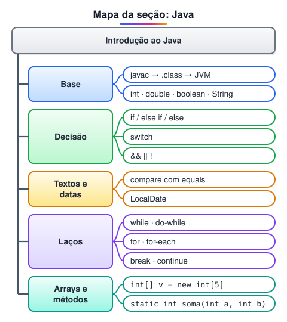
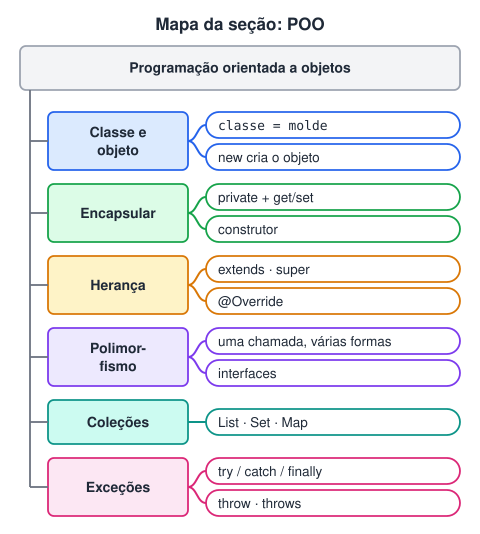
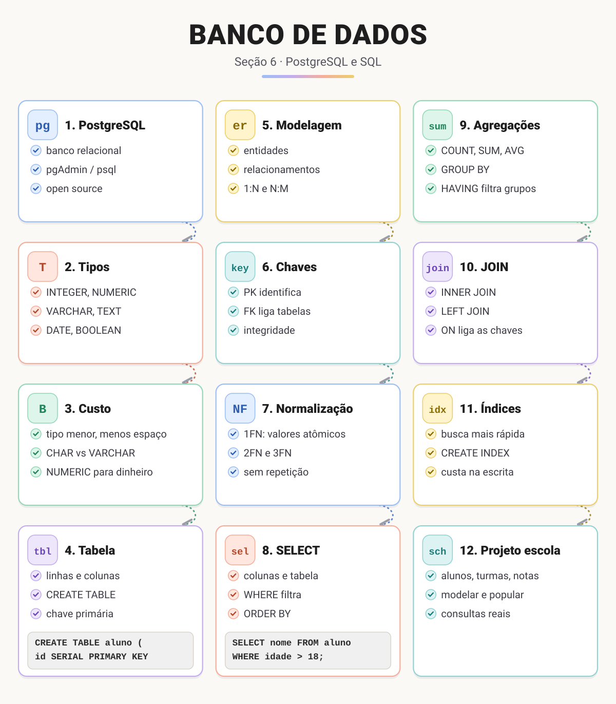

# Sobre o curso

> 🎯 Resumo do curso online da trilha **Web Back-End** do **Santander Coders 2023**, aplicado pela **Ada Tech**. O caminho segue a ordem de um back-end: versionar o código (Git) → pensar a solução (algoritmos) → entender como os computadores conversam (redes e HTTP) → programar em Java → organizar o código com orientação a objetos → guardar e consultar dados no PostgreSQL.

Cada aula segue o mesmo roteiro: **Nesta aula** → **De onde paramos** → conteúdo com exemplos e diagramas → **Exercício** (resposta recolhida em *Ver resposta*) → **Revisão rápida** → **Próximo passo** → **Resumo**.

**Legenda dos quadros:** 🗺️ o que a aula cobre · 💡 dica · ⚠️ correção ou ajuste em relação às anotações originais · 📝 exercício · ➡️ próximo passo · 📌 resumo · 🧭 cheat sheet de revisão no fim de cada seção

Os códigos em Java e SQL foram testados; os diagramas foram redesenhados para leitura em e-readers.

## 🧭 Mapas das seções

### Git e versionamento

### Introdução a algoritmos

### Redes e sistemas

### Introdução ao Java

### Programação orientada a objetos

### Banco de dados com PostgreSQL

## 📌 Resumo do curso

| Seção | Ideia central | Conceitos-chave |
| --- | --- | --- |
| Git | histórico e colaboração | `add`, `commit`, `push`, `branch`, `merge` |
| Algoritmos | resolver problemas passo a passo | decisão, laços, funções, O(log n) |
| Redes | como os dados chegam ao servidor | TCP/IP, IP e máscara, DNS, HTTP |
| Java | a linguagem do back-end | tipos, `if`, `for`, arrays, métodos |
| POO | organizar o código em objetos | encapsulamento, herança, interfaces, `List`, `try` |
| Banco de dados | guardar e consultar dados | `CREATE TABLE`, `SELECT`, `JOIN`, índices |

> Os arquivos de projeto (`.pkt`, `.vpd`) e o edital em PDF ficam só nas anotações pessoais; aqui estão os resumos, os códigos e os diagramas.
