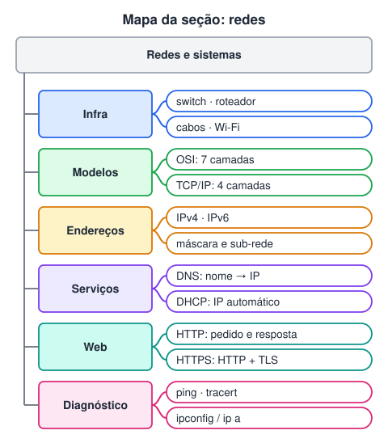

# Sobre o curso

> ✍️ **Sobre a autoria:** deste curso foram usados apenas os tópicos e os objetivos. As anotações e as explicações são de autoria de Josué B. Almeida; onde a explicação foi complementada ou melhorada, o trabalho foi feito com IA (Claude). Os vídeos, os materiais e o conteúdo original do curso pertencem aos seus autores e não são reproduzidos aqui.

> Resumo do curso online da trilha Web Back-End do Santander Coders 2023, aplicado pela Ada Tech. O caminho segue a ordem de um back-end: versionar o código (Git), pensar a solução (algoritmos), entender como os computadores conversam (redes e HTTP), programar em Java com orientação a objetos e guardar os dados num banco relacional (PostgreSQL). Cada aula tem explicação, exemplos testados, diagramas, exercícios com resolução e um resumo.

> **Legenda das páginas:** 🗺️ o que a aula cobre · 📌 resumo final · ⚠️ correção ou ajuste em relação às anotações originais · 💡 dica · 📝 exercício com resolução · 🧭 cheat sheet de revisão no fim de cada seção.

## Cronograma do bootcamp

*Como funcionou o programa, as fases da seleção e o conteúdo do curso online.*

- Sobre o bootcamp e cronograma

## Git e versionamento - Prof Bruno Feitosa

**Mapa da sessão**

*Guardar o histórico do código, trabalhar com branches e colaborar com repositórios remotos.*

- O que é versionamento
- Instalação e configuração inicial do Git
- Estudo de fluxo do Git
- Git diff e retorno de estado
- Repositórios remotos
- Branches, gitignore e merge

## Introdução a algoritmos - Prof Erick Muller

**Mapa da sessão**

*Lógica em pseudocódigo: sequência, decisão, repetição, vetores, funções e eficiência (Big O).*

- Fluxo simples sequencial
- Tipos de dados
- Estruturas de decisão
- Estruturas de repetição
- Exercícios 1
- Listas e Arrays
- Funções
- Projeto: caixa eletrônico em pseudocódigo
- Desempenho de algoritmos: busca binária e Big O
- Exercícios 2

## Redes e sistemas

**Mapa da sessão**

*Como os dados viajam: equipamentos, cabos, camadas OSI e TCP/IP, endereços IP, DNS, HTTP, diagnóstico e segurança.*

- Definição e breve história das redes
- Infraestrutura de redes e principais equipamentos
- Cabeamento estruturado
- Modelo OSI e modelo TCP-IP
- IPv4 e IPv6
- Exercícios I
- Cálculo de sub-rede
- Domínios, DNS, DHCP e latência
- HTTP e HTTPS (Adicionado pelo aluno para melhorar o estudo)
- Principais comandos de configuração
- Segurança
- Simulando redes com packet tracer
- Exercícios II

## Introdução ao Java - Prof. Jessé Haniel

**Mapa da sessão**

*Instalação, tipos, operadores, decisões, textos e datas, laços, arrays e métodos em Java.*

- Setup
- Variáveis
- Tabela verdade
- Estruturas condicionais
- Manipulando Strings e datas
- Laços de repetição
- Arrays e matrizes
- Funções

## POO Java - Prof. Thalles Trevizan

**Mapa da sessão**

*Classes e objetos, encapsulamento, herança, polimorfismo, interfaces, coleções e exceções.*

- Classe e objeto
- Métodos e atributos da classe
- Modificadores de acesso, construtor, getters e setters e encapsulamento
- Exercícios I
- Modelagem orientada a objetos
- Herança
- Polimorfismo
- Herança, composição e acoplamento
- Coleções: List, Set e Map (Adicionado pelo aluno para melhorar o estudo)
- Exceções (Adicionado pelo aluno para melhorar o estudo)
- Exercícios II

## Introdução a banco de dados - Prof. Thiago Marto

**Mapa da sessão**

*PostgreSQL: tipos, modelagem ER, normalização, consultas com JOIN, índices e um projeto completo.*

- Baixar e instalar o PostgreSQL
- Tipos de dados e custo de armazenamento
- Modelagem de entidade
- Normalização dos dados
- Consultas SQL: SELECT, filtros, agregações e JOIN (Adicionado pelo aluno para melhorar o estudo)
- Índices
- Projeto: banco de dados de uma escola
- Exercícios I
- Exercícios II

## 📌 Resumo do curso

| Seção | Ideia central | Comandos e conceitos-chave |
| --- | --- | --- |
| Git | Histórico e colaboração no código | `add`, `commit`, `push`, `pull`, `branch`, `merge` |
| Algoritmos | Resolver problemas passo a passo | se/senão, enquanto, para, funções, O(log n) |
| Redes | Como os dados chegam ao servidor | TCP/IP, IP e máscara, DNS, HTTP, `ping` |
| Java | A linguagem do back-end | tipos, `if`, `for`, arrays, métodos |
| POO | Organizar o código em objetos | encapsulamento, herança, interfaces, `List`, `try` |
| Banco de dados | Guardar e consultar dados | `CREATE TABLE`, `SELECT`, `JOIN`, índices |

