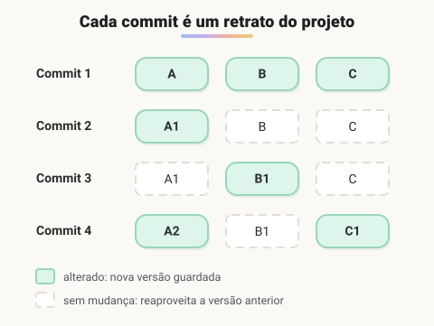

# O que é versionamento

> 🗺️ **Nesta aula:** o que é versionamento de código, sistemas centralizados e distribuídos, o que é o Git, suas características e como ele guarda cada versão (commits, árvores e blobs).

## Onde começamos

Este bootcamp de back-end começa por uma ferramenta que você vai usar em todos os outros módulos: o controle de versão. Antes de escrever algoritmos, Java ou SQL, é preciso saber guardar, comparar e compartilhar o código com segurança.

## O que é versionamento

**Versionamento de código é registrar, de forma organizada, cada alteração feita em um projeto ao longo do tempo**, para poder ver o histórico, comparar versões, voltar atrás e trabalhar em equipe sem um sobrescrever o trabalho do outro.

Sem uma ferramenta, isso costuma virar pastas como `projeto_final`, `projeto_final_v2` e `projeto_final_agora_vai`. Um **sistema de controle de versão** (VCS) resolve isso registrando:

- **o que** mudou (as linhas alteradas);
- **quem** mudou e **quando**;
- **por que** mudou (a mensagem de cada versão).

Ele também permite criar **branches** (ramificações), que são linhas de desenvolvimento paralelas: uma nova funcionalidade é feita numa branch e, quando estiver pronta e testada, é **mesclada** (merge) na principal.

## Centralizado × distribuído

|  | Centralizado (SVN) | Distribuído (Git, Mercurial) |
| --- | --- | --- |
| Onde fica o histórico | só no servidor | em cada cópia local |
| Trabalhar offline | quase nada | commits, histórico e branches |
| Se o servidor cair | o trabalho para | qualquer cópia restaura o projeto |
| Velocidade | depende da rede | a maioria das operações é local |

## O que é o Git

**O Git é um sistema de controle de versão distribuído**, criado por **Linus Torvalds em 2005** para versionar o kernel do Linux. Cada desenvolvedor tem uma cópia completa do repositório, com todo o histórico, e só precisa da rede para sincronizar com um servidor (GitHub, GitLab, Bitbucket).

> 💡 **Git ≠ GitHub.** Git é o programa que roda no seu computador. GitHub é um site que hospeda repositórios Git e adiciona recursos de colaboração, como pull requests e issues.

### Características principais

1. **Branches baratas**: criar e trocar de branch é instantâneo, o que incentiva desenvolver cada funcionalidade isolada.
2. **Merge**: combina o trabalho de branches diferentes; resolve sozinho os casos simples e pede ajuda quando duas pessoas mudam a mesma linha (conflito).
3. **Histórico completo**: cada commit guarda autor, data, mensagem e um identificador único (hash).
4. **Colaboração**: repositórios remotos permitem compartilhar e sincronizar o trabalho da equipe.

## Como o Git guarda as versões

**Um commit é uma foto (snapshot) do projeto inteiro em um momento**, e não uma lista de diferenças. Para não desperdiçar espaço, arquivos que não mudaram não são copiados de novo: o commit novo apenas aponta para o mesmo conteúdo já guardado.

Por baixo, o Git guarda três tipos de objeto, todos identificados pelo hash do seu conteúdo:

| Objeto | Guarda |
| --- | --- |
| **blob** | o conteúdo completo de um arquivo (sem nome) |
| **tree** | uma pasta: nomes de arquivos e subpastas, apontando para blobs e outras trees |
| **commit** | a tree raiz do projeto, o commit pai, autor, data e mensagem |

Como o identificador vem do conteúdo, dois arquivos idênticos viram o mesmo blob, e qualquer alteração gera um hash novo. Isso torna o histórico à prova de adulteração.

> ⚠️ **Correção:** as anotações diziam que "os blobs armazenam as diferenças em relação à versão anterior do arquivo". Um blob guarda o **conteúdo completo** do arquivo, compactado. A economia vem de reaproveitar blobs iguais entre commits; só depois, ao empacotar o repositório (*packfiles*), o Git compacta versões parecidas com deltas.

## Exercício

Você alterou só o arquivo `index.html` de um projeto com 50 arquivos e fez um commit. Quantos blobs novos o Git criou? O commit novo guarda os outros 49 arquivos?

Ver resposta

Um blob novo, para o `index.html` alterado. O commit novo representa o projeto inteiro (é um snapshot), mas a sua tree aponta para os mesmos 49 blobs que já existiam: eles não são copiados de novo.

## 🧠 Revisão rápida

**O que um sistema de controle de versão registra?**

O que mudou, quem mudou, quando e por quê.

**Qual a principal vantagem de um VCS distribuído?**

Cada cópia tem o histórico completo, permitindo trabalhar offline e restaurar o projeto de qualquer cópia.

**Um commit guarda diferenças ou uma foto do projeto?**

Uma foto (snapshot) do projeto inteiro, reaproveitando os arquivos que não mudaram.

> ➡️ **Próximo passo:** instalar e configurar o Git em **Instalação e configuração inicial do Git**.

## 📌 Resumo

| Item | Em uma frase |
| --- | --- |
| Versionamento | histórico organizado das alterações |
| VCS distribuído | cada cópia tem o histórico completo |
| Git | VCS distribuído criado por Linus Torvalds em 2005 |
| GitHub | serviço que hospeda repositórios Git |
| Commit | snapshot do projeto com autor, data e mensagem |
| Blob / tree | conteúdo de arquivo / estrutura de pastas |
| Hash | identificador calculado a partir do conteúdo |
