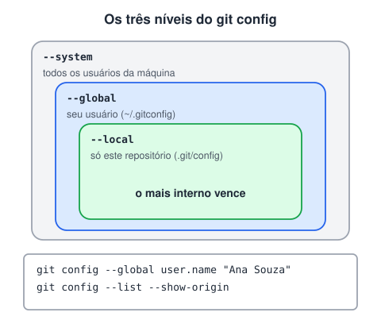

# Instalação e configuração inicial do Git

> 🗺️ **Nesta aula:** instalar o Git, configurar nome, e-mail e branch padrão, conferir a configuração, ferramentas úteis e os dois jeitos de começar um repositório (`git init` e `git clone`).

## De onde paramos

Você viu o que é versionamento e como o Git guarda as versões. Agora vamos preparar a máquina para usá-lo.

## Links

Git

🔗 [Git - Downloads](https://git-scm.com/downloads)

Documentação

🔗 [Git - Documentation](https://git-scm.com/doc)

GitHub Desktop

🔗 [GitHub Desktop](https://desktop.github.com/)

Extensão GitLens para VS Code

🔗 [https://marketplace.visualstudio.com/items?itemName=eamodio.gitlens](https://marketplace.visualstudio.com/items?itemName=eamodio.gitlens)

Extensão Git Graph para VS Code

🔗 [https://marketplace.visualstudio.com/items?itemName=mhutchie.git-graph](https://marketplace.visualstudio.com/items?itemName=mhutchie.git-graph)

## Instalação

- **Windows**: baixe o instalador no site acima. Ele traz o **Git Bash**, um terminal com comandos de Linux.
- **macOS**: `git --version` no Terminal oferece instalar as ferramentas de linha de comando; ou use `brew install git`.
- **Linux (Debian/Ubuntu)**: `sudo apt install git`.

## Configuração inicial

O Git grava seu nome e e-mail em cada commit. Configure uma vez por máquina:

```bash
git config --global user.name "Seu Nome"
git config --global user.email "seuemail@example.com"

# nome da branch criada pelo git init
git config --global init.defaultBranch main

# editor usado nas mensagens (opcional)
git config --global core.editor "code --wait"
```

> 💡 Use no Git o mesmo e-mail da sua conta do GitHub (ou o e-mail `noreply` que o GitHub oferece, para não expor o seu). É assim que os commits aparecem ligados ao seu perfil.



## Conferindo

```bash
# versão instalada
git --version

# todas as configurações globais
git config --global --list

# um valor específico
git config user.name
```

`--global` vale para todos os repositórios do seu usuário. Sem ele, a configuração vale só para o repositório atual (útil para usar um e-mail do trabalho em um projeto específico).

## Começando um repositório

```bash
# transforma a pasta atual em repositório
# (cria a pasta oculta .git)
git init

# copia um repositório remoto, com todo o histórico
git clone https://github.com/usuario/projeto.git
```

> ⚠️ Não rode `git init` na pasta do usuário nem em `Documentos`: tudo dentro dela passaria a ser um repositório. Crie uma pasta para cada projeto. E nunca apague ou edite a pasta `.git` à mão: é ali que fica todo o histórico.

## Exercício

Configure seu nome, seu e-mail e a branch padrão `main`. Depois crie uma pasta `meu-primeiro-repo`, transforme-a em repositório e confira se a pasta `.git` foi criada.

<details>
<summary>Ver resposta</summary>

```bash
git config --global user.name "Ana Souza"
git config --global user.email "ana@example.com"
git config --global init.defaultBranch main

mkdir meu-primeiro-repo
cd meu-primeiro-repo
git init
# -a mostra arquivos ocultos
ls -a
```

A saída do `ls -a` deve mostrar `.git`. No Windows (cmd), use `dir /a`.

</details>

## 🧠 Revisão rápida

**Por que configurar `user.name` e `user.email`?**

Porque o Git grava autor e e-mail em cada commit.

**Qual a diferença entre `git init` e `git clone`?**

`init` cria um repositório novo; `clone` copia um existente com todo o histórico.

**O que `--global` faz?**

Aplica a configuração a todos os repositórios do usuário.

> ➡️ **Próximo passo:** entender por quais estados um arquivo passa até virar um commit: **Estudo de fluxo do Git**.

## 📌 Resumo

| Comando | Em uma frase |
| --- | --- |
| `git config --global user.name` | define o autor dos commits |
| `git config --global user.email` | define o e-mail dos commits |
| `init.defaultBranch main` | nome da branch inicial |
| `git config --global --list` | mostra a configuração |
| `git init` | cria um repositório |
| `git clone URL` | copia um repositório remoto |
