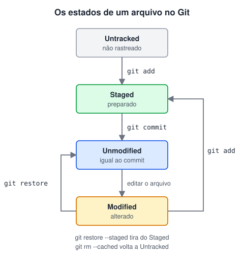

# Estudo de fluxo do Git

> 🗺️ **Nesta aula:** os estados de um arquivo no Git (untracked, unmodified, modified, staged), as três áreas (diretório de trabalho, staging e repositório) e os comandos que levam de uma para a outra: `add`, `status`, `commit` e `log`.

## De onde paramos

Com o Git configurado e um repositório criado, vamos ver o caminho que uma alteração faz até virar um commit.

## As três áreas

1. **Diretório de trabalho** (working directory): a pasta do projeto, onde você edita os arquivos.
2. **Staging area** (área de preparação, ou *index*): onde você monta o próximo commit, escolhendo quais alterações entram.
3. **Repositório** (a pasta `.git`): onde ficam os commits, o histórico permanente.

A staging area existe para você fazer commits **pequenos e com um assunto só**, mesmo que tenha mexido em várias coisas.

## Os estados de um arquivo



| Estado | Significa |
| --- | --- |
| `untracked` | arquivo novo, que o Git ainda não acompanha |
| `unmodified` | acompanhado e igual ao último commit |
| `modified` | acompanhado e alterado desde o último commit |
| `staged` | alteração marcada para entrar no próximo commit |

## Os comandos do fluxo

```bash
# mostra o estado de cada arquivo (use sempre!)
git status

# leva para a staging area
git add arquivo.txt
# todos os arquivos alterados e novos da pasta
git add .

# grava o que está na staging como um commit
git commit -m "feat: adiciona página de contato"

# histórico, do mais novo para o mais antigo
git log
# uma linha por commit
git log --oneline
```

> 💡 Depois do commit, os arquivos voltam a `unmodified`. Se você editar de novo, eles viram `modified`, e a alteração precisa de um novo `git add` antes do próximo commit. Um `git add` guarda o arquivo **como ele estava naquele momento**: editar de novo depois do `add` exige outro `add`.

## Um ciclo completo

```bash
echo "Olá" > leia-me.txt
git status
# leia-me.txt aparece como untracked

git add leia-me.txt
git status
# agora em "Changes to be committed" (staged)

git commit -m "docs: cria leia-me"
git status
# "nothing to commit, working tree clean"

echo "Mais uma linha" >> leia-me.txt
git status
# leia-me.txt aparece como modified
```

## Boas mensagens de commit

- Uma linha curta (até ~50 caracteres), no imperativo: "adiciona", "corrige", "remove".
- Um assunto por commit. "Ajustes" e "agora vai" não ajudam ninguém.
- Muitos times usam o padrão **Conventional Commits**: `feat:`, `fix:`, `docs:`, `refactor:`.

## Exercício

Você criou `app.js` e alterou `index.html` (que já estava no repositório). Quer fazer um commit só com o `index.html` e outro só com o `app.js`. Quais comandos usar?

<details>
<summary>Ver resposta</summary>

```bash
git add index.html
git commit -m "fix: corrige título da página"

git add app.js
git commit -m "feat: adiciona script principal"
```

A staging area permite escolher o que entra em cada commit. Antes do primeiro commit, `app.js` estava `untracked` e `index.html` estava `modified`.

</details>

## 🧠 Revisão rápida

**Qual a diferença entre `modified` e `staged`?**

`modified`: alterado, mas fora do próximo commit. `staged`: marcado com `git add` para entrar.

**Para que serve a staging area?**

Para escolher exatamente o que entra em cada commit.

**Como ver o histórico em uma linha por commit?**

`git log --oneline`.

> ➡️ **Próximo passo:** comparar versões e desfazer alterações em **Git diff e retorno de estado**.

## 📌 Resumo

| Item | Em uma frase |
| --- | --- |
| Diretório de trabalho | onde você edita os arquivos |
| Staging area | onde se monta o próximo commit |
| Repositório | histórico de commits (`.git`) |
| `git status` | mostra o estado de cada arquivo |
| `git add` | leva alterações para a staging |
| `git commit -m` | grava a staging como um commit |
| `git log --oneline` | histórico resumido |
