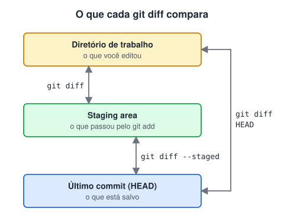
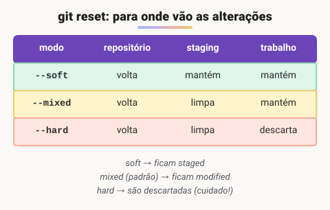

# Git diff e retorno de estado

> 🗺️ **Nesta aula:** ver diferenças com `git diff`, desfazer alterações com `git restore`, desfazer commits com `git reset` (soft, mixed e hard) e `git revert`, e saber qual usar em cada situação.

## De onde paramos

Você já leva arquivos do diretório de trabalho para a staging e daí para o repositório. Agora vamos ver o que mudou entre essas áreas e como voltar atrás em cada uma delas.

## `git diff`: o que mudou?

O `git diff` mostra, linha a linha, as diferenças entre duas versões: linhas com `+` foram adicionadas e com `-` foram removidas.



```bash
# trabalho × staging (o que falta dar git add)
git diff
# staging × último commit (o que vai entrar)
git diff --staged  # o mesmo que --cached
# trabalho × último commit (tudo que mudou)
git diff HEAD

# entre dois commits ou duas branches
git diff a1b2c3d e4f5a6b
git diff main feature

# só os nomes e a quantidade de linhas
git diff --stat
# diferenças palavra por palavra
git diff --color-words
```

## Desfazendo alterações ainda não commitadas: `git restore`

```bash
# modified → unmodified
# descarta as alterações do arquivo (sem volta!)
git restore arquivo.txt

# staged → modified
# tira da staging e mantém as alterações
git restore --staged arquivo.txt
```

> 💡 O `git status` sempre sugere o comando certo para desfazer cada estado. Em versões antigas do Git, o mesmo era feito com `git checkout -- arquivo` e `git reset HEAD arquivo`.

## Desfazendo commits

### `git reset`: move a branch para trás

O `git reset` faz a branch atual voltar para outro commit. O que acontece com as alterações dos commits desfeitos depende do modo:



```bash
# desfaz o último commit; alterações ficam staged
git reset --soft HEAD~1
# padrão: alterações voltam para modified
git reset --mixed HEAD~1
# desfaz e APAGA as alterações
git reset --hard HEAD~1
```

`HEAD~1` é "um commit antes do atual". Você também pode passar o hash de um commit (veja com `git log --oneline`).

### `git revert`: desfaz criando um commit novo

```bash
git revert a1b2c3d
```

O commit original continua no histórico, e um novo commit aplica as alterações inversas.

### Qual usar?

| Situação | Comando |
| --- | --- |
| Commit ainda **não enviado** (só local) | `git reset` |
| Commit **já enviado** ao remoto | `git revert` |
| Desfazer um commit do meio do histórico | `git revert` |

> ⚠️ **Correção:** as anotações traziam `git reset --hard HEAD nome-do-arquivo` para "desfazer o git add e descartar as alterações". Esse comando **não existe**: o Git recusa `--hard` com nome de arquivo. Para tirar da staging **e** descartar as alterações de um arquivo, use `git restore --staged --worktree arquivo`. E `reset --soft` deixa as alterações **staged**, não "marcadas como modificadas".

> ⚠️ O `reset` reescreve o histórico: não use em commits que outras pessoas já baixaram. Se um `--hard` apagar algo por engano, o `git reflog` mostra por onde o `HEAD` passou, e `git reset --hard hash` costuma recuperar o commit.

## Exercício

Para cada caso, escreva o comando: (a) você editou `config.js` e quer descartar a edição; (b) deu `git add` em `.env` por engano; (c) fez um commit cedo demais, ainda não enviou e quer acrescentar mais arquivos nele; (d) um commit com bug já está no GitHub.

<details>
<summary>Ver resposta</summary>

```bash
# a)
git restore config.js
# b)
git restore --staged .env
# c) desfaz mantendo tudo staged; depois
#    git add nos novos arquivos e git commit
git reset --soft HEAD~1
# d)
git revert <hash-do-commit>
```

No caso (c), outra opção é `git add` nos arquivos e `git commit --amend`, que refaz o último commit.

</details>

## 🧠 Revisão rápida

**O que `git diff` sem argumentos compara?**

O diretório de trabalho com a staging area.

**Qual a diferença entre `reset --soft` e `reset --hard`?**

O soft mantém as alterações staged; o hard apaga as alterações.

**Por que preferir `revert` em commits já enviados?**

Porque ele não reescreve o histórico que os colegas já têm.

> ➡️ **Próximo passo:** enviar e receber commits de um servidor em **Repositórios remotos**.

## 📌 Resumo

| Comando | Em uma frase |
| --- | --- |
| `git diff` | trabalho × staging |
| `git diff --staged` | staging × último commit |
| `git restore arq` | descarta alterações não preparadas |
| `git restore --staged arq` | tira da staging, mantendo as alterações |
| `reset --soft / --mixed / --hard` | desfaz commits locais |
| `git revert` | desfaz criando um commit novo |
| `git reflog` | recupera commits "perdidos" |
