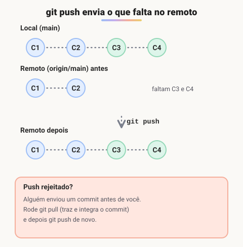
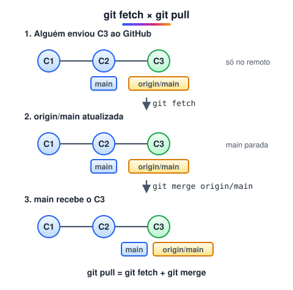

# Repositórios remotos

> 🗺️ **Nesta aula:** o que é um repositório remoto, como ver, adicionar e remover remotos, enviar commits com `git push`, receber com `git fetch` e `git pull`, e como se autenticar no GitHub.

## De onde paramos

Até aqui o histórico só existia no seu computador. Para fazer backup e trabalhar em equipe, o repositório precisa de uma cópia num servidor.

## O que é um repositório remoto

**Um remoto é uma cópia do repositório hospedada em outro lugar**, normalmente no GitHub, GitLab ou Bitbucket. O remoto principal se chama, por convenção, `origin`.

## Gerenciando remotos

```bash
# lista os nomes dos remotos
git remote
# nomes e URLs
git remote -v

# associa um remoto
git remote add origin https://github.com/usuario/projeto.git
# troca a URL
git remote set-url origin git@github.com:usuario/projeto.git
# desassocia
git remote remove origin
```

## `git push`: enviar seus commits

```bash
git push origin main

# na primeira vez, -u liga a branch local
# à remota; depois basta "git push"
git push -u origin main
```



O push só funciona se o remoto não tiver commits que você ainda não tem. Se alguém enviou algo antes, faça `git pull`, resolva eventuais conflitos e tente de novo.

## `git fetch` e `git pull`: receber alterações

- `git fetch` baixa os commits novos e atualiza as referências remotas (como `origin/main`), **sem mexer nos seus arquivos**. Serve para olhar antes de integrar.
- `git pull` = `git fetch` + `git merge`: baixa e já integra na branch atual.



```bash
git fetch origin
# o que chegou e ainda não está na sua main
git log main..origin/main --oneline

# baixa e integra a branch atual
git pull
git pull origin main
```

> ⚠️ **Correção:** as anotações diziam que `git pull` sem argumentos "pega todas as branches e modificações". Ele integra só a **branch atual**, a partir da branch remota ligada a ela. Quem atualiza as referências de todas as branches remotas é o `git fetch`.

## Autenticação no GitHub

O GitHub **não aceita a senha da conta** em operações Git por HTTPS. Use uma destas opções:

- **GitHub CLI**: `gh auth login` configura tudo pelo navegador;
- **Personal Access Token** no lugar da senha;
- **Chave SSH**: gere com `ssh-keygen -t ed25519` e cadastre a chave pública no GitHub.

## Exercício

Você criou um repositório vazio no GitHub e tem um projeto local com commits. Quais comandos publicam o projeto? E, no dia seguinte, como trazer um commit que um colega enviou?

<details>
<summary>Ver resposta</summary>

```bash
git remote add origin https://github.com/usuario/meu-projeto.git
git branch -M main
git push -u origin main

# no dia seguinte
git pull
```

O `-u` liga a `main` local à remota; por isso, depois, `git pull` e `git push` funcionam sem argumentos.

</details>

## 🧠 Revisão rápida

**O que é o `origin`?**

O nome padrão do repositório remoto principal.

**Qual a diferença entre `fetch` e `pull`?**

O fetch só baixa; o pull baixa e integra na branch atual.

**Seu push foi rejeitado. O que fazer?**

Rodar `git pull`, resolver conflitos se houver, e enviar de novo.

> ➡️ **Próximo passo:** trabalhar em paralelo com branches, ignorar arquivos e juntar trabalhos em **Branches, gitignore e merge**.

## 📌 Resumo

| Comando | Em uma frase |
| --- | --- |
| `git remote -v` | lista remotos e URLs |
| `git remote add origin URL` | associa um remoto |
| `git push -u origin main` | primeiro envio, criando o vínculo |
| `git fetch` | baixa sem integrar |
| `git pull` | baixa e integra a branch atual |
| Autenticação | token, SSH ou `gh auth login` |
