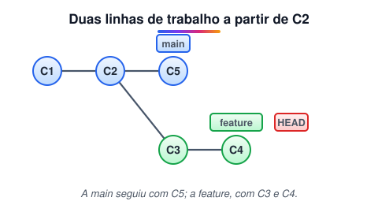
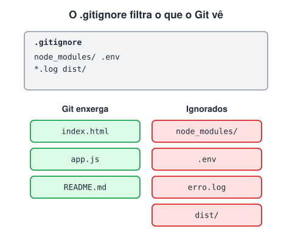
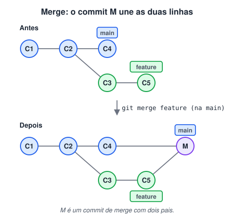
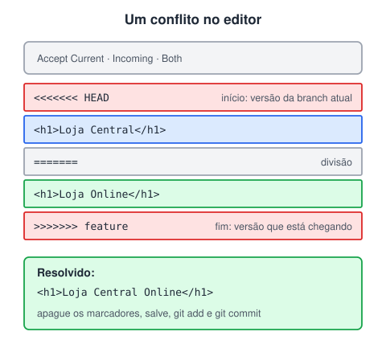

# Branches, gitignore e merge

> 🗺️ **Nesta aula:** criar e trocar de branch, ver o histórico com `git log --oneline --graph`, ignorar arquivos com `.gitignore`, juntar branches com `git merge` (fast-forward e três vias) e resolver conflitos.

## De onde paramos

Com o remoto configurado, você já compartilha commits. Em equipe, porém, ninguém trabalha direto na branch principal: cada tarefa ganha a sua branch.

## O que é uma branch

**Uma branch é só um ponteiro móvel para um commit.** Criar uma branch não copia arquivos: cria um nome novo apontando para o commit atual. A cada commit, a branch em que você está avança para o commit novo. O `HEAD` indica em qual branch você está.



Isso permite desenvolver funcionalidades, correções e experimentos sem mexer na branch principal (`main`, antigamente `master`).

## Comandos

```bash
# lista as branches locais (* = atual)
git branch
# só a branch atual
git branch --show-current

# cria uma branch (sem trocar)
git branch feature/login
# troca de branch
git switch feature/login
# cria e já troca
git switch -c feature/login

# apaga uma branch já mesclada
git branch -d feature/login
```

> 💡 `git switch` (Git 2.23+) é o comando moderno para trocar de branch. As anotações usavam `git checkout nome` e `git checkout -b nome`, que continuam funcionando, mas o `checkout` faz muitas coisas diferentes e confunde.

### Vendo o histórico das branches

```bash
git log --oneline --decorate --graph --all
```

- `--oneline`: uma linha por commit (hash curto e mensagem);
- `--decorate`: mostra quais branches e tags apontam para cada commit;
- `--graph` e `--all`: desenham as bifurcações de todas as branches.

## Arquivo `.gitignore`

**O** `.gitignore` **lista arquivos e pastas que o Git deve ignorar**: eles não aparecem no `git status` nem entram no `git add .`.



```bash
# comentários começam com #
# todos os arquivos .log
*.log
# a pasta inteira
target/
node_modules/
# só o arquivo da raiz
/config.local
# segredos
.env
# exceção: este não é ignorado
!importante.log
```

- Fica normalmente na raiz do repositório (também pode haver um em subpastas).
- Modelos prontos para cada linguagem: repositório **github/gitignore** e o site gitignore.io.

> ⚠️ **Correções:** as anotações diziam que, "após adicionar ou modificar o `.gitignore`, é necessário realizar um commit para que as regras entrem em vigor". As regras valem **na hora**; o commit serve para compartilhá-las com a equipe. Os exemplos `.log` e `.txt` precisam do curinga (`*.log`). E o `.gitignore` só afeta arquivos **ainda não rastreados**: se o arquivo já foi commitado, rode `git rm --cached arquivo`.

## Merge: juntando branches

**O merge traz as alterações de outra branch para a branch atual.** Primeiro vá para a branch que vai receber o trabalho:

```bash
git switch main
git merge feature/login
```

### Fast-forward

Se a `main` não recebeu nenhum commit desde que a feature foi criada, o Git só **avança o ponteiro** da `main`: nenhum commit novo é criado.

### Merge de três vias

Se as duas branches avançaram, o Git compara três versões (o ancestral comum e as duas pontas) e cria um **commit de merge** com dois pais.



> ⚠️ **Correção:** as anotações apresentavam "merge recursivo" e "merge de três vias" como tipos diferentes, e diziam que o fast-forward acontece quando "não há conflitos". O fast-forward acontece quando a branch de destino **não divergiu**. Nos demais casos, o Git faz sempre um merge de três vias; "recursive" (e, desde o Git 2.34, "ort") é o nome do algoritmo que o executa.

## Resolvendo conflitos

Um conflito acontece quando as duas branches alteram **as mesmas linhas**. O Git pausa o merge e marca o trecho no arquivo:



1. Abra o arquivo, escreva a versão final e apague os marcadores `<<<<<<<`, `=======` e `>>>>>>>`.
2. Marque como resolvido com `git add arquivo`.
3. Finalize com `git commit` (ou desista com `git merge --abort`).

## Exercício

Crie a branch `feature/rodape`, faça um commit nela alterando `index.html`, volte para a `main` e mescle. Qual tipo de merge vai acontecer se ninguém mexeu na `main` nesse meio tempo?

<details>
<summary>Ver resposta</summary>

```bash
git switch -c feature/rodape
# ... edita index.html ...
git add index.html
git commit -m "feat: adiciona rodapé"

git switch main
git merge feature/rodape
git branch -d feature/rodape
```

Como a `main` não avançou, o merge é **fast-forward**: o ponteiro da `main` só anda até o commit da feature.

</details>

## 🧠 Revisão rápida

**O que é uma branch no Git?**

Um ponteiro móvel para um commit.

**Em qual branch você deve estar para rodar `git merge feature`?**

Na branch que vai receber o trabalho (normalmente a `main`).

**Coloquei `.env` no `.gitignore`, mas ele continua rastreado. Por quê?**

Porque já tinha sido commitado. Use `git rm --cached .env`.

> ➡️ **Próximo passo:** fim do módulo de Git. Agora começa a programação em si: **Fluxo simples sequencial**, em Introdução a algoritmos.

## 📌 Resumo

| Item | Em uma frase |
| --- | --- |
| Branch | ponteiro móvel para um commit |
| `git switch -c nome` | cria e troca de branch |
| `git log --oneline --graph --all` | desenha o histórico |
| `.gitignore` | lista o que o Git ignora |
| `git merge` | traz outra branch para a atual |
| Fast-forward | só avança o ponteiro |
| Três vias | cria um commit de merge |
| Conflito | editar, `git add` e `git commit` |
