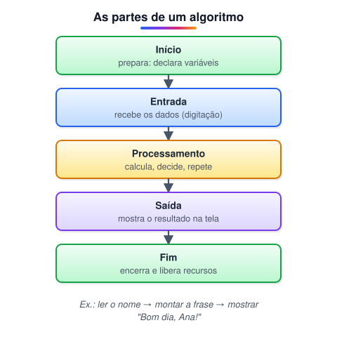

# Fluxo simples sequencial

> 🗺️ **Nesta aula:** o que é um algoritmo, as cinco partes de um fluxo sequencial (início, entrada, processamento, saída e fim) e o primeiro pseudocódigo do curso.

## De onde paramos

No módulo de Git você aprendeu a guardar e compartilhar código. Agora começa a parte de **lógica**: antes de escrever Java, é preciso saber descrever a solução de um problema passo a passo.

## O que é um algoritmo

Um **algoritmo** é uma sequência finita de passos, em ordem, que resolve um problema. Uma receita de bolo é um algoritmo: ingredientes (entrada), modo de preparo (processamento) e o bolo pronto (saída).<br />No **fluxo sequencial**, os passos são executados um depois do outro, de cima para baixo, sem desvios nem repetições. É a estrutura mais simples; decisões e laços vêm nas próximas aulas.

## As cinco partes



| Parte | O que acontece |
| --- | --- |
| Início | Prepara o terreno: declara variáveis e constantes, importa bibliotecas. |
| Entrada | Recebe os dados: digitação do usuário, arquivo, banco de dados. |
| Processamento | Aplica a lógica: contas, comparações, decisões, repetições. |
| Saída | Mostra o resultado: tela, arquivo, outro sistema. |
| Fim | Encerra: fecha arquivos e conexões, libera recursos. |

> 💡 Nem todo algoritmo tem todas as partes bem visíveis. Um programa que só mostra "Olá" não tem entrada, mas ainda tem início, saída e fim.

## Pseudocódigo

**Pseudocódigo** é um jeito de escrever o algoritmo em português estruturado, sem se prender às regras de uma linguagem. O curso usa estes comandos:

| Comando | Significado |
| --- | --- |
| `var nome: tipo` | declara uma variável |
| `mostrar "texto"` | escreve na tela |
| `esperar_digitacao -> x` | lê o que o usuário digitar e guarda em x |
| `definir valor -> x` | guarda um valor em x |

## Exemplo: "Bom dia, nome do usuário"

O programa pergunta o nome e responde com um cumprimento.

```
inicio principal
  var nome: texto

  mostrar "Qual é o seu nome? "
  esperar_digitacao -> nome

  mostrar "Bom dia, " + nome + "!"
fim
```

**Teste de uso** (o que aparece na tela):

```
Qual é o seu nome? Ana
Bom dia, Ana!
```

Repare nas partes: `inicio principal` e `var` são o início; `esperar_digitacao` é a entrada; juntar o texto com `+` é o processamento; o último `mostrar` é a saída; `fim` encerra.

## 📝 Exercício

Escreva o pseudocódigo de um programa que lê o ano de nascimento e mostra a idade que a pessoa terá em 2030.

<details>
<summary>Ver resposta</summary>

```
inicio principal
  var ano: inteiro
  var idade: inteiro

  mostrar "Ano de nascimento: "
  esperar_digitacao -> ano

  definir 2030 - ano -> idade
  mostrar "Em 2030 você terá " + idade
fim
```

Com 1998, mostra "Em 2030 você terá 32".

</details>

## 🧠 Revisão rápida

**O que caracteriza um fluxo sequencial?**

Os passos executam um após o outro, sem decisões nem repetições.

**Em qual parte fica o cálculo de um algoritmo?**

No processamento.

**Para que serve o pseudocódigo?**

Para planejar a lógica em linguagem próxima do português, antes de escolher uma linguagem de programação.

> ➡️ **Próximo passo:** conhecer os tipos de dados e as variáveis que guardam os valores do algoritmo.

## 📌 Resumo

| Item | Em uma frase |
| --- | --- |
| Algoritmo | Sequência finita e ordenada de passos que resolve um problema. |
| Fluxo sequencial | Passos executados em ordem, sem desvios. |
| Cinco partes | Início, entrada, processamento, saída e fim. |
| Pseudocódigo | Algoritmo escrito em português estruturado. |
