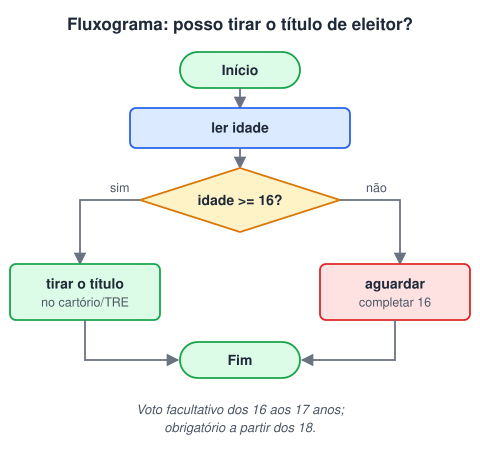

# Estruturas de decisão

> 🗺️ **Nesta aula:** como o algoritmo escolhe um caminho: operadores relacionais e lógicos, se, se/senão, senão se, escolha/caso e o fluxograma do título de eleitor.

## De onde paramos

Até aqui os algoritmos seguiam sempre o mesmo caminho. Com uma **estrutura de decisão** (ou condicional), partes do código só rodam quando uma condição é verdadeira.

## Condições: operadores relacionais e lógicos

Uma condição é uma pergunta cuja resposta é verdadeiro ou falso. Ela usa **operadores relacionais** para comparar valores:

| Operador | Significado | Exemplo verdadeiro |
| --- | --- | --- |
| `==` | igual | 5 == 5 |
| `!=` | diferente | 5 != 3 |
| `>` e `<` | maior, menor | 7 > 2 |
| `>=` e `<=` | maior ou igual, menor ou igual | 16 >= 16 |
| Para combinar condições, use os **operadores lógicos**: |  |  |

- **e**: verdadeiro só se as duas partes forem verdadeiras;
- **ou**: verdadeiro se pelo menos uma parte for verdadeira;
- **não**: inverte o resultado.

```
// pseudocódigo
idade >= 16 e idade < 18
// o mesmo em Java
idade >= 16 && idade < 18
// "ou" e "não" em Java
temIngresso || ehConvidado
!estaBloqueado
```

> ⚠️ Não confunda `=` (atribuir) com `==` (comparar). Em Java, `if (x = 5)` nem compila; em C ele compila e vira um bug difícil de achar.

## As estruturas de decisão

**1. se**: executa o bloco só quando a condição é verdadeira.

```
se (saldo < 0) então
  mostrar "Conta no negativo"
fim se
```

**2. se/senão**: um bloco para verdadeiro e outro para falso. Sempre um dos dois roda.

```
se (nota >= 7) então
  mostrar "Aprovado"
senão
  mostrar "Reprovado"
fim se
```

**3. se/senão se/senão** (encadeado): testa várias condições em ordem e executa só a **primeira** verdadeira. O senão final pega o resto.

```
se (nota >= 9) então
  mostrar "A"
senão se (nota >= 7) então
  mostrar "B"
senão se (nota >= 5) então
  mostrar "C"
senão
  mostrar "D"
fim se
```

> 💡 A ordem importa. Se o teste `nota >= 5` viesse primeiro, uma nota 10 cairia nele e receberia "C".

**4. escolha/caso**: compara **uma** variável com vários valores exatos. Fica mais limpo que um encadeado longo de `==`. Em Java é o `switch`.

```
escolha (opcao)
  caso 1:
    mostrar "Ver saldo"
  caso 2:
    mostrar "Depositar"
  caso 3:
    mostrar "Sacar"
  caso contrário:
    mostrar "Opção inválida"
fim escolha
```

## Fluxograma: posso tirar o título de eleitor?

No fluxograma, a decisão é um losango com duas saídas (sim e não).



> ⚠️ **Correção:** o fluxograma original mandava quem tem menos de 16 "esperar até ter 18 anos". O título pode ser tirado a partir dos 16; o voto é facultativo aos 16 e 17 e obrigatório a partir dos 18. Então a pessoa espera completar 16, não 18.

O mesmo algoritmo em pseudocódigo, já com as três faixas:

```
inicio principal
  var idade: inteiro
  mostrar "Sua idade: "
  esperar_digitacao -> idade

  se (idade < 16) então
    mostrar "Ainda não pode tirar"
  senão se (idade < 18) então
    mostrar "Pode tirar; voto facultativo"
  senão
    mostrar "Voto obrigatório"
  fim se
fim
```

## 📝 Exercício

Leia um número inteiro e mostre se ele é par ou ímpar. Dica: o operador `%` dá o resto da divisão.

<details>
<summary>Ver resposta</summary>

```
inicio principal
  var n: inteiro
  esperar_digitacao -> n
  se (n % 2 == 0) então
    mostrar "Par"
  senão
    mostrar "Ímpar"
  fim se
fim
```

</details>

## 🧠 Revisão rápida

**Num se/senão se, quantos blocos podem executar?**

No máximo um: o da primeira condição verdadeira (ou o senão, se nenhuma for).

**Quando usar escolha/caso em vez de se?**

Quando uma única variável é comparada com vários valores exatos, como as opções de um menu.

**Quanto vale verdadeiro e falso? E verdadeiro ou falso?**

Falso e verdadeiro, respectivamente.

> ➡️ **Próximo passo:** repetir passos com laços, sem copiar o código.

## 📌 Resumo

| Item | Em uma frase |
| --- | --- |
| Condição | Expressão que resulta em verdadeiro ou falso. |
| se/senão | Escolhe entre dois caminhos. |
| senão se | Testa várias condições em ordem; vale a primeira verdadeira. |
| escolha/caso | Compara uma variável com valores exatos (switch). |
