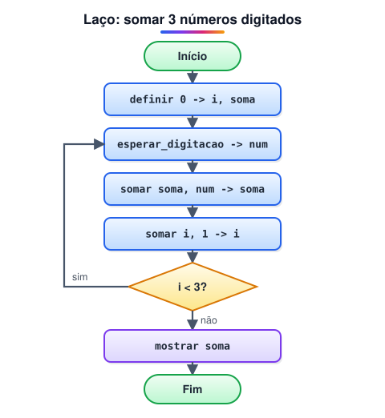

# Estruturas de repetição

> 🗺️ **Nesta aula:** os três laços (enquanto, faça-enquanto e para), contador e acumulador, como evitar laço infinito e o fluxograma que soma 3 números.

## De onde paramos

Com decisões o algoritmo escolhe um caminho. Com uma **estrutura de repetição** (laço ou loop) ele repete um bloco enquanto uma condição for verdadeira, sem copiar o código várias vezes.<br />Cada execução do bloco se chama **iteração**.

## Os três laços

**1. enquanto** (`while`): testa a condição **antes** de cada iteração. Se ela já começar falsa, o bloco não roda nenhuma vez.

```
definir 1 -> i
enquanto (i <= 5) faça
  mostrar i
  somar i, 1 -> i
fim enquanto
// mostra 1 2 3 4 5
```

**2. faça-enquanto** (`do-while`): testa a condição **depois**. O bloco roda pelo menos uma vez. Ótimo para menus e validação de entrada.

```
faça
  mostrar "Digite uma nota de 0 a 10: "
  esperar_digitacao -> nota
enquanto (nota < 0 ou nota > 10)
```

**3. para** (`for`): usado quando se sabe quantas vezes repetir. Junta numa linha a inicialização, a condição e a atualização.

```
para (i <- 1; i <= 5; i <- i + 1) faça
  mostrar i
fim para
```

| Laço | Testa quando | Use quando |
| --- | --- | --- |
| enquanto | antes | não se sabe quantas vezes vai repetir |
| faça-enquanto | depois | o bloco precisa rodar ao menos uma vez |
| para | antes | a quantidade de repetições é conhecida |

## Contador e acumulador

Dois padrões aparecem em quase todo laço:

- **Contador**: variável que aumenta de 1 em 1 para contar as iterações (`i <- i + 1`).
- **Acumulador**: variável que vai juntando um resultado (`soma <- soma + num`). Começa em 0 para somas e em 1 para produtos.

## Fluxograma: somar 3 números digitados



```
inicio principal
  var i, num, soma: inteiro
  definir 0 -> i
  definir 0 -> soma

  enquanto (i < 3) faça
    mostrar "Entre com um número: "
    esperar_digitacao -> num
    somar soma, num -> soma
    somar i, 1 -> i
  fim enquanto

  mostrar soma
fim
```

Teste de mesa com as entradas 4, 10 e 1:

| i (antes) | num | soma (depois) |
| --- | --- | --- |
| 0 | 4 | 4 |
| 1 | 10 | 14 |
| 2 | 1 | 15 |

Quando i vira 3, a condição `i < 3` fica falsa, o laço termina e o programa mostra 15.

> 💡 O fluxograma original testava `iteração > 2` e voltava no "não". É a mesma lógica com a pergunta invertida: continuar enquanto `i < 3` é o mesmo que parar quando `i > 2`.

## Laço infinito, pare e continue

Se nada dentro do laço muda a condição, ele nunca termina: é um **laço infinito**. Esquecer o `somar i, 1 -> i` acima já causa isso.

```
definir 1 -> i
enquanto (i <= 5) faça
  mostrar i
  // faltou aumentar i: repete 1 para sempre
fim enquanto
```

Duas instruções controlam o laço por dentro: **pare** (`break`) sai imediatamente; **continue** (`continue`) pula para a próxima iteração.

## 📝 Exercício

Mostre a tabuada do 7 (de 7 × 1 até 7 × 10) usando o laço para.

<details>
<summary>Ver resposta</summary>

```
inicio principal
  var i: inteiro
  para (i <- 1; i <= 10; i <- i + 1) faça
    mostrar "7 x " + i + " = " + (7 * i)
  fim para
fim
```

</details>

## 🧠 Revisão rápida

**Qual laço sempre executa ao menos uma vez?**

O faça-enquanto, porque testa a condição no final.

**Com que valor começa um acumulador de soma? E de produto?**

0 para soma e 1 para produto.

**O que causa um laço infinito?**

Uma condição que nunca fica falsa, normalmente porque a variável testada não muda dentro do laço.

> ➡️ **Próximo passo:** praticar sequência, decisão e repetição na primeira lista de exercícios.

## 📌 Resumo

| Item | Em uma frase |
| --- | --- |
| enquanto | Testa antes; pode não executar nenhuma vez. |
| faça-enquanto | Testa depois; executa ao menos uma vez. |
| para | Repetição com contagem conhecida. |
| Contador e acumulador | Contam iterações e juntam resultados. |
